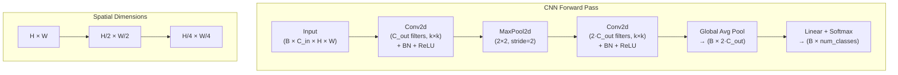
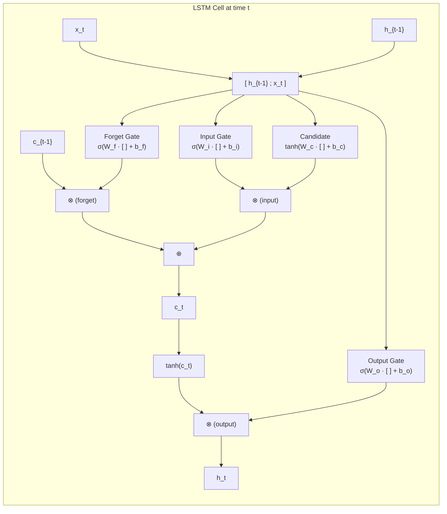
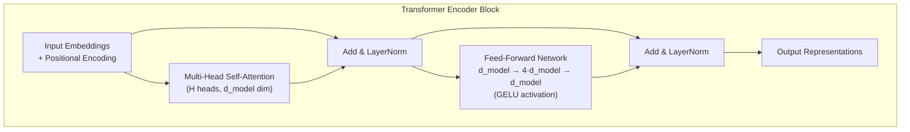
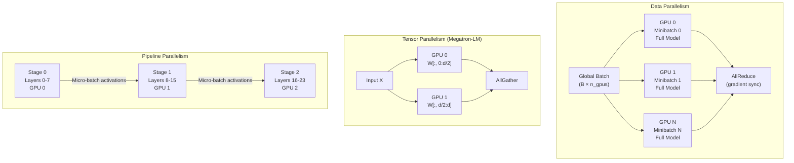
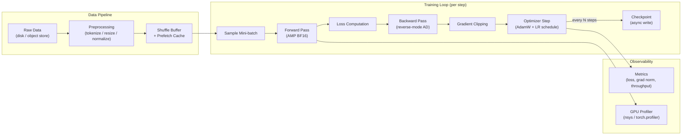
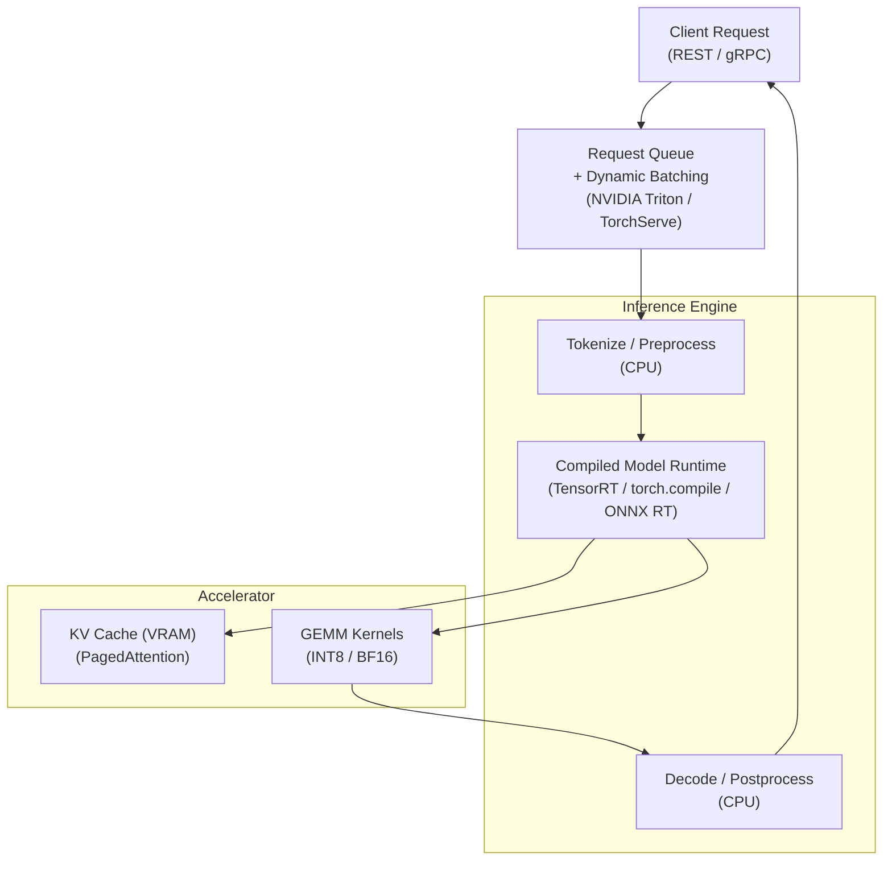

# Lesson 3: Deep Learning

## 1. First-Principles Intuition & Invariants

Deep learning is a computational paradigm for modeling complex, non-linear mappings from high-dimensional input data to output predictions through hierarchical, learned representations. It is not a loose collection of algorithms but a mathematically grounded discipline rooted in function approximation theory, differential calculus, information theory, and numerical linear algebra. The central thesis is that raw high-dimensional signals—images, text, audio, molecular graphs—contain latent structure that can be progressively disentangled into increasingly abstract, task-relevant features through successive differentiable transformations.

### Universal Approximation and Its Limits

The theoretical license for deep networks comes from the **Universal Approximation Theorem** (Cybenko, 1989; Hornik, 1991): a feedforward network with a single hidden layer of sufficient width and a non-polynomial activation function can approximate any continuous function on a compact subset of $\mathbb{R}^n$ to arbitrary precision. The theorem is *existential*, not constructive—it guarantees that such a network *exists* but says nothing about how to find its weights or how wide "sufficient" actually is.

This is precisely why *depth* matters in practice. Montufar et al. (2014) showed that deep ReLU networks can represent functions that require exponentially many neurons in a shallow network to match. Each layer refactors the input geometry: earlier layers learn low-level features (edges, phonemes, n-grams), while deeper layers compose those into semantic abstractions (object parts, syntax trees, discourse structure). The hierarchical composition is not incidental—it reflects genuine compositional structure in the physical world from which the data originates.

### Information-Geometric View

A neural network layer can be viewed as a learned coordinate transformation in a Riemannian manifold. The weight matrix $\mathbf{W}^{(l)}$ defines a linear map; the activation function $f$ then folds and crumples the resulting space. The sequence of transformations is designed to map the input distribution onto a representation space where the target labels are **linearly separable**. This is the deep learning hypothesis: the data lives on a low-dimensional manifold embedded in a high-dimensional ambient space, and the network learns to "unfold" that manifold.

Information-theoretically, each layer is a stochastic encoder. The **Information Bottleneck** principle (Tishby & Schwartz-Ziv, 2017) frames training as a compression-extraction trade-off: compress the input $X$ while preserving mutual information with the label $Y$. Layers near the input preserve $I(X; T_l)$; layers near the output maximize $I(T_l; Y)$. This framing explains why deep networks generalize despite massive overparameterization—they are implicitly performing lossy compression.

### Structural Invariants as Inductive Biases

The empirical success of different architectures is not accidental; each encodes a structural prior—an **inductive bias**—that reflects a genuine symmetry or regularity in the data:

- **Convolutional Neural Networks (CNNs):** encode *translation equivariance*. The same filter response at position $(i, j)$ and $(i+\Delta, j+\Delta)$ implies the same local feature; the network need not learn this invariance from data.
- **Recurrent Neural Networks (RNNs) / LSTMs:** encode *temporal stationarity*—the transition dynamics $\mathbf{h}_t = f(\mathbf{h}_{t-1}, \mathbf{x}_t)$ are shared across time steps.
- **Transformers:** encode *permutation equivariance* over sequence positions, with positional encodings re-introducing order as a learned or fixed signal. Attention is an adaptive, content-based routing mechanism.
- **Graph Neural Networks (GNNs):** encode *permutation invariance* over node orderings, respecting the relational structure of graph-structured data.

Choosing an architecture is therefore a statement about the symmetries you believe the problem possesses. When those symmetries are correct, generalization improves dramatically because the hypothesis space is constrained to functions that respect them.

### Computational Invariants for Systems Programmers

At the implementation level, every layer reduces to a small set of primitives:

1. **GEMM** (General Matrix-Matrix Multiplication): the dominant operation in linear layers, attention, and convolutions (via `im2col`/`col2im`).
2. **Elementwise operations**: activation functions, dropout masks, layer normalization.
3. **Reductions**: softmax, cross-entropy loss, batch statistics.

The memory footprint during training is dominated not by parameters but by **activations retained for the backward pass**. For a network with $L$ layers, batch size $B$, and hidden dimension $d$, the activation memory is $O(B \cdot L \cdot d)$. Parameter memory is $O(L \cdot d^2)$ for dense layers. This asymmetry is why gradient checkpointing (trading recomputation for memory) is a critical production technique.

---

## 2. Core Architectures & Mechanics

### 2.1 Feedforward Neural Networks

A feedforward network is a directed acyclic computational graph. Each layer $l$ computes:

$$
\mathbf{a}^{(l)} = f^{(l)}\!\left(\mathbf{W}^{(l)} \mathbf{a}^{(l-1)} + \mathbf{b}^{(l)}\right)
$$

where $\mathbf{W}^{(l)} \in \mathbb{R}^{d_l \times d_{l-1}}$, $\mathbf{b}^{(l)} \in \mathbb{R}^{d_l}$, and $f^{(l)}$ is a pointwise nonlinearity. The full forward pass is a function composition:

$$
\hat{\mathbf{y}} = f^{(L)} \circ f^{(L-1)} \circ \cdots \circ f^{(1)}(\mathbf{x})
$$

#### Activation Functions: A Comparative Analysis

| Activation | Formula | Gradient at saturation | Dead neurons | Use case |
|---|---|---|---|---|
| Sigmoid | $\sigma(z) = \frac{1}{1+e^{-z}}$ | $\to 0$ (vanishes) | No | Binary output gates |
| Tanh | $\tanh(z) = \frac{e^z - e^{-z}}{e^z + e^{-z}}$ | $\to 0$ (vanishes) | No | RNN hidden states |
| ReLU | $\max(0, z)$ | 0 for $z < 0$ | Yes (~10–20% of neurons) | Default hidden layers |
| Leaky ReLU | $\max(\alpha z, z),\ \alpha=0.01$ | $\alpha$ (nonzero) | Rare | Alternative to ReLU |
| GELU | $z \cdot \Phi(z)$ | Smooth, nonzero | No | Transformers (BERT, GPT) |
| SiLU/Swish | $z \cdot \sigma(z)$ | Smooth, nonzero | No | EfficientNet, LLaMA |

ReLU's sparsity is a feature as much as a bug—sparse activations are computationally efficient and often improve generalization. GELU and SiLU outperform ReLU empirically in large-scale language models, likely because their smooth gradients stabilize training at high learning rates.

#### Backpropagation: Reverse-Mode Automatic Differentiation

Backpropagation is a specific application of **reverse-mode automatic differentiation** (reverse-mode AD). The key insight is that for a scalar loss $\mathcal{L}$, reverse-mode AD computes $\nabla_\theta \mathcal{L}$ in a single backward pass, regardless of the number of parameters. This is in contrast to forward-mode AD, which requires one pass per parameter.

For layer $l$, define the **upstream gradient** (error signal) as $\boldsymbol{\delta}^{(l)} = \frac{\partial \mathcal{L}}{\partial \mathbf{z}^{(l)}}$ where $\mathbf{z}^{(l)} = \mathbf{W}^{(l)}\mathbf{a}^{(l-1)} + \mathbf{b}^{(l)}$ is the pre-activation. By the chain rule:

$$
\boldsymbol{\delta}^{(l)} = \left(\mathbf{W}^{(l+1)\top} \boldsymbol{\delta}^{(l+1)}\right) \odot f'^{(l)}\!\left(\mathbf{z}^{(l)}\right)
$$

The parameter gradients follow:

$$
\frac{\partial \mathcal{L}}{\partial \mathbf{W}^{(l)}} = \boldsymbol{\delta}^{(l)} \mathbf{a}^{(l-1)\top}, \qquad \frac{\partial \mathcal{L}}{\partial \mathbf{b}^{(l)}} = \boldsymbol{\delta}^{(l)}
$$

The computational graph is built dynamically in frameworks like PyTorch (eager mode) or statically in JAX/XLA. Each operation registers its **VJP** (Vector-Jacobian Product) during the forward pass; the backward pass evaluates these VJPs in reverse topological order.

```python
import numpy as np
from typing import Callable, Tuple

# Production-grade NumPy implementation of a two-layer MLP
# with forward/backward passes, demonstrating the mechanics
# without framework abstraction.

def relu(z: np.ndarray) -> np.ndarray:
    return np.maximum(0.0, z)

def relu_grad(z: np.ndarray) -> np.ndarray:
    return (z > 0).astype(z.dtype)

def softmax(z: np.ndarray) -> np.ndarray:
    # Numerically stable: subtract row-wise max before exp
    shifted = z - z.max(axis=1, keepdims=True)
    exp_z = np.exp(shifted)
    return exp_z / exp_z.sum(axis=1, keepdims=True)

def cross_entropy_loss(
    probs: np.ndarray, labels: np.ndarray
) -> Tuple[float, np.ndarray]:
    """
    Returns scalar loss and gradient of loss w.r.t. pre-softmax logits.
    The combined softmax + cross-entropy gradient simplifies to (probs - one_hot).
    """
    n = labels.shape[0]
    log_probs = np.log(probs + 1e-12)   # epsilon for numerical stability
    loss = -log_probs[np.arange(n), labels].mean()
    # Gradient of cross-entropy w.r.t. logits (pre-softmax)
    grad = probs.copy()
    grad[np.arange(n), labels] -= 1.0
    grad /= n
    return loss, grad


class TwoLayerMLP:
    """
    Two-layer MLP: input -> ReLU -> output (softmax).
    Demonstrates the full forward/backward mechanics explicitly.
    """

    def __init__(self, d_in: int, d_hidden: int, d_out: int, seed: int = 42):
        rng = np.random.default_rng(seed)
        # He initialization: var = 2 / fan_in (optimal for ReLU)
        self.W1 = rng.standard_normal((d_in, d_hidden)) * np.sqrt(2.0 / d_in)
        self.b1 = np.zeros(d_hidden)
        # Xavier/Glorot for the output layer (no ReLU)
        self.W2 = rng.standard_normal((d_hidden, d_out)) * np.sqrt(1.0 / d_hidden)
        self.b2 = np.zeros(d_out)
        # Cache for backward pass
        self._cache: dict = {}

    def forward(self, X: np.ndarray) -> np.ndarray:
        """
        X: (batch, d_in)
        Returns logits: (batch, d_out)
        """
        z1 = X @ self.W1 + self.b1          # (batch, d_hidden)
        a1 = relu(z1)                        # (batch, d_hidden)
        z2 = a1 @ self.W2 + self.b2          # (batch, d_out)
        probs = softmax(z2)                  # (batch, d_out)
        self._cache = {"X": X, "z1": z1, "a1": a1, "probs": probs}
        return probs

    def backward(
        self, labels: np.ndarray
    ) -> Tuple[float, dict]:
        """
        Computes loss and all parameter gradients.
        Returns (loss, grads_dict).
        """
        X, z1, a1, probs = (
            self._cache["X"], self._cache["z1"],
            self._cache["a1"], self._cache["probs"],
        )
        loss, dz2 = cross_entropy_loss(probs, labels)  # (batch, d_out)

        # Layer 2 gradients
        dW2 = a1.T @ dz2                     # (d_hidden, d_out)
        db2 = dz2.sum(axis=0)                # (d_out,)

        # Backprop through ReLU: Hadamard product with indicator
        da1 = dz2 @ self.W2.T                # (batch, d_hidden)
        dz1 = da1 * relu_grad(z1)            # (batch, d_hidden)

        # Layer 1 gradients
        dW1 = X.T @ dz1                      # (d_in, d_hidden)
        db1 = dz1.sum(axis=0)                # (d_hidden,)

        grads = {"W1": dW1, "b1": db1, "W2": dW2, "b2": db2}
        return loss, grads

    def sgd_step(self, grads: dict, lr: float = 1e-3) -> None:
        self.W1 -= lr * grads["W1"]
        self.b1 -= lr * grads["b1"]
        self.W2 -= lr * grads["W2"]
        self.b2 -= lr * grads["b2"]


# --- Example training loop ---
if __name__ == "__main__":
    rng = np.random.default_rng(0)
    N, D, H, C = 256, 784, 128, 10          # batch, input, hidden, classes
    X = rng.standard_normal((N, D)).astype(np.float32)
    y = rng.integers(0, C, size=N)

    model = TwoLayerMLP(D, H, C)
    for step in range(500):
        probs = model.forward(X)
        loss, grads = model.backward(y)
        model.sgd_step(grads, lr=1e-2)
        if step % 100 == 0:
            preds = probs.argmax(axis=1)
            acc = (preds == y).mean()
            print(f"step={step:4d}  loss={loss:.4f}  acc={acc:.3f}")
```

### 2.2 Convolutional Neural Networks

CNNs replace dense matrix multiplications with **locally-connected, weight-shared** operations that exploit spatial locality and translation equivariance. The 2D discrete cross-correlation (commonly—if loosely—called convolution in ML literature) for a single filter $\mathbf{K}$ over input $\mathbf{X}$ is:

$$
(\mathbf{X} \star \mathbf{K})[i, j] = \sum_{m=0}^{k_h-1} \sum_{n=0}^{k_w-1} \mathbf{X}[i + m,\, j + n] \cdot \mathbf{K}[m, n]
$$

For $C_{in}$ input channels, $C_{out}$ output channels, and kernel size $k \times k$, the filter bank $\mathbf{W} \in \mathbb{R}^{C_{out} \times C_{in} \times k \times k}$ produces:

$$
\mathbf{Y}[c_{out}, i, j] = \sum_{c_{in}} (\mathbf{X}[c_{in}] \star \mathbf{W}[c_{out}, c_{in}])[i, j] + b_{c_{out}}
$$

The parameter count is $C_{out} \cdot C_{in} \cdot k^2 + C_{out}$—independent of the spatial size of the input. This is the fundamental efficiency gain over a fully connected layer operating on the same input.

#### The `im2col` Trick

High-performance CNN implementations (cuDNN, oneDNN) transform convolution into GEMM via `im2col`: the input patches are unrolled into columns of a matrix $\hat{\mathbf{X}} \in \mathbb{R}^{(C_{in} k^2) \times (H_{out} W_{out} B)}$, and the filter bank is reshaped into $\hat{\mathbf{W}} \in \mathbb{R}^{C_{out} \times (C_{in} k^2)}$. Then:

$$
\hat{\mathbf{Y}} = \hat{\mathbf{W}} \cdot \hat{\mathbf{X}}
$$

This reduces to a single GEMM call, which is heavily optimized on every hardware target. The tradeoff is memory: `im2col` can expand memory usage by a factor of $k^2$ for the intermediate matrix.

#### Receptive Fields and the Depth-Width Trade-off

Each neuron in a convolutional layer "sees" only a $k \times k$ region of the input. After $L$ layers of stride-1 convolutions, the **effective receptive field** (ERF) grows as $k + (k-1)(L-1)$ linearly. Stacking $3 \times 3$ convolutions is preferable to using large kernels ($5\times 5$, $7\times 7$) because two $3\times 3$ layers cover the same receptive field as one $5\times 5$ layer with fewer parameters ($2 \times 9 C^2$ vs. $25 C^2$) and an additional nonlinearity.



#### Batch Normalization: Why It Works

Batch Normalization (Ioffe & Szegedy, 2015) normalizes pre-activations over the batch dimension:

$$
\hat{z}_i = \frac{z_i - \mu_\mathcal{B}}{\sqrt{\sigma_\mathcal{B}^2 + \epsilon}}, \qquad \tilde{z}_i = \gamma \hat{z}_i + \beta
$$

where $\gamma$ and $\beta$ are learned scale and shift parameters. The standard narrative—that BN reduces **internal covariate shift**—is not well-supported empirically. The more accurate explanation (Santurkar et al., 2018) is that BN **smooths the loss landscape**: it reduces the Lipschitz constant of the gradient, making the loss more predictable and allowing larger, more aggressive learning rates. This explains the empirical observation that BN enables faster convergence and reduces sensitivity to weight initialization.

### 2.3 Recurrent Neural Networks and the Gradient Pathology

An RNN processes a sequence $\mathbf{x}_1, \ldots, \mathbf{x}_T$ by maintaining a hidden state:

$$
\mathbf{h}_t = \tanh\!\left(\mathbf{W}_{hh} \mathbf{h}_{t-1} + \mathbf{W}_{xh} \mathbf{x}_t + \mathbf{b}_h\right)
$$

The gradient of the loss with respect to $\mathbf{h}_0$ requires multiplying through the **Jacobian** of the recurrence $T$ times:

$$
\frac{\partial \mathcal{L}}{\partial \mathbf{h}_0} = \prod_{t=1}^{T} \frac{\partial \mathbf{h}_t}{\partial \mathbf{h}_{t-1}} \cdot \frac{\partial \mathcal{L}}{\partial \mathbf{h}_T}
$$

Each factor $\frac{\partial \mathbf{h}_t}{\partial \mathbf{h}_{t-1}} = \text{diag}(f'(\mathbf{z}_t)) \mathbf{W}_{hh}$. If the singular values of $\mathbf{W}_{hh}$ are less than 1, the product contracts exponentially → **vanishing gradients**. If they exceed 1, the product explodes → **exploding gradients**. Gradient clipping addresses the latter; the former is structurally mitigated by the LSTM.

#### Long Short-Term Memory (LSTM)

The LSTM (Hochreiter & Schmidhuber, 1997) introduces a **cell state** $\mathbf{c}_t$ that flows through time with only additive interactions, creating a nearly unobstructed gradient highway:

$$
\begin{aligned}
\mathbf{f}_t &= \sigma(\mathbf{W}_f[\mathbf{h}_{t-1}; \mathbf{x}_t] + \mathbf{b}_f) & &\text{(forget gate)} \\
\mathbf{i}_t &= \sigma(\mathbf{W}_i[\mathbf{h}_{t-1}; \mathbf{x}_t] + \mathbf{b}_i) & &\text{(input gate)} \\
\tilde{\mathbf{c}}_t &= \tanh(\mathbf{W}_c[\mathbf{h}_{t-1}; \mathbf{x}_t] + \mathbf{b}_c) & &\text{(candidate cell)} \\
\mathbf{c}_t &= \mathbf{f}_t \odot \mathbf{c}_{t-1} + \mathbf{i}_t \odot \tilde{\mathbf{c}}_t & &\text{(cell update)} \\
\mathbf{o}_t &= \sigma(\mathbf{W}_o[\mathbf{h}_{t-1}; \mathbf{x}_t] + \mathbf{b}_o) & &\text{(output gate)} \\
\mathbf{h}_t &= \mathbf{o}_t \odot \tanh(\mathbf{c}_t)
\end{aligned}
$$

The gradient of $\mathcal{L}$ with respect to $\mathbf{c}_{t-1}$ flows as $\frac{\partial \mathcal{L}}{\partial \mathbf{c}_t} \odot \mathbf{f}_t$—a simple elementwise multiplication that does not involve repeated matrix products. When the forget gate is near 1, gradients flow back through hundreds of steps without attenuation.



### 2.4 The Transformer Architecture

The Transformer (Vaswani et al., 2017) replaced recurrence with **scaled dot-product self-attention**, enabling full parallelization over sequence positions and effectively unlimited context (bounded only by memory):

$$
\text{Attention}(\mathbf{Q}, \mathbf{K}, \mathbf{V}) = \text{softmax}\!\left(\frac{\mathbf{Q}\mathbf{K}^\top}{\sqrt{d_k}}\right)\mathbf{V}
$$

The $1/\sqrt{d_k}$ scaling prevents the dot products from growing large when $d_k$ is large, which would push the softmax into saturation regions with near-zero gradients.

**Multi-Head Attention** projects the input into $H$ independent query/key/value spaces, computes attention in each, and concatenates the results:

$$
\text{MHA}(\mathbf{X}) = \text{Concat}(\text{head}_1, \ldots, \text{head}_H)\mathbf{W}^O
$$
$$
\text{head}_i = \text{Attention}(\mathbf{X}\mathbf{W}_i^Q,\, \mathbf{X}\mathbf{W}_i^K,\, \mathbf{X}\mathbf{W}_i^V)
$$

Each head can specialize in a different type of relationship (syntactic, semantic, positional). The computational complexity of attention is $O(n^2 d)$ in both time and memory—the quadratic $n^2$ term is the fundamental bottleneck for long sequences, motivating architectures like Mamba (selective state spaces) and FlashAttention (IO-aware exact attention).



The FFN inside each Transformer block is $\text{FFN}(\mathbf{x}) = \mathbf{W}_2 \cdot \text{GELU}(\mathbf{W}_1 \mathbf{x} + \mathbf{b}_1) + \mathbf{b}_2$ with expansion factor 4 (i.e., $\mathbf{W}_1 \in \mathbb{R}^{4d \times d}$). This pointwise MLP, applied identically at each position, accounts for roughly two-thirds of a standard Transformer's parameters.

### 2.5 Optimization: SGD, Momentum, Adam, and Beyond

Gradient descent updates parameters as $\theta \leftarrow \theta - \eta \nabla_\theta \mathcal{L}$. In practice, the loss is computed on a **mini-batch** $\mathcal{B} \subset \mathcal{D}$, giving a noisy but cheap gradient estimate. Batch size, learning rate, and their ratio define the **linear scaling rule** (Goyal et al., 2017): scaling batch size by $k$ requires scaling the learning rate by $k$ to maintain the same update dynamics.

**SGD with Nesterov Momentum:**

$$
\mathbf{v}_{t+1} = \mu \mathbf{v}_t - \eta \nabla_\theta \mathcal{L}(\theta_t + \mu \mathbf{v}_t), \qquad \theta_{t+1} = \theta_t + \mathbf{v}_{t+1}
$$

The *lookahead* gradient evaluation at $\theta_t + \mu \mathbf{v}_t$ gives momentum a predictive quality that improves convergence on convex problems.

**Adam** (Kingma & Ba, 2014) maintains per-parameter adaptive learning rates via first and second moment estimates of the gradient:

$$
m_t = \beta_1 m_{t-1} + (1 - \beta_1) g_t \qquad \text{(first moment)}
$$
$$
v_t = \beta_2 v_{t-1} + (1 - \beta_2) g_t^2 \qquad \text{(second moment)}
$$
$$
\hat{m}_t = \frac{m_t}{1 - \beta_1^t}, \quad \hat{v}_t = \frac{v_t}{1 - \beta_2^t} \qquad \text{(bias correction)}
$$
$$
\theta_t = \theta_{t-1} - \frac{\eta}{\sqrt{\hat{v}_t} + \epsilon} \hat{m}_t
$$

Adam's default hyperparameters ($\beta_1=0.9, \beta_2=0.999, \epsilon=10^{-8}$) work well across a wide range of tasks. However, Adam can converge to **sharp minima** that generalize worse than the flatter minima found by SGD with momentum (Wilson et al., 2017). This is an active area: AdamW (decoupled weight decay), Adan, and Schedule-Free Adam are modern successors.

**AdamW** decouples L2 regularization from the adaptive gradient update:

$$
\theta_t = \theta_{t-1} - \eta \left(\frac{\hat{m}_t}{\sqrt{\hat{v}_t} + \epsilon} + \lambda \theta_{t-1}\right)
$$

Standard Adam folds weight decay into the gradient ($g_t \leftarrow g_t + \lambda \theta$), which scales the decay by $1/\sqrt{\hat{v}_t}$—inadvertently suppressing regularization on frequently-updated parameters. AdamW restores the original L2 semantics.

---

## 3. High-Performance Optimization & Failure Modes

### 3.1 Memory Hierarchy and Computational Efficiency

Modern accelerators (GPUs, TPUs) are structured around a deep memory hierarchy. NVIDIA H100 numbers as a representative example:

| Memory tier | Capacity | Bandwidth | Latency |
|---|---|---|---|
| Registers | ~256 KB/SM | ~20 TB/s | ~1 cycle |
| L1 / Shared SRAM | 256 KB/SM | ~19 TB/s | ~30 cycles |
| L2 Cache | 50 MB | ~12 TB/s | ~200 cycles |
| HBM3 (VRAM) | 80 GB | ~3.35 TB/s | ~600 cycles |
| NVLink / PCIe | — | 900 GB/s / 128 GB/s | μs |

The key performance metric for a neural network operation is **arithmetic intensity**: FLOP / bytes read. GEMM with large matrices has high arithmetic intensity ($O(N)$) and saturates compute. Elementwise operations like activation functions have intensity $O(1)$—they are **memory-bound**. This is why fused kernels (e.g., FlashAttention) that keep intermediate results in SRAM rather than writing them back to HBM are so valuable: they convert memory-bound operations into compute-bound ones.

**FlashAttention** (Dao et al., 2022) tiles the attention computation into blocks that fit in SRAM, avoiding the $O(n^2)$ memory materialization of the full attention matrix. The result is the same as standard attention (no approximation), but requires $O(n)$ HBM memory instead of $O(n^2)$, with a ~2–4× wall-clock speedup on long sequences.

### 3.2 Mixed Precision Training

Modern training uses **BF16 or FP16 arithmetic** for the forward and backward passes, with FP32 **master weights** for parameter updates:

```text
FP16 Forward → FP16 Backward → FP32 Gradient Accumulation → FP32 Weight Update → Copy to FP16
```

FP16 has a narrower dynamic range (max ~65504) than FP32 (max ~3.4×10³⁸). **Loss scaling** multiplies the loss by a large scalar $S$ before the backward pass, then divides the gradients by $S$ before the optimizer step. This shifts gradients into the representable FP16 range. Modern frameworks use dynamic loss scaling: $S$ is increased if no overflow occurs for $N$ steps and halved on overflow detection.

BF16 (Brain Float 16) uses the same 8-bit exponent as FP32 (preserving dynamic range) but only 7 mantissa bits. It is numerically safer than FP16 for training and is the default in TPU training and NVIDIA Ampere/Hopper GPUs.

```python
import torch
import torch.nn as nn
from torch.cuda.amp import GradScaler, autocast

# Minimal mixed-precision training loop with AMP
def train_epoch_amp(
    model: nn.Module,
    optimizer: torch.optim.Optimizer,
    loader: torch.utils.data.DataLoader,
    scaler: GradScaler,
    device: torch.device,
) -> float:
    model.train()
    total_loss = 0.0
    criterion = nn.CrossEntropyLoss()

    for X, y in loader:
        X, y = X.to(device), y.to(device)
        optimizer.zero_grad(set_to_none=True)   # faster than zero_grad()

        # Forward pass in BF16/FP16
        with autocast(dtype=torch.bfloat16):
            logits = model(X)
            loss = criterion(logits, y)

        # Scale loss, backward in FP16, unscale and step in FP32
        scaler.scale(loss).backward()
        # Gradient clipping: unscale first so clip threshold is in FP32 units
        scaler.unscale_(optimizer)
        torch.nn.utils.clip_grad_norm_(model.parameters(), max_norm=1.0)
        scaler.step(optimizer)
        scaler.update()

        total_loss += loss.item()

    return total_loss / len(loader)
```

### 3.3 Distributed Training: Data, Model, and Pipeline Parallelism

Large models require distributing computation across multiple accelerators. The three canonical strategies compose orthogonally:



- **Data Parallelism (DDP):** Each device holds a full model copy; gradients are averaged via AllReduce after each backward pass. Scales to thousands of GPUs for sufficiently large batch sizes. Communication overhead is $O(\text{params})$ per step, which is constant regardless of batch size.

- **Tensor Parallelism (Megatron-LM style):** Splits individual weight matrices across devices. A linear layer $Y = XW$ with $W \in \mathbb{R}^{d \times d}$ is split column-wise: $W = [W_1 \| W_2]$, each shard on a different GPU. An AllReduce (or AllGather + ReduceScatter) is inserted within each transformer block. Communication is $O(\text{activation size})$ per layer, requiring high-bandwidth NVLink interconnects.

- **Pipeline Parallelism:** Partitions model layers into sequential stages across devices. Micro-batching (interleaving multiple micro-batches in flight) reduces the **pipeline bubble**—idle time while the pipeline fills and drains. The bubble fraction is $\frac{p-1}{m}$ where $p$ is pipeline stages and $m$ is micro-batches per step.

**ZeRO (Zero Redundancy Optimizer)** (Rajbhandari et al., 2020) is a memory optimization that shards optimizer states (ZeRO-1), gradients (ZeRO-2), and parameters (ZeRO-3) across data-parallel ranks. ZeRO-3 achieves the same memory footprint as tensor parallelism without the high-bandwidth interconnect requirement, at the cost of additional AllGather communication for parameters during forward and backward passes.

### 3.4 Numerical Stability and Gradient Pathologies

#### Vanishing and Exploding Gradients: Root Cause Analysis

The magnitude of the gradient at layer $l$ depends on the product of $L - l$ Jacobians:

$$
\left\|\frac{\partial \mathcal{L}}{\partial \mathbf{z}^{(l)}}\right\| \approx \left\|\frac{\partial \mathcal{L}}{\partial \mathbf{z}^{(L)}}\right\| \cdot \prod_{k=l}^{L-1} \left\|\mathbf{W}^{(k)}\right\| \cdot \left|f'\!\left(\mathbf{z}^{(k)}\right)\right|
$$

If $\|\mathbf{W}\| \cdot |f'| < 1$ on average, the gradient decays geometrically. If $> 1$, it grows geometrically. This is not just a training problem—it limits the *effective depth* of the network, since layers whose gradients vanish effectively stop learning.

**Mitigation strategies by root cause:**

| Failure mode | Root cause | Mitigation |
|---|---|---|
| Vanishing gradients | $\|\mathbf{W}\| \cdot \|f'\| \ll 1$ | ReLU/GELU activations, residual connections, careful init |
| Exploding gradients | $\|\mathbf{W}\| \cdot \|f'\| \gg 1$ | Gradient clipping, weight normalization |
| Dead ReLU neurons | Negative pre-activation → zero gradient forever | Leaky ReLU, careful LR tuning, good init |
| Loss NaN (FP16) | Gradient overflow | Loss scaling, BF16 |
| Poor convergence | Bad initialization | He init (ReLU), Glorot init (tanh/linear) |

#### Residual Connections: The Gradient Highway

The core insight of ResNets (He et al., 2016) is that learning a **residual** $\mathcal{F}(\mathbf{x})$ is easier than learning the full mapping $\mathcal{H}(\mathbf{x})$ when the target is close to the identity:

$$
\mathbf{y} = \mathcal{F}(\mathbf{x},\, \{\mathbf{W}_i\}) + \mathbf{x}
$$

The gradient through a residual block is:

$$
\frac{\partial \mathcal{L}}{\partial \mathbf{x}} = \frac{\partial \mathcal{L}}{\partial \mathbf{y}} \cdot \left(1 + \frac{\partial \mathcal{F}}{\partial \mathbf{x}}\right)
$$

The additive identity term $1$ ensures that even if $\frac{\partial \mathcal{F}}{\partial \mathbf{x}} \to 0$, the gradient does not vanish. This allows training networks hundreds of layers deep (ResNet-1000+) that were previously intractable.

### 3.5 Regularization: Overfitting, Generalization, and Double Descent

**Overfitting** is the failure mode where the model memorizes the training set and fails to generalize. The classical bias-variance trade-off suggests that increasing model capacity always increases variance. The **double descent** phenomenon (Belkin et al., 2019; Nakkiran et al., 2020) complicates this: as model size grows past the interpolation threshold (zero training loss), test error can *decrease again*. Modern overparameterized networks operate in this benign second descent regime, which is why massive models can generalize despite having far more parameters than training examples.

Practical regularization techniques with their mechanistic rationale:

**Dropout** (Srivastava et al., 2014): Randomly sets activations to zero with probability $p$ during training. Equivalent to training an ensemble of $2^n$ sub-networks sharing parameters. At inference, all neurons are active and outputs are scaled by $(1-p)$ (or equivalently, activations are scaled by $\frac{1}{1-p}$ during training with *inverted dropout*, which is what PyTorch implements). Dropout is less effective in Batch Norm networks (the interaction causes train/test discrepancy) and is largely replaced by **DropPath/Stochastic Depth** in modern architectures.

**Weight Decay (L2 regularization):** Adds $\frac{\lambda}{2}\|\theta\|_2^2$ to the loss, penalizing large weights. In gradient descent, this appears as $\theta \leftarrow (1 - \eta\lambda)\theta - \eta\nabla_\theta \mathcal{L}$—a constant shrinkage per step. It encourages the optimizer toward the minimum-norm solution among all interpolating solutions, which tends to generalize better.

**Label Smoothing:** Replaces hard one-hot targets $y \in \{0,1\}$ with soft targets $\tilde{y} = (1-\epsilon)y + \epsilon/K$. This prevents the network from becoming overconfident (pushing logit differences to $\pm\infty$) and acts as a form of output regularization. Mixup, CutMix, and RandAugment are data-level augmentation strategies with similar regularizing effects.

### 3.6 Adversarial Robustness

Adversarial examples (Szegedy et al., 2013) are inputs crafted by adding a small, human-imperceptible perturbation $\boldsymbol{\delta}$ such that $\|\boldsymbol{\delta}\|_p \leq \varepsilon$ but the network misclassifies $\mathbf{x} + \boldsymbol{\delta}$:

**FGSM** (Goodfellow et al., 2014): a single-step attack:

$$
\boldsymbol{\delta} = \varepsilon \cdot \text{sign}\!\left(\nabla_\mathbf{x} \mathcal{L}(\mathbf{x}, y)\right)
$$

**PGD** (Madry et al., 2018): iterates FGSM with projection back onto the $\ell_\infty$ ball:

$$
\mathbf{x}^{(t+1)} = \Pi_{\mathcal{B}_\varepsilon(\mathbf{x})}\!\left(\mathbf{x}^{(t)} + \alpha \cdot \text{sign}\!\left(\nabla_{\mathbf{x}^{(t)}} \mathcal{L}\right)\right)
$$

**Adversarial training** (the strongest empirically validated defense) augments the training distribution with worst-case perturbations:

$$
\min_\theta \mathbb{E}_{(\mathbf{x},y) \sim \mathcal{D}} \left[\max_{\|\boldsymbol{\delta}\|_p \leq \varepsilon} \mathcal{L}(\mathbf{x} + \boldsymbol{\delta}, y; \theta)\right]
$$

This is a minimax problem. The inner maximization is solved approximately with PGD; the outer minimization uses standard gradient descent. Adversarial training incurs a ~3–5% clean accuracy penalty in exchange for dramatically improved robustness—a fundamental trade-off with no known lossless solution.

```python
import torch
import torch.nn as nn

def pgd_attack(
    model: nn.Module,
    X: torch.Tensor,
    y: torch.Tensor,
    epsilon: float = 8.0 / 255,
    alpha: float = 2.0 / 255,
    num_steps: int = 20,
    norm: str = "linf",
) -> torch.Tensor:
    """
    Projected Gradient Descent (PGD) adversarial attack.
    Returns adversarial examples within epsilon-ball of X.
    """
    criterion = nn.CrossEntropyLoss()
    # Random initialization within the epsilon ball (improves coverage)
    delta = torch.empty_like(X).uniform_(-epsilon, epsilon)
    delta = torch.clamp(X + delta, 0.0, 1.0) - X
    delta.requires_grad_(True)

    for _ in range(num_steps):
        loss = criterion(model(X + delta), y)
        loss.backward()
        with torch.no_grad():
            if norm == "linf":
                delta.data = delta.data + alpha * delta.grad.sign()
                delta.data = torch.clamp(delta.data, -epsilon, epsilon)
                delta.data = torch.clamp(X + delta.data, 0.0, 1.0) - X
            elif norm == "l2":
                grad_norm = delta.grad.norm(p=2, dim=(1, 2, 3), keepdim=True).clamp(min=1e-8)
                delta.data = delta.data + alpha * delta.grad / grad_norm
                norms = delta.data.norm(p=2, dim=(1, 2, 3), keepdim=True).clamp(min=epsilon)
                delta.data = delta.data * (epsilon / norms)
                delta.data = torch.clamp(X + delta.data, 0.0, 1.0) - X
        delta.grad.zero_()

    return (X + delta).detach()


def adversarial_training_step(
    model: nn.Module,
    optimizer: torch.optim.Optimizer,
    X: torch.Tensor,
    y: torch.Tensor,
    epsilon: float = 8.0 / 255,
    pgd_steps: int = 7,
) -> float:
    """
    Single adversarial training step (PGD-AT, Madry et al. 2018).
    """
    model.eval()   # BN in eval mode during attack generation is critical
    X_adv = pgd_attack(model, X, y, epsilon=epsilon, num_steps=pgd_steps)
    model.train()
    optimizer.zero_grad(set_to_none=True)
    loss = nn.CrossEntropyLoss()(model(X_adv), y)
    loss.backward()
    optimizer.step()
    return loss.item()
```

### 3.7 Inference Optimization: Quantization and Pruning

**Post-Training Quantization (PTQ)** converts FP32 weights to INT8 or INT4, reducing memory bandwidth and enabling integer arithmetic on hardware that supports it (TensorRT, ONNX Runtime, ExecuTorch). The standard affine quantization scheme:

$$
\hat{w} = \text{clamp}\!\left(\text{round}\!\left(\frac{w}{s}\right) + z,\, 0,\, 2^b - 1\right)
$$

where $s$ is the scale (FP32) and $z$ is the zero-point (integer). Dequantization for inference: $w \approx s(\hat{w} - z)$. The quantization error $w - s(q - z)$ is minimized by calibrating $s$ and $z$ on a small representative dataset.

**Quantization-Aware Training (QAT)** simulates quantization during training using **straight-through estimators** (STE): the forward pass uses fake-quantized values; the backward pass passes gradients through the rounding operation as if it were the identity. This allows the model to adapt its weights to tolerate quantization noise, typically recovering 1–2% accuracy over PTQ.

**Structured Pruning** removes entire neurons, attention heads, or layers, yielding hardware-efficient sparse models. Unstructured pruning (zeroing individual weights) achieves higher sparsity ratios but requires sparse compute support (not universally available) for real speedups.

---

## 4. End-to-End Systems View

### 4.1 Training Pipeline Architecture



### 4.2 Production Inference Stack

A production deep learning inference service has a sharply different profile from training: latency-critical, memory-constrained, and throughput-optimized.



**Key inference performance levers:**

- `torch.compile` (PyTorch 2.0+): Uses TorchDynamo to capture the computation graph and TorchInductor to generate optimized Triton or C++ kernels. Typical 1.5–2.5× speedup on transformer inference with zero model changes.
- **Continuous Batching** (vLLM): For autoregressive LLMs, sequences complete at different times. Continuous batching replaces completed sequences mid-batch, keeping GPU utilization near 100% vs. the ~20–40% typical of static batching.
- **PagedAttention** (Kwon et al., 2023): Manages the KV cache with virtual memory pages, eliminating fragmentation and enabling high throughput under variable sequence lengths.
- **Speculative Decoding**: A small draft model generates $k$ candidate tokens; the target model verifies all $k$ in a single forward pass. Accepted tokens are kept; the first rejected token is replaced. Throughput improves by $\approx 2{-}3\times$ when the draft acceptance rate is high, with zero change in output distribution.

---

## 5. Lab Exercises

### Exercise 1: Implement Backpropagation from First Principles

Extend the `TwoLayerMLP` from Section 2.1 to a configurable $L$-layer network. Implement the full forward and backward passes without using any autograd framework. Verify your gradients against a numerical finite-difference check with step size $h = 10^{-5}$:

$$
\frac{\partial \mathcal{L}}{\partial \theta_i} \approx \frac{\mathcal{L}(\theta + h \mathbf{e}_i) - \mathcal{L}(\theta - h \mathbf{e}_i)}{2h}
$$

Relative error $\frac{\|\nabla_\theta^{\text{analytical}} - \nabla_\theta^{\text{numerical}}\|}{\|\nabla_\theta^{\text{analytical}}\| + \|\nabla_\theta^{\text{numerical}}\|}$ should be below $10^{-5}$.

### Exercise 2: Implement and Profile a Convolution

Implement 2D cross-correlation in NumPy using (a) explicit loops, (b) `im2col` + GEMM (via `np.dot`), and (c) `scipy.signal.correlate2d`. Profile all three on a $3 \times 224 \times 224$ input with 64 filters of size $3 \times 3$. Analyze the throughput difference and explain it in terms of cache efficiency and BLAS utilization.

### Exercise 3: Diagnose a Broken Training Run

You are given a training script that diverges at step 5000. The loss curve shows stable decrease until it suddenly goes to NaN. Develop a systematic debugging checklist covering: (1) gradient norm monitoring, (2) activation statistics at each layer, (3) learning rate and optimizer state inspection, (4) batch statistics for potential corrupted samples, and (5) FP16 overflow detection. Implement the diagnostic hooks in PyTorch using `register_forward_hook` and `register_backward_hook`.

### Exercise 4: Quantize a ResNet to INT8

Using PyTorch's `torch.ao.quantization` API:
1. Apply dynamic quantization with `torch.ao.quantization.quantize_dynamic` (linear layers only).
2. Apply full static PTQ with calibration using 100 representative samples.
3. Measure accuracy, model size (bytes), and inference latency on CPU before and after.
4. Explain the accuracy gap between dynamic and static quantization in terms of activation range calibration.

---

## Summary

Deep learning's empirical power rests on three mutually reinforcing pillars: **expressive architectures** that encode the right inductive biases for a problem's symmetry structure; **gradient-based optimization** that efficiently navigates the parameter space of billions of dimensions; and **hardware-aware implementation** that maps mathematical operations onto the memory hierarchy of modern accelerators. The architectures—feedforward networks, CNNs, LSTMs, and Transformers—are not competing paradigms but specialized tools, each optimal when the problem's structure matches the architecture's inductive bias. The failure modes (vanishing gradients, numerical instability, overfitting, adversarial vulnerability) are not bugs but structural consequences of the mathematical underpinnings, and each has a principled mitigation grounded in that same mathematics. Mastery of deep learning at the systems level requires holding all three pillars simultaneously: the theoretical invariants, the algorithmic mechanics, and the low-level implementation constraints of the hardware the models run on.
