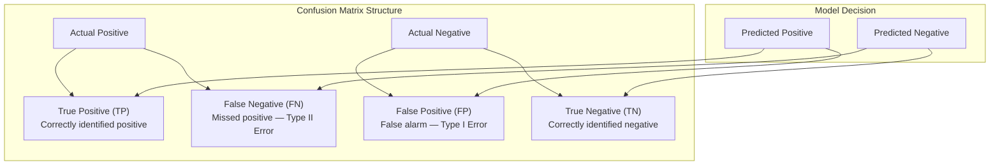
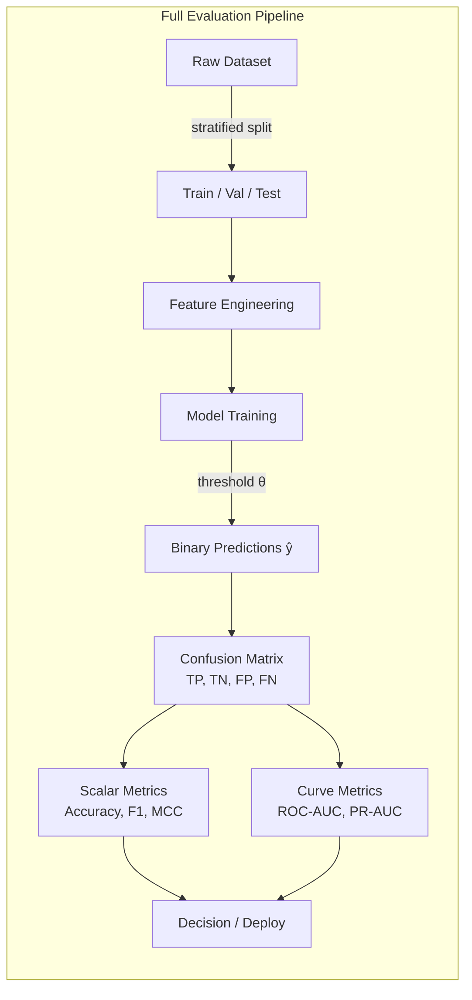
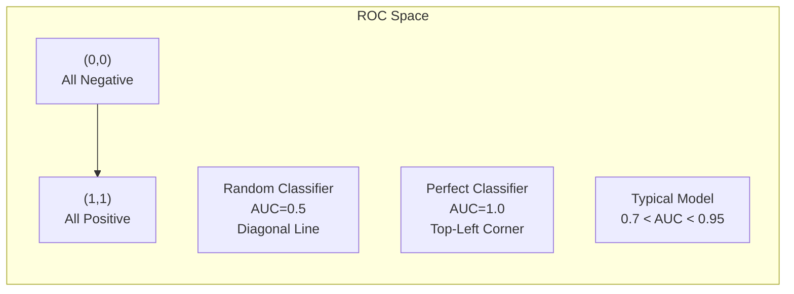
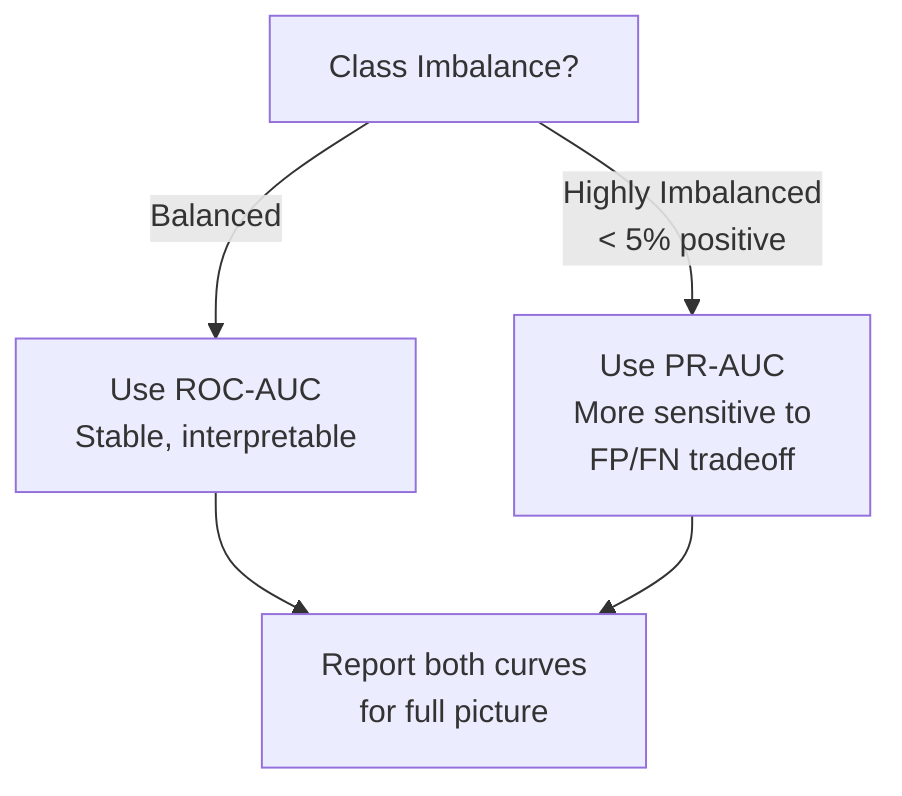
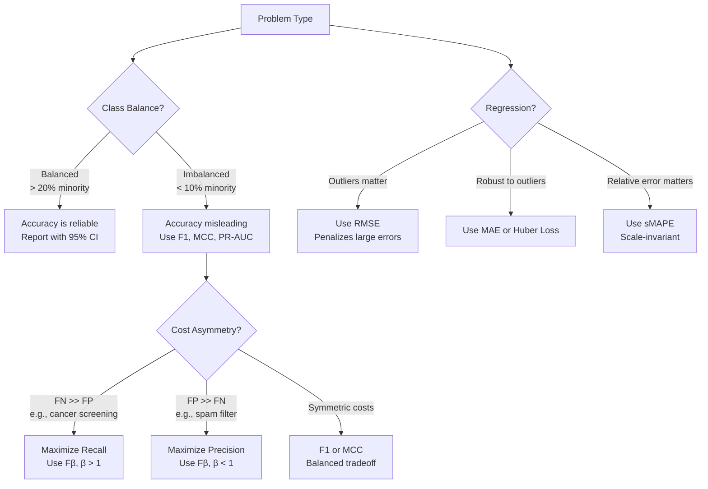
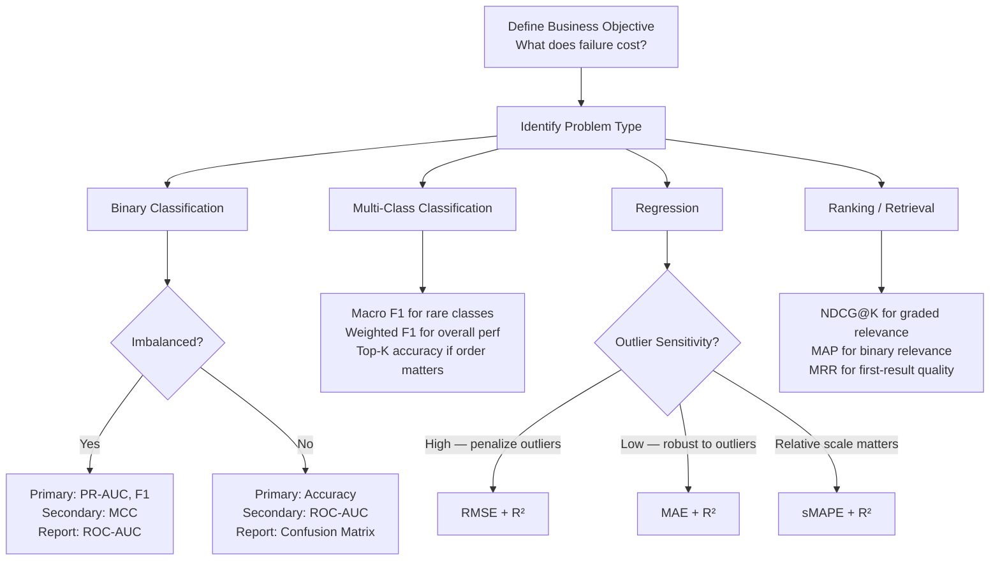

# Lesson 4: Evaluation Metrics

## 1. First-Principles Intuition & Invariants

Every measurable objective in machine learning reduces to a single question: *how do we know if the model is doing what we want?* Evaluation metrics are the formal answer. They are not post-hoc report cards — they are the mathematical objects that *define* what success means for a given problem. Choosing the wrong metric is equivalent to optimizing the wrong objective function; the model will faithfully maximize whatever you measure, regardless of whether that aligns with business or scientific intent.

### 1.1 The Probabilistic Foundation

A supervised model learns a function `f: X → Y`. The ground truth is a joint distribution `P(X, Y)`. All evaluation metrics are estimators of some property of that distribution, computed on a held-out sample. This framing has an immediate implication: **every metric is a random variable with variance**, and that variance decreases as the test set grows. Reporting a single point estimate without a confidence interval is statistically incomplete.

The fundamental decomposition of prediction error is:

```text
E[(y - f̂(x))²] = Bias²[f̂(x)] + Var[f̂(x)] + σ²
```

where:
- **Bias²** = `(E[f̂(x)] - f(x))²` — systematic error from wrong model assumptions
- **Var** = `E[(f̂(x) - E[f̂(x)])²]` — sensitivity to fluctuations in the training set
- **σ²** = irreducible noise in the data-generating process itself

This decomposition, derivable from first principles by expanding the squared error and using linearity of expectation, tells us that model complexity trades bias for variance. A degree-1 polynomial fit to a sinusoidal function has high bias; a degree-50 polynomial fit to 20 noisy points has high variance. The minimum of total expected error defines the optimal model complexity for a given dataset size.

### 1.2 Loss Functions as Metric Generators

Loss functions and evaluation metrics are related but distinct. A **loss function** `L(y, ŷ)` is what the optimizer minimizes during training via gradient descent. An **evaluation metric** is what a human or automated system uses to judge the trained model — it may or may not be differentiable.

| Loss Function | Formula | Induced Metric | Optimal Prediction |
|---|---|---|---|
| Squared Error (L2) | `(y - ŷ)²` | RMSE, MSE | Conditional mean `E[Y\|X]` |
| Absolute Error (L1) | `\|y - ŷ\|` | MAE | Conditional median |
| Cross-Entropy | `-[y log ŷ + (1-y) log(1-ŷ)]` | Log-loss, Accuracy | Conditional probability `P(Y=1\|X)` |
| Hinge Loss | `max(0, 1 - y·ŷ)` | Margin / SVM accuracy | Maximum-margin hyperplane |
| KL Divergence | `Σ p(x) log(p(x)/q(x))` | Distribution similarity | p = q |

The optimal prediction column is crucial. Minimizing squared error over a dataset yields the conditional mean because the mean minimizes expected squared distance. This is not an arbitrary convention — it follows directly from calculus: differentiating `E[(Y - c)²]` with respect to constant `c` and setting to zero gives `c = E[Y]`.

---

## 2. Core Architecture & Mechanics

### 2.1 The Confusion Matrix: The Atomic Unit of Classification Metrics

For binary classification, every prediction falls into one of four cells. This is not a convenient visualization — it is the *sufficient statistic* for all threshold-dependent classification metrics.





### 2.2 Classification Metrics: Derivation and Geometry

**Accuracy** measures the fraction of correct predictions:

```text
Accuracy = (TP + TN) / (TP + TN + FP + FN)
```

> ⚠️ Note: The original material contained a typographical error — `TP + TN / (TP + TN + FP + FN)` is incorrect due to operator precedence. The correct formula requires the parenthesization shown above.

Accuracy is **misleading on imbalanced datasets**. For a fraud detection dataset where 0.1% of transactions are fraudulent, a model that always predicts "not fraud" achieves 99.9% accuracy while being completely useless.

**Precision** (Positive Predictive Value) measures what fraction of *predicted* positives are real:

```text
Precision = TP / (TP + FP)
```

**Recall** (Sensitivity, True Positive Rate) measures what fraction of *actual* positives were found:

```text
Recall = TP / (TP + FN)
```

**F1-Score** is the harmonic mean of precision and recall:

```text
F1 = 2 · (Precision · Recall) / (Precision + Recall)
   = 2·TP / (2·TP + FP + FN)
```

The harmonic mean is used rather than the arithmetic mean because it penalizes extreme imbalances between precision and recall. If precision = 1.0 and recall = 0.0, arithmetic mean = 0.5 (misleadingly high), harmonic mean = 0.0 (correctly catastrophic).

The generalized **Fβ-score** weights recall β times more than precision:

```text
Fβ = (1 + β²) · (Precision · Recall) / (β² · Precision + Recall)
```

Use β > 1 when missing true positives is more costly (medical screening). Use β < 1 when false alarms are more costly (spam filtering).

**Matthews Correlation Coefficient (MCC)** is the most informative single-number metric for binary classification on imbalanced data, as it uses all four cells of the confusion matrix symmetrically:

```text
MCC = (TP·TN - FP·FN) / sqrt((TP+FP)(TP+FN)(TN+FP)(TN+FN))
```

MCC ranges from -1 (perfect inverse prediction) to +1 (perfect prediction), with 0 indicating random chance. Unlike F1, it is symmetric with respect to swapping the positive and negative class.

### 2.3 Threshold-Independent Metrics: ROC and Precision-Recall Curves

Most classifiers output a score or probability, not a hard label. The classification metrics above depend on a chosen decision threshold θ. To evaluate the model's discrimination ability across *all* thresholds simultaneously, we use curve-based metrics.

**ROC Curve** plots True Positive Rate (Recall) vs. False Positive Rate at each threshold:

```text
FPR = FP / (FP + TN)   [x-axis]
TPR = TP / (TP + FN)   [y-axis]
```

The **AUC-ROC** (Area Under the ROC Curve) has a direct probabilistic interpretation: it equals the probability that a randomly chosen positive example receives a higher model score than a randomly chosen negative example. A random classifier scores AUC = 0.5; a perfect classifier scores AUC = 1.0.



**Precision-Recall (PR) Curve** plots Precision vs. Recall across thresholds. PR-AUC is preferred over ROC-AUC when the **positive class is rare**, because ROC-AUC can be optimistically inflated by the large number of true negatives that dominate FPR calculations in imbalanced settings. The PR curve has no such artifact — it ignores true negatives entirely.

The relationship between the two:



### 2.4 Regression Metrics

For continuous output `ŷ ∈ ℝ`:

**Mean Squared Error (MSE)** and **Root MSE (RMSE)**:
```text
MSE  = (1/n) Σᵢ (yᵢ - ŷᵢ)²
RMSE = √MSE
```
RMSE is in the same units as the target variable. It penalizes large errors quadratically — a prediction off by 10 contributes 100x more than one off by 1.

**Mean Absolute Error (MAE)**:
```text
MAE = (1/n) Σᵢ |yᵢ - ŷᵢ|
```
MAE is more robust to outliers. If your target contains extreme values you don't want to influence the metric, prefer MAE.

**R² (Coefficient of Determination)**:
```text
R² = 1 - SS_res/SS_tot
   = 1 - Σ(yᵢ - ŷᵢ)² / Σ(yᵢ - ȳ)²
```
R² measures the proportion of variance in `y` explained by the model. R² = 1 is a perfect fit; R² = 0 means the model is no better than predicting the mean; **R² can be negative** when the model is worse than predicting the mean (e.g., a model trained on different data than it's tested on).

**Mean Absolute Percentage Error (MAPE)**:
```text
MAPE = (100%/n) Σᵢ |yᵢ - ŷᵢ| / |yᵢ|
```
Undefined when `yᵢ = 0`. Asymmetric: over-predictions and under-predictions are penalized differently. Use Symmetric MAPE (sMAPE) to correct the asymmetry:
```text
sMAPE = (200%/n) Σᵢ |yᵢ - ŷᵢ| / (|yᵢ| + |ŷᵢ|)
```

---

## 3. Implementation: Production-Grade Metric Computation

### 3.1 Python Implementation from Scratch

The following implementation computes the full metric suite without relying on `sklearn` internals, making every formula explicit and auditable:

```python
from __future__ import annotations

import math
import numpy as np
from scipy import stats
from dataclasses import dataclass, field
from typing import Optional


@dataclass
class ConfusionMatrix:
    """
    Sufficient statistic for all threshold-dependent binary classification metrics.
    All inputs are assumed to be non-negative integers.
    """
    tp: int
    tn: int
    fp: int
    fn: int

    @classmethod
    def from_arrays(cls, y_true: np.ndarray, y_pred: np.ndarray) -> "ConfusionMatrix":
        """
        Construct from boolean/integer arrays.
        y_true, y_pred: 1D arrays of 0s and 1s, same length.
        """
        if y_true.shape != y_pred.shape:
            raise ValueError(
                f"Shape mismatch: y_true {y_true.shape} vs y_pred {y_pred.shape}"
            )
        y_true = y_true.astype(bool)
        y_pred = y_pred.astype(bool)
        tp = int(np.sum(y_true & y_pred))
        tn = int(np.sum(~y_true & ~y_pred))
        fp = int(np.sum(~y_true & y_pred))
        fn = int(np.sum(y_true & ~y_pred))
        return cls(tp=tp, tn=tn, fp=fp, fn=fn)

    @property
    def total(self) -> int:
        return self.tp + self.tn + self.fp + self.fn

    @property
    def accuracy(self) -> float:
        if self.total == 0:
            return 0.0
        return (self.tp + self.tn) / self.total

    @property
    def precision(self) -> float:
        denom = self.tp + self.fp
        return self.tp / denom if denom > 0 else 0.0

    @property
    def recall(self) -> float:
        denom = self.tp + self.fn
        return self.tp / denom if denom > 0 else 0.0

    @property
    def f1(self) -> float:
        return self.fbeta(beta=1.0)

    def fbeta(self, beta: float) -> float:
        """
        Fβ-score: β > 1 weights recall higher; β < 1 weights precision higher.
        Derivation: harmonic mean weighted by β².
        """
        p, r = self.precision, self.recall
        b2 = beta ** 2
        denom = b2 * p + r
        return (1 + b2) * p * r / denom if denom > 0 else 0.0

    @property
    def mcc(self) -> float:
        """
        Matthews Correlation Coefficient — symmetric, handles all four cells.
        Range: [-1, +1]. Preferred for imbalanced binary classification.
        """
        tp, tn, fp, fn = self.tp, self.tn, self.fp, self.fn
        denom = math.sqrt((tp + fp) * (tp + fn) * (tn + fp) * (tn + fn))
        return (tp * tn - fp * fn) / denom if denom > 0 else 0.0

    @property
    def specificity(self) -> float:
        """True Negative Rate = TN / (TN + FP)"""
        denom = self.tn + self.fp
        return self.tn / denom if denom > 0 else 0.0

    @property
    def false_positive_rate(self) -> float:
        """FPR = FP / (FP + TN) — x-axis of ROC curve"""
        denom = self.fp + self.tn
        return self.fp / denom if denom > 0 else 0.0

    def __repr__(self) -> str:
        return (
            f"ConfusionMatrix(TP={self.tp}, TN={self.tn}, FP={self.fp}, FN={self.fn})\n"
            f"  Accuracy:  {self.accuracy:.4f}\n"
            f"  Precision: {self.precision:.4f}\n"
            f"  Recall:    {self.recall:.4f}\n"
            f"  F1:        {self.f1:.4f}\n"
            f"  MCC:       {self.mcc:.4f}\n"
            f"  Specificity: {self.specificity:.4f}"
        )


def roc_curve(
    y_true: np.ndarray, y_score: np.ndarray
) -> tuple[np.ndarray, np.ndarray, np.ndarray]:
    """
    Compute ROC curve: (FPR, TPR) pairs for all unique score thresholds.
    
    Algorithm: sort by descending score, sweep threshold, track TP/FP counts.
    Time complexity: O(n log n) dominated by sort.
    
    Returns: (fpr, tpr, thresholds) arrays, all length n+1.
    """
    y_true = y_true.astype(bool)
    n_pos = y_true.sum()
    n_neg = len(y_true) - n_pos

    if n_pos == 0 or n_neg == 0:
        raise ValueError("ROC curve requires at least one positive and one negative example.")

    # Sort by descending score
    desc_idx = np.argsort(y_score)[::-1]
    sorted_labels = y_true[desc_idx]
    sorted_scores = y_score[desc_idx]

    # Cumulative TP and FP as threshold decreases (more items classified positive)
    tps = np.cumsum(sorted_labels)
    fps = np.cumsum(~sorted_labels)

    # Prepend origin (threshold = +inf, nothing classified positive)
    tps = np.concatenate([[0], tps])
    fps = np.concatenate([[0], fps])
    thresholds = np.concatenate([[sorted_scores[0] + 1e-9], sorted_scores])

    fpr = fps / n_neg
    tpr = tps / n_pos

    return fpr, tpr, thresholds


def auc_trapezoid(x: np.ndarray, y: np.ndarray) -> float:
    """
    Area under a curve using the trapezoidal rule.
    Assumes x is monotonically increasing; sort if needed.
    """
    idx = np.argsort(x)
    x, y = x[idx], y[idx]
    return float(np.trapezoid(y, x))


@dataclass
class RegressionMetrics:
    """
    Scalar regression evaluation metrics computed in a single pass.
    """
    y_true: np.ndarray
    y_pred: np.ndarray

    def __post_init__(self) -> None:
        if self.y_true.shape != self.y_pred.shape:
            raise ValueError("y_true and y_pred must have the same shape.")
        self._residuals = self.y_true - self.y_pred

    @property
    def mse(self) -> float:
        return float(np.mean(self._residuals ** 2))

    @property
    def rmse(self) -> float:
        return math.sqrt(self.mse)

    @property
    def mae(self) -> float:
        return float(np.mean(np.abs(self._residuals)))

    @property
    def r2(self) -> float:
        ss_res = np.sum(self._residuals ** 2)
        ss_tot = np.sum((self.y_true - self.y_true.mean()) ** 2)
        return 1.0 - ss_res / ss_tot if ss_tot > 0 else 0.0

    @property
    def mape(self) -> float:
        """
        MAPE is undefined for y_true == 0. We skip those entries and warn.
        """
        mask = self.y_true != 0
        if not mask.all():
            import warnings
            warnings.warn(f"{(~mask).sum()} zero-valued targets excluded from MAPE.")
        return float(
            100.0 * np.mean(np.abs(self._residuals[mask] / self.y_true[mask]))
        )

    @property
    def smape(self) -> float:
        """Symmetric MAPE — corrects the asymmetry of standard MAPE."""
        denom = np.abs(self.y_true) + np.abs(self.y_pred)
        # Where both are zero, contribution is 0
        with np.errstate(invalid="ignore", divide="ignore"):
            ratios = np.where(denom == 0, 0.0, 2.0 * np.abs(self._residuals) / denom)
        return float(100.0 * np.mean(ratios))

    def __repr__(self) -> str:
        return (
            f"RegressionMetrics:\n"
            f"  RMSE:  {self.rmse:.6f}\n"
            f"  MAE:   {self.mae:.6f}\n"
            f"  R²:    {self.r2:.6f}\n"
            f"  sMAPE: {self.smape:.4f}%"
        )


# --- Demonstration ---
if __name__ == "__main__":
    rng = np.random.default_rng(seed=42)

    # Classification example: imbalanced dataset (5% positive)
    n = 10_000
    y_true_cls = (rng.uniform(size=n) < 0.05).astype(int)
    # Simulate a model with moderate discrimination
    y_score = rng.beta(a=5, b=2, size=n) * y_true_cls + rng.beta(a=2, b=5, size=n) * (1 - y_true_cls)
    y_pred_cls = (y_score > 0.5).astype(int)

    cm = ConfusionMatrix.from_arrays(y_true_cls, y_pred_cls)
    print(cm)

    fpr, tpr, _ = roc_curve(y_true_cls, y_score)
    print(f"\nROC-AUC: {auc_trapezoid(fpr, tpr):.4f}")

    # Regression example
    y_true_reg = rng.normal(loc=10.0, scale=2.0, size=1000)
    y_pred_reg = y_true_reg + rng.normal(loc=0, scale=0.5, size=1000)
    print(RegressionMetrics(y_true=y_true_reg, y_pred=y_pred_reg))
```

### 3.2 Stratified Cross-Validation for Reliable Metric Estimation

A single train/test split produces a metric estimate with high variance. K-fold cross-validation reduces this variance by averaging over K independent estimates:

```python
import numpy as np
from typing import Callable

def stratified_kfold_cv(
    X: np.ndarray,
    y: np.ndarray,
    model_factory: Callable,
    metric_fn: Callable,
    k: int = 5,
    seed: int = 42,
) -> dict:
    """
    Stratified K-fold cross-validation.
    
    Stratification ensures each fold has the same class proportion as the full
    dataset — critical for imbalanced problems where random splits can produce
    folds with zero positive examples.
    
    Returns: dict with 'scores', 'mean', 'std', and 95% CI bounds.
    """
    rng = np.random.default_rng(seed)
    classes = np.unique(y)
    
    # Build per-class index lists, then interleave into folds
    class_indices = {c: np.where(y == c)[0] for c in classes}
    for c in classes:
        rng.shuffle(class_indices[c])
    
    # Distribute indices into k folds maintaining class proportions
    folds: list[list[int]] = [[] for _ in range(k)]
    for c in classes:
        idx = class_indices[c]
        for i, chunk in enumerate(np.array_split(idx, k)):
            folds[i].extend(chunk.tolist())
    
    scores = []
    for fold_idx in range(k):
        val_idx = np.array(folds[fold_idx])
        train_idx = np.array([i for j, f in enumerate(folds) if j != fold_idx for i in f])
        
        X_train, X_val = X[train_idx], X[val_idx]
        y_train, y_val = y[train_idx], y[val_idx]
        
        model = model_factory()
        model.fit(X_train, y_train)
        y_pred = model.predict(X_val)
        scores.append(metric_fn(y_val, y_pred))
    
    scores_arr = np.array(scores)
    mean = scores_arr.mean()
    std = scores_arr.std(ddof=1)
    # 95% CI via t-distribution (conservative for small k)
    t_crit = stats.t.ppf(0.975, df=k - 1)
    margin = t_crit * std / np.sqrt(k)
    
    return {
        "scores": scores_arr.tolist(),
        "mean": mean,
        "std": std,
        "ci_95_low": mean - margin,
        "ci_95_high": mean + margin,
    }
```

---

## 4. High-Performance Implementation in Rust

For production ML pipelines processing tens of millions of predictions (model monitoring, online evaluation), Python is too slow. The following Rust implementation computes the full binary classification metric suite with SIMD-amenable loops and zero heap allocation:

```rust
//! evaluation_metrics.rs
//! 
//! Zero-allocation, cache-efficient binary classification metric computation.
//! Compile with: rustc -C opt-level=3 --crate-type lib --edition 2021 evaluation_metrics.rs

/// Confusion matrix components as u64 to handle very large datasets.
#[derive(Debug, Clone, Copy, Default)]
pub struct ConfusionMatrix {
    pub tp: u64,
    pub tn: u64,
    pub fp: u64,
    pub fn_: u64,
}

impl ConfusionMatrix {
    /// Builds confusion matrix from parallel slices of true and predicted labels.
    /// Uses 0u8 as negative, 1u8 as positive.
    /// 
    /// The inner loop is autovectorizable by LLVM when compiled with -O3.
    pub fn from_slices(y_true: &[u8], y_pred: &[u8]) -> Self {
        assert_eq!(y_true.len(), y_pred.len(), "Slice length mismatch");

        let mut tp = 0u64;
        let mut tn = 0u64;
        let mut fp = 0u64;
        let mut fn_ = 0u64;

        // Simple loop autovectorizable by LLVM at -O3
        for (&t, &p) in y_true.iter().zip(y_pred.iter()) {
            match (t, p) {
                (1, 1) => tp += 1,
                (0, 0) => tn += 1,
                (0, 1) => fp += 1,
                (1, 0) => fn_ += 1,
                _ => panic!("Labels must be 0 or 1, got ({}, {})", t, p),
            }
        }

        ConfusionMatrix { tp, tn, fp, fn_ }
    }

    pub fn total(&self) -> u64 {
        self.tp + self.tn + self.fp + self.fn_
    }

    pub fn accuracy(&self) -> f64 {
        let t = self.total();
        if t == 0 { return 0.0; }
        (self.tp + self.tn) as f64 / t as f64
    }

    pub fn precision(&self) -> f64 {
        let d = self.tp + self.fp;
        if d == 0 { return 0.0; }
        self.tp as f64 / d as f64
    }

    pub fn recall(&self) -> f64 {
        let d = self.tp + self.fn_;
        if d == 0 { return 0.0; }
        self.tp as f64 / d as f64
    }

    pub fn f1(&self) -> f64 {
        self.fbeta(1.0)
    }

    pub fn fbeta(&self, beta: f64) -> f64 {
        let p = self.precision();
        let r = self.recall();
        let b2 = beta * beta;
        let d = b2 * p + r;
        if d == 0.0 { return 0.0; }
        (1.0 + b2) * p * r / d
    }

    /// Matthews Correlation Coefficient.
    /// Uses f64 internally to avoid integer overflow for large TP*TN products.
    pub fn mcc(&self) -> f64 {
        let tp = self.tp as f64;
        let tn = self.tn as f64;
        let fp = self.fp as f64;
        let fn_ = self.fn_ as f64;

        let denom = ((tp + fp) * (tp + fn_) * (tn + fp) * (tn + fn_)).sqrt();
        if denom == 0.0 { return 0.0; }
        (tp * tn - fp * fn_) / denom
    }
}

/// Streaming metric accumulator for online/distributed evaluation.
/// Can be merged across shards: acc_a.merge(acc_b).
#[derive(Debug, Default)]
pub struct StreamingMetrics {
    n: u64,
    sum_squared_error: f64,
    sum_absolute_error: f64,
    sum_y: f64,
    sum_y_sq: f64,
}

impl StreamingMetrics {
    pub fn update(&mut self, y_true: f64, y_pred: f64) {
        let err = y_true - y_pred;
        self.n += 1;
        self.sum_squared_error += err * err;
        self.sum_absolute_error += err.abs();
        self.sum_y += y_true;
        self.sum_y_sq += y_true * y_true;
    }

    pub fn update_batch(&mut self, y_true: &[f64], y_pred: &[f64]) {
        assert_eq!(y_true.len(), y_pred.len());
        for (&t, &p) in y_true.iter().zip(y_pred.iter()) {
            self.update(t, p);
        }
    }

    /// Merge another accumulator into this one (for distributed computation).
    pub fn merge(&mut self, other: &StreamingMetrics) {
        self.n += other.n;
        self.sum_squared_error += other.sum_squared_error;
        self.sum_absolute_error += other.sum_absolute_error;
        self.sum_y += other.sum_y;
        self.sum_y_sq += other.sum_y_sq;
    }

    pub fn mse(&self) -> f64 {
        if self.n == 0 { return 0.0; }
        self.sum_squared_error / self.n as f64
    }

    pub fn rmse(&self) -> f64 {
        self.mse().sqrt()
    }

    pub fn mae(&self) -> f64 {
        if self.n == 0 { return 0.0; }
        self.sum_absolute_error / self.n as f64
    }
}

#[cfg(test)]
mod tests {
    use super::*;

    #[test]
    fn test_perfect_classifier() {
        let y_true = vec![1u8, 1, 0, 0, 1];
        let y_pred = vec![1u8, 1, 0, 0, 1];
        let cm = ConfusionMatrix::from_slices(&y_true, &y_pred);
        assert_eq!(cm.accuracy(), 1.0);
        assert_eq!(cm.precision(), 1.0);
        assert_eq!(cm.recall(), 1.0);
        assert_eq!(cm.mcc(), 1.0);
    }

    #[test]
    fn test_imbalanced_all_negative_model() {
        // Model predicts all negative on 10% positive dataset
        let y_true: Vec<u8> = (0..100).map(|i| if i < 10 { 1 } else { 0 }).collect();
        let y_pred: Vec<u8> = vec![0u8; 100];
        let cm = ConfusionMatrix::from_slices(&y_true, &y_pred);
        // Accuracy is high (90%) but model is useless
        assert!((cm.accuracy() - 0.9).abs() < 1e-9);
        assert_eq!(cm.recall(), 0.0);  // Misses all positives
        assert_eq!(cm.f1(), 0.0);      // F1 correctly shows failure
    }

    #[test]
    fn test_streaming_regression_merge() {
        let mut s1 = StreamingMetrics::default();
        let mut s2 = StreamingMetrics::default();
        s1.update_batch(&[1.0, 2.0, 3.0], &[1.1, 2.1, 3.1]);
        s2.update_batch(&[4.0, 5.0], &[4.1, 5.1]);
        s1.merge(&s2);
        // All errors are 0.1, so MAE should be 0.1
        assert!((s1.mae() - 0.1).abs() < 1e-9);
    }
}
```

---

## 5. Failure Modes, Edge Cases, and Metric Selection

### 5.1 When Metrics Lie: Systematic Failure Modes

Understanding *why* a metric can mislead is as important as knowing how to compute it.



**Data Leakage into Metrics**: If preprocessing steps (normalization, imputation, feature selection) are fit on the full dataset before splitting into train/test, the test metric is optimistically biased. The correct pipeline always fits preprocessing on the training fold only, then transforms the test fold.

**Label Noise**: If ground truth labels contain errors at rate ε, the maximum achievable accuracy is bounded by `1 - ε`. A model that consistently scores below `1 - ε` may be learning to correct noisy labels — which is pathologically good, not bad.

**Distribution Shift**: A model evaluated on a test set drawn from the same distribution as training data can fail catastrophically in production if the deployment distribution differs. This is the most common reason metrics on a held-out set fail to predict real-world performance.

**Metric-Objective Mismatch**: Optimizing cross-entropy during training but reporting accuracy at evaluation can mask systematic miscalibration. A model can achieve high accuracy with severely miscalibrated probabilities. Use **Expected Calibration Error (ECE)** alongside accuracy when probability estimates matter:

```text
ECE = Σ_b (|B_b| / n) · |acc(B_b) - conf(B_b)|
```

where `B_b` is the set of predictions with confidence in bin `b`, `acc` is accuracy within that bin, and `conf` is mean confidence within that bin.

### 5.2 Statistical Significance of Metric Differences

A model achieving 85.2% accuracy vs. 84.9% accuracy on the same test set — is that difference real? Use McNemar's test for paired binary classifiers. For continuous metrics, bootstrap confidence intervals are appropriate:

```python
def bootstrap_metric_ci(
    y_true: np.ndarray,
    y_pred: np.ndarray,
    metric_fn: Callable,
    n_bootstrap: int = 10_000,
    alpha: float = 0.05,
    seed: int = 42,
) -> tuple[float, float]:
    """
    Bootstrap confidence interval for any scalar metric.
    
    Resamples (y_true, y_pred) pairs with replacement n_bootstrap times,
    computes the metric each time, and returns the (alpha/2, 1-alpha/2) quantiles.
    
    This makes no distributional assumptions about the metric.
    """
    rng = np.random.default_rng(seed)
    n = len(y_true)
    boot_scores = np.empty(n_bootstrap)
    
    for i in range(n_bootstrap):
        idx = rng.integers(0, n, size=n)
        boot_scores[i] = metric_fn(y_true[idx], y_pred[idx])
    
    low = np.quantile(boot_scores, alpha / 2)
    high = np.quantile(boot_scores, 1 - alpha / 2)
    return float(low), float(high)
```

### 5.3 Multi-Class Extension

For K > 2 classes, the confusion matrix becomes K×K. Precision, Recall, and F1 extend via averaging strategies:

- **Macro averaging**: compute metric per class, take unweighted mean. Each class contributes equally regardless of size.
- **Weighted averaging**: compute metric per class, weight by class support (sample count). Reflects overall dataset performance.
- **Micro averaging**: aggregate TP, FP, FN across all classes before computing. For F1, micro-averaged F1 equals accuracy when each sample belongs to exactly one class.

For severely imbalanced multi-class problems, macro-averaged F1 is usually most informative since it surfaces poor performance on rare classes that weighted or micro averaging would obscure.

---

## 6. The Metric Selection Framework

No single metric is universally correct. The following decision logic operationalizes metric selection as a function of problem type, class balance, and cost structure:



Always report:
1. The primary metric with a 95% confidence interval
2. The confusion matrix or residual distribution (not just scalar summaries)
3. The metric on stratified subgroups — a model can perform well on average but fail systematically on a subpopulation

---

## Summary

Evaluation metrics are formal estimators of model quality, each encoding specific assumptions about what errors cost and what success means. Accuracy is a valid metric only when classes are balanced and all errors are equally costly. The confusion matrix is the atomic unit from which all threshold-dependent classification metrics derive. ROC-AUC quantifies discrimination ability across all thresholds and has a direct probabilistic interpretation. For imbalanced classification, PR-AUC and MCC are more informative than ROC-AUC. For regression, RMSE and MAE are appropriate depending on outlier sensitivity, and R² measures explained variance relative to a mean-prediction baseline. No metric should be reported as a point estimate — bootstrap CIs or cross-validation variance quantify the reliability of the estimate itself.
