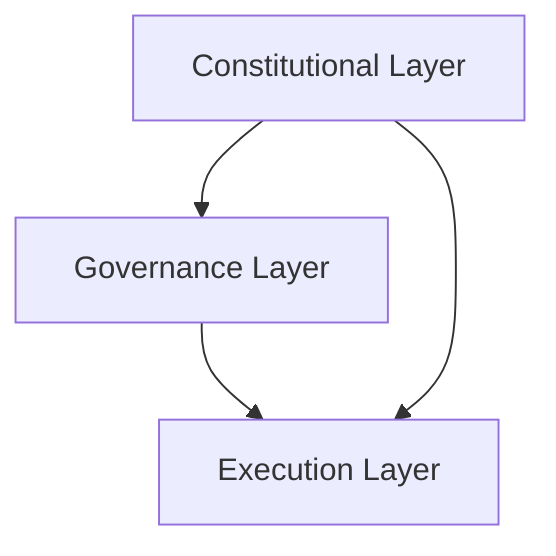

# Lesson 1: Principles of Constitutional AI

## 1. First-Principles Intuition & Invariants

The concept of Constitutional AI (CAI) emerges from the intersection of artificial intelligence, legal frameworks, and ethical guidelines. It seeks to imbue AI systems with a set of principles that ensure they operate within a structured, transparent, and accountable manner. This foundational approach is akin to the principles embedded in a constitution, which governs the behavior of a nation-state. In the context of AI, these principles are designed to guide the development, deployment, and operation of AI systems to align with societal values, legal standards, and ethical norms.

At its core, Constitutional AI is about establishing a set of invariants that govern the behavior of AI systems. These invariants are akin to the axioms in a mathematical system, providing a bedrock upon which the entire architecture of the AI system is built. The problem space of Constitutional AI is vast, encompassing issues of data privacy, algorithmic fairness, transparency, accountability, and the prevention of misuse. Each of these issues is deeply intertwined with legal and ethical considerations, necessitating a comprehensive approach to their resolution.

To understand the invariants of Constitutional AI, we must delve into the underlying principles that guide its development. These principles include:

- **Transparency**: AI systems should be transparent in their decision-making processes, allowing stakeholders to understand how decisions are reached. This principle is crucial for building trust and ensuring accountability.
- **Accountability**: There must be clear mechanisms for holding AI systems and their developers accountable for their actions. This includes mechanisms for auditing, oversight, and redress.
- **Fairness**: AI systems should operate in a manner that is fair and unbiased, avoiding discrimination against any group or individual.
- **Privacy**: The privacy of individuals must be protected, with AI systems handling personal data in a manner that respects individual rights and complies with relevant legal standards.
- **Security**: AI systems must be secure, with robust mechanisms in place to prevent unauthorized access, tampering, and misuse.

These principles are not merely aspirational; they are grounded in a rigorous mathematical and systems-theoretic framework. For instance, the principle of fairness can be formalized using game theory and optimization techniques, ensuring that AI systems do not inadvertently perpetuate or exacerbate existing biases. Similarly, the principle of security can be grounded in formal verification techniques, ensuring that AI systems are resilient to a wide range of attacks.

## 2. Core Architecture & Mechanics

The architecture of a Constitutional AI system is designed to embody the principles outlined above. At its core, a Constitutional AI system consists of several key components:

- **Constitutional Layer**: This layer defines the principles and invariants that govern the behavior of the AI system. It is akin to the constitution of a nation-state, providing a set of rules and guidelines that all other components must adhere to.
- **Governance Layer**: This layer is responsible for enforcing the principles and invariants defined in the Constitutional Layer. It includes mechanisms for auditing, oversight, and redress, ensuring that the AI system operates within the bounds of its constitutional framework.
- **Execution Layer**: This layer is responsible for the actual execution of the AI system. It includes the algorithms, data structures, and execution models that drive the behavior of the AI system.

To illustrate the architecture of a Constitutional AI system, we can use a simple Mermaid diagram:

In this diagram, the Constitutional Layer defines the principles and invariants that govern the behavior of the AI system. The Governance Layer is responsible for enforcing these principles and invariants, while the Execution Layer is responsible for the actual execution of the AI system.

The Constitutional Layer is implemented using a set of formal specifications and guidelines. These specifications define the principles and invariants that govern the behavior of the AI system, ensuring that all components adhere to a common set of rules. The Governance Layer is implemented using a set of mechanisms for auditing, oversight, and redress. These mechanisms ensure that the AI system operates within the bounds of its constitutional framework, with clear mechanisms for holding it accountable.

The Execution Layer is implemented using a set of algorithms, data structures, and execution models. These components are designed to operate within the bounds of the principles and invariants defined in the Constitutional Layer, ensuring that the AI system behaves in a manner that is transparent, accountable, fair, private, and secure.

## 3. High-Performance Optimization & Failure Modes

The high-performance optimization of a Constitutional AI system is a complex challenge, requiring a careful balance between performance, efficiency, and compliance with the principles and invariants defined in the Constitutional Layer. To achieve this balance, several key strategies can be employed:

- **Concurrency**: The use of concurrent execution models can significantly improve the performance of a Constitutional AI system. However, care must be taken to ensure that concurrency does not compromise the principles and invariants defined in the Constitutional Layer. This can be achieved using techniques such as lock-free data structures and concurrent algorithms.
- **Resource Scaling**: The use of resource scaling techniques can improve the performance of a Constitutional AI system by allowing it to scale efficiently in response to changing workloads. However, care must be taken to ensure that resource scaling does not compromise the principles and invariants defined in the Constitutional Layer. This can be achieved using techniques such as dynamic resource allocation and load balancing.
- **Boundary Edge Cases**: The handling of boundary edge cases is a critical aspect of high-performance optimization in a Constitutional AI system. Boundary edge cases are situations that occur at the boundaries of the system's operating parameters, such as extreme workloads or unusual input data. Care must be taken to ensure that boundary edge cases do not compromise the principles and invariants defined in the Constitutional Layer. This can be achieved using techniques such as robust error handling and fault tolerance.

The failure modes of a Constitutional AI system are also a critical aspect of its design. A failure mode is a situation in which the AI system fails to operate as intended, potentially compromising the principles and invariants defined in the Constitutional Layer. To mitigate the risk of failure modes, several key strategies can be employed:

- **Redundancy**: The use of redundancy can improve the reliability of a Constitutional AI system by providing backup mechanisms in case of failure. This can be achieved using techniques such as redundant data storage and redundant execution paths.
- **Fault Tolerance**: The use of fault tolerance can improve the reliability of a Constitutional AI system by allowing it to continue operating in the presence of faults. This can be achieved using techniques such as fault detection and fault recovery.
- **Monitoring and Logging**: The use of monitoring and logging can improve the reliability of a Constitutional AI system by providing real-time visibility into its operation. This can be achieved using techniques such as real-time monitoring and log analysis.

In conclusion, the principles of Constitutional AI provide a robust framework for the development, deployment, and operation of AI systems. By grounding these principles in a rigorous mathematical and systems-theoretic framework, we can ensure that AI systems operate in a manner that is transparent, accountable, fair, private, and secure. The architecture of a Constitutional AI system is designed to embody these principles, with a focus on high-performance optimization and failure mitigation. By understanding the principles, architecture, and mechanics of Constitutional AI, we can build AI systems that are aligned with societal values, legal standards, and ethical norms.
