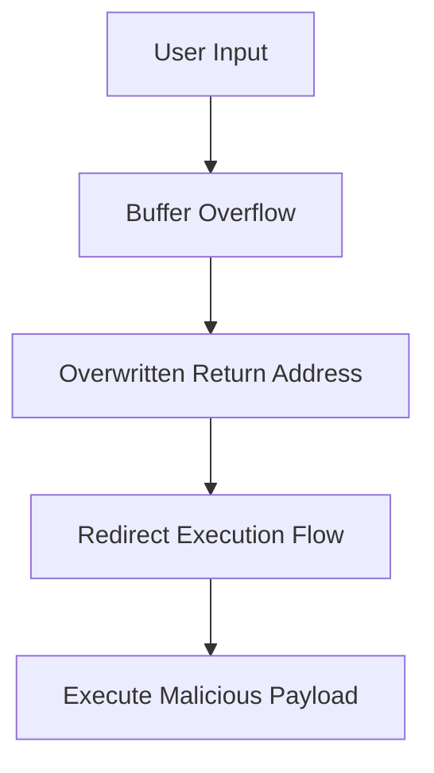

# Lesson 1: Understanding Adversarial Jailbreaks

## 1. First-Principles Intuition & Invariants

In the realm of computing, the concept of a jailbreak is deeply intertwined with the broader themes of system security, user freedom, and the relentless pursuit of technological boundaries. A jailbreak, at its core, is an adversarial technique that exploits vulnerabilities in a system to gain unauthorized access to features or functionalities that are typically restricted. This act of subversion is not merely a technical feat but a profound challenge to the very architecture and design principles that underpin modern computing systems.

To fully understand the implications of jailbreaks, we must delve into the foundational principles of system security. At the heart of any secure system lies the concept of privilege separation, which ensures that different components of a system operate with the minimum necessary permissions. This principle is embodied in the architecture of operating systems through mechanisms such as user and kernel modes, where the kernel has higher privileges and controls critical system resources, while user-mode applications operate with limited permissions.

However, the pursuit of security is inherently a cat-and-mouse game. As systems become more complex and interconnected, so do the opportunities for adversaries to exploit vulnerabilities. A jailbreak is a manifestation of this adversarial dynamic, where an attacker identifies and exploits a flaw in the system's security model to gain elevated privileges. This process often involves a deep understanding of the system's architecture, including its memory management, process scheduling, and inter-process communication mechanisms.

One of the key invariants in the study of jailbreaks is the principle of least privilege. This principle posits that a system should operate with the minimum permissions necessary to perform its intended function. By adhering to this principle, systems can minimize the potential impact of a successful jailbreak, as the attacker would have limited access to critical resources. However, the reality is that no system is entirely immune to vulnerabilities, and jailbreaks continue to pose a significant threat to system security.

Another critical invariant is the concept of security through obscurity. This approach relies on the secrecy of the system's design and implementation details to deter adversaries. While security through obscurity can provide a temporary deterrent, it is not a robust defense mechanism. Adversaries with sufficient resources and expertise can reverse-engineer system components and identify vulnerabilities that can be exploited for a jailbreak.

The problem space of jailbreaks is further complicated by the emergence of advanced adversarial techniques. These techniques leverage sophisticated algorithms and machine learning models to automate the process of vulnerability discovery and exploitation. For example, adversarial machine learning can be used to generate inputs that bypass security mechanisms, while genetic algorithms can be employed to optimize the search for vulnerabilities. These techniques highlight the need for a comprehensive and adaptive approach to system security, one that can anticipate and counteract the evolving tactics of adversaries.

## 2. Core Architecture & Mechanics

To dissect the mechanics of a jailbreak, we must examine the internal data structures, algorithms, and execution models that underpin modern computing systems. At the heart of any jailbreak is the identification of a vulnerability that can be exploited to gain unauthorized access. This vulnerability can take many forms, ranging from buffer overflows to race conditions, and each requires a unique approach to exploitation.

One common technique used in jailbreaks is the exploitation of buffer overflows. A buffer overflow occurs when a program writes more data to a buffer than it can hold, resulting in the overwriting of adjacent memory regions. This can lead to the execution of arbitrary code, as the attacker can manipulate the overwritten memory to redirect the program's execution flow. In the context of a jailbreak, a buffer overflow can be used to bypass security checks and gain elevated privileges.

To illustrate the mechanics of a buffer overflow exploit, consider the following simplified example. Suppose a system has a function that reads user input into a fixed-size buffer:

```c
void vulnerable_function() {
    char buffer[100];
    gets(buffer);  // Vulnerable function that does not check input length
}
```

In this example, the `gets` function reads input from the user without checking the length of the input, allowing an attacker to write more data to the buffer than it can hold. This can overwrite adjacent memory regions, including the return address of the function. By carefully crafting the input, the attacker can redirect the execution flow to a malicious payload, effectively gaining control of the system.

Another common technique used in jailbreaks is the exploitation of race conditions. A race condition occurs when the behavior of a system depends on the relative timing of events. In the context of a jailbreak, a race condition can be used to exploit vulnerabilities that arise from the concurrent execution of multiple threads or processes. For example, an attacker can use a race condition to manipulate the state of a system while it is performing a security check, allowing them to bypass the check and gain unauthorized access.

To illustrate the mechanics of a race condition exploit, consider the following simplified example. Suppose a system has a function that checks the permissions of a file before opening it:

```c
void open_file(char *filename) {
    if (check_permissions(filename)) {
        FILE *file = fopen(filename, "r");
        // Process file
        fclose(file);
    }
}
```

In this example, the `check_permissions` function checks the permissions of the file before opening it. However, if an attacker can manipulate the file's permissions between the `check_permissions` call and the `fopen` call, they can bypass the security check and gain unauthorized access to the file. This can be achieved through a race condition, where the attacker changes the file's permissions in a rapid sequence of operations.

To visualize the mechanics of a jailbreak, we can use a Mermaid diagram to illustrate the process of exploiting a buffer overflow vulnerability:



In this diagram, the user input is used to trigger a buffer overflow, which overwrites the return address of the function. This redirects the execution flow to a malicious payload, effectively gaining control of the system.

## 3. High-Performance Optimization & Failure Modes

The high-performance optimization of computing systems is a critical factor in the success of jailbreaks. Modern systems are designed to operate efficiently, with optimizations that can inadvertently introduce vulnerabilities. For example, optimizations such as speculative execution can lead to race conditions that can be exploited by an attacker. Similarly, optimizations such as just-in-time (JIT) compilation can introduce vulnerabilities that can be exploited through advanced adversarial techniques.

One of the key failure modes in the context of jailbreaks is the reliance on outdated or unpatched software. Many systems are vulnerable to known vulnerabilities that have been patched in newer versions, but are still present in older versions. This is particularly true for systems that are not regularly updated, such as embedded devices or legacy systems. By targeting these systems, attackers can exploit vulnerabilities that have been long forgotten, making the jailbreak process more straightforward.

Another critical failure mode is the lack of robust security mechanisms. Modern systems rely on a combination of security mechanisms, such as firewalls, intrusion detection systems, and antivirus software, to protect against adversarial attacks. However, these mechanisms can be bypassed through sophisticated adversarial techniques, such as polymorphic malware or advanced persistent threats (APTs). By evading these security mechanisms, attackers can gain unauthorized access to the system and perform a jailbreak.

To mitigate these failure modes, it is essential to adopt a comprehensive and adaptive approach to system security. This includes regular software updates, the use of robust security mechanisms, and the implementation of advanced security techniques, such as hardware-based security features and machine learning-based threat detection. By anticipating and counteracting the evolving tactics of adversaries, we can minimize the risk of successful jailbreaks and ensure the security and integrity of our systems.

In conclusion, the study of adversarial jailbreaks is a critical aspect of system security. By understanding the theoretical grounding, core architecture, and high-performance optimization of computing systems, we can better anticipate and counteract the evolving tactics of adversaries. This requires a deep understanding of the underlying principles of system security, as well as the ability to apply advanced techniques to protect against adversarial attacks. Through a comprehensive and adaptive approach to system security, we can ensure the security and integrity of our systems in the face of the relentless pursuit of technological boundaries.
