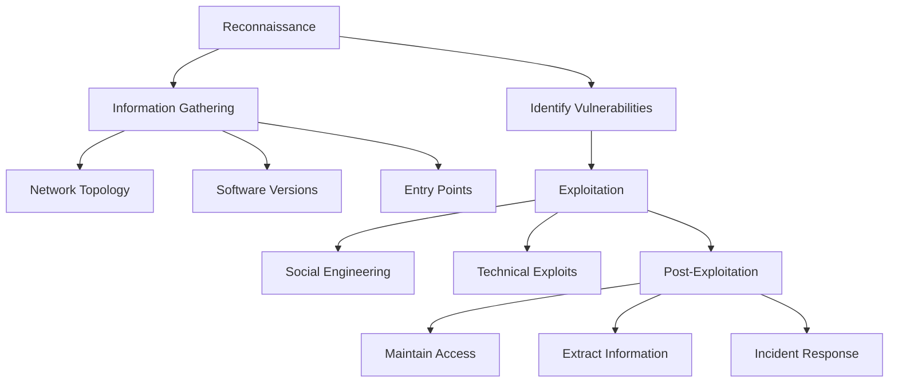

# Lesson 2: Red Teaming Strategies

## 1. First-Principles Intuition & Invariants

Red teaming is a critical component of modern security testing, designed to simulate adversarial attacks on an organization's systems and networks. The primary objective of a red team is to identify and exploit vulnerabilities that an actual attacker might exploit, thereby providing actionable insights for improving an organization's security posture. This approach is grounded in the principle of "assume breach," which posits that it is not a question of whether an organization will be attacked, but rather when and how. By adopting this mindset, red teams can proactively identify and address security weaknesses before they can be exploited by malicious actors.

The theoretical foundation of red teaming is deeply rooted in game theory and the concept of red-blue team dynamics. In this context, the red team represents the adversary, while the blue team represents the organization's defenders. The interaction between these two teams is akin to a zero-sum game, where the red team's success is the blue team's failure, and vice versa. This adversarial relationship drives continuous improvement in both offensive and defensive strategies.

One of the key invariants in red teaming is the principle of "thinking like an attacker." This requires red team members to adopt a mindset that is both creative and methodical, constantly seeking innovative ways to bypass security measures. This principle is not just about technical skill but also about understanding the motivations and tactics of potential attackers. By simulating real-world attack scenarios, red teams can uncover vulnerabilities that might be overlooked by traditional security testing methods.

Another invariant is the importance of continuous learning and adaptation. The landscape of cybersecurity is constantly evolving, with new threats and vulnerabilities emerging regularly. Red teams must stay abreast of the latest developments in both offensive and defensive technologies to remain effective. This includes keeping up with advancements in machine learning, artificial intelligence, and other emerging fields that can be leveraged for both attack and defense.

## 2. Core Architecture & Mechanics

The architecture of a red teaming strategy is multifaceted, encompassing a wide range of technical and operational components. At its core, a red team operates as a specialized unit within an organization, tasked with conducting simulated attacks on the organization's systems and networks. The team's activities are guided by a well-defined set of objectives and methodologies, which are designed to mimic the tactics, techniques, and procedures (TTPs) of real-world attackers.

One of the key components of a red team's architecture is the use of a structured framework for conducting attacks. This framework typically includes several stages, such as reconnaissance, exploitation, and post-exploitation. During the reconnaissance phase, red team members gather information about the target organization's systems and networks, including network topology, software versions, and potential entry points. This information is then used to identify vulnerabilities that can be exploited.

The exploitation phase involves the actual attack on the target systems. This can take many forms, ranging from social engineering attacks to sophisticated technical exploits. The choice of exploitation method depends on the specific vulnerabilities identified during the reconnaissance phase and the objectives of the red team. For example, if the goal is to gain unauthorized access to a specific system, the red team might use a combination of phishing attacks and software vulnerabilities to achieve this.

The post-exploitation phase involves maintaining access to the target systems and extracting sensitive information. This phase is critical for understanding the full extent of the potential damage that could be caused by a real attacker. By simulating this phase, red teams can identify weaknesses in the organization's incident response capabilities and develop strategies for mitigating them.

To illustrate the architecture of a red teaming strategy, we can use a Mermaid diagram to visualize the key components and their interactions:

In this diagram, the reconnaissance phase involves gathering information about the target organization's systems and networks, which is then used to identify vulnerabilities. The exploitation phase involves using these vulnerabilities to gain unauthorized access to the systems, while the post-exploitation phase involves maintaining access and extracting sensitive information. The incident response phase is critical for understanding the organization's ability to detect and respond to such attacks.

## 3. High-Performance Optimization & Failure Modes

To ensure the effectiveness of a red teaming strategy, it is essential to optimize the team's performance and identify potential failure modes. One of the key challenges in red teaming is maintaining a high level of concurrency and resource scaling. Red teams often need to conduct multiple attacks simultaneously, each requiring significant computational resources. To address this challenge, red teams can use automated tools and scripts to streamline their operations and improve efficiency.

Concurrency is a critical aspect of red teaming, as it allows the team to conduct multiple attacks in parallel. This can be achieved through the use of multi-threading, distributed computing, and other parallel processing techniques. By leveraging these technologies, red teams can significantly reduce the time required to conduct attacks and improve their overall effectiveness.

Another important consideration in red teaming is the identification and mitigation of failure modes. Failure modes can arise from a variety of sources, including technical issues, human error, and organizational challenges. For example, a red team might encounter technical issues related to the reliability of their tools or the stability of the target systems. These issues can be mitigated through rigorous testing and validation of tools, as well as the use of robust error-handling mechanisms.

Human error is another potential failure mode in red teaming. Red team members must be highly skilled and experienced to conduct effective attacks, and even the most skilled individuals can make mistakes. To minimize the risk of human error, red teams can implement strict quality control processes and provide ongoing training and support to their members.

Organizational challenges can also pose a risk to the effectiveness of red teaming. For example, red teams may encounter resistance from other parts of the organization, such as IT departments or business units, who may view their activities as disruptive or unnecessary. To address these challenges, red teams must establish clear communication channels and work collaboratively with other stakeholders to ensure that their activities are aligned with the organization's overall security objectives.

In addition to optimizing performance and mitigating failure modes, red teams must also be prepared to handle boundary edge cases. These cases can arise from unexpected vulnerabilities or attack vectors that were not identified during the reconnaissance phase. To handle these cases, red teams must be flexible and adaptable, willing to pivot their strategies as needed to address new challenges.

One example of a boundary edge case in red teaming is the use of zero-day vulnerabilities. Zero-day vulnerabilities are unknown vulnerabilities that have not yet been patched by the vendor. These vulnerabilities can pose a significant risk to organizations, as they can be exploited by attackers before they are aware of their existence. To mitigate the risk of zero-day vulnerabilities, red teams can conduct regular vulnerability assessments and engage with the broader cybersecurity community to stay informed about the latest threats.

In conclusion, red teaming is a critical component of modern security testing, providing organizations with valuable insights into their security posture and helping them to identify and address vulnerabilities before they can be exploited by malicious actors. By adopting a first-principles approach to red teaming, organizations can ensure that their red teams are effective, efficient, and well-prepared to handle the challenges of the modern cybersecurity landscape.
