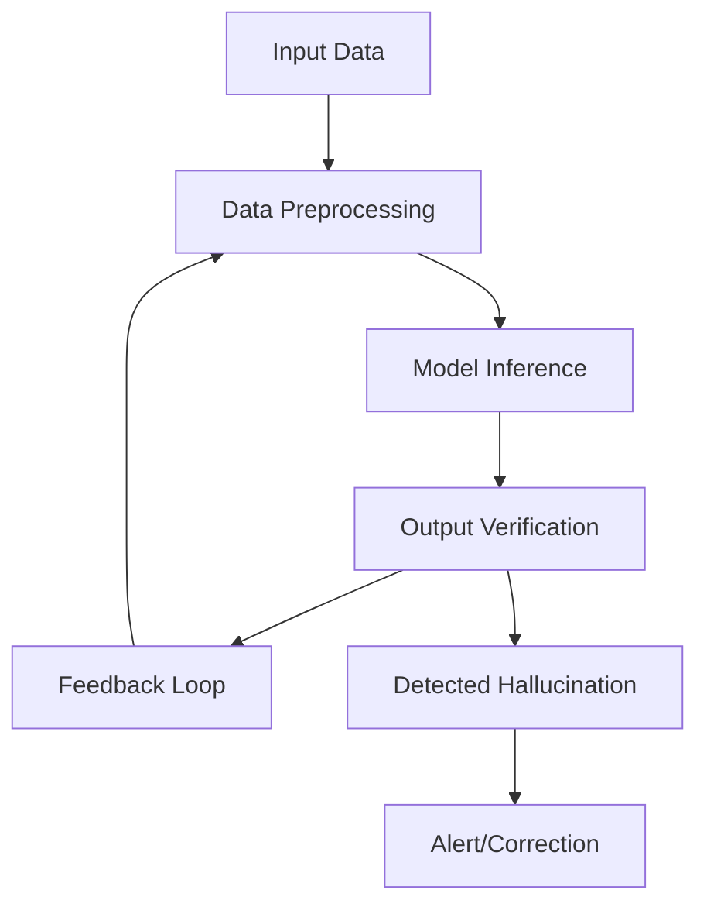

# Lesson 1: Methods for Detecting Hallucination

## 1. First-Principles Intuition & Invariants

In the realm of artificial intelligence, the concept of "hallucination" refers to the generation of outputs by an AI model that are factually incorrect, inconsistent, or entirely fabricated. These hallucinations can arise from a variety of sources, including the model's training data, architectural design, and the nature of the input prompts. Understanding and detecting hallucinations is crucial for ensuring the reliability and trustworthiness of AI systems, particularly in critical applications such as healthcare, finance, and autonomous systems.

At its core, the problem of hallucination detection is rooted in the discrepancy between the model's output and the underlying reality or truth. This discrepancy can be framed as a deviation from the expected behavior of the model, given its training and the nature of the input. To formally define this, we can consider the output of an AI model as a function \( f: X \rightarrow Y \), where \( X \) is the input space and \( Y \) is the output space. The goal of hallucination detection is to identify instances where \( f(x) \) diverges significantly from the true or expected output \( y^* \in Y \).

One of the key invariants in hallucination detection is the consistency of the model's output with external knowledge bases and factual data. This consistency can be mathematically formalized through the concept of a verification function \( v: Y \rightarrow \{0, 1\} \), where \( v(y) = 1 \) if the output \( y \) is consistent with the external knowledge base, and \( v(y) = 0 \) otherwise. The challenge lies in designing and implementing verification functions that are both comprehensive and efficient, capable of handling the vast and diverse nature of AI outputs.

Another invariant is the coherence of the model's output within the context of the input prompt. This coherence can be assessed through the concept of semantic similarity, where the output \( y \) should semantically align with the input \( x \). Semantic similarity can be measured using various techniques, such as cosine similarity on word embeddings, syntactic parsing, and semantic role labeling. The key is to ensure that the model's output maintains a logical and coherent relationship with the input, reflecting the intended meaning and context.

## 2. Core Architecture & Mechanics

To dissect the internal mechanisms of hallucination detection, we need to examine the architecture and execution models of AI systems. At a high level, the process of detecting hallucinations involves several key components: data preprocessing, model inference, output verification, and feedback loops.

### Data Preprocessing

Data preprocessing is the initial stage where the input data is transformed into a format suitable for model inference. This stage involves tasks such as tokenization, normalization, and feature extraction. The quality and consistency of the preprocessed data are critical for the accuracy of the model's output. For instance, if the input data contains inconsistencies or errors, the model may generate outputs that are factually incorrect.

### Model Inference

Model inference is the core stage where the AI model generates an output based on the preprocessed input. This stage involves the execution of the model's architecture, which can be a neural network, a decision tree, or any other machine learning algorithm. The model's architecture plays a significant role in determining the likelihood of hallucinations. For example, deep neural networks with many layers and parameters are more prone to generating outputs that are difficult to verify, as they can learn complex and abstract representations that may not align with external knowledge bases.

### Output Verification

Output verification is the stage where the generated output is checked for consistency and coherence. This stage involves the application of verification functions and semantic similarity measures to assess the quality of the output. The verification functions can be based on external knowledge bases, such as databases, ontologies, or rule-based systems. The semantic similarity measures can be based on natural language processing techniques, such as word embeddings, syntactic parsing, and semantic role labeling.

To illustrate the architecture of hallucination detection, we can use a Mermaid diagram:

In this diagram, the input data is preprocessed and fed into the model for inference. The output is then verified for consistency and coherence. If a hallucination is detected, an alert or correction is generated, and the feedback loop is used to update the model's training data and parameters.

### Feedback Loops

Feedback loops are a critical component of hallucination detection, as they allow the system to learn from detected hallucinations and improve its accuracy over time. Feedback loops can be implemented using various techniques, such as active learning, reinforcement learning, and online learning. Active learning involves selecting a subset of the detected hallucinations for manual verification and using the verified outputs to update the model's training data. Reinforcement learning involves rewarding the model for generating outputs that are consistent with external knowledge bases and penalizing the model for generating outputs that are factually incorrect. Online learning involves updating the model's parameters in real-time based on the detected hallucinations.

## 3. High-Performance Optimization & Failure Modes

To ensure the high performance and reliability of hallucination detection systems, several optimization techniques and failure modes need to be considered.

### Concurrency

Concurrency is a critical aspect of hallucination detection, as it allows the system to handle multiple inputs and outputs simultaneously. Concurrency can be achieved through parallel processing, distributed computing, and multi-threading. Parallel processing involves executing multiple tasks simultaneously on multiple processors or cores. Distributed computing involves executing tasks across multiple machines or nodes in a network. Multi-threading involves executing multiple threads within a single process.

To optimize concurrency, several techniques can be employed, such as load balancing, task scheduling, and resource allocation. Load balancing involves distributing the workload evenly across multiple processors or nodes to ensure that no single processor or node becomes a bottleneck. Task scheduling involves assigning tasks to processors or nodes based on their availability and capabilities. Resource allocation involves allocating resources, such as memory and bandwidth, to processors or nodes based on their needs.

### Resource Scaling

Resource scaling is another critical aspect of hallucination detection, as it allows the system to handle increasing workloads and inputs. Resource scaling can be achieved through horizontal scaling, vertical scaling, and elastic scaling. Horizontal scaling involves adding more processors or nodes to the system to handle increasing workloads. Vertical scaling involves upgrading the processors or nodes to handle increasing workloads. Elastic scaling involves dynamically adjusting the number of processors or nodes based on the workload.

To optimize resource scaling, several techniques can be employed, such as auto-scaling, load balancing, and resource pooling. Auto-scaling involves automatically adding or removing processors or nodes based on the workload. Load balancing involves distributing the workload evenly across multiple processors or nodes to ensure that no single processor or node becomes a bottleneck. Resource pooling involves sharing resources, such as memory and bandwidth, across multiple processors or nodes to improve efficiency.

### Boundary Edge Cases

Boundary edge cases are a critical aspect of hallucination detection, as they can lead to unexpected and incorrect outputs. Boundary edge cases can arise from various sources, such as input data, model architecture, and verification functions. For example, input data can contain outliers or anomalies that are difficult to verify. Model architecture can contain biases or limitations that lead to incorrect outputs. Verification functions can contain errors or inconsistencies that lead to false positives or false negatives.

To handle boundary edge cases, several techniques can be employed, such as robust testing, error handling, and fault tolerance. Robust testing involves testing the system with a wide range of inputs and edge cases to ensure that it handles them correctly. Error handling involves detecting and correcting errors in the input data, model architecture, and verification functions. Fault tolerance involves designing the system to handle failures and errors gracefully, without generating incorrect outputs.

### Failure Mitigations

Failure mitigations are a critical aspect of hallucination detection, as they allow the system to recover from failures and errors. Failure mitigations can be achieved through redundancy, backup, and recovery. Redundancy involves using multiple processors or nodes to handle critical tasks, ensuring that the system can continue to operate even if one processor or node fails. Backup involves creating copies of the system's data and parameters, ensuring that they can be restored in case of a failure. Recovery involves restoring the system's data and parameters from backups, ensuring that the system can continue to operate even if a failure occurs.

To optimize failure mitigations, several techniques can be employed, such as fault injection, stress testing, and disaster recovery. Fault injection involves injecting faults into the system to test its resilience and recovery capabilities. Stress testing involves testing the system under extreme conditions to identify its failure modes and limits. Disaster recovery involves designing and implementing disaster recovery plans to ensure that the system can recover from catastrophic failures.

In conclusion, detecting hallucinations in AI outputs is a complex and challenging problem that requires a deep understanding of the underlying architecture and mechanics of AI systems. By establishing theoretical grounding, dissecting internal data structures and algorithms, and optimizing for concurrency, resource scaling, boundary edge cases, and failure modes, we can build reliable and trustworthy AI systems that generate accurate and consistent outputs.
