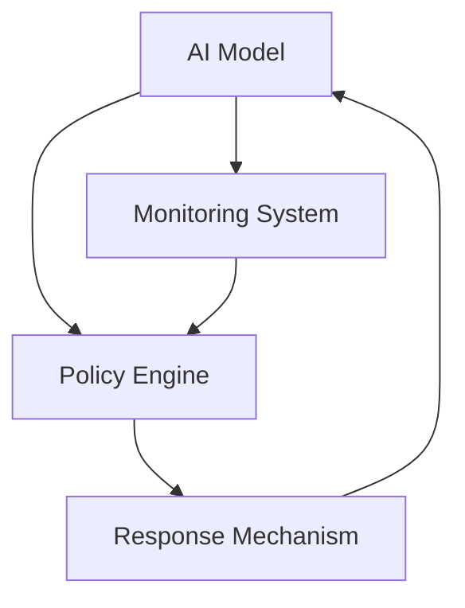

# Lesson 2: Design Principles for AI Guardrails

## 1. First-Principles Intuition & Invariants

The design of AI guardrails is a critical endeavor that intersects the domains of artificial intelligence, software engineering, and ethical computing. At its core, the problem of AI safety and alignment revolves around ensuring that AI systems behave as intended, without causing harm to users, systems, or society at large. This requires a deep understanding of the theoretical underpinnings of AI, the problem space it inhabits, and the invariants that must be maintained to ensure safe and effective operation.

To begin, let us consider the concept of **halting problem** and its implications for AI systems. The halting problem, first articulated by Alan Turing, demonstrates that it is impossible to determine, in general, whether a given program will terminate or run indefinitely. This fundamental limitation has profound implications for AI safety, as it means that we cannot guarantee that an AI system will always halt or behave predictably. Therefore, guardrails must be designed with the understanding that they cannot provide absolute guarantees but rather probabilistic assurances and fail-safes.

Another critical invariant in AI guardrails is the principle of **transparency and explainability**. As AI systems become more complex and autonomous, the ability to understand and explain their decision-making processes becomes paramount. Guardrails should be designed to provide insights into the internal workings of AI models, enabling developers and users to audit and validate the system's behavior. This transparency is essential for building trust and ensuring that AI systems operate in a manner that aligns with human values and ethical standards.

Furthermore, the principle of **robustness to adversarial attacks** is a cornerstone of AI guardrails. AI systems are often vulnerable to adversarial inputs that can manipulate their behavior, leading to unintended consequences. Guardrails must be designed to detect and mitigate such attacks, ensuring that AI systems remain resilient and reliable in the face of malicious intent.

Lastly, the principle of **scalability and performance** is crucial for the practical deployment of AI guardrails. As AI systems are integrated into larger, distributed systems, guardrails must be able to scale efficiently, maintaining performance and reliability across diverse environments. This requires a deep understanding of concurrency, resource management, and failure modes, ensuring that guardrails do not become bottlenecks or points of failure in the overall system architecture.

## 2. Core Architecture & Mechanics

The architecture of AI guardrails is a complex and multifaceted system that integrates various components to ensure the safe and effective operation of AI models. At a high level, guardrails can be conceptualized as a layer of abstraction that sits between the AI model and its environment, enforcing a set of rules and constraints to prevent harmful behavior.

To illustrate this, let us consider a simplified architecture of an AI guardrail system. The core components of this architecture include:

- **Policy Engine:** The policy engine is responsible for defining and enforcing a set of rules and constraints that govern the behavior of AI models. These rules can be based on a variety of criteria, such as ethical guidelines, legal requirements, or operational constraints. The policy engine must be flexible and adaptable, allowing for the dynamic adjustment of rules in response to changing conditions or new threats.

- **Monitoring System:** The monitoring system is responsible for continuously observing the behavior of AI models and detecting any violations of the defined policies. This involves the collection and analysis of various metrics, such as model outputs, system performance, and user interactions. The monitoring system must be capable of detecting subtle anomalies and providing real-time alerts to the policy engine.

- **Response Mechanism:** The response mechanism is responsible for taking corrective action when a policy violation is detected. This can involve a variety of actions, such as halting the AI model, logging the incident, or notifying human operators. The response mechanism must be designed to be both effective and efficient, minimizing the impact on system performance while ensuring that policy violations are addressed promptly.

To visualize this architecture, we can use a Mermaid diagram:

In this diagram, the AI model interacts with both the policy engine and the monitoring system. The policy engine defines and enforces rules, while the monitoring system continuously observes the model's behavior. When a policy violation is detected, the monitoring system alerts the policy engine, which then triggers the response mechanism to take corrective action.

## 3. High-Performance Optimization & Failure Modes

The design of AI guardrails must take into account the high-performance requirements and potential failure modes of AI systems. As AI models become more complex and integrated into larger systems, guardrails must be able to scale efficiently, maintain performance, and handle failures gracefully.

One of the key challenges in designing high-performance guardrails is the need to balance the overhead of monitoring and enforcing policies with the performance of the AI model. This requires a deep understanding of concurrency and resource management, ensuring that guardrails do not become bottlenecks or points of failure in the overall system architecture.

To address this challenge, guardrails can be designed to leverage parallel processing and distributed computing techniques. For example, the monitoring system can be distributed across multiple nodes, allowing for parallel analysis of model outputs and system metrics. Similarly, the policy engine can be designed to use efficient data structures and algorithms, minimizing the overhead of enforcing rules.

Another critical aspect of high-performance guardrails is the ability to handle failures gracefully. AI systems are often subject to a variety of failure modes, such as hardware malfunctions, software bugs, or network disruptions. Guardrails must be designed to detect and recover from these failures, ensuring that the AI model remains operational and reliable.

To illustrate this, let us consider a scenario where the monitoring system experiences a failure. In this case, the guardrails can be designed to use a failover mechanism, switching to a backup monitoring system to continue observing the AI model's behavior. Similarly, the policy engine can be designed to use a redundancy mechanism, ensuring that policy violations are detected and addressed even in the event of a failure.

In summary, the design of AI guardrails is a complex and multifaceted endeavor that requires a deep understanding of the theoretical underpinnings of AI, the problem space it inhabits, and the invariants that must be maintained to ensure safe and effective operation. By grounding guardrails in first-principles intuition and invariants, designing a robust architecture, and optimizing for high performance and failure modes, we can build AI systems that are safe, reliable, and aligned with human values.
