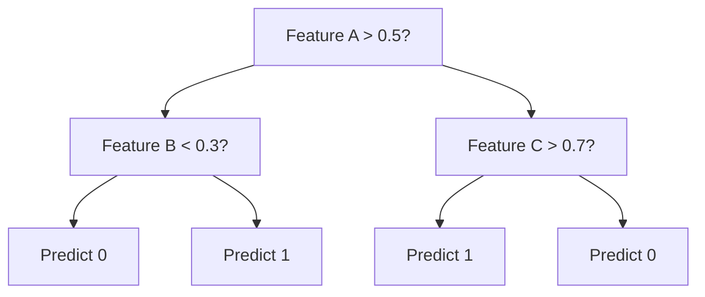

# Lesson 1: Model Decomposition Techniques

## 1. First-Principles Intuition & Invariants

Understanding the inner workings of artificial intelligence (AI) models is a critical step towards ensuring their reliability, fairness, and alignment with human values. In the realm of AI safety and alignment, the ability to decompose complex models into interpretable components is not merely a technical necessity but a moral imperative. It allows stakeholders to scrutinize the decision-making processes of AI systems, fostering trust and accountability.

At the heart of model decomposition lies the principle of modularity. Just as a well-designed software system is composed of modular components that interact through well-defined interfaces, AI models can be dissected into interpretable subcomponents that reveal their underlying mechanisms. This approach is grounded in the mathematical and system invariants that govern the behavior of AI models, such as the linearity of linear models, the decision boundaries of decision trees, and the activation functions of neural networks.

The problem space of model interpretability is multifaceted, encompassing both the technical challenges of decomposing complex models and the ethical considerations of ensuring that these models are transparent and accountable. A key invariant in this space is the trade-off between model complexity and interpretability. While more complex models often achieve higher predictive accuracy, they can become opaque, making it difficult to understand how they arrive at their predictions. Conversely, simpler models may be more interpretable but may not capture the nuances of the data, leading to suboptimal performance.

To address this trade-off, model decomposition techniques aim to strike a balance between complexity and interpretability by breaking down complex models into interpretable components. This process involves identifying the key features and decision rules that contribute to the model's predictions, as well as understanding how these components interact to produce the final output. By doing so, model decomposition techniques provide insights into the inner workings of AI models, enabling stakeholders to assess their fairness, reliability, and alignment with human values.

## 2. Core Architecture & Mechanics

The architecture of AI models plays a crucial role in their interpretability. Different types of models, such as linear models, decision trees, and neural networks, have distinct internal data structures and execution models that influence their interpretability. In this section, we will dissect the internal architecture of these models and explore the mechanisms that govern their behavior.

### Linear Models

Linear models are among the simplest and most interpretable types of AI models. They represent the relationship between input features and output predictions as a linear combination of the input features, weighted by a set of coefficients. The mathematical representation of a linear model is given by the equation:

\[ y = \beta_0 + \beta_1 x_1 + \beta_2 x_2 + \ldots + \beta_n x_n \]

where \( y \) is the output prediction, \( x_1, x_2, \ldots, x_n \) are the input features, and \( \beta_0, \beta_1, \ldots, \beta_n \) are the coefficients.

The interpretability of linear models stems from their simplicity and transparency. The coefficients of the model provide a direct measure of the influence of each input feature on the output prediction. A positive coefficient indicates that an increase in the corresponding input feature leads to an increase in the output prediction, while a negative coefficient indicates the opposite. By examining the coefficients of a linear model, stakeholders can gain insights into the key features that drive the model's predictions.

### Decision Trees

Decision trees are another type of interpretable AI model that represent the decision-making process as a tree-like structure. Each internal node of the tree corresponds to a decision based on a feature, and each leaf node corresponds to a prediction. The execution model of a decision tree involves traversing the tree from the root node to a leaf node based on the input features, and returning the prediction associated with the leaf node.

The interpretability of decision trees stems from their tree-like structure, which provides a clear and intuitive representation of the decision-making process. By examining the decision rules at each internal node, stakeholders can gain insights into the key features and thresholds that drive the model's predictions. Additionally, decision trees can be visualized using ASCII or Mermaid diagrams, which provide a graphical representation of the tree structure.

### Neural Networks

Neural networks are among the most complex and powerful types of AI models, but they are also among the least interpretable. They consist of multiple layers of interconnected nodes, where each node applies a nonlinear activation function to a weighted sum of its inputs. The execution model of a neural network involves propagating the input features through the layers of the network, applying the activation functions at each node, and returning the output prediction.

The interpretability of neural networks is a challenging problem, as the decision-making process is distributed across multiple layers of interconnected nodes. However, model decomposition techniques can be used to break down neural networks into interpretable components. One such technique is the use of feature importance scores, which provide a measure of the influence of each input feature on the output prediction. Feature importance scores can be computed using various methods, such as permutation importance, SHAP values, and LIME.

Another technique for decomposing neural networks is the use of layer-wise relevance propagation (LRP), which provides a measure of the contribution of each node in the network to the output prediction. LRP involves propagating the output prediction back through the layers of the network, assigning relevance scores to each node based on its contribution to the output prediction. By examining the relevance scores of the nodes in a neural network, stakeholders can gain insights into the key features and decision rules that drive the model's predictions.

## 3. High-Performance Optimization & Failure Modes

Model decomposition techniques can be used not only to improve the interpretability of AI models but also to optimize their performance and mitigate failure modes. In this section, we will explore the concurrency, resource scaling, boundary edge cases, and failure mitigations associated with model decomposition techniques.

### Concurrency

Model decomposition techniques can be used to improve the concurrency of AI models by breaking them down into parallelizable components. For example, decision trees can be parallelized by evaluating the decision rules at each internal node in parallel, and neural networks can be parallelized by evaluating the nodes in each layer in parallel. By leveraging parallel processing, model decomposition techniques can improve the performance of AI models, enabling them to handle larger datasets and more complex decision-making processes.

### Resource Scaling

Model decomposition techniques can also be used to improve the resource scaling of AI models by breaking them down into components that can be distributed across multiple resources. For example, decision trees can be distributed across multiple nodes in a cluster, and neural networks can be distributed across multiple GPUs. By leveraging distributed processing, model decomposition techniques can improve the scalability of AI models, enabling them to handle larger datasets and more complex decision-making processes.

### Boundary Edge Cases

Model decomposition techniques can be used to identify and mitigate boundary edge cases in AI models by breaking them down into interpretable components. For example, decision trees can be analyzed to identify the decision rules that correspond to boundary edge cases, and neural networks can be analyzed to identify the nodes that correspond to boundary edge cases. By examining the decision rules and nodes associated with boundary edge cases, stakeholders can gain insights into the behavior of AI models in these cases and mitigate potential failures.

### Failure Mitigations

Model decomposition techniques can be used to mitigate failures in AI models by breaking them down into interpretable components. For example, decision trees can be analyzed to identify the decision rules that correspond to potential failures, and neural networks can be analyzed to identify the nodes that correspond to potential failures. By examining the decision rules and nodes associated with potential failures, stakeholders can gain insights into the behavior of AI models in these cases and mitigate potential failures.

In conclusion, model decomposition techniques are a powerful tool for improving the interpretability, performance, and reliability of AI models. By breaking down complex models into interpretable components, stakeholders can gain insights into the inner workings of AI models, assess their fairness, reliability, and alignment with human values, and mitigate potential failures. As the field of AI continues to evolve, model decomposition techniques will play an increasingly important role in ensuring the safety and alignment of AI systems.
