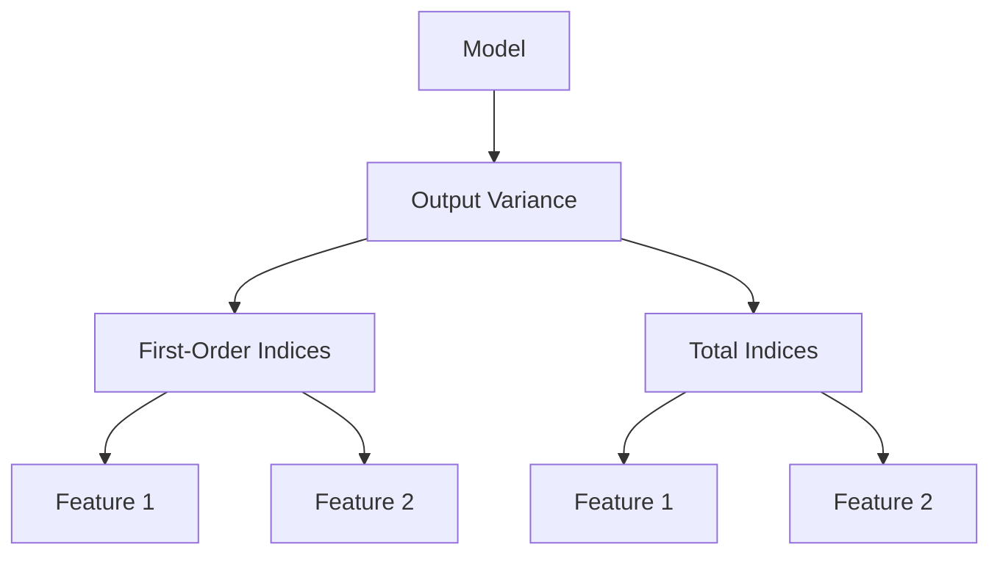

# Lesson 2: Feature Importance and Sensitivity Analysis

## 1. First-Principles Intuition & Invariants

In the realm of artificial intelligence and machine learning, understanding the mechanisms by which models make predictions is paramount. This understanding not only aids in the development of more robust and reliable systems but also ensures that these systems align with human values and ethical standards. At the heart of this endeavor lies the concept of feature importance and sensitivity analysis, which provide insights into the influence of individual input features on model predictions.

Feature importance and sensitivity analysis are critical for several reasons. Firstly, they help in identifying the most influential features, which can guide feature selection and engineering efforts, thereby improving model performance and reducing computational overhead. Secondly, they offer a means to interpret model predictions, making it easier to explain the decision-making process to stakeholders and ensuring transparency. Lastly, these analyses can highlight potential biases and vulnerabilities in the model, enabling proactive mitigation strategies.

From a theoretical standpoint, feature importance can be understood through the lens of information theory and statistical dependence. Information theory provides a framework for quantifying the amount of information that one random variable (the feature) contains about another (the prediction). Mutual information, a key concept in this framework, measures the reduction in uncertainty about the prediction when the feature is known. Mathematically, mutual information \( I(X;Y) \) between two random variables \( X \) and \( Y \) is defined as:

\[
I(X;Y) = \sum_{x \in X} \sum_{y \in Y} p(x, y) \log \frac{p(x, y)}{p(x)p(y)}
\]

This equation captures the joint probability distribution \( p(x, y) \) of the feature and prediction, as well as their marginal distributions \( p(x) \) and \( p(y) \). High mutual information indicates a strong relationship between the feature and the prediction, suggesting that the feature is important.

Sensitivity analysis, on the other hand, focuses on how small changes in input features affect model predictions. This is particularly useful for understanding the robustness of the model and identifying features that can lead to significant changes in predictions. Sensitivity analysis can be performed using various techniques, such as local sensitivity analysis, which examines the impact of small perturbations around a specific input point, and global sensitivity analysis, which considers the entire input space.

The invariants in feature importance and sensitivity analysis lie in their ability to provide consistent and reliable insights across different models and datasets. These methods should be robust to variations in data distribution and model architecture, ensuring that the identified features and sensitivities are meaningful and actionable.

## 2. Core Architecture & Mechanics

To delve deeper into the mechanics of feature importance and sensitivity analysis, we will explore two popular methods: permutation feature importance and Sobol sensitivity analysis.

### Permutation Feature Importance

Permutation feature importance is a model-agnostic technique that assesses the importance of a feature by measuring the decrease in model performance when the values of that feature are randomly shuffled. The intuition behind this method is that if a feature is important, shuffling its values should degrade the model's performance significantly.

The process of computing permutation feature importance involves the following steps:

1. **Train the Model:** Start by training a predictive model on the dataset.
2. **Evaluate Baseline Performance:** Measure the performance of the model on a validation set using a suitable metric (e.g., accuracy, mean squared error).
3. **Shuffle Feature Values:** For each feature, shuffle its values in the validation set while keeping the values of other features unchanged.
4. **Evaluate Performance with Shuffled Feature:** Measure the performance of the model on the validation set with the shuffled feature.
5. **Compute Importance Score:** The importance score for a feature is the decrease in performance when the feature is shuffled. This score is averaged over multiple shuffling iterations to ensure stability.

Permutation feature importance is straightforward to implement and can be applied to any predictive model, regardless of its architecture. However, it can be computationally expensive, especially for large datasets and models with many features.

### Sobol Sensitivity Analysis

Sobol sensitivity analysis is a global sensitivity analysis method that quantifies the contribution of each input feature to the variance of the model output. This method is based on the decomposition of the variance of the output into contributions from individual features and their interactions.

The Sobol sensitivity indices are defined as follows:

- **First-Order Index (\( S_i \)):** Measures the main effect of the \( i \)-th feature on the output variance.
- **Total Index (\( S_{Ti} \)):** Measures the total effect of the \( i \)-th feature, including its interactions with other features.

The Sobol indices are computed using the following equations:

\[
S_i = \frac{V_i}{V_Y}
\]

\[
S_{Ti} = 1 - \frac{V_{Y|X_i}}{V_Y}
\]

where \( V_i \) is the variance of the output with respect to the \( i \)-th feature, \( V_Y \) is the total variance of the output, and \( V_{Y|X_i} \) is the variance of the output with the \( i \)-th feature fixed.

Sobol sensitivity analysis is particularly useful for models with complex interactions between features, as it provides insights into both main effects and interaction effects. However, it requires a large number of model evaluations to estimate the sensitivity indices accurately, which can be computationally intensive.

To illustrate the mechanics of Sobol sensitivity analysis, consider a simple example using a Mermaid diagram:

In this diagram, the model's output variance is decomposed into first-order and total indices for each feature. The first-order indices represent the main effects of the features, while the total indices account for both main effects and interactions.

## 3. High-Performance Optimization & Failure Modes

When implementing feature importance and sensitivity analysis, several considerations must be taken into account to ensure high performance and reliability.

### Concurrency and Resource Scaling

For large datasets and complex models, the computation of feature importance and sensitivity indices can be resource-intensive. To optimize performance, concurrency and parallelization techniques can be employed. For example, permutation feature importance can be parallelized by shuffling and evaluating multiple features simultaneously across different threads or processes. Similarly, Sobol sensitivity analysis can benefit from parallel evaluations of the model for different input samples.

Resource scaling is another critical aspect of high-performance optimization. Cloud-based computing resources can be leveraged to distribute the computational load across multiple machines, thereby reducing the time required for analysis. Additionally, efficient data structures and algorithms can be used to minimize memory usage and improve cache performance.

### Boundary Edge Cases and Failure Mitigations

Feature importance and sensitivity analysis are not immune to boundary edge cases and potential failures. For instance, permutation feature importance may produce unreliable results if the validation set is too small or if the model is overfitting. To mitigate these issues, it is essential to ensure that the validation set is representative of the entire dataset and that the model is properly regularized.

Sobol sensitivity analysis can also encounter challenges, particularly when dealing with high-dimensional input spaces. In such cases, the number of model evaluations required to estimate the sensitivity indices can become prohibitively large. To address this, dimensionality reduction techniques can be applied to reduce the input space before performing sensitivity analysis.

Another potential failure mode arises when the model's predictions are highly sensitive to noise or outliers in the input data. In such cases, feature importance and sensitivity analysis may identify features that are not truly important but rather correlate with noise. To mitigate this, robust statistical techniques can be employed to filter out noise and outliers before performing the analysis.

In conclusion, feature importance and sensitivity analysis are powerful tools for understanding the mechanisms by which machine learning models make predictions. By providing insights into the influence of individual input features, these methods enable the development of more robust, interpretable, and aligned AI systems. Through a combination of theoretical grounding, practical implementation, and optimization techniques, these methods can be effectively applied to a wide range of models and datasets.
