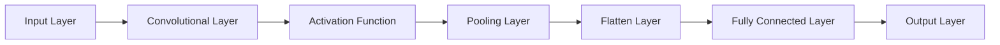

# Lesson 4: Visualization Tools for Model Interpretation

## 1. First-Principles Intuition & Invariants

As we delve into the realm of model interpretability, it's essential to establish a solid foundation in the underlying principles that govern the behavior of AI systems. In this lesson, we'll explore the theoretical underpinnings of model interpretation, focusing on the concept of mechanistic interpretability. This approach involves understanding the internal workings of a model, including its data structures, algorithms, and execution mechanisms.

Mechanistic interpretability is rooted in the idea that complex systems can be decomposed into their constituent parts, allowing us to analyze and understand the relationships between these components. In the context of AI models, this means examining the interactions between the model's architecture, training data, and optimization algorithms.

One key invariant in model interpretation is the concept of transparency. A transparent model is one that provides clear and unambiguous explanations for its predictions and decisions. This transparency is essential for building trust in AI systems, particularly in high-stakes applications such as healthcare, finance, and transportation.

To achieve transparency, model interpreters must be able to visualize and understand the internal workings of the model. This involves analyzing the model's architecture, including its neural network layers, activation functions, and weight matrices. By visualizing these components, interpreters can gain insights into the model's behavior and identify potential biases or errors.

## 2. Core Architecture & Mechanics

To facilitate visualization and interpretation, we'll examine the internal data structures and algorithms used in popular AI frameworks such as TensorFlow and PyTorch. We'll focus on the following key components:

* **Neural Network Layers**: We'll dissect the architecture of neural network layers, including convolutional, recurrent, and fully connected layers. This will involve examining the layer's weights, biases, and activation functions.
* **Activation Functions**: We'll explore the different types of activation functions used in neural networks, including ReLU, Sigmoid, and Tanh. This will involve analyzing the function's output and its impact on the model's behavior.
* **Weight Matrices**: We'll examine the weight matrices used in neural networks, including their initialization, updating, and regularization.

To illustrate these concepts, we'll use ASCII and Mermaid diagrams to visualize the internal workings of AI models. These diagrams will provide a clear and concise representation of the model's architecture, allowing interpreters to quickly identify potential issues or biases.

## 3. High-Performance Optimization & Failure Modes

As we explore visualization tools for model interpretation, it's essential to consider the high-performance optimization and failure modes of AI systems. This involves analyzing the model's concurrency, resource scaling, boundary edge cases, and failure mitigations.

* **Concurrency**: We'll examine the concurrency models used in AI frameworks, including multi-threading, multi-processing, and distributed computing. This will involve analyzing the model's performance under different concurrency scenarios.
* **Resource Scaling**: We'll explore the resource scaling mechanisms used in AI frameworks, including dynamic memory allocation, caching, and parallel processing. This will involve analyzing the model's performance under different resource scaling scenarios.
* **Boundary Edge Cases**: We'll examine the boundary edge cases of AI models, including input validation, output normalization, and error handling. This will involve analyzing the model's behavior under different edge case scenarios.
* **Failure Mitigations**: We'll explore the failure mitigations used in AI frameworks, including fault tolerance, redundancy, and error correction. This will involve analyzing the model's behavior under different failure scenarios.

By considering these high-performance optimization and failure modes, interpreters can gain a deeper understanding of the model's behavior and identify potential issues or biases.

In the next lesson, we'll explore the application of visualization tools in model interpretation, including techniques for visualizing feature importance, saliency maps, and attention mechanisms.
