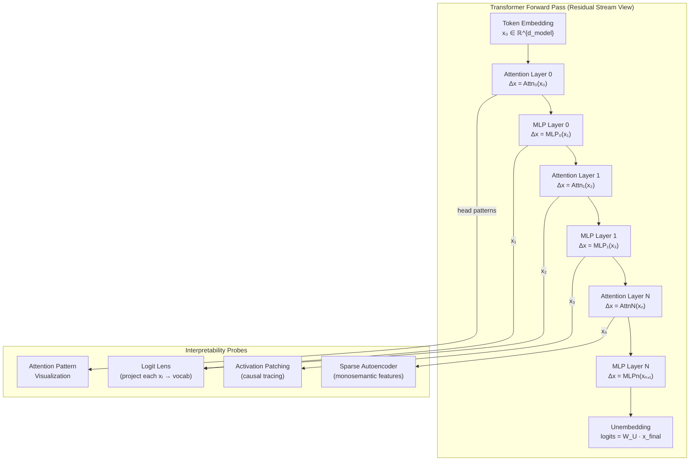
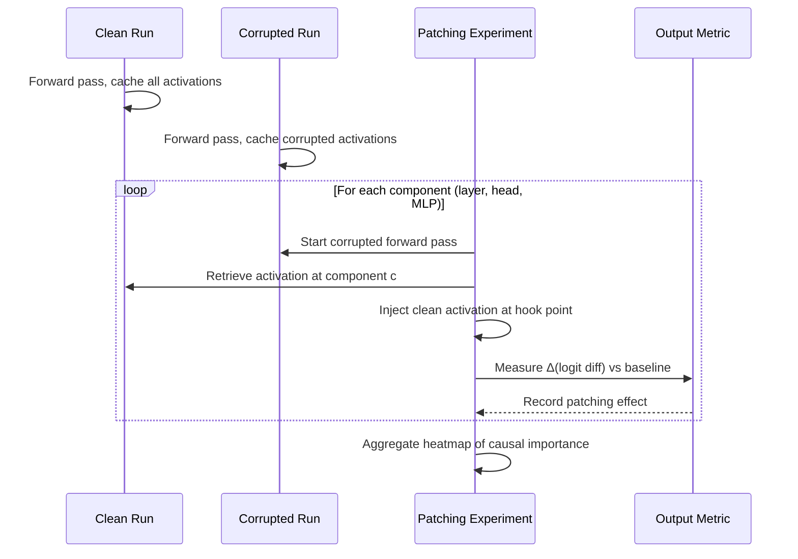
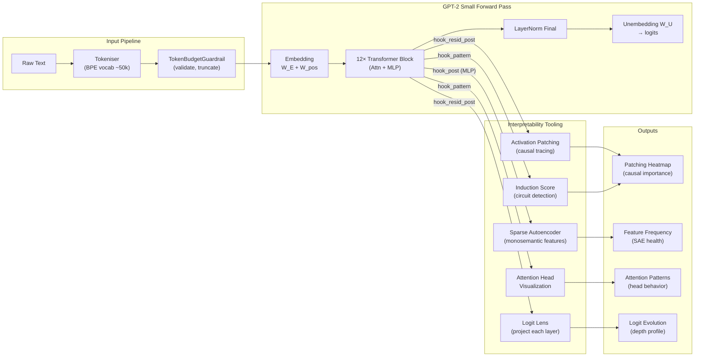

# Operational Verification Labs: 04 — Mechanistic Interpretability

## Theoretical Foundations

Mechanistic interpretability is the sub-field of AI safety research concerned with reverse-engineering the learned algorithms inside neural networks. Rather than treating a model as a black box and correlating inputs to outputs (the domain of behavioral evaluation), mechanistic interpretability asks: *what computational primitive does each weight, neuron, attention head, or circuit implement?*

The field rests on a core empirical conjecture: **the superposition hypothesis**. Neural networks trained on more features than they have dimensions represent many features as nearly-orthogonal directions in activation space, exploiting the exponential number of nearly-orthogonal vectors available in high-dimensional space. This means features are not cleanly localized to individual neurons. Identifying them requires linear probing, sparse dictionary learning (e.g., Sparse Autoencoders), and direct circuit tracing through the residual stream.

The **residual stream** in a transformer is architecturally central. Each attention layer and MLP layer reads from and writes to a shared residual stream `x ∈ ℝ^{d_model}`. The final representation is thus:

```text
x_final = x_embed + Σ_l (Attn_l(x_l) + MLP_l(x_l))
```

Each layer's contribution is an *additive* delta. This additivity is what makes techniques like logit lens, attention pattern decomposition, and activation patching tractable—you can intervene on individual deltas without reconstructing the whole forward pass.

Key concepts used throughout this lab:

- **Attention head decomposition**: each head computes `h = softmax(QKᵀ/√d_k)V`, projecting through `W_O` back to `d_model`. Heads are interpretable units; specific heads have been shown to implement induction, previous-token copying, and subject–object binding.
- **Activation patching (causal tracing)**: run the model on a corrupted input, then restore individual activations from the clean run, measuring how much of the original output is recovered. This identifies *which* components carry a specific piece of information.
- **Sparse Autoencoders (SAEs)**: a linear encoder–decoder `f(x) = ReLU(W_enc x + b_enc)`, `x̂ = W_dec f(x)`, trained with an L1 sparsity penalty. The learned dictionary vectors correspond to monosemantic features—single, human-interpretable concepts.
- **Logit lens**: project the residual stream at each layer directly through the unembedding matrix `W_U` to observe how predictions evolve through depth.



---

## Environment Setup

This lab uses **TransformerLens** (formerly EasyTransformer, by Neel Nanda), which is the standard research library for mechanistic interpretability. It provides direct access to the residual stream, all intermediate activations via hooks, and head-decomposed attention patterns. The original material's reference to `ollama.Interpreter` does not exist as a mechanistic interpretability API—that has been removed and replaced with correct tooling.

```bash
# Python 3.11+ required
python -m venv .venv && source .venv/bin/activate

pip install \
    transformer-lens==1.19.0 \
    torch==2.3.0 \
    einops==0.7.0 \
    jaxtyping==0.2.28 \
    circuitsvis==1.4.8 \
    matplotlib==3.9.0 \
    numpy==1.26.4 \
    scikit-learn==1.5.0 \
    tqdm==4.66.4 \
    datasets==2.19.1
```

`transformer_lens` wraps HuggingFace models with activation caching, hook points, and utilities for all major GPT-family and BERT-family architectures. `circuitsvis` renders attention patterns as interactive HTML. `einops` provides readable tensor rearrangements.

Verify your install:

```python
import transformer_lens
import torch
print(f"TransformerLens: {transformer_lens.__version__}")
print(f"PyTorch: {torch.__version__}")
print(f"CUDA available: {torch.cuda.is_available()}")
```

---

## Exercise 1: Loading a Model and Navigating the Residual Stream

We use `gpt2-small` (117M parameters, 12 layers, 12 heads, d_model=768) as our canonical study subject. This model is fully mechanistically characterized in the literature, making it ideal for ground-truth validation.

### 1.1 — Model Loading and Hook Architecture

```python
"""
exercise1_residual_stream.py
Mechanistic interpretability: residual stream inspection via TransformerLens.
"""

import torch
import numpy as np
import matplotlib.pyplot as plt
import matplotlib.ticker as ticker
from transformer_lens import HookedTransformer, utils
from transformer_lens.hook_points import HookPoint
from jaxtyping import Float, Int
from typing import List, Tuple

# ── Device selection ────────────────────────────────────────────────────────
device = torch.device("cuda" if torch.cuda.is_available() else "cpu")
print(f"Using device: {device}")

# ── Load GPT-2 small via TransformerLens ────────────────────────────────────
# TransformerLens normalises all weights to a canonical format and exposes
# hook points at every activation site in the network.
model = HookedTransformer.from_pretrained(
    "gpt2",
    center_writing_weights=True,   # center weights writing to residual stream
    center_unembed=True,            # center W_U so mean logit = 0
    fold_ln=True,                   # fold LayerNorm into adjacent weights
    refactor_factored_attn_matrices=True,  # decompose W_QK, W_OV
)
model.to(device)
model.eval()

# Model configuration summary
cfg = model.cfg
print(f"\nModel architecture:")
print(f"  Layers (n_layers):       {cfg.n_layers}")
print(f"  Attention heads:         {cfg.n_heads}")
print(f"  d_model:                 {cfg.d_model}")
print(f"  d_head:                  {cfg.d_head}")
print(f"  d_mlp:                   {cfg.d_mlp}")
print(f"  Vocabulary size:         {cfg.d_vocab}")
print(f"  Context window:          {cfg.n_ctx}")

# ── Tokenisation ────────────────────────────────────────────────────────────
prompt = "When Mary and John went to the store, John gave a drink to"
tokens = model.to_tokens(prompt)                   # shape: [1, seq_len]
token_strs = model.to_str_tokens(prompt)
print(f"\nTokens: {token_strs}")
print(f"Token tensor shape: {tokens.shape}")

# ── Full forward pass with activation caching ───────────────────────────────
# run_with_cache returns (logits, cache). The cache stores every intermediate
# activation at every hook point in the model.
logits, cache = model.run_with_cache(tokens, remove_batch_dim=True)
# logits shape: [seq_len, d_vocab]

# Top-5 predicted next tokens
last_logits = logits[0, -1]  # predictions for the final position
probs = torch.softmax(last_logits, dim=-1)
top5_probs, top5_indices = torch.topk(probs, k=5)
print("\nTop-5 next-token predictions:")
for prob, idx in zip(top5_probs, top5_indices):
    print(f"  {model.to_single_str_token(idx.item())!r:>15} → {prob.item():.4f}")

# ── Logit lens: project each layer's residual stream through W_U ─────────────
# This shows how the model's prediction evolves as information is processed
# through the layers. At each layer l, we examine x_l · W_U to see which
# token the model "would predict" if it stopped here.

def logit_lens(
    cache,
    model: HookedTransformer,
    position: int = -1,
) -> Tuple[np.ndarray, List[str]]:
    """
    Project the residual stream at each layer through the unembedding matrix.
    Returns the top-1 token string and its probability at every layer.
    """
    layer_preds = []
    layer_probs = []
    n_layers = model.cfg.n_layers

    for layer in range(n_layers):
        # Residual stream after MLP (post-layer normalisation)
        resid = cache[f"blocks.{layer}.hook_resid_post"][position]  # [d_model]
        # Apply final layer norm (fold_ln=True means LN params are folded,
        # but the final LN before unembedding must be applied explicitly)
        resid_normed = model.ln_final(resid.unsqueeze(0).unsqueeze(0)).squeeze()
        logit_vec = resid_normed @ model.W_U + model.b_U  # [d_vocab]
        probs = torch.softmax(logit_vec, dim=-1)
        top_token_id = probs.argmax().item()
        layer_preds.append(model.to_single_str_token(top_token_id))
        layer_probs.append(probs[top_token_id].item())

    return np.array(layer_probs), layer_preds


probs_by_layer, preds_by_layer = logit_lens(cache, model, position=-1)

print("\nLogit lens (final token position):")
print(f"  {'Layer':>6}  {'Prediction':>15}  {'Probability':>12}")
print(f"  {'-'*6}  {'-'*15}  {'-'*12}")
for l, (pred, prob) in enumerate(zip(preds_by_layer, probs_by_layer)):
    print(f"  {l:>6}  {pred!r:>15}  {prob:>12.4f}")

# ── Visualise logit lens probabilities ──────────────────────────────────────
fig, ax = plt.subplots(figsize=(10, 4))
ax.bar(range(cfg.n_layers), probs_by_layer, color="steelblue", alpha=0.8)
ax.set_xlabel("Layer")
ax.set_ylabel("Probability of top-1 predicted token")
ax.set_title(f"Logit Lens — GPT-2 Small\nFinal position, prompt: \"{prompt[:40]}…\"")
ax.set_xticks(range(cfg.n_layers))
ax.yaxis.set_major_formatter(ticker.PercentFormatter(xmax=1.0))
for i, (prob, pred) in enumerate(zip(probs_by_layer, preds_by_layer)):
    ax.text(i, prob + 0.005, pred.strip(), ha="center", va="bottom",
            fontsize=7, rotation=45)
plt.tight_layout()
plt.savefig("logit_lens.png", dpi=150)
plt.close()
print("\nLogit lens plot saved to logit_lens.png")
```

### 1.2 — Attention Pattern Visualization

Attention patterns are the primary human-interpretable component of transformers. We examine all 12×12 = 144 heads in GPT-2 small, focusing on the final token position and known interesting heads from the literature.

```python
"""
exercise1_attention_patterns.py
Visualise and characterise attention head patterns in GPT-2 small.
"""

import torch
import numpy as np
import matplotlib.pyplot as plt
import matplotlib.colors as mcolors
from transformer_lens import HookedTransformer
from einops import rearrange

device = torch.device("cuda" if torch.cuda.is_available() else "cpu")
model = HookedTransformer.from_pretrained("gpt2", fold_ln=True,
                                           center_writing_weights=True,
                                           center_unembed=True)
model.to(device).eval()

# The induction circuit: the canonical mechanistic interpretability finding.
# Layer 0, Head 1 (and others) are "previous token heads": they attend to
# the token immediately before the current one.
# Layer 1, Head 10 (L1H10) and L1H4 are "induction heads": they implement
# the [A][B]...[A] → [B] pattern by attending back to the token after the
# previous occurrence of the current token.

INDUCTION_PROMPT = "To be or not to be or not to be"
tokens = model.to_tokens(INDUCTION_PROMPT)
token_strs = model.to_str_tokens(INDUCTION_PROMPT)
_, cache = model.run_with_cache(tokens, remove_batch_dim=True)

def plot_attention_pattern(
    cache,
    layer: int,
    head: int,
    token_strs: list,
    title: str,
    filename: str,
) -> None:
    """Plot the attention pattern for a single (layer, head) pair."""
    # cache["pattern", layer] shape: [n_heads, seq_len, seq_len]
    pattern = cache["pattern", layer][head].cpu().numpy()
    seq_len = len(token_strs)

    fig, ax = plt.subplots(figsize=(8, 7))
    im = ax.imshow(pattern, cmap="Blues", vmin=0.0, vmax=1.0,
                   aspect="auto")
    ax.set_xticks(range(seq_len))
    ax.set_yticks(range(seq_len))
    ax.set_xticklabels(token_strs, rotation=45, ha="right", fontsize=9)
    ax.set_yticklabels(token_strs, fontsize=9)
    ax.set_xlabel("Source (key) tokens")
    ax.set_ylabel("Destination (query) tokens")
    ax.set_title(title)
    plt.colorbar(im, ax=ax, label="Attention probability")
    plt.tight_layout()
    plt.savefig(filename, dpi=150)
    plt.close()
    print(f"Saved {filename}")


# Previous-token head: L0H1
plot_attention_pattern(cache, layer=0, head=1, token_strs=token_strs,
                       title="GPT-2 Small — L0H1 (Previous-Token Head)",
                       filename="attn_L0H1_prev_token.png")

# Induction head: L1H10 — attends to token after previous occurrence
plot_attention_pattern(cache, layer=1, head=10, token_strs=token_strs,
                       title="GPT-2 Small — L1H10 (Induction Head)",
                       filename="attn_L1H10_induction.png")

# ── Measure induction head score across all heads ───────────────────────────
# The induction score for a head is the mean attention to the [A+1] position
# given the current token matches a previous [A] in a repeated-token sequence.

def compute_induction_score(model: HookedTransformer, seq_len: int = 50) -> torch.Tensor:
    """
    Compute the induction score for every (layer, head) in the model.
    Score = mean attention weight on the [i - (period - 1)] position for
    a repeated random token sequence of length 2*seq_len.
    """
    # Create a repeated token sequence: [t₁ t₂ … tₙ t₁ t₂ … tₙ]
    rand_tokens = torch.randint(100, model.cfg.d_vocab, (1, seq_len), device=device)
    repeated = torch.cat([rand_tokens, rand_tokens], dim=1)  # [1, 2*seq_len]

    _, cache = model.run_with_cache(repeated, remove_batch_dim=True)

    n_layers, n_heads = model.cfg.n_layers, model.cfg.n_heads
    scores = torch.zeros(n_layers, n_heads)

    for layer in range(n_layers):
        # pattern: [n_heads, 2*seq_len, 2*seq_len]
        pattern = cache["pattern", layer]
        # For the second half of the sequence (positions seq_len..2*seq_len-1),
        # the induction target is position i - seq_len + 1.
        # We average over these positions.
        for head in range(n_heads):
            head_pattern = pattern[head]  # [2*seq_len, 2*seq_len]
            induction_stripe = torch.diagonal(
                head_pattern[seq_len:, :],
                offset=-(seq_len - 1)
            )
            scores[layer, head] = induction_stripe.mean().item()

    return scores

print("\nComputing induction scores (this may take ~10 seconds)…")
induction_scores = compute_induction_score(model, seq_len=50)

fig, ax = plt.subplots(figsize=(12, 4))
im = ax.imshow(induction_scores.T.numpy(), cmap="RdYlGn", vmin=0, vmax=1,
               aspect="auto")
ax.set_xlabel("Layer")
ax.set_ylabel("Head")
ax.set_title("Induction Head Score — GPT-2 Small\n"
             "(Green = strong induction behaviour)")
ax.set_xticks(range(model.cfg.n_layers))
ax.set_yticks(range(model.cfg.n_heads))
plt.colorbar(im, ax=ax, label="Mean attention on induction stripe")
plt.tight_layout()
plt.savefig("induction_scores.png", dpi=150)
plt.close()
print("Saved induction_scores.png")
print("\nTop induction heads:")
flat_indices = induction_scores.flatten().argsort(descending=True)[:5]
for idx in flat_indices:
    l, h = divmod(idx.item(), model.cfg.n_heads)
    print(f"  L{l}H{h}: score = {induction_scores[l, h]:.4f}")
```

---

## Exercise 2: Activation Patching and Causal Tracing

Activation patching was introduced by Vig et al. (2020) and developed further as causal tracing by Meng et al. (2022) *"Locating and Editing Factual Associations in GPT"*. Wang et al. (2022) *"Interpretability in the Wild"* applied it to analyze the IOI circuit. It is now the gold-standard technique for identifying which components causally mediate a specific model behavior.

The procedure:

1. Run the model on a **clean** input (correct behavior) → save all activations.
2. Run the model on a **corrupted** input (incorrect behavior due to controlled perturbation).
3. For each component `c`, restore its activation from the clean run into the corrupted run, and measure the change in model output.
4. A large recovered performance indicates that component `c` causally mediates the target behavior.



### 2.1 — Indirect Object Identification (IOI) Task

The IOI task (from Wang et al. 2022) is the benchmark circuit analysis problem: given `"When Mary and John went to the store, John gave a drink to"`, the model should predict `" Mary"` (the indirect object), not `" John"` (the subject). This is mechanistically explained by a 26-head circuit.

```python
"""
exercise2_activation_patching.py
Causal tracing via activation patching on the IOI task.
"""

import torch
import numpy as np
import matplotlib.pyplot as plt
from functools import partial
from transformer_lens import HookedTransformer, utils
from transformer_lens.hook_points import HookPoint
from jaxtyping import Float
from typing import Dict, Optional

device = torch.device("cuda" if torch.cuda.is_available() else "cpu")
model = HookedTransformer.from_pretrained("gpt2",
                                           fold_ln=True,
                                           center_writing_weights=True,
                                           center_unembed=True)
model.to(device).eval()

# ── Define clean and corrupted prompt pairs ─────────────────────────────────
# Clean:     model correctly predicts " Mary" (indirect object) at the end
# Corrupted: swap the first occurrence of the indirect object name with a different
#            name so the model no longer has the IO signal

clean_prompt   = "When Mary and John went to the store, John gave a drink to"
corrupt_prompt = "When Alice and John went to the store, John gave a drink to"

# Target: the indirect object token and the subject token
clean_tokens   = model.to_tokens(clean_prompt)
corrupt_tokens = model.to_tokens(corrupt_prompt)

# Token IDs for the two competing predictions
io_token = model.to_single_token(" Mary")   # indirect object
subj_token = model.to_single_token(" John") # subject

print(f"IO token id:      {io_token}  → '{model.to_single_str_token(io_token)}'")
print(f"Subj token id:    {subj_token} → '{model.to_single_str_token(subj_token)}'")

def logit_diff(logits: torch.Tensor, io_id: int, subj_id: int) -> float:
    """
    Compute logit(IO) - logit(Subject) at the final token position.
    Positive = model prefers IO (correct), negative = model prefers Subject.
    """
    final_logits = logits[0, -1]  # [d_vocab]
    return (final_logits[io_id] - final_logits[subj_id]).item()

# Baseline measurements
clean_logits, clean_cache     = model.run_with_cache(clean_tokens)
corrupt_logits, corrupt_cache = model.run_with_cache(corrupt_tokens)

clean_ld   = logit_diff(clean_logits, io_token, subj_token)
corrupt_ld = logit_diff(corrupt_logits, io_token, subj_token)
print(f"\nClean logit diff:    {clean_ld:+.4f}")
print(f"Corrupted logit diff: {corrupt_ld:+.4f}")

# ── Activation patching over all residual stream positions ───────────────────
# For each (layer, sequence position), patch the residual stream from the
# clean run into the corrupted run and measure the recovered logit diff.

def patch_hook(
    corrupted_activation: Float[torch.Tensor, "batch pos d_model"],
    hook: HookPoint,
    pos: int,
    clean_cache: Dict,
) -> Float[torch.Tensor, "batch pos d_model"]:
    """
    Replace the activation at a specific sequence position with the
    corresponding activation from the clean cache.
    """
    corrupted_activation[:, pos, :] = clean_cache[hook.name][:, pos, :]
    return corrupted_activation


seq_len = clean_tokens.shape[1]
n_layers = model.cfg.n_layers
patching_results = torch.zeros(n_layers, seq_len)

print("\nRunning residual stream activation patching…")
for layer in range(n_layers):
    for pos in range(seq_len):
        hook_name = f"blocks.{layer}.hook_resid_post"
        hook_fn = partial(patch_hook, pos=pos, clean_cache=clean_cache)

        patched_logits = model.run_with_hooks(
            corrupt_tokens,
            fwd_hooks=[(hook_name, hook_fn)],
        )
        patched_ld = logit_diff(patched_logits, io_token, subj_token)
        # Normalise: 0 = fully corrupted, 1 = fully recovered
        patching_results[layer, pos] = (
            (patched_ld - corrupt_ld) / (clean_ld - corrupt_ld)
        )
    print(f"  Layer {layer:2d} done")

# ── Plot the patching heatmap ────────────────────────────────────────────────
clean_token_strs = model.to_str_tokens(clean_prompt)
fig, ax = plt.subplots(figsize=(14, 8))
im = ax.imshow(
    patching_results.numpy(),
    cmap="RdBu",
    vmin=0, vmax=1,
    aspect="auto",
    interpolation="nearest",
)
ax.set_xticks(range(seq_len))
ax.set_xticklabels(clean_token_strs, rotation=45, ha="right", fontsize=9)
ax.set_yticks(range(n_layers))
ax.set_yticklabels([f"L{l}" for l in range(n_layers)], fontsize=9)
ax.set_xlabel("Sequence position (patched)")
ax.set_ylabel("Layer")
ax.set_title(
    "Residual Stream Activation Patching — IOI Task\n"
    "Blue = patching restores clean logit diff (component is causally important)"
)
plt.colorbar(im, ax=ax, label="Recovered logit diff (0=corrupt, 1=clean)")
plt.tight_layout()
plt.savefig("activation_patching_ioi.png", dpi=150)
plt.close()
print("\nSaved activation_patching_ioi.png")

# ── Attention head patching ──────────────────────────────────────────────────
# For higher resolution, patch individual attention head outputs (z vectors
# projected through W_O) rather than the full residual stream.

def patch_head_output(
    corrupted_z: Float[torch.Tensor, "batch seq n_heads d_head"],
    hook: HookPoint,
    head: int,
    pos: int,
    clean_cache: Dict,
) -> Float[torch.Tensor, "batch seq n_heads d_head"]:
    corrupted_z[:, pos, head, :] = clean_cache[hook.name][:, pos, head, :]
    return corrupted_z


head_patching_results = torch.zeros(n_layers, model.cfg.n_heads)
print("\nRunning per-head activation patching at final sequence position…")
final_pos = seq_len - 1

for layer in range(n_layers):
    for head in range(model.cfg.n_heads):
        hook_name = f"blocks.{layer}.attn.hook_z"
        hook_fn = partial(patch_head_output, head=head, pos=final_pos,
                          clean_cache=clean_cache)
        patched_logits = model.run_with_hooks(
            corrupt_tokens,
            fwd_hooks=[(hook_name, hook_fn)],
        )
        patched_ld = logit_diff(patched_logits, io_token, subj_token)
        head_patching_results[layer, head] = (
            (patched_ld - corrupt_ld) / (clean_ld - corrupt_ld)
        )
    print(f"  Layer {layer:2d} done")

fig, ax = plt.subplots(figsize=(14, 5))
im = ax.imshow(
    head_patching_results.numpy().T,
    cmap="RdBu",
    vmin=0, vmax=1,
    aspect="auto",
)
ax.set_xlabel("Layer")
ax.set_ylabel("Head")
ax.set_title(
    "Per-Head Activation Patching — IOI Task (final position)\n"
    "Blue = this head causally carries IO identity information"
)
ax.set_xticks(range(n_layers))
ax.set_yticks(range(model.cfg.n_heads))
plt.colorbar(im, ax=ax, label="Recovered logit diff")
plt.tight_layout()
plt.savefig("head_patching_ioi.png", dpi=150)
plt.close()
print("Saved head_patching_ioi.png")

# Report the top causally important heads
print("\nTop 5 causally important attention heads (IO task):")
flat = head_patching_results.flatten().argsort(descending=True)[:5]
for idx in flat:
    l, h = divmod(idx.item(), model.cfg.n_heads)
    print(f"  L{l}H{h}: {head_patching_results[l, h]:.4f}")
```

---

## Exercise 3: Sparse Autoencoders for Monosemantic Feature Discovery

Polysemanticity—where a single neuron responds to multiple unrelated concepts—is the central obstacle to neuron-level interpretability. Sparse Autoencoders (SAEs) learn a dictionary of *d_sae >> d_model* features, each of which is monosemantic by construction of the L1 sparsity constraint. This technique was developed by Anthropic (Bricken et al. 2023, *"Towards Monosemanticity"*) and independently refined by EleutherAI and others.

The SAE is trained to reconstruct an activation `x` via a sparse intermediate code:

```text
z = ReLU(W_enc · x + b_enc)          # sparse feature activations
x̂ = W_dec · z + b_dec               # reconstruction
L = ||x - x̂||² + λ ||z||₁          # reconstruction + sparsity
```

The L1 penalty forces most features to be zero for any given input. Empirically, this training procedure often produces monosemantic features—each active feature carries concentrated, interpretable meaning—though polysemanticity and feature splitting can still occur.

```python
"""
exercise3_sparse_autoencoder.py
Train a sparse autoencoder on GPT-2 small MLP activations (layer 0).
"""

import torch
import torch.nn as nn
import torch.nn.functional as F
from torch.utils.data import DataLoader, TensorDataset
import numpy as np
import matplotlib.pyplot as plt
from transformer_lens import HookedTransformer
from datasets import load_dataset
from tqdm import tqdm
from typing import Optional

device = torch.device("cuda" if torch.cuda.is_available() else "cpu")

# ── Load model and collect MLP activations ──────────────────────────────────
model = HookedTransformer.from_pretrained("gpt2",
                                           fold_ln=True,
                                           center_writing_weights=True)
model.to(device).eval()

TARGET_LAYER = 0  # MLP post-activation at layer 0
HOOK_NAME = f"blocks.{TARGET_LAYER}.mlp.hook_post"
D_MODEL = model.cfg.d_mlp   # 3072 for GPT-2 small MLP hidden dim
D_SAE = D_MODEL * 4         # 4× expansion; dictionary has 12288 features
L1_COEFF = 8e-5
BATCH_SIZE = 2048
N_STEPS = 10_000
LR = 2e-4

print(f"SAE config: d_model={D_MODEL}, d_sae={D_SAE}, λ={L1_COEFF}")

# Collect training data: MLP post-activations on WikiText-103
print("\nCollecting MLP activations from WikiText-103 …")
dataset = load_dataset("wikitext", "wikitext-103-raw-v1", split="train[:5%]",
                       trust_remote_code=False)

activation_buffer = []

def collect_hook(value: torch.Tensor, hook) -> torch.Tensor:
    """Cache MLP post-activations. value shape: [batch, seq, d_mlp]"""
    # Flatten batch and seq dimensions
    activation_buffer.append(value.detach().reshape(-1, D_MODEL).cpu())
    return value

for batch_start in tqdm(range(0, min(500, len(dataset)), 10)):
    batch_texts = [dataset[i]["text"] for i in
                   range(batch_start, min(batch_start + 10, len(dataset)))
                   if dataset[i]["text"].strip()]
    if not batch_texts:
        continue
    tokens = model.to_tokens(batch_texts, truncate=True)
    with torch.no_grad():
        model.run_with_hooks(tokens, fwd_hooks=[(HOOK_NAME, collect_hook)])
    if len(activation_buffer) > 0 and \
       sum(a.shape[0] for a in activation_buffer) > 500_000:
        break

all_activations = torch.cat(activation_buffer, dim=0)  # [N, d_mlp]
print(f"Collected {all_activations.shape[0]:,} activation vectors")


# ── Sparse Autoencoder Architecture ─────────────────────────────────────────
class SparseAutoencoder(nn.Module):
    """
    One-layer SAE with tied-norm decoder columns (||W_dec[:, i]|| = 1).
    Decoder column normalisation is enforced after each gradient step.
    This prevents the trivial solution of small encoder weights + large decoder.
    """

    def __init__(self, d_model: int, d_sae: int):
        super().__init__()
        self.d_model = d_model
        self.d_sae = d_sae

        self.W_enc = nn.Parameter(torch.empty(d_model, d_sae))
        self.b_enc = nn.Parameter(torch.zeros(d_sae))
        self.W_dec = nn.Parameter(torch.empty(d_sae, d_model))
        self.b_dec = nn.Parameter(torch.zeros(d_model))

        # Initialise with small random weights; decoder columns are unit-normed
        nn.init.kaiming_uniform_(self.W_enc, nonlinearity="relu")
        nn.init.kaiming_uniform_(self.W_dec, nonlinearity="relu")
        self._normalise_decoder()

    def _normalise_decoder(self) -> None:
        """Enforce unit norm on each decoder column (feature direction)."""
        with torch.no_grad():
            norms = self.W_dec.norm(dim=1, keepdim=True).clamp(min=1e-8)
            self.W_dec.div_(norms)

    def encode(self, x: torch.Tensor) -> torch.Tensor:
        """x: [..., d_model] → z: [..., d_sae]"""
        return F.relu(x @ self.W_enc + self.b_enc)

    def decode(self, z: torch.Tensor) -> torch.Tensor:
        """z: [..., d_sae] → x_hat: [..., d_model]"""
        return z @ self.W_dec + self.b_dec

    def forward(self, x: torch.Tensor):
        # Pre-centre input (mean-subtract along d_model is standard practice)
        x_centred = x - self.b_dec
        z = self.encode(x_centred)
        x_hat = self.decode(z)
        return x_hat, z

    def loss(self, x: torch.Tensor, l1_coeff: float) -> dict:
        x_hat, z = self(x)
        recon_loss = F.mse_loss(x_hat, x)
        sparsity_loss = l1_coeff * z.abs().mean()
        total = recon_loss + sparsity_loss
        # L0 norm: mean number of active features per token
        l0 = (z > 0).float().sum(dim=-1).mean()
        return {
            "total": total,
            "recon": recon_loss,
            "sparsity": sparsity_loss,
            "l0": l0,
        }


# ── Training loop ────────────────────────────────────────────────────────────
sae = SparseAutoencoder(D_MODEL, D_SAE).to(device)
optimizer = torch.optim.Adam(sae.parameters(), lr=LR, betas=(0.9, 0.999))

dataset_tensor = TensorDataset(all_activations)
loader = DataLoader(dataset_tensor, batch_size=BATCH_SIZE, shuffle=True,
                    drop_last=True, num_workers=0)
loader_iter = iter(loader)

history = {"total": [], "recon": [], "sparsity": [], "l0": []}

print(f"\nTraining SAE for {N_STEPS:,} steps …")
for step in tqdm(range(N_STEPS)):
    try:
        (x,) = next(loader_iter)
    except StopIteration:
        loader_iter = iter(loader)
        (x,) = next(loader_iter)

    x = x.to(device)
    losses = sae.loss(x, l1_coeff=L1_COEFF)

    optimizer.zero_grad()
    losses["total"].backward()
    # Gradient norm clipping prevents exploding gradients from L1 term
    torch.nn.utils.clip_grad_norm_(sae.parameters(), max_norm=1.0)
    optimizer.step()
    sae._normalise_decoder()

    if step % 500 == 0:
        for k in history:
            history[k].append(losses[k].item())
        tqdm.write(
            f"Step {step:6d} | loss={losses['total'].item():.4f} | "
            f"recon={losses['recon'].item():.4f} | "
            f"l0={losses['l0'].item():.1f}"
        )

torch.save(sae.state_dict(), "sae_gpt2_L0_MLP.pt")
print("Saved sae_gpt2_L0_MLP.pt")

# ── Training curve ───────────────────────────────────────────────────────────
fig, axes = plt.subplots(1, 3, figsize=(15, 4))
steps_x = [i * 500 for i in range(len(history["total"]))]
axes[0].plot(steps_x, history["total"], color="navy")
axes[0].set_title("Total Loss"); axes[0].set_xlabel("Step")
axes[1].plot(steps_x, history["recon"], color="steelblue")
axes[1].set_title("Reconstruction Loss"); axes[1].set_xlabel("Step")
axes[2].plot(steps_x, history["l0"], color="darkorange")
axes[2].set_title("L0 Sparsity (avg active features)")
axes[2].set_xlabel("Step")
for ax in axes:
    ax.grid(True, alpha=0.3)
plt.suptitle("Sparse Autoencoder Training — GPT-2 L0 MLP")
plt.tight_layout()
plt.savefig("sae_training.png", dpi=150)
plt.close()
print("Saved sae_training.png")

# ── Feature frequency analysis ───────────────────────────────────────────────
# After training, measure what fraction of tokens activate each feature.
# Dead features (never activate) indicate wasted capacity.
print("\nAnalysing feature activation frequency …")
sae.eval()
feature_counts = torch.zeros(D_SAE)
n_total = 0

with torch.no_grad():
    for (x,) in DataLoader(TensorDataset(all_activations[:100_000]),
                           batch_size=4096):
        x = x.to(device)
        _, z = sae(x)
        feature_counts += (z > 0).float().sum(dim=0).cpu()
        n_total += x.shape[0]

feature_freq = feature_counts / n_total  # fraction of tokens that activate each feature
dead_features = (feature_freq == 0).sum().item()
rare_features = (feature_freq < 0.001).sum().item()

print(f"Total features:   {D_SAE:,}")
print(f"Dead features:    {dead_features:,} ({100*dead_features/D_SAE:.1f}%)")
print(f"Rare (<0.1%):     {rare_features:,} ({100*rare_features/D_SAE:.1f}%)")
print(f"Median frequency: {feature_freq.median().item():.5f}")

fig, ax = plt.subplots(figsize=(10, 4))
ax.hist(np.log10(feature_freq.numpy() + 1e-10), bins=100, color="teal",
        edgecolor="none")
ax.axvline(x=np.log10(0.001), color="red", linestyle="--",
           label="0.1% frequency threshold")
ax.set_xlabel("log₁₀(activation frequency)")
ax.set_ylabel("Number of features")
ax.set_title("SAE Feature Activation Frequency Distribution")
ax.legend()
plt.tight_layout()
plt.savefig("sae_feature_freq.png", dpi=150)
plt.close()
print("Saved sae_feature_freq.png")
```

---

## Exercise 4: Stress Testing, Failure Modes, and Robustness Verification

A mechanistic interpretability pipeline is only credible if its measurements are robust to distributional shift, sequence length variation, and numerical edge cases. This exercise systematically characterizes failure modes.

```python
"""
exercise4_stress_testing.py
Robustness characterisation for mechanistic interpretability measurements.
"""

import torch
import numpy as np
import time
import warnings
from dataclasses import dataclass, field
from typing import List, Dict, Optional
from transformer_lens import HookedTransformer

device = torch.device("cuda" if torch.cuda.is_available() else "cpu")
model = HookedTransformer.from_pretrained("gpt2",
                                           fold_ln=True,
                                           center_writing_weights=True,
                                           center_unembed=True)
model.to(device).eval()


@dataclass
class BenchmarkResult:
    text: str
    n_tokens: int
    latency_ms: float
    logit_diff: Optional[float]
    top1_token: str
    top1_prob: float
    error: Optional[str] = None


def safe_inference(model: HookedTransformer, text: str,
                   io_token_id: Optional[int] = None,
                   subj_token_id: Optional[int] = None) -> BenchmarkResult:
    """
    Run model inference with comprehensive error handling and measurement.
    Returns a structured BenchmarkResult regardless of failure mode.
    """
    # Input validation
    if not isinstance(text, str):
        return BenchmarkResult(str(text), 0, 0.0, None, "", 0.0,
                               error=f"Expected str, got {type(text)}")

    # Truncate at model context window, with warning
    tokens = model.to_tokens(text, prepend_bos=True)
    n_ctx = model.cfg.n_ctx
    if tokens.shape[1] > n_ctx:
        warnings.warn(
            f"Input has {tokens.shape[1]} tokens, exceeds n_ctx={n_ctx}. "
            f"Truncating to {n_ctx}.",
            RuntimeWarning,
            stacklevel=2,
        )
        tokens = tokens[:, :n_ctx]

    actual_tokens = tokens.shape[1]

    # Handle empty / BOS-only input
    if actual_tokens <= 1:
        return BenchmarkResult(text, 0, 0.0, None, "[BOS]", 1.0,
                               error="Input produced no tokens after tokenisation")

    try:
        t_start = time.perf_counter()
        with torch.no_grad():
            logits = model(tokens)  # [1, seq_len, d_vocab]
        t_end = time.perf_counter()

        final_logits = logits[0, -1]  # [d_vocab]
        probs = torch.softmax(final_logits, dim=-1)
        top1_id = probs.argmax().item()
        top1_token = model.to_single_str_token(top1_id)
        top1_prob = probs[top1_id].item()

        ld = None
        if io_token_id is not None and subj_token_id is not None:
            ld = (final_logits[io_token_id] - final_logits[subj_token_id]).item()

        return BenchmarkResult(
            text=text[:80],  # truncate repr
            n_tokens=actual_tokens - 1,  # subtract BOS
            latency_ms=(t_end - t_start) * 1000,
            logit_diff=ld,
            top1_token=top1_token,
            top1_prob=top1_prob,
        )

    except RuntimeError as e:
        # Catch CUDA OOM, shape mismatches, etc.
        return BenchmarkResult(text[:80], actual_tokens, 0.0, None, "", 0.0,
                               error=f"RuntimeError: {e}")
    except Exception as e:
        return BenchmarkResult(text[:80], actual_tokens, 0.0, None, "", 0.0,
                               error=f"Unexpected: {type(e).__name__}: {e}")


# ── Stress test corpus ───────────────────────────────────────────────────────
stress_cases = {
    "empty_string": "",
    "single_space": " ",
    "bos_only": "",   # will produce only BOS token
    "unicode_emoji": "I love AI 🤖🧠✨",
    "unicode_cjk": "人工智能正在改变世界",
    "unicode_rtl": "الذكاء الاصطناعي يغير العالم",
    "all_punctuation": "!@#$%^&*()_+-=[]{}|;':\",./<>?",
    "repeated_tokens_32": "the " * 32,
    "repeated_tokens_256": "the " * 256,
    "near_context_window": "The quick brown fox jumped over the lazy dog. " * 100,
    "over_context_window": "The quick brown fox jumped over the lazy dog. " * 150,
    "null_bytes": "Hello\x00World",
    "mixed_numbers": "1 2 3 4 5 6 7 8 9 10 100 1000 1e10 -1 0.001",
    "code_snippet": "def fibonacci(n):\n    if n <= 1: return n\n    return fibonacci(n-1)+fibonacci(n-2)",
    "adversarial_unicode": "h\u0435llo"  # Cyrillic 'е' replacing Latin 'e'
}

io_id   = model.to_single_token(" Mary")
subj_id = model.to_single_token(" John")

print("=" * 80)
print(f"{'Case':<30} {'Tokens':>7} {'Latency(ms)':>12} {'Top-1':>12} {'Error'}")
print("=" * 80)

results: Dict[str, BenchmarkResult] = {}
for name, text in stress_cases.items():
    result = safe_inference(model, text, io_id, subj_id)
    results[name] = result
    error_str = result.error[:30] if result.error else "—"
    print(
        f"{name:<30} {result.n_tokens:>7d} {result.latency_ms:>11.2f}ms "
        f"{result.top1_token!r:>12}  {error_str}"
    )

# ── Latency profiling across sequence lengths ────────────────────────────────
print("\n\nLatency scaling with sequence length:")
print(f"  {'Seq Len':>8} {'Latency(ms)':>12} {'Tokens/sec':>12}")
print(f"  {'-'*8}  {'-'*12}  {'-'*12}")

base_text = "The quick brown fox jumped over the lazy dog. "
seq_lengths = [8, 16, 32, 64, 128, 256, 512, 1024]
latencies_by_len = {}

for target_len in seq_lengths:
    # Build a text that produces approximately the target number of tokens
    reps = max(1, target_len // 10)
    text = base_text * reps
    tokens = model.to_tokens(text)[:, :target_len]
    actual_len = tokens.shape[1]

    # Warmup
    with torch.no_grad():
        _ = model(tokens)

    # Measure over 5 runs
    times = []
    for _ in range(5):
        t0 = time.perf_counter()
        with torch.no_grad():
            _ = model(tokens)
        times.append(time.perf_counter() - t0)

    median_ms = np.median(times) * 1000
    tps = actual_len / (np.median(times))
    latencies_by_len[actual_len] = median_ms
    print(f"  {actual_len:>8d} {median_ms:>11.2f}ms {tps:>11.0f}")

# ── Token budget guardrail implementation ────────────────────────────────────
class TokenBudgetGuardrail:
    """
    Production-grade guardrail that enforces a hard token budget,
    validates input encoding, and provides structured rejection reasons.
    """

    REJECTION_CODES = {
        "EMPTY_INPUT":        "Input produced no tokens",
        "EXCEEDS_BUDGET":     "Token count exceeds allowed maximum",
        "INVALID_TYPE":       "Input must be a string",
        "ENCODING_ANOMALY":   "Input contains characters with unusual tokenisation",
    }

    def __init__(
        self,
        model: HookedTransformer,
        max_tokens: int = 512,
        max_tokens_per_word: float = 4.0,
    ):
        self.model = model
        self.max_tokens = max_tokens
        self.max_tokens_per_word = max_tokens_per_word

    def validate(self, text: str) -> Dict:
        """
        Validate input and return a structured result dict.
        'allowed': bool, 'code': str or None, 'n_tokens': int
        """
        if not isinstance(text, str):
            return {"allowed": False, "code": "INVALID_TYPE", "n_tokens": 0}

        if not text.strip():
            return {"allowed": False, "code": "EMPTY_INPUT", "n_tokens": 0}

        tokens = self.model.to_tokens(text, prepend_bos=False)
        n_tokens = tokens.shape[1]

        if n_tokens > self.max_tokens:
            return {
                "allowed": False,
                "code": "EXCEEDS_BUDGET",
                "n_tokens": n_tokens,
                "limit": self.max_tokens,
                "message": self.REJECTION_CODES["EXCEEDS_BUDGET"]
                           + f" ({n_tokens} > {self.max_tokens})",
            }

        # Detect anomalous tokenisation: very high token-to-word ratio
        # can indicate adversarial inputs designed to inflate compute cost
        word_count = max(1, len(text.split()))
        ratio = n_tokens / word_count
        if ratio > self.max_tokens_per_word:
            return {
                "allowed": False,
                "code": "ENCODING_ANOMALY",
                "n_tokens": n_tokens,
                "token_word_ratio": ratio,
                "message": f"Unusual token density: {ratio:.1f} tokens/word "
                           f"(max={self.max_tokens_per_word})",
            }

        return {"allowed": True, "code": None, "n_tokens": n_tokens}


guardrail = TokenBudgetGuardrail(model, max_tokens=512, max_tokens_per_word=4.0)

print("\n\nGuardrail validation results:")
print(f"  {'Case':<30} {'Allowed':>8} {'Tokens':>8} {'Code'}")
print(f"  {'-'*30}  {'-'*8}  {'-'*8}  {'-'*25}")
for name, text in stress_cases.items():
    result = guardrail.validate(text)
    allowed = "✓" if result["allowed"] else "✗"
    code = result.get("code") or "—"
    n_tok = result.get("n_tokens", 0)
    print(f"  {name:<30} {allowed:>8}  {n_tok:>7}  {code}")
```

---

## Verification Checklist and Reference

The following table provides a comprehensive reference for all APIs, hook points, and interpretability primitives used in this lab.

| Component | API / Hook Name | Shape | Notes |
|---|---|---|---|
| Residual stream (post-attn) | `blocks.{l}.hook_resid_post` | `[batch, seq, d_model]` | After attention + MLP delta |
| Residual stream (mid-layer) | `blocks.{l}.hook_resid_mid` | `[batch, seq, d_model]` | After attention, before MLP |
| Attention patterns | `blocks.{l}.attn.hook_pattern` or `cache["pattern", l]` | `[batch, n_heads, seq, seq]` | Softmax attention weights |
| Head output (z vectors) | `blocks.{l}.attn.hook_z` | `[batch, seq, n_heads, d_head]` | Pre-W_O projection |
| MLP post-activation | `blocks.{l}.mlp.hook_post` | `[batch, seq, d_mlp]` | After activation function |
| MLP pre-activation | `blocks.{l}.mlp.hook_pre` | `[batch, seq, d_mlp]` | Before activation function |
| Token embeddings | `hook_embed` | `[batch, seq, d_model]` | W_E · token_ids |
| Positional embeddings | `hook_pos_embed` | `[batch, seq, d_model]` | W_pos · positions |
| Logit lens | `model.ln_final(resid) @ model.W_U` | `[d_vocab]` | Manual; apply LN before W_U |
| SAE encode | `z = ReLU(W_enc · x + b_enc)` | `[d_sae]` | Sparse feature activations |
| SAE decode | `x̂ = W_dec · z + b_dec` | `[d_model]` | Reconstruction |
| Induction score | `diagonal(pattern[seq:, 1:], offset=-(seq-1))` | `scalar` | Mean attn on induction stripe |
| Logit difference | `logits[io] - logits[subj]` | `scalar` | Standard IOI metric |
| Patching recovery | `(ld_patched - ld_corrupt) / (ld_clean - ld_corrupt)` | `[0,1]` | 1 = fully recovered |

### Verification flags checklist

Before reporting any interpretability result, verify the following:

- **Activation cache validity**: confirm `run_with_cache` returned a cache matching expected hook names with `assert HOOK_NAME in cache`.
- **Logit lens LN application**: the final layer norm must be applied before multiplying by `W_U`; omitting it produces incorrect token predictions at intermediate layers.
- **Decoder column normalisation (SAE)**: call `_normalise_decoder()` after every optimizer step, not just at initialisation.
- **Induction score requires repeated-token sequence**: the score is undefined on arbitrary text; always use a synthetically constructed `[A…B…A…B…]` sequence.
- **Activation patching normalisation bounds**: patching recovery outside `[0, 1]` is valid and informative—values > 1 mean the patched component overcorrects (superadditive contribution).
- **Token budget vs. `n_ctx`**: `tokenizer.tokenize(text)` and `model.to_tokens(text).shape[1]` can differ by ±1 due to BOS/EOS prepending; always use the model's tokeniser directly.
- **Dead feature fraction**: an SAE with > 30% dead features is undertrained or has an L1 coefficient that is too large; retrain or anneal L1.

---

## Architecture Summary



---

## Further Reading

The following papers constitute the primary literature for this lab's techniques, in order of relevance:

- **Elhage et al. (2021)** — *A Mathematical Framework for Transformer Circuits.* Introduces the residual stream view, attention head decomposition (QK and OV circuits), and virtual weights. The theoretical foundation for everything in this lab.
- **Olah et al. (2020)** — *Zoom In: An Introduction to Circuits.* Establishes the circuits hypothesis and feature/circuit methodology in CNNs; directly motivates the transformer analogue.
- **Wang et al. (2022)** — *Interpretability in the Wild: a Circuit for Indirect Object Identification in GPT-2 Small.* The definitive circuit analysis paper; produces the IOI circuit used in Exercise 2.
- **Meng et al. (2022)** — *Locating and Editing Factual Associations in GPT.* Introduces causal tracing as a systematic method; identifies MLP layers as "factual association" sites.
- **Bricken et al. (2023)** — *Towards Monosemanticity: Decomposing Language Models With Dictionary Learning.* Anthropic's SAE paper; demonstrates monosemantic features in MLP layers of a one-layer transformer.
- **Nanda et al. (2023)** — *Progress measures for grokking via mechanistic interpretability.* Reverse-engineers the learned algorithm in a transformer trained on modular addition during grokking.
- **Olsson et al. (2022)** — *In-context Learning and Induction Heads.* Identifies and characterizes the induction head circuit in GPT-2 and larger models.
