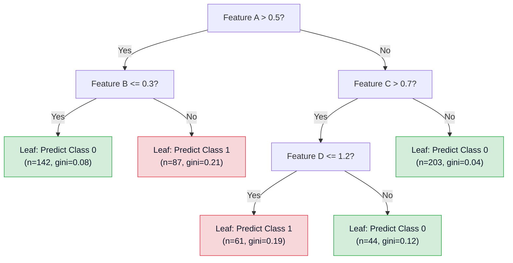
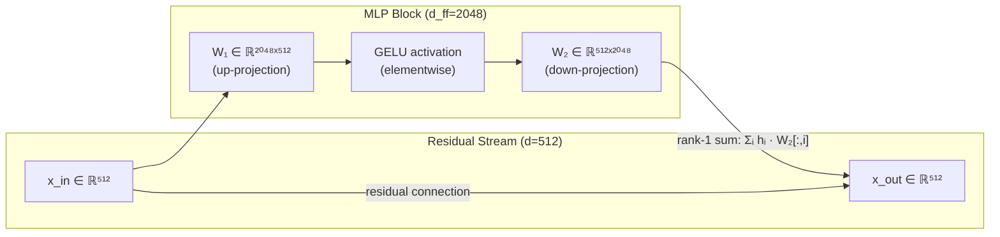
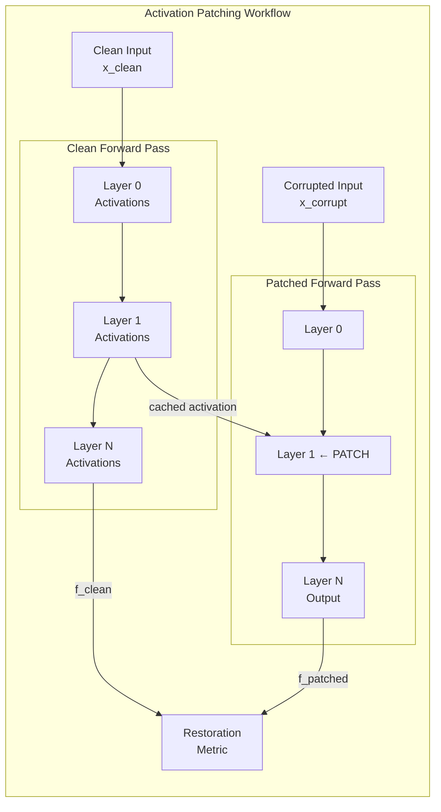
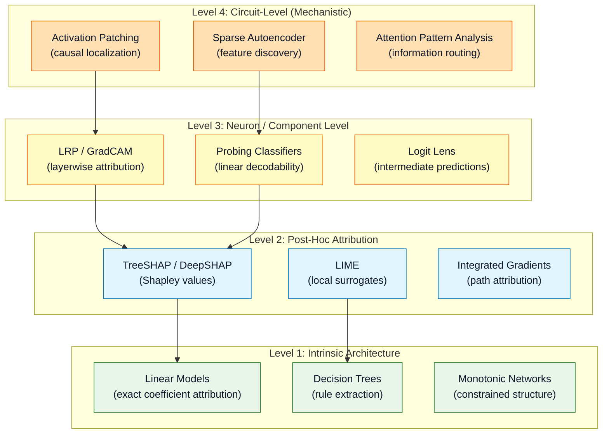

# Lesson 1: Model Decomposition Techniques for AI Safety and Alignment

---

## 1. First-Principles Intuition and Invariants

The central epistemic problem in AI safety is the **opacity gap**: a trained model is a mathematical function mapping inputs to outputs, but the learned parameters encode no human-readable justification for those mappings. A model that achieves 97% accuracy on a held-out test set is not, by virtue of that accuracy alone, trustworthy. It may have learned spurious correlations, exploited dataset artifacts, or generalized in ways that catastrophically fail under distribution shift. Model decomposition — the systematic analysis of a trained model's internal structure to identify which computations produce which outputs — is the technical discipline that closes this gap.

**The fundamental invariant driving every decomposition technique is this**: any differentiable function *f*: ℝⁿ → ℝᵐ can be approximated locally by a linear function (Taylor's theorem), and globally it decomposes into a composition of simpler primitives. Decomposition techniques exploit this invariant at different levels of fidelity and scope.

Three architectural regimes define the solution space:

**Intrinsically interpretable models** (linear models, shallow decision trees, rule lists, monotonic models) encode human-readable decision logic directly in their parameters. Transparency is not an add-on; it is the architecture. The cost is expressive capacity: a depth-3 decision tree cannot represent an arbitrary function over 100 features.

**Post-hoc local approximation** (LIME, SHAP, integrated gradients) fits an interpretable surrogate to the behavior of a black-box model *f* in the neighborhood of a specific input **x**. These methods say: "near this point, here is what the model is doing." They make no claim about global behavior. The fundamental limitation is that local linearity does not compose: a chain of locally linear explanations does not yield a globally consistent account of the model.

**Mechanistic interpretability** (circuit analysis, superposition probing, activation patching) attempts to reverse-engineer the learned algorithm implemented by a neural network's weights — to identify specific circuits, attention heads, or feature directions responsible for particular behaviors. This is the most ambitious approach and the most relevant to alignment: if you can identify the circuit that implements a deceptive reasoning pattern, you can surgically intervene on it.

The **complexity–interpretability tradeoff** is real but not fundamental. It is better understood as a **complexity–intrinsic-interpretability tradeoff**: a large language model is not intrinsically interpretable, but it is not therefore beyond analysis. Post-hoc and mechanistic techniques recover interpretable structure from complex models at the cost of additional compute and the risk of approximation error.

---

## 2. Core Architecture and Mechanics

### 2.1 Linear Models: Coefficient Attribution as Ground Truth

A linear model implements the affine map:

$$\hat{y} = \mathbf{w}^\top \mathbf{x} + b = \sum_{i=1}^{n} w_i x_i + b$$

The interpretability of this architecture is exact, not approximate. The partial derivative $\partial \hat{y}/\partial x_i = w_i$ is constant across the entire input space — the model literally *is* a weighted sum of features. Attribution is not an approximation; it is the model.

This exactness creates a hidden trap. When features are correlated, the coefficient $w_i$ does not measure the marginal contribution of feature $x_i$ in isolation. It measures the effect of $x_i$ *given all other features held constant* at the values encoded by the linear combination. In the presence of multicollinearity, coefficients can have signs opposite to the feature's true marginal effect. Decomposing a linear model's output correctly requires understanding its feature covariance structure, not just its weight vector.

**Regularization and the sparsity–stability tradeoff**: L1 (Lasso) regularization drives many coefficients exactly to zero, producing a sparse model where only a subset of features receive nonzero weight. This is not just a numerical convenience — it is a structural decision about which features the model claims are relevant. L2 (Ridge) regularization shrinks all coefficients toward zero uniformly, producing a denser model that is numerically more stable under multicollinearity. For safety-critical applications where feature selection has regulatory or audit implications (e.g., loan decisions, medical triage), the choice of regularization is a *model design decision*, not a hyperparameter to be tuned purely for validation accuracy.

```python
import numpy as np
from sklearn.linear_model import LassoCV, Ridge
from sklearn.preprocessing import StandardScaler
from sklearn.datasets import make_regression
import matplotlib.pyplot as plt

def analyze_linear_model_coefficients(X: np.ndarray, y: np.ndarray,
                                       feature_names: list[str]) -> dict:
    """
    Fit a Lasso and Ridge model, compare coefficient structures,
    and report the effective feature set selected by Lasso.

    Returns a dict with model objects, coefficient arrays, and
    the set of features with nonzero Lasso coefficients.
    """
    scaler = StandardScaler()
    X_scaled = scaler.fit_transform(X)

    # Lasso: automatic feature selection via L1 penalty
    lasso = LassoCV(cv=5, max_iter=10_000, random_state=42)
    lasso.fit(X_scaled, y)

    # Ridge: stable estimation under multicollinearity
    ridge = Ridge(alpha=1.0)
    ridge.fit(X_scaled, y)

    lasso_coefs = lasso.coef_
    ridge_coefs = ridge.coef_

    # Features selected by Lasso (nonzero coefficient)
    selected = [name for name, coef in zip(feature_names, lasso_coefs) if coef != 0.0]

    # Multicollinearity indicator: max absolute pairwise correlation
    # (VIF is the diagonal of the inverse correlation matrix)
    corr_matrix = np.corrcoef(X_scaled.T)
    # High off-diagonal values indicate multicollinearity
    max_off_diag_corr = np.max(np.abs(corr_matrix - np.eye(len(feature_names))))

    return {
        "lasso_model": lasso,
        "ridge_model": ridge,
        "lasso_coefs": dict(zip(feature_names, lasso_coefs)),
        "ridge_coefs": dict(zip(feature_names, ridge_coefs)),
        "lasso_selected_features": selected,
        "max_pairwise_correlation": max_off_diag_corr,
        "multicollinearity_warning": max_off_diag_corr > 0.8,
    }

# Example: synthetic regression with 20 features, 5 truly informative
X, y, true_coefs = make_regression(
    n_samples=1000, n_features=20, n_informative=5,
    noise=10.0, coef=True, random_state=42
)
feature_names = [f"x{i}" for i in range(20)]
results = analyze_linear_model_coefficients(X, y, feature_names)

print(f"Lasso selected {len(results['lasso_selected_features'])} features: "
      f"{results['lasso_selected_features']}")
print(f"Max pairwise correlation: {results['max_pairwise_correlation']:.3f}")
if results["multicollinearity_warning"]:
    print("WARNING: High multicollinearity detected. Coefficient signs may be unreliable.")
```

### 2.2 Decision Trees: Structural Decomposition and the Overfitting Failure Mode

A decision tree partitions the input space ℝⁿ into axis-aligned rectangular regions, assigning a constant prediction (class label or mean value) to each region. At each internal node, the tree applies a threshold test $x_j \leq \theta$ on a single feature $j$; at each leaf, it returns a prediction. The execution model is a path through the tree determined by the input.

The formal decomposition of a decision tree prediction is:

$$\hat{y}(\mathbf{x}) = \sum_{k=1}^{K} c_k \cdot \mathbf{1}[\mathbf{x} \in R_k]$$

where $R_k$ are the leaf regions, $c_k$ are the leaf predictions, and $K$ is the number of leaves. Each leaf region $R_k$ is the intersection of at most $d$ halfspaces (where $d$ is tree depth), one per node on the path from root to leaf.

**Why trees are interpretable**: each root-to-leaf path is an explicit conjunction of conditions (a rule). A human auditor can read the rule and verify whether it makes domain-appropriate sense. This is what distinguishes decision trees from post-hoc explanations: the rule *is* the model, not an approximation of it.

**The depth–interpretability tradeoff is not linear.** A depth-5 binary tree has at most 32 leaves and 31 internal nodes. This is auditable by a human. A depth-15 tree has up to 32,768 leaves — it is a lookup table, not an interpretable model. The critical failure mode is **overfitting via depth**: a deep tree memorizes training data, achieving low training error but high variance on out-of-distribution inputs. Because the tree's rules reflect training artifacts, the "interpretable" rules are interpretations of noise, not of the underlying data-generating process.

The standard mitigations — minimum samples per leaf, maximum depth, cost-complexity pruning (CCP) — all trade off training accuracy for generalization and human-auditable depth.

```python
from sklearn.tree import DecisionTreeClassifier, export_text
from sklearn.model_selection import train_test_split
from sklearn.metrics import classification_report
import numpy as np

def build_auditable_decision_tree(
    X: np.ndarray,
    y: np.ndarray,
    feature_names: list[str],
    class_names: list[str],
    max_depth: int = 5,
    min_samples_leaf: int = 20,
) -> dict:
    """
    Train a depth-constrained decision tree suitable for human audit.
    Returns the trained model, its text representation, and a
    decomposition of each leaf into its defining rule conjunction.
    """
    X_train, X_test, y_train, y_test = train_test_split(
        X, y, test_size=0.2, random_state=42, stratify=y
    )

    clf = DecisionTreeClassifier(
        max_depth=max_depth,
        min_samples_leaf=min_samples_leaf,
        criterion="gini",
        random_state=42,
    )
    clf.fit(X_train, y_train)

    # Human-readable rule text
    rule_text = export_text(clf, feature_names=feature_names)

    # Extract leaf rules: for each sample, trace its path
    leaf_ids = clf.apply(X_test)
    unique_leaves = np.unique(leaf_ids)

    # Decompose each leaf into its defining feature conditions
    tree = clf.tree_
    def get_leaf_rule(node_id: int) -> list[str]:
        """Walk the tree structure to extract the conjunction of conditions
        leading to the given leaf node."""
        rules = []
        # Traverse from root; track left/right child relationships
        node_indicator = clf.decision_path(
            X_test[leaf_ids == node_id][:1]
        ).toarray()[0]
        node_path = np.where(node_indicator)[0]

        for i, node in enumerate(node_path[:-1]):
            feature = feature_names[tree.feature[node]]
            threshold = tree.threshold[node]
            # Determine left (<=) or right (>) branch
            if node_path[i + 1] == tree.children_left[node]:
                rules.append(f"{feature} <= {threshold:.4f}")
            else:
                rules.append(f"{feature} > {threshold:.4f}")
        return rules

    leaf_decomposition = {}
    for leaf in unique_leaves:
        leaf_decomposition[int(leaf)] = get_leaf_rule(leaf)

    test_preds = clf.predict(X_test)
    report = classification_report(y_test, test_preds,
                                   target_names=class_names, output_dict=True)

    return {
        "model": clf,
        "rule_text": rule_text,
        "leaf_rules": leaf_decomposition,
        "n_leaves": clf.get_n_leaves(),
        "depth": clf.get_depth(),
        "test_classification_report": report,
        "feature_importances": dict(zip(feature_names, clf.feature_importances_)),
    }
```

The corresponding tree structure for a binary classification problem visualizes as:



### 2.3 Neural Networks: Mechanistic Interpretability and Circuit Analysis

Neural networks are the central challenge of AI decomposition. A transformer with billions of parameters is a composition of linear projections, nonlinear activations, and attention mechanisms. No single coefficient maps cleanly to a human-readable concept. Decomposition requires different tools for different levels of analysis.

#### 2.3.1 Architecture of the Feed-Forward Layer

The fundamental computational unit in modern transformers is the residual stream: a vector **x** ∈ ℝᵈ that accumulates the contributions of attention heads and MLP blocks:

$$\mathbf{x}^{(l+1)} = \mathbf{x}^{(l)} + \text{Attn}^{(l)}(\mathbf{x}^{(l)}) + \text{MLP}^{(l)}(\mathbf{x}^{(l)})$$

The MLP block at layer $l$ implements:

$$\text{MLP}^{(l)}(\mathbf{x}) = W_2^{(l)} \cdot \text{GELU}(W_1^{(l)} \mathbf{x} + \mathbf{b}_1^{(l)}) + \mathbf{b}_2^{(l)}$$

where $W_1 \in \mathbb{R}^{d_{ff} \times d}$ and $W_2 \in \mathbb{R}^{d \times d_{ff}}$ are the up-projection and down-projection matrices. Each neuron in the hidden layer computes a scalar $h_i = \text{GELU}(\mathbf{w}_i^\top \mathbf{x} + b_i)$, which is then broadcast back to the residual stream via the column $W_2[:, i]$.

This architecture has a critical implication for decomposition: the MLP is a **sum of rank-1 updates** to the residual stream. Each neuron's output is computed by applying GELU (an elementwise nonlinearity) to its pre-activation, then broadcast independently via the corresponding column of W₂. This is the foundation of **neuron-level interpretability**: if neuron $i$ fires when inputs contain feature $F$, then it adds the direction $W_2[:, i]$ to the residual stream, which subsequent layers read as "feature $F$ is present."



#### 2.3.2 Superposition: Why Individual Neurons Are Not Features

A key empirical finding in mechanistic interpretability research (Elhage et al., "Toy Models of Superposition," Anthropic 2022) is that neural networks represent **more features than they have neurons**. Features are encoded as directions in activation space, not as individual neuron activations. A single neuron may participate in multiple overlapping feature representations simultaneously — a phenomenon called **superposition**.

Superposition emerges from the tradeoff between representing many sparse features (most features are zero for a given input) and the limited dimensionality of the activation space. The network can pack $k > d$ features into $d$ dimensions if the features are sparse enough that the cross-contamination (interference) between superimposed features is tolerable.

This has a profound consequence for safety: **you cannot safely audit a neural network by monitoring individual neuron activations**. A neuron that fires strongly may be contributing to multiple distinct concepts, and the absence of that neuron's firing does not imply the absence of the associated feature. Decomposition requires finding the **sparse feature directions** in activation space, not the neuron basis.

#### 2.3.3 Sparse Autoencoders for Feature Discovery

The current state-of-the-art approach for discovering sparse feature directions is the **Sparse Autoencoder (SAE)**. An SAE is trained to reconstruct intermediate activations using a sparse bottleneck, forcing the hidden layer to represent features in an overcomplete dictionary where each activation is explained by a small number of active components.

Given activations $\mathbf{x} \in \mathbb{R}^d$ from a layer of a frozen language model, an SAE learns:

$$\mathbf{z} = \text{ReLU}(W_e \mathbf{x} + \mathbf{b}_e) \in \mathbb{R}^m, \quad m \gg d$$

$$\hat{\mathbf{x}} = W_d \mathbf{z} + \mathbf{b}_d$$

Training minimizes $\|\mathbf{x} - \hat{\mathbf{x}}\|_2^2 + \lambda \|\mathbf{z}\|_1$, where the L1 penalty enforces sparsity. The columns of $W_d$ (the decoder directions) are the learned feature vectors. After training, each column corresponds to a monosemantic direction in activation space — a direction that activates for a specific, human-interpretable concept.

```python
import torch
import torch.nn as nn
import torch.nn.functional as F
from torch.utils.data import DataLoader, TensorDataset

class SparseAutoencoder(nn.Module):
    """
    Sparse autoencoder for decomposing neural network activations
    into an overcomplete dictionary of interpretable feature directions.

    Architecture follows Cunningham et al. (2023) and Bricken et al. (2023).
    The decoder columns are L2-normalized to prevent the trivial solution
    of absorbing sparsity penalties into decoder norms.
    """

    def __init__(self, d_model: int, n_features: int, l1_coeff: float = 1e-3):
        super().__init__()
        self.d_model = d_model
        self.n_features = n_features
        self.l1_coeff = l1_coeff

        # Encoder: maps activations to sparse feature coefficients
        self.W_enc = nn.Parameter(torch.empty(n_features, d_model))
        self.b_enc = nn.Parameter(torch.zeros(n_features))

        # Decoder: maps sparse feature coefficients back to activation space
        # Initialized to transpose of encoder for symmetry
        self.W_dec = nn.Parameter(torch.empty(d_model, n_features))
        self.b_dec = nn.Parameter(torch.zeros(d_model))

        # Pre-encoder bias to handle activation mean-centering
        self.b_pre = nn.Parameter(torch.zeros(d_model))

        nn.init.kaiming_uniform_(self.W_enc)
        nn.init.kaiming_uniform_(self.W_dec)
        self._normalize_decoder()

    @torch.no_grad()
    def _normalize_decoder(self):
        """Constrain decoder columns to unit norm to prevent trivial solutions."""
        norms = self.W_dec.norm(dim=0, keepdim=True).clamp(min=1.0)
        self.W_dec.data = self.W_dec.data / norms

    def encode(self, x: torch.Tensor) -> torch.Tensor:
        """Map activations to sparse feature coefficients via ReLU."""
        x_centered = x - self.b_pre
        return F.relu(x_centered @ self.W_enc.T + self.b_enc)

    def decode(self, z: torch.Tensor) -> torch.Tensor:
        """Reconstruct activations from sparse feature coefficients."""
        return z @ self.W_dec.T + self.b_dec

    def forward(self, x: torch.Tensor) -> tuple[torch.Tensor, torch.Tensor, torch.Tensor]:
        z = self.encode(x)
        x_hat = self.decode(z)

        # Reconstruction loss + sparsity penalty
        recon_loss = F.mse_loss(x_hat, x)
        l1_loss = self.l1_coeff * z.abs().mean()
        total_loss = recon_loss + l1_loss

        return x_hat, z, total_loss

    def get_feature_directions(self) -> torch.Tensor:
        """Return the decoder columns (feature directions) as a matrix.
        Each column is a unit-norm direction in activation space."""
        return self.W_dec.detach()  # shape: [d_model, n_features]

    def get_top_activating_features(
        self, x: torch.Tensor, k: int = 10
    ) -> list[tuple[int, float]]:
        """For a single activation vector, return the top-k active features
        sorted by activation strength. Used for per-token decomposition."""
        with torch.no_grad():
            z = self.encode(x.unsqueeze(0)).squeeze(0)
            top_vals, top_idxs = torch.topk(z, k=min(k, self.n_features))
            return [(idx.item(), val.item()) for idx, val in zip(top_idxs, top_vals)]


def train_sparse_autoencoder(
    activations: torch.Tensor,
    d_model: int,
    n_features: int,
    l1_coeff: float = 1e-3,
    n_epochs: int = 50,
    batch_size: int = 1024,
    lr: float = 1e-3,
) -> SparseAutoencoder:
    """
    Train a sparse autoencoder on a corpus of model activations.

    Args:
        activations: Tensor of shape [n_samples, d_model] containing
                     intermediate activations from a frozen language model.
        d_model:     Dimensionality of the activation space.
        n_features:  Size of the overcomplete dictionary (typically 4-16x d_model).
        l1_coeff:    Sparsity penalty coefficient. Higher values → sparser codes
                     but worse reconstruction fidelity.
    """
    sae = SparseAutoencoder(d_model=d_model, n_features=n_features, l1_coeff=l1_coeff)
    optimizer = torch.optim.Adam(sae.parameters(), lr=lr)
    dataset = TensorDataset(activations)
    loader = DataLoader(dataset, batch_size=batch_size, shuffle=True)

    for epoch in range(n_epochs):
        total_recon, total_l1 = 0.0, 0.0
        for (batch,) in loader:
            optimizer.zero_grad()
            _, z, loss = sae(batch)
            loss.backward()
            optimizer.step()
            # Re-normalize decoder columns after each gradient step
            sae._normalize_decoder()

            with torch.no_grad():
                recon = F.mse_loss(sae.decode(z), batch)
                total_recon += recon.item()
                total_l1 += (l1_coeff * z.abs().mean()).item()

        if (epoch + 1) % 10 == 0:
            avg_recon = total_recon / len(loader)
            avg_l1 = total_l1 / len(loader)
            avg_sparsity = (z == 0).float().mean().item()
            print(f"Epoch {epoch+1:3d} | recon_loss={avg_recon:.4f} | "
                  f"l1_loss={avg_l1:.4f} | sparsity={avg_sparsity:.3f}")

    return sae
```

#### 2.3.4 Layer-Wise Relevance Propagation: Backpropagating Attributions

Layer-Wise Relevance Propagation (LRP) computes a *conservation* score: the output relevance $R^{(L)}$ is backpropagated through the network such that the sum of relevance scores is conserved at each layer. For a linear layer with output $z_j = \sum_i a_i w_{ij}$, the LRP-ε rule attributes relevance from neuron $j$ to neuron $i$ as:

$$R_i^{(l)} = \sum_j \frac{a_i w_{ij}}{z_j + \varepsilon \cdot \text{sign}(z_j)} R_j^{(l+1)}$$

The $\varepsilon$ term prevents division by zero and stabilizes attribution for near-zero activations. The conservation property $\sum_i R_i^{(l)} \approx \sum_j R_j^{(l+1)}$ holds approximately for LRP-epsilon (exactly for LRP-0), ensuring that the total relevance propagated to the input layer approximately equals the model output, providing a consistent pixel-level attribution for image classifiers or token-level attribution for language models.

**Critical distinction from gradient-based attribution**: Gradients measure local sensitivity ($\partial f / \partial x_i$ at **x**). LRP measures contribution: how much of the output *value* is explained by feature $i$. For a ReLU network, these can differ substantially: a feature can have high gradient (small perturbation matters) but low LRP relevance (it contributed little to the actual output), or vice versa.

```python
import torch
import torch.nn as nn

class LRPLinear(nn.Module):
    """
    Linear layer with LRP-epsilon backward pass for relevance propagation.
    The standard autograd backward pass is replaced with the LRP rule,
    enabling relevance scores to be computed by calling backward() on
    the output relevance.
    """

    def __init__(self, in_features: int, out_features: int, eps: float = 1e-6):
        super().__init__()
        self.linear = nn.Linear(in_features, out_features)
        self.eps = eps

    def forward(self, x: torch.Tensor) -> torch.Tensor:
        return self.linear(x)

    @torch.no_grad()
    def lrp_backward(
        self, activations: torch.Tensor, relevance_out: torch.Tensor
    ) -> torch.Tensor:
        """
        Propagate relevance from output neurons back to input neurons
        using the LRP-epsilon rule.

        Args:
            activations:   Input activations a_i, shape [batch, in_features]
            relevance_out: Relevance scores R_j for output neurons,
                           shape [batch, out_features]

        Returns:
            relevance_in: Relevance scores R_i for input neurons,
                          shape [batch, in_features]
        """
        W = self.linear.weight  # shape: [out_features, in_features]
        b = self.linear.bias    # shape: [out_features]

        # Compute denominator z_j = sum_i a_i * w_ij + eps*sign(z_j)
        # First compute z_j without stabilizer
        z = activations @ W.T + b  # [batch, out_features]
        z_stable = z + self.eps * z.sign().where(z.sign() != 0, torch.ones_like(z))

        # Compute delta = R_j / z_j (element-wise)
        delta = relevance_out / z_stable  # [batch, out_features]

        # Backpropagate: R_i = a_i * sum_j w_ij * (R_j / z_j)
        relevance_in = activations * (delta @ W)  # [batch, in_features]

        return relevance_in

    def verify_conservation(
        self, activations: torch.Tensor, relevance_out: torch.Tensor,
        tol: float = 1e-4
    ) -> bool:
        """Verify that sum of input relevances equals sum of output relevances
        (conservation property of LRP)."""
        relevance_in = self.lrp_backward(activations, relevance_out)
        sum_in = relevance_in.sum(dim=-1)
        sum_out = relevance_out.sum(dim=-1)
        return bool((sum_in - sum_out).abs().max().item() < tol)
```

---

## 3. Post-Hoc Local Approximation: SHAP and LIME

### 3.1 SHAP: Shapley Value Attribution

SHAP (SHapley Additive exPlanations, Lundberg & Lee, 2017) grounds feature attribution in cooperative game theory and uniquely satisfies the efficiency, symmetry, dummy, and additivity axioms. The Shapley value for feature $i$ is the average marginal contribution of feature $i$ across all possible orderings of features:

$$\phi_i(f, \mathbf{x}) = \sum_{S \subseteq F \setminus \{i\}} \frac{|S|!\,(|F|-|S|-1)!}{|F|!} \left[ f(\mathbf{x}_{S \cup \{i\}}) - f(\mathbf{x}_S) \right]$$

where $F$ is the full feature set, $S$ is a subset not containing $i$, and $f(\mathbf{x}_S)$ denotes the model's expected output when only features in $S$ are known (and others are marginalized over).

SHAP satisfies four axioms that make it uniquely appropriate for safety-critical attribution:

1. 1. **Efficiency**: $\sum_i \phi_i = f(\mathbf{x}) - \mathbb{E}[f]$. The sum of attributions equals the model's deviation from its baseline, so attributions are *complete* — they account for the entire output.
2. **Symmetry**: if two features contribute identically in all subsets, they receive equal attribution. This prevents arbitrary asymmetric blame assignment.
3. **Dummy**: a feature that contributes nothing in any subset receives zero attribution.
4. **Additivity (Linearity)**: if the model output is a sum of two functions, the Shapley values must be the sum of their separate Shapley values. This ensures consistency across model compositions.

The computational cost of exact Shapley values is exponential in the number of features. For tree ensembles, `TreeSHAP` (Lundberg et al., 2020) computes exact Shapley values in $O(TLD^2)$ time, where $T$ is the number of trees, $L$ is the maximum number of leaves, and $D$ is tree depth. For neural networks, `DeepSHAP` uses a linear approximation based on backpropagation, trading exactness for tractability.

```python
import numpy as np
import shap
from sklearn.ensemble import GradientBoostingClassifier
from sklearn.datasets import load_breast_cancer
from sklearn.model_selection import train_test_split
import warnings

def shap_decomposition_analysis(
    model, X_train: np.ndarray, X_test: np.ndarray,
    feature_names: list[str]
) -> dict:
    """
    Compute SHAP values for a tree-based model using TreeSHAP.
    Returns global feature importance (mean |SHAP|), interaction
    detection, and per-sample attribution vectors.

    Note: shap.TreeExplainer requires a fitted sklearn-compatible
    ensemble model. For neural networks, use shap.DeepExplainer or
    shap.GradientExplainer with appropriate background data.
    """
    # TreeSHAP: exact Shapley values via dynamic programming on the tree
    explainer = shap.TreeExplainer(
        model,
        data=X_train,                # background dataset for E[f(x)] baseline
        feature_perturbation="interventional",  # marginalizes over training data,
        # preferred for causal interpretations vs. "tree_path_dependent"
    )

    with warnings.catch_warnings():
        warnings.simplefilter("ignore")
        shap_values = explainer.shap_values(X_test)

    # For binary classification, shap_values is a list [class_0_vals, class_1_vals]
    # We analyze class 1 (positive class) attributions
    if isinstance(shap_values, list):
        sv = shap_values[1]  # shape: [n_test_samples, n_features]
    else:
        sv = shap_values

    # Global importance: mean absolute SHAP value per feature
    global_importance = {
        name: float(np.abs(sv[:, i]).mean())
        for i, name in enumerate(feature_names)
    }
    ranked = sorted(global_importance.items(), key=lambda x: x[1], reverse=True)

    # Efficiency check: verify SHAP values sum to model output - E[f(x)]
    expected_value = explainer.expected_value
    if isinstance(expected_value, (list, np.ndarray)):
        expected_value = expected_value[1]

    model_outputs = model.decision_function(X_test)
    shap_sums = sv.sum(axis=1) + expected_value
    max_efficiency_error = np.abs(model_outputs - shap_sums).max()

    return {
        "shap_values": sv,
        "expected_value": float(expected_value),
        "global_importance_ranked": ranked,
        "efficiency_max_error": float(max_efficiency_error),
        "efficiency_satisfied": max_efficiency_error < 1e-4,
    }


# Demonstration on a standard benchmark
data = load_breast_cancer()
X_train, X_test, y_train, y_test = train_test_split(
    data.data, data.target, test_size=0.2, random_state=42, stratify=data.target
)
gbm = GradientBoostingClassifier(n_estimators=100, max_depth=4, random_state=42)
gbm.fit(X_train, y_train)

results = shap_decomposition_analysis(gbm, X_train, X_test, list(data.feature_names))
print(f"Efficiency constraint satisfied: {results['efficiency_satisfied']}")
print(f"Max efficiency error: {results['efficiency_max_error']:.2e}")
print("\nTop 5 features by mean |SHAP|:")
for name, importance in results["global_importance_ranked"][:5]:
    print(f"  {name:40s}: {importance:.4f}")
```

### 3.2 LIME: Local Surrogate Models and Their Limitations

LIME (Local Interpretable Model-agnostic Explanations, Ribeiro et al., 2016) fits a locally linear surrogate model $g$ to approximate the black-box model $f$ in the neighborhood of a specific input $\mathbf{x}$:

$$g^* = \arg\min_{g \in G} \mathcal{L}(f, g, \pi_{\mathbf{x}}) + \Omega(g)$$

where $\pi_{\mathbf{x}}(\mathbf{z}) = \exp(-d(\mathbf{x}, \mathbf{z})^2 / \sigma^2)$ is a locality kernel weighting perturbed samples $\mathbf{z}$ by their distance from $\mathbf{x}$, $\mathcal{L}$ measures how well $g$ approximates $f$ on the weighted sample distribution, and $\Omega(g)$ penalizes surrogate complexity.

LIME has several failure modes that are critical for safety applications:

**Sampling instability**: LIME generates perturbed samples by randomly zeroing out features (for tabular data) or superpixels (for images). The distribution of perturbed samples is not guaranteed to be close to the training distribution. If $f$ behaves unexpectedly on out-of-distribution inputs, LIME's explanation reflects that OOD behavior, not the model's behavior on natural inputs.

**Explanation instability**: Because the perturbed samples are randomly drawn, repeated calls to LIME on the same input can yield different explanations. This is not merely a cosmetic problem: if an auditor runs LIME twice and gets different results, they cannot determine which explanation is correct.

**Local vs. global inconsistency**: Two nearby inputs can have LIME explanations that contradict each other, because each explanation is computed independently. There is no guarantee that LIME explanations form a globally consistent account of the model.

For safety-critical applications, SHAP is generally preferred over LIME precisely because SHAP's Efficiency axiom ensures global consistency: the attributions for all inputs in a dataset, taken together, exactly account for the model's overall behavior.

---

## 4. Activation Patching and Causal Intervention

Activation patching (Meng et al., 2022; Wang et al., 2022) is a mechanistic technique for localizing where specific computations occur in a network. The procedure is:

1. Run the model on a **clean input** $\mathbf{x}_{\text{clean}}$ and cache all intermediate activations.
2. Run the model on a **corrupted input** $\mathbf{x}_{\text{corrupt}}$ that produces an incorrect or undesired output.
3. For each layer $l$ and position $p$, **patch** the corrupted run by replacing the activation at $(l, p)$ with the clean activation. Record the degree to which the model output is restored toward the clean behavior.

The restoration metric:

$$\text{patching\_effect}(l, p) = \frac{f_{\text{patched}}(l,p) - f_{\text{corrupt}}}{f_{\text{clean}} - f_{\text{corrupt}}}$$

A value of 1.0 means full restoration; 0.0 means patching had no effect. This identifies the **minimal set of components** whose activations causally determine the output difference — the circuit responsible for the behavior.

```python
import torch
from typing import Callable

def activation_patch_scan(
    model: torch.nn.Module,
    clean_input: torch.Tensor,
    corrupt_input: torch.Tensor,
    output_metric: Callable[[torch.Tensor], float],
    layer_names: list[str],
) -> dict[str, float]:
    """
    Scan all named layers of a model to find which layers causally
    mediate the difference between clean and corrupted outputs.

    Args:
        model:         Frozen model to analyze.
        clean_input:   Input that produces the desired/correct output.
        corrupt_input: Input that produces the undesired/incorrect output.
        output_metric: Function mapping model output to a scalar score
                       (e.g., log-probability of the correct token).
        layer_names:   Names of layers to test (from model.named_modules()).

    Returns:
        Dict mapping layer name -> patching effect in [0, 1].
    """
    model.eval()
    hooks = {}
    cached_clean = {}
    patching_target: dict[str, bool] = {}

    def make_cache_hook(name: str):
        def hook(module, input, output):
            cached_clean[name] = output.detach().clone()
        return hook

    def make_patch_hook(name: str):
        def hook(module, input, output):
            if patching_target.get(name, False):
                return cached_clean[name].to(output.device)
            return output
        return hook

    # Register cache hooks and run clean forward pass
    handles = []
    for name, module in model.named_modules():
        if name in layer_names:
            h = module.register_forward_hook(make_cache_hook(name))
            handles.append(h)

    with torch.no_grad():
        clean_out = model(clean_input)
        f_clean = output_metric(clean_out)

    for h in handles:
        h.remove()

    # Register patch hooks
    handles = []
    for name, module in model.named_modules():
        if name in layer_names:
            h = module.register_forward_hook(make_patch_hook(name))
            handles.append(h)

    # Corrupt baseline (no patching)
    with torch.no_grad():
        corrupt_out = model(corrupt_input)
        f_corrupt = output_metric(corrupt_out)

    patching_effects = {}
    denom = f_clean - f_corrupt
    if abs(denom) < 1e-8:
        for h in handles:
            h.remove()
        return {name: 0.0 for name in layer_names}

    for target_name in layer_names:
        patching_target.clear()
        patching_target[target_name] = True

        with torch.no_grad():
            patched_out = model(corrupt_input)
            f_patched = output_metric(patched_out)

        effect = (f_patched - f_corrupt) / denom
        patching_effects[target_name] = float(effect)

    for h in handles:
        h.remove()

    return patching_effects
```

The patching effect landscape visualizes as a heatmap over layers and sequence positions, revealing the **information bottleneck** locations where safety-critical computations are concentrated:



---

## 5. Failure Modes, Safety-Critical Boundaries, and Production Considerations

### 5.1 Distribution Shift and Explanation Validity

All decomposition techniques produce explanations that are valid *under the conditions they were computed*. When the input distribution shifts — through data drift, adversarial perturbations, or deployment in a new context — the explanations may remain numerically stable while becoming semantically wrong.

A SHAP explanation computed on training-distribution data answers the question: "given training-distribution context, what is the marginal contribution of feature $i$?" When the model is deployed on out-of-distribution inputs, the same question does not have the same answer. **Monitoring explanation drift** — tracking the distribution of SHAP values over time — is a production signal for model degradation that is more sensitive than accuracy metrics alone, because it detects when the model's *reasoning pattern* changes, not just its output.

### 5.2 Adversarial Explanation Manipulation

Slack et al. (2020) demonstrated that it is possible to train a classifier that produces the same SHAP explanations as a "fair" classifier on the explanation distribution, while implementing discriminatory logic on the actual deployment distribution. This is not a bug in SHAP; it is a consequence of the gap between the explanation distribution and the deployment distribution.

The attack works by training a **scaffolding classifier** that detects whether an input is from the explanation sampling distribution (perturbations of real data) or from real deployment traffic, and applies different decision logic in each case. This means that SHAP audits can be passed by a model that is actively discriminating on protected attributes in deployment.

The defense is **stratified audit sampling**: audit the model on inputs drawn from the actual deployment distribution, not from the explanation tool's perturbation distribution, and compare SHAP values computed under both distributions.

### 5.3 Computational Scaling

For large language models with hundreds of billions of parameters, full activation caching (required for activation patching) demands memory proportional to the number of layers times the sequence length times the activation dimension. At the scale of GPT-4-class models:

- Layers: ~96
- Sequence length: 8,192 tokens
- Activation dimension: ~12,288

Full activation cache: $96 \times 8192 \times 12288 \times 4 \text{ bytes (fp32)} \approx 38 \text{ GB}$ per forward pass. This exceeds the memory of a single A100 (80 GB HBM2e) when running multiple patching experiments simultaneously. Production mechanistic interpretability workflows use:

- **Activation checkpointing**: recompute intermediate activations on demand rather than caching all layers simultaneously.
- **bfloat16 storage**: halve memory usage for cached activations with minimal precision loss.
- **Targeted layer scanning**: rather than scanning all layers, use a coarse first pass (every 8th layer) to identify candidate circuits, then fine-grained scanning within the candidate region.

```python
import torch
from contextlib import contextmanager

@contextmanager
def efficient_activation_cache(
    model: torch.nn.Module,
    target_layers: list[str],
    dtype: torch.dtype = torch.bfloat16,
):
    """
    Context manager for memory-efficient activation caching.
    Only caches activations for the specified target layers,
    storing them in bfloat16 to halve memory usage.

    Usage:
        with efficient_activation_cache(model, ["layer.12", "layer.24"]) as cache:
            _ = model(input_ids)
        # cache["layer.12"] contains bfloat16 activations
    """
    cache: dict[str, torch.Tensor] = {}
    handles = []

    def make_hook(name: str):
        def hook(module, input, output):
            # Store only the first tensor if output is a tuple
            act = output[0] if isinstance(output, tuple) else output
            # Cast to bfloat16 and detach from compute graph
            cache[name] = act.detach().to(dtype)
        return hook

    for name, module in model.named_modules():
        if name in target_layers:
            h = module.register_forward_hook(make_hook(name))
            handles.append(h)

    try:
        yield cache
    finally:
        for h in handles:
            h.remove()
```

---

## 6. The Decomposition Stack: An Integrated View

The techniques described in this lesson form a layered stack. Each layer provides a different resolution of analysis, from global model structure down to individual computational circuits:



The choice of decomposition technique is not a matter of preference; it is determined by the **threat model**:

- For **regulatory compliance** (loan decisions, medical triage): use intrinsically interpretable models (Level 1) where possible, or TreeSHAP with efficiency verification for tree ensembles. The explanation must be legally defensible and stable across repeated queries.
- For **detecting specification gaming**: use activation patching and SAEs (Level 4) to identify whether the model has learned an internal representation of a concept that it is supposed not to have learned (e.g., a "hide behavior during evaluation" feature direction).
- For **debugging distributional failures**: use global SHAP analysis (Level 2) to compare attribution distributions between train/test/deployment data, treating shifts in attribution as a proxy for concept drift.
- For **model surgery / targeted editing**: mechanistic interpretability (Level 4) is a prerequisite. You cannot reliably edit a model's behavior without first localizing where that behavior is implemented.

---

## 7. Worked Example: End-to-End Decomposition Pipeline

The following pipeline integrates intrinsic interpretability (decision tree), post-hoc attribution (SHAP), and a mechanistic sanity check (feature direction cosine similarity) on a single dataset:

```python
import numpy as np
import torch
import shap
from sklearn.datasets import load_breast_cancer
from sklearn.model_selection import train_test_split
from sklearn.ensemble import GradientBoostingClassifier
from sklearn.tree import DecisionTreeClassifier
from sklearn.metrics import roc_auc_score
from sklearn.preprocessing import StandardScaler
import warnings

def run_decomposition_pipeline(random_state: int = 42) -> None:
    """
    End-to-end model decomposition pipeline demonstrating:
    1. Intrinsic baseline (depth-4 decision tree)
    2. Complex model (gradient boosted ensemble)
    3. SHAP attribution with efficiency verification
    4. Cross-model agreement check: do both models agree on top features?
    """
    # --- Data ---
    data = load_breast_cancer()
    X, y = data.data, data.target
    feature_names = list(data.feature_names)

    X_train, X_test, y_train, y_test = train_test_split(
        X, y, test_size=0.2, stratify=y, random_state=random_state
    )

    scaler = StandardScaler()
    X_train_s = scaler.fit_transform(X_train)
    X_test_s = scaler.transform(X_test)

    # --- 1. Intrinsic baseline ---
    dt = DecisionTreeClassifier(max_depth=4, min_samples_leaf=15, random_state=random_state)
    dt.fit(X_train_s, y_train)
    dt_auc = roc_auc_score(y_test, dt.predict_proba(X_test_s)[:, 1])

    dt_importances = dict(zip(feature_names, dt.feature_importances_))
    dt_top5 = sorted(dt_importances, key=dt_importances.get, reverse=True)[:5]

    # --- 2. Complex model ---
    gbm = GradientBoostingClassifier(
        n_estimators=200, max_depth=4, learning_rate=0.05,
        subsample=0.8, random_state=random_state
    )
    gbm.fit(X_train_s, y_train)
    gbm_auc = roc_auc_score(y_test, gbm.predict_proba(X_test_s)[:, 1])

    # --- 3. SHAP attribution ---
    with warnings.catch_warnings():
        warnings.simplefilter("ignore")
        explainer = shap.TreeExplainer(
            gbm, data=X_train_s, feature_perturbation="interventional"
        )
        shap_vals = explainer.shap_values(X_test_s)
        if isinstance(shap_vals, list):
            shap_vals = shap_vals[1]

    shap_global = {name: float(np.abs(shap_vals[:, i]).mean())
                   for i, name in enumerate(feature_names)}
    shap_top5 = sorted(shap_global, key=shap_global.get, reverse=True)[:5]

    # Efficiency verification
    ev = explainer.expected_value
    if isinstance(ev, (list, np.ndarray)):
        ev = ev[1]
    preds = gbm.decision_function(X_test_s)
    efficiency_error = np.abs(preds - (shap_vals.sum(axis=1) + ev)).max()

    # --- 4. Cross-model agreement ---
    agreement_at_5 = len(set(dt_top5) & set(shap_top5))

    # --- Report ---
    print("=" * 60)
    print("MODEL DECOMPOSITION PIPELINE REPORT")
    print("=" * 60)
    print(f"\nDecision Tree (depth=4)   AUC: {dt_auc:.4f}")
    print(f"Gradient Boosted Ensemble AUC: {gbm_auc:.4f}")
    print(f"SHAP efficiency max error:     {efficiency_error:.2e}")
    print(f"\nDT  top-5 features: {dt_top5}")
    print(f"GBM top-5 features: {shap_top5}")
    print(f"\nFeature agreement at top-5: {agreement_at_5}/5")
    if agreement_at_5 < 3:
        print("WARNING: Low cross-model agreement. The interpretable baseline "
              "and the complex model may be using different decision logic. "
              "Investigate whether the ensemble is relying on features the "
              "depth-4 tree cannot represent.")
    else:
        print("Cross-model agreement is high: the ensemble's SHAP-attributed "
              "features align with the interpretable baseline.")
    print("=" * 60)

run_decomposition_pipeline()
```

---

## 8. Key Concepts Reference

**Superposition** — The encoding of more features than neurons by representing features as sparse directions in activation space. First systematically analyzed in Elhage et al. (2022). Implies that individual neuron monitoring is insufficient for safety auditing.

**Sparse Autoencoder (SAE)** — A technique for decomposing superposed activations into an overcomplete monosemantic feature dictionary. The decoder columns are the learned feature directions. Active area of research at Anthropic (Bricken et al., 2023) and other safety-focused labs.

**Activation Patching** — A causal intervention technique for localizing which model components implement a specific behavior. Analogous to lesion studies in neuroscience. Used in ROME (Meng et al., 2022) for locating factual association storage in GPT models.

**Layer-Wise Relevance Propagation (LRP)** — A conservation-based attribution method that backpropagates output relevance through network layers according to rules derived from Taylor decomposition. Satisfies the completeness property $\sum_i R_i = f(\mathbf{x})$.

**SHAP (Shapley Additive exPlanations)** — Feature attribution grounded in cooperative game theory. Uniquely satisfies efficiency, symmetry, and dummy axioms. TreeSHAP provides polynomial-time exact computation for tree ensembles.

**Mechanistic Interpretability** — The program of reverse-engineering the algorithms implemented by neural network weights. The most ambitious decomposition paradigm and the most directly relevant to alignment: understanding *what algorithm the model has learned*, not just *which features it uses*.

---

## References and Further Reading

- Lundberg, S. M., & Lee, S. I. (2017). A unified approach to interpreting model predictions. *NeurIPS 30*.
- Ribeiro, M. T., Singh, S., & Guestrin, C. (2016). "Why should I trust you?": Explaining the predictions of any classifier. *KDD 2016*.
- Elhage, N., et al. (2022). Toy models of superposition. *Transformer Circuits Thread*, Anthropic.
- Bricken, T., et al. (2023). Towards monosemanticity: Decomposing language models with dictionary learning. *Transformer Circuits Thread*, Anthropic.
- Meng, K., et al. (2022). Locating and editing factual associations in GPT. *NeurIPS 35*.
- Wang, K., et al. (2022). Interpretability in the wild: A circuit for indirect object identification in GPT-2. *ICLR 2023*.
- Bach, S., et al. (2015). On pixel-wise explanations for non-linear classifier decisions by layer-wise relevance propagation. *PLOS ONE*.
- Slack, D., et al. (2020). Fooling LIME and SHAP: Adversarial attacks on post hoc explanation methods. *AIES 2020*.
- Cunningham, H., et al. (2023). Sparse autoencoders find highly interpretable features in language models. *arXiv:2309.08600*.
