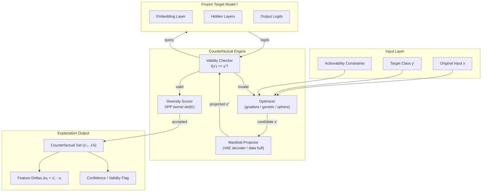

# Lesson 3: Counterfactual Explanations and What-If Analysis

## 1. First-Principles Intuition and Causal Foundations

### The Causal Ladder and Where Counterfactuals Live

Counterfactual reasoning sits at the apex of Judea Pearl's *Ladder of Causation*. The three rungs are:

1. **Association** — $P(y | x)$: observing correlations in data.
2. **Intervention** — $P(y | do(x'))$: computing what happens when we forcibly set a variable to a value, breaking its natural causal parents.
3. **Counterfactual** — $P(y_x | x')$: reasoning about what *would have* happened to a specific observed unit had things been different.

A standard supervised model operates at rung 1. It learns $P(y | x)$ from i.i.d. data and cannot, without additional causal structure, answer interventional or counterfactual queries. This gap is not philosophical—it has direct safety consequences. A loan-rejection model that cites "low income" as a reason may actually be using income as a proxy for race if those variables are confounded in the training distribution. Intervening on income alone ($do(\text{income} = \$80k)$) will not change the model's output if the race signal bleeds through a correlated feature. Counterfactual explanations, when grounded in a valid causal graph, expose this spurious reliance in a way that observational statistics cannot.

Pearl's Structural Causal Model (SCM) formalizes this. An SCM $\mathcal{M}$ consists of:
- A set of endogenous variables $\mathbf{V}$ and exogenous noise variables $\mathbf{U}$.
- A set of structural equations $V_i = f_i(\text{pa}(V_i), U_i)$ where $\text{pa}(V_i)$ are the causal parents of $V_i$.

A counterfactual query $P(Y_{X=x'} = y | X = x, Y = y_0)$ is answered by the three-step *abduction-action-prediction* procedure:

1. **Abduction**: Use the observed evidence $(X=x, Y=y_0)$ to update the prior on $\mathbf{U}$ to a posterior $P(\mathbf{U} | X=x, Y=y_0)$.
2. **Action**: Modify $\mathcal{M}$ by replacing $f_X$ with the constant $x'$, producing the mutilated model $\mathcal{M}_{X=x'}$.
3. **Prediction**: Compute $Y$ in the mutilated model under the posterior $\mathbf{U}$.

Most practical ML counterfactual methods implicitly skip step 1 (abduction) because the noise variables are not modeled. They operate on the input space directly—a critical limitation discussed in Section 4.

### Formal Problem Statement

Given a model $f: \mathcal{X} \rightarrow \mathcal{Y}$, an input $x \in \mathcal{X}$, and a target prediction $y' \neq f(x)$, a counterfactual explanation is a point $x' \in \mathcal{X}$ satisfying:

$$
x^* = \arg\min_{x' \in \mathcal{X}} \; d(x, x') \quad \text{subject to} \quad f(x') = y'
$$

where $d(\cdot, \cdot)$ is a problem-appropriate distance metric. This formulation is a constrained optimization problem. The constraint $f(x') = y'$ is typically non-convex (and non-differentiable for discrete $y'$), so the problem is relaxed to:

$$
x^* = \arg\min_{x'} \; \lambda \cdot d(x, x') + \mathcal{L}(f(x'), y')
$$

where $\mathcal{L}$ is a loss penalizing deviation from the target class (e.g., cross-entropy). The scalar $\lambda$ controls the trade-off between proximity to the original input and achieving the desired prediction.

**Three non-negotiable desiderata** for a valid counterfactual:

| Property | Definition | Why It Matters |
|---|---|---|
| **Validity** | $f(x') = y'$ | The counterfactual must actually achieve the target class. |
| **Proximity** | $d(x, x')$ is small | Explanations should describe minimal change. |
| **Plausibility** (Actionability) | $x'$ lies on the data manifold | A counterfactual suggesting a person change their age is not actionable; one suggesting they repay a debt is. |

The tension between validity and plausibility is the central engineering challenge. Gradient descent in raw input space will find valid but off-manifold points—pixel noise that flips a classifier—which are meaningless as explanations.

---

## 2. Algorithmic Taxonomy

### 2.1 Gradient-Based Methods: DICE and Wachter et al.

**Wachter et al. (2017)** introduced the first formal counterfactual framework for ML. Their objective:

$$
\mathcal{L}(x, x', y', \lambda) = \lambda \cdot (\hat{f}(x') - y')^2 + d(x, x')
$$

They use the *median absolute deviation* (MAD)-normalized $L_1$ distance:

$$
d(x, x') = \sum_j \frac{|x_j - x_j'|}{\text{MAD}_j}
$$

where $\text{MAD}_j = \text{median}_i(|x_{ij} - \text{median}_i(x_{ij})|)$ is computed over the training set for feature $j$. This normalization is crucial: it makes the distance metric invariant to the scale of each feature, preventing high-variance features from dominating the search.

**DiCE (Diverse Counterfactual Explanations, Mothilal et al., 2020)** extends this by generating a *set* of $k$ counterfactuals that are mutually diverse. The loss becomes:

$$
\mathcal{L} = \frac{1}{k}\sum_{i=1}^{k} \text{yloss}(f(x_i'), y') + \frac{\lambda_1}{k}\sum_{i=1}^{k} d(x_i', x) - \lambda_2 \cdot \text{dpp\_diversity}(\{x_1', \ldots, x_k'\})
$$

The diversity term uses a **Determinantal Point Process (DPP)** kernel:

$$
\text{dpp\_diversity}(C) = \det(K_C)
$$

where $K_C$ is a kernel matrix $K_{ij} = \kappa(x_i', x_j')$ measuring similarity between counterfactuals. Maximizing $\det(K_C)$ encourages the selected set to span different regions of the decision boundary—this is not mere aesthetic variety but provides the user with structurally distinct recourse paths.

### 2.2 Prototype-Based Methods: Growing Spheres and Latent Space Search

**Growing Spheres (Laugel et al., 2017)** avoids gradient computation entirely. It:
1. Generates random points on a hypersphere of radius $r$ centered at $x$.
2. Checks if any point crosses the decision boundary (changes class).
3. If not, increases $r$ by $\delta$; if yes, bisects the segment between $x$ and the found point to minimize distance.

This is a derivative-free, model-agnostic approach. Its failure mode is exponential sample complexity in high dimensions (the curse of dimensionality): a hypersphere in 1000 dimensions concentrates its volume near its equator, making uniform sampling extremely unlikely to find the nearest decision boundary point.

**Latent space methods** address the manifold problem by searching in the latent space of a generative model (VAE or GAN) rather than raw input space. For a VAE with encoder $q_\phi(z|x)$ and decoder $p_\theta(x|z)$:

$$
z^* = \arg\min_{z} \; d(p_\theta(z), x) + \lambda \cdot \mathcal{L}(f(p_\theta(z)), y')
$$

The decoder $p_\theta$ acts as a manifold projector, guaranteeing that any point in the latent space decodes to a plausible input. This is architecturally sound but couples the quality of explanations to the quality of the generative model—a brittle dependency in practice.

### 2.3 SHAP-Based Counterfactual Approximation

SHAP (Shapley Additive Explanations) is an attribution method, not a counterfactual method. This distinction is frequently blurred and must be stated precisely:

- **SHAP** answers: "How much did each feature contribute to the difference between this prediction and the expected prediction?" (Rung 1: Association).
- **Counterfactuals** answer: "What is the smallest change to the input that would produce a different prediction?" (Rung 3: Counterfactual).

SHAP values $\phi_j$ satisfy $f(x) - E[f(X)] = \sum_j \phi_j(x)$. Using SHAP to guide counterfactual search is valid: features with high $|\phi_j|$ are good candidates for perturbation. But SHAP values alone are not counterfactual explanations. Presenting them as such is a category error that weakens safety arguments.

---

## 3. Architecture and Implementation

### 3.1 System Architecture



### 3.2 Production Python Implementation

The following is a production-grade DiCE-style counterfactual generator using PyTorch. It uses the actual `dice-ml` library's core algorithm as a reference but is implemented from scratch to expose the internals.

```python
"""
counterfactual_engine.py

Production-grade counterfactual explanation generator.
Implements gradient-based multi-objective optimization (DiCE-style).

References:
  - Wachter et al. (2017): https://arxiv.org/abs/1711.00399
  - Mothilal et al. (2020): https://arxiv.org/abs/1905.07697
"""

from __future__ import annotations

import logging
from dataclasses import dataclass, field
from typing import List, Optional, Tuple

import numpy as np
import torch
import torch.nn as nn
import torch.optim as optim

logger = logging.getLogger(__name__)


@dataclass
class CounterfactualConfig:
    """Configuration for counterfactual generation."""
    num_cfs: int = 5                    # Number of diverse counterfactuals to find
    max_iter: int = 1000                # Maximum optimization iterations
    lr: float = 0.05                    # Gradient step size
    lambda_proximity: float = 0.5       # Weight on proximity loss
    lambda_diversity: float = 1.0       # Weight on DPP diversity term
    target_class: int = 1               # Target prediction class
    # Features that cannot be changed (e.g., age, race in a loan model)
    immutable_features: List[int] = field(default_factory=list)
    proximity_metric: str = "mad_l1"    # "mad_l1" | "l2"
    convergence_threshold: float = 1e-4


class DPPDiversityLoss(nn.Module):
    """
    Determinantal Point Process diversity loss.

    Maximizes det(K) where K_ij = exp(-||x'_i - x'_j||^2 / sigma^2).
    We minimize -log det(K) for numerical stability.

    This term ensures generated counterfactuals span structurally
    distinct regions of the decision boundary, not just the nearest point.
    """

    def __init__(self, sigma: float = 1.0):
        super().__init__()
        self.sigma = sigma

    def forward(self, cfs: torch.Tensor) -> torch.Tensor:
        # cfs: (num_cfs, num_features)
        n = cfs.shape[0]
        if n == 1:
            return torch.tensor(0.0, device=cfs.device)

        # Pairwise squared distances
        diff = cfs.unsqueeze(0) - cfs.unsqueeze(1)  # (n, n, d)
        sq_dist = (diff ** 2).sum(dim=-1)             # (n, n)
        K = torch.exp(-sq_dist / (2.0 * self.sigma ** 2))

        # Add small diagonal for numerical stability (Cholesky-compatible)
        K = K + 1e-6 * torch.eye(n, device=cfs.device)

        # Minimize -log det(K) = -2 * sum(log(diag(L))) where K = L L^T
        try:
            L = torch.linalg.cholesky(K)
            log_det = 2.0 * torch.sum(torch.log(torch.diagonal(L)))
        except torch.linalg.LinAlgError:
            # Fallback: direct log det via eigenvalues
            eigvals = torch.linalg.eigvalsh(K).clamp(min=1e-9)
            log_det = torch.sum(torch.log(eigvals))

        return -log_det  # We minimize, so negate


class CounterfactualEngine:
    """
    Gradient-based diverse counterfactual explanation engine.

    The model f must be differentiable w.r.t. its inputs.
    For non-differentiable models (tree ensembles, etc.),
    wrap with a differentiable surrogate or use GrowingSpheres.
    """

    def __init__(
        self,
        model: nn.Module,
        feature_ranges: np.ndarray,  # (num_features, 2) with [min, max]
        config: CounterfactualConfig,
        mad_values: Optional[np.ndarray] = None,  # (num_features,) MAD per feature
    ):
        self.model = model
        self.model.eval()
        for p in self.model.parameters():
            p.requires_grad_(False)

        self.config = config
        self.feature_ranges = torch.tensor(feature_ranges, dtype=torch.float32)
        self.dpp_loss = DPPDiversityLoss(sigma=1.0)

        # MAD normalization: if not provided, use uniform (equivalent to L2 / L1)
        if mad_values is not None:
            # Avoid division by zero for constant features
            safe_mad = np.where(mad_values > 1e-9, mad_values, 1.0)
            self.mad = torch.tensor(safe_mad, dtype=torch.float32)
        else:
            self.mad = torch.ones(feature_ranges.shape[0], dtype=torch.float32)

    def _proximity_loss(
        self, x: torch.Tensor, cfs: torch.Tensor
    ) -> torch.Tensor:
        """MAD-normalized L1 proximity loss (Wachter et al. 2017)."""
        delta = torch.abs(cfs - x.unsqueeze(0)) / self.mad.to(cfs.device)
        return delta.sum(dim=-1).mean()

    def _validity_loss(
        self, cfs: torch.Tensor, target_class: int
    ) -> torch.Tensor:
        """
        Cross-entropy loss driving cfs toward target_class.
        Uses soft logit rather than hard argmax to keep gradients defined.
        """
        logits = self.model(cfs)
        targets = torch.full(
            (cfs.shape[0],), target_class, dtype=torch.long, device=cfs.device
        )
        return nn.functional.cross_entropy(logits, targets)

    def _apply_constraints(self, cfs: torch.Tensor, x: torch.Tensor) -> torch.Tensor:
        """
        Project cfs back into the feasible region:
        1. Clamp to [feature_min, feature_max]
        2. Zero out gradients for immutable features (preserve original values)
        """
        ranges = self.feature_ranges.to(cfs.device)
        cfs_clamped = torch.max(
            torch.min(cfs, ranges[:, 1]), ranges[:, 0]
        )
        if self.config.immutable_features:
            mask = torch.ones_like(cfs_clamped)
            mask[:, self.config.immutable_features] = 0.0
            # Restore original values for immutable features
            cfs_clamped = cfs_clamped * mask + x.unsqueeze(0) * (1.0 - mask)
        return cfs_clamped

    def generate(
        self, x: np.ndarray
    ) -> Tuple[np.ndarray, List[dict]]:
        """
        Generate `config.num_cfs` diverse counterfactuals for input x.

        Returns:
            cfs_np: (num_cfs, num_features) array of counterfactuals.
            metadata: per-counterfactual diagnostics (validity, distance, iters).
        """
        device = next(self.model.parameters()).device
        x_t = torch.tensor(x, dtype=torch.float32, device=device)
        ranges = self.feature_ranges.to(device)

        # Initialize CFs with small random perturbations around x
        # Using uniform sampling in [min, max] is an alternative but
        # starting near x biases search toward the proximity optimum.
        init_noise = torch.randn(
            self.config.num_cfs, x_t.shape[0], device=device
        ) * 0.1
        cfs = (x_t.unsqueeze(0) + init_noise).requires_grad_(True)

        # Separate optimizer for CF parameters only; model weights are frozen
        optimizer = optim.Adam([cfs], lr=self.config.lr)
        scheduler = optim.lr_scheduler.CosineAnnealingLR(
            optimizer, T_max=self.config.max_iter, eta_min=1e-5
        )

        prev_loss = float("inf")
        for iteration in range(self.config.max_iter):
            optimizer.zero_grad()

            # Clamp inline (non-in-place to preserve autograd graph)
            cfs_proj = torch.max(torch.min(cfs, ranges[:, 1]), ranges[:,
