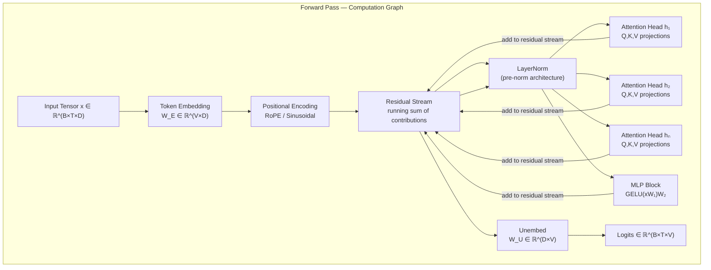
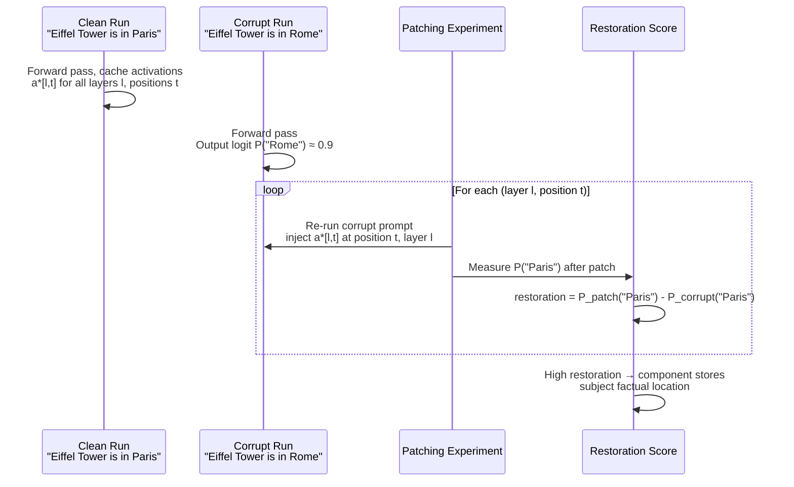
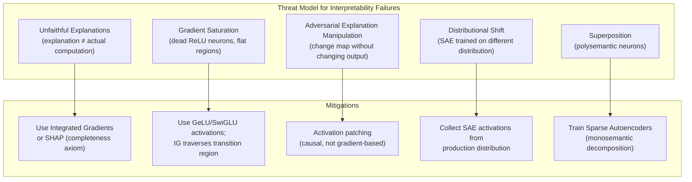

# Lesson 4: Visualization Tools for Model Interpretation

## 1. First-Principles Intuition & Invariants

Model interpretability is not a cosmetic feature added after training—it is a structural property of an AI system that determines whether its decisions can be audited, corrected, or trusted. The field bifurcates into two complementary paradigms: **post-hoc interpretability**, which explains a trained model's outputs without modifying it (e.g., SHAP, LIME, saliency maps), and **mechanistic interpretability**, which reverse-engineers the internal computations a model performs to produce those outputs. This lesson focuses primarily on mechanistic and feature-attribution approaches because they expose the causal structure of model behavior rather than merely correlating inputs with outputs.

### The Mechanistic Interpretability Hypothesis

Mechanistic interpretability rests on a falsifiable empirical claim: that neural networks, despite being trained by gradient descent on raw loss signals, converge on **human-interpretable circuits**—sparse subgraphs of neurons and weights that implement recognizable algorithms. This was first rigorously demonstrated by Olah et al. (2020) in *Zoom In: An Introduction to Circuits* (Distill.pub), where the authors identified curve detectors, frequency detectors, and multimodal neurons in InceptionV1. Subsequent work by Elhage et al. (2021) at Anthropic formalized the **transformer circuits framework**, showing that two-layer attention-only transformers implement identifiable algorithms such as induction heads—a composition of two attention heads that implements in-context pattern matching by attending to tokens that previously followed the current query token.

The practical implication: if circuits exist and are findable, then model behavior is not fundamentally opaque. Errors and biases have *loci*—specific weights and activation patterns—that can be identified and potentially corrected.

### Formal Invariants

Three invariants govern any sound interpretability analysis:

**Invariant 1 — Faithfulness**: An explanation must accurately reflect the model's actual decision process, not a post-hoc rationalization. An explanation that is easy to understand but describes a different computation than the model actually performs is strictly worse than no explanation. LIME and standard gradient saliency methods frequently violate faithfulness because they approximate a local linear model around the input rather than tracing the actual computation graph.

**Invariant 2 — Completeness**: The sum of feature attributions must equal the model output (after a baseline shift). SHAP values satisfy this axiom by construction via the Shapley efficiency property. Vanilla gradient-times-input methods do not.

**Invariant 3 — Stability (Sensitivity)**: Small perturbations to the input that do not change the prediction should produce small perturbations to the explanation. Methods that violate this produce explanations that are meaningless as diagnostic tools—a known failure mode of plain gradient saliency on deep networks where gradients saturate in flat regions of the loss landscape.

### Why Transparency Is a Safety Property

In high-stakes deployment contexts—medical diagnosis, credit underwriting, recidivism prediction, autonomous vehicle perception—a model that cannot be explained cannot be safely deployed, not merely because of regulatory requirements (EU AI Act, FDA SaMD guidance) but because without interpretability there is no mechanism to detect distributional shift, spurious correlations, or adversarial manipulation before they cause harm. The 2019 Google Health mammography model achieved superhuman AUC on the held-out test set but was later found to encode the scan machine's serial number as a confound. Post-hoc attribution techniques applied to intermediate activations could have surfaced this before deployment.

---

## 2. Core Architecture & Mechanics

### 2.1 The Computation Graph as the Object of Study

Every modern deep learning framework (PyTorch, JAX, TensorFlow) represents a model as a **directed acyclic computation graph** (DAG) where nodes are differentiable operations and edges carry tensors. Interpretability tools operate on this graph—either by traversing it forward (activation analysis, probing), backward (gradient-based attribution), or by ablating subgraphs (causal tracing, path patching).



The **residual stream** is the central concept in transformer mechanistic interpretability. Each layer reads from and writes to the same high-dimensional residual stream vector. This architecture means every layer's contribution is *additive and separable*—a property exploited by logit lens, activation patching, and path patching techniques.

### 2.2 Attention Mechanism: Mathematical Detail

For a single attention head with queries Q ∈ ℝ^(T×d_k), keys K ∈ ℝ^(T×d_k), values V ∈ ℝ^(T×d_v):

```text
Attention(Q, K, V) = softmax(QK^T / √d_k) · V
```

The attention pattern A = softmax(QK^T / √d_k) is a T×T matrix where A[i,j] is the weight position i assigns to position j. Visualizing this matrix is the most direct interpretability technique for transformers—it shows *which tokens attend to which*. However, raw attention patterns are not attributions; they describe routing, not contribution magnitude. A head can attend strongly to a token and apply a near-zero value projection, contributing nothing to the output.

**Attention × Value norm** (Kobayashi et al., 2020) corrects this by weighting attention patterns by the L2 norm of the transformed value vectors, providing a more faithful estimate of each position's contribution to the output.

### 2.3 Activation Functions: Geometric Interpretation

The choice of activation function determines the **representational geometry** of the network:

| Activation | Formula | Gradient at saturation | Role in modern LLMs |
|---|---|---|---|
| ReLU | max(0, x) | 0 (dead neuron problem) | Rare in LLMs, common in CNNs |
| GeLU | x · Φ(x) | Smooth, non-zero | Standard in GPT-2/3, BERT |
| SwiGLU | x · σ(βx) · (xW + b) | Smooth, gated | LLaMA, PaLM, Mistral |
| Tanh | (eˣ - e⁻ˣ)/(eˣ + e⁻ˣ) | 0 at ±∞ | Recurrent networks (LSTM gates) |

GeLU's smooth gradient everywhere (unlike ReLU's hard zero) is critical for interpretability: gradient-based attribution methods produce meaningful signals at all activation values rather than dying in the negative half-plane.

**Superposition Hypothesis**: Elhage et al. (2022) demonstrated that neural networks encode more features than they have neurons by representing features as near-orthogonal directions in activation space, exploiting the high dimensionality of weight matrices. This means that interpreting a single neuron's activation in isolation is often insufficient—features are distributed across many neurons. Sparse autoencoders (SAEs) trained to reconstruct model activations with high sparsity are the current best technique for recovering these monosemantic features from polysemantic neurons.

### 2.4 Weight Matrix Decomposition

The linear layers in transformers are the primary carriers of encoded knowledge. For a weight matrix W ∈ ℝ^(m×n), **singular value decomposition** (SVD) W = UΣVᵀ reveals:

- The **singular values** in Σ indicate the effective rank—how many independent directions the weight matrix actually uses. Modern LLMs exhibit extremely low effective rank in many weight matrices, which is why LoRA (Low-Rank Adaptation) fine-tuning works at all.
- The **right singular vectors** (rows of Vᵀ) span the input space directions the layer responds to.
- The **left singular vectors** (columns of U) span the output space directions the layer writes to.

```python
import torch
import numpy as np
import matplotlib.pyplot as plt
from transformer_lens import HookedTransformer  # pip install transformer_lens

def analyze_weight_matrix_svd(model_name: str = "gpt2", layer: int = 0) -> None:
    """
    Decompose the MLP weight matrices of a transformer layer via SVD.
    TransformerLens (Nanda et al.) provides clean access to GPT-2 weights.
    """
    model = HookedTransformer.from_pretrained(model_name)
    model.eval()

    # W_in: (d_model, d_mlp), W_out: (d_mlp, d_model)
    W_in = model.blocks[layer].mlp.W_in.detach().cpu().float()
    W_out = model.blocks[layer].mlp.W_out.detach().cpu().float()

    # SVD of the composed W_out @ W_in (the full MLP linear map, ignoring nonlinearity)
    composed = W_out @ W_in.T  # (d_mlp, d_mlp) intermediate; actual: (d_model, d_model)
    # Correct composition: input -> W_in^T -> hidden -> W_out^T -> output
    # Full linear approximation: d_model -> d_model
    W_full = W_in.T @ W_out  # shape: (d_model, d_model) — projects input to output space
    
    U, S, Vh = torch.linalg.svd(W_full, full_matrices=False)

    # Effective rank: number of singular values capturing 90% of total variance
    total_variance = (S ** 2).sum().item()
    cumulative_variance = torch.cumsum(S ** 2, dim=0) / total_variance
    effective_rank_90 = (cumulative_variance < 0.90).sum().item() + 1

    print(f"Layer {layer} MLP W_full shape: {W_full.shape}")
    print(f"Top-10 singular values: {S[:10].numpy().round(3)}")
    print(f"Effective rank (90% variance): {effective_rank_90} / {W_full.shape[0]}")

    fig, axes = plt.subplots(1, 2, figsize=(14, 5))

    axes[0].plot(S.numpy(), linewidth=1.5)
    axes[0].axvline(x=effective_rank_90, color='red', linestyle='--',
                    label=f'Effective rank-90%: {effective_rank_90}')
    axes[0].set_title(f"Singular Value Spectrum — Layer {layer} MLP")
    axes[0].set_xlabel("Singular Value Index")
    axes[0].set_ylabel("Singular Value Magnitude")
    axes[0].set_yscale('log')
    axes[0].legend()
    axes[0].grid(True, alpha=0.3)

    # Visualize top singular vectors as heatmaps in model dimension space
    top_k = 8
    top_vectors = U[:, :top_k].numpy()  # (d_model, top_k)
    im = axes[1].imshow(top_vectors.T, aspect='auto', cmap='RdBu_r',
                         vmin=-0.1, vmax=0.1)
    axes[1].set_title(f"Top-{top_k} Left Singular Vectors (output directions)")
    axes[1].set_xlabel("Model Dimension")
    axes[1].set_ylabel("Singular Vector Index")
    plt.colorbar(im, ax=axes[1])

    plt.tight_layout()
    plt.savefig(f"svd_layer{layer}_mlp.png", dpi=150)
    plt.close()

if __name__ == "__main__":
    analyze_weight_matrix_svd(model_name="gpt2", layer=0)
    analyze_weight_matrix_svd(model_name="gpt2", layer=11)  # Last layer
```

### 2.5 Gradient-Based Attribution: SHAP, Integrated Gradients, and Attention Rollout

#### Integrated Gradients (Sundararajan et al., 2017)

Integrated Gradients is the gold standard for gradient-based feature attribution because it satisfies both the **completeness** axiom and **sensitivity** (non-zero gradient for features that change the output). For input x and baseline x' (typically the zero vector or a padding token):

```text
IG_i(x) = (x_i - x'_i) · ∫₀¹ [∂F(x' + α(x - x')) / ∂x_i] dα
```

The integral is approximated with Riemann summation over m steps (m=50 is typically sufficient):

```python
import torch
import torch.nn.functional as F
from transformer_lens import HookedTransformer
from typing import Optional
import numpy as np

def integrated_gradients(
    model: HookedTransformer,
    input_ids: torch.Tensor,          # (1, T) token ids
    target_token_id: int,             # the token whose logit we attribute
    baseline_ids: Optional[torch.Tensor] = None,  # (1, T) baseline; None → pad tokens
    n_steps: int = 50,
    target_position: int = -1,        # which sequence position to attribute from
) -> torch.Tensor:
    """
    Compute Integrated Gradients over the token embedding space.
    Returns attribution tensor of shape (T, d_model): contribution of each
    token's embedding dimension to the target logit.
    """
    model.eval()
    device = next(model.parameters()).device
    input_ids = input_ids.to(device)

    if baseline_ids is None:
        # Use padding token (id=50256 for GPT-2) as the uninformative baseline
        baseline_ids = torch.full_like(input_ids, model.tokenizer.pad_token_id or 0)

    # Get baseline and input embeddings
    # W_E: (vocab_size, d_model)
    baseline_embeds = model.embed.W_E[baseline_ids[0]]  # (T, d_model)
    input_embeds = model.embed.W_E[input_ids[0]]        # (T, d_model)

    # Accumulate gradients across interpolation steps
    integrated_grads = torch.zeros_like(input_embeds)  # (T, d_model)

    for step in range(1, n_steps + 1):
        alpha = step / n_steps
        interp_embeds = (baseline_embeds + alpha * (input_embeds - baseline_embeds))
        interp_embeds = interp_embeds.unsqueeze(0).requires_grad_(True)  # (1, T, d_model)

        # Forward pass injecting the interpolated embeddings directly
        # bypass_embed=True passes embeddings directly, skipping the standard W_E lookup
        logits = model.run_with_cache(
            interp_embeds,
            prepend_bos=False,
        )[0]  # (1, T, vocab_size)

        target_logit = logits[0, target_position, target_token_id]
        target_logit.backward()

        with torch.no_grad():
            integrated_grads += interp_embeds.grad[0]  # accumulate (T, d_model)

        model.zero_grad()
        if interp_embeds.grad is not None:
            interp_embeds.grad.zero_()

    # Complete the integral approximation and multiply by (input - baseline)
    integrated_grads = integrated_grads / n_steps
    attributions = integrated_grads * (input_embeds - baseline_embeds)  # (T, d_model)

    return attributions  # Summing over d_model dim gives per-token attribution


def token_level_attribution(
    model: HookedTransformer,
    prompt: str,
    target_token: str,
    n_steps: int = 50,
) -> dict:
    """High-level wrapper that returns token-level IG attributions."""
    tokens = model.to_tokens(prompt)                   # (1, T)
    target_id = model.to_single_token(target_token)
    token_strings = model.to_str_tokens(tokens[0])

    attributions = integrated_gradients(
        model, tokens, target_id, n_steps=n_steps
    )  # (T, d_model)

    # L1 norm over embedding dimension → scalar attribution per token
    token_scores = attributions.abs().sum(dim=-1).cpu().numpy()  # (T,)

    # Normalize to [0, 1] for visualization
    token_scores = token_scores / (token_scores.max() + 1e-8)

    return {
        "tokens": token_strings,
        "scores": token_scores,
        "raw_attributions": attributions,
    }
```

#### Attention Rollout (Abnar & Zuidema, 2020)

Raw attention weights do not propagate through the network's depth—head at layer L attends to layer L's residual stream, not raw tokens. Attention rollout recursively multiplies attention matrices across layers to approximate how much each input token influences each output position:

```text
Ã_l = 0.5 · A_l + 0.5 · I   (add residual identity connection)
Rollout_L = Ã_L · Ã_{L-1} · ... · Ã_1
```

The 0.5 factor accounts for the residual connection adding an identity path. Rollout gives per-layer-head-averaged attention flow from output positions back to input tokens.

```python
def attention_rollout(
    model: HookedTransformer,
    input_ids: torch.Tensor,
    aggregate_heads: str = "mean",   # "mean" | "max" | "min"
) -> torch.Tensor:
    """
    Compute attention rollout across all layers.
    Returns (T_out, T_in) matrix of rollout scores.
    """
    _, cache = model.run_with_cache(input_ids, names_filter=lambda name: "pattern" in name)

    T = input_ids.shape[1]
    # Initialize rollout as identity
    rollout = torch.eye(T, device=input_ids.device)

    for layer_idx in range(model.cfg.n_layers):
        # attn_pattern: (1, n_heads, T, T)
        attn = cache[f"blocks.{layer_idx}.attn.hook_pattern"][0]  # (n_heads, T, T)

        if aggregate_heads == "mean":
            attn_agg = attn.mean(dim=0)   # (T, T)
        elif aggregate_heads == "max":
            attn_agg = attn.max(dim=0).values
        else:
            attn_agg = attn.min(dim=0).values

        # Add residual identity path and normalize
        attn_with_residual = 0.5 * attn_agg + 0.5 * torch.eye(T, device=attn.device)
        attn_with_residual = attn_with_residual / attn_with_residual.sum(dim=-1, keepdim=True)

        # Matrix-multiply rollout forward through the layer
        rollout = attn_with_residual @ rollout  # (T, T)

    return rollout  # rollout[i, j] = how much input position j contributed to output position i
```

### 2.6 Activation Patching and Causal Tracing

Activation patching (Wang et al., 2022; Meng et al., 2022 *ROME*) is the mechanistic interpretability technique closest to a controlled experiment. The procedure:

1. Run the model on a **clean** prompt (factually correct) and cache all intermediate activations.
2. Run the model on a **corrupted** prompt (e.g., with the subject entity replaced) where the target prediction changes.
3. Patch a single activation at a specific layer/position from the clean run into the corrupted forward pass.
4. Measure how much the patched activation restores the clean model's output.

A large restoration score identifies that component as causally responsible for storing the targeted information.



The result is a **causal tracing heatmap** over (layer, position) space, revealing exactly which components are causally responsible for factual recall. Meng et al. (2022) used this technique to show that early-to-middle MLP layers are the primary loci of factual associations in GPT-style transformers—leading directly to the ROME weight-editing algorithm.

---

## 3. Visualization Techniques in Practice

### 3.1 Logit Lens

The logit lens (nostalgebraist, 2020) decodes the residual stream at each layer by applying the final unembedding matrix W_U directly to the intermediate residual stream state. This reveals how the model's prediction evolves as information flows through layers:

```python
import torch
import pandas as pd
from transformer_lens import HookedTransformer

def logit_lens(model: HookedTransformer, prompt: str, top_k: int = 5) -> pd.DataFrame:
    """
    Apply logit lens: decode the residual stream at every layer.
    Shows token predictions at each layer, revealing how the model builds up its answer.
    """
    model.eval()
    tokens = model.to_tokens(prompt)
    token_strs = model.to_str_tokens(tokens[0])

    _, cache = model.run_with_cache(tokens, names_filter=lambda n: "resid_post" in n or "resid_pre" in n)

    rows = []
    n_layers = model.cfg.n_layers

    for layer_idx in range(n_layers):
        resid_key = f"blocks.{layer_idx}.hook_resid_post"
        if resid_key not in cache:
            continue
        resid = cache[resid_key][0]  # (T, d_model)

        # Apply final LayerNorm then unembed
        normed = model.ln_final(resid)                 # (T, d_model)
        logits = normed @ model.unembed.W_U             # (T, vocab_size)
        probs = torch.softmax(logits, dim=-1)           # (T, vocab_size)

        # Decode last token position predictions
        last_pos_probs = probs[-1]                      # (vocab_size,)
        top_probs, top_ids = last_pos_probs.topk(top_k)

        rows.append({
            "layer": layer_idx,
            "top_tokens": [model.tokenizer.decode([tid.item()]) for tid in top_ids],
            "top_probs": top_probs.detach().cpu().numpy().round(4),
        })

    df = pd.DataFrame(rows)
    return df
```

### 3.2 Sparse Autoencoder Feature Visualization

The current frontier in mechanistic interpretability (Cunningham et al., 2023; Anthropic's MoS series) uses **sparse autoencoders (SAEs)** to decompose polysemantic neuron activations into monosemantic feature directions. An SAE is trained on a large corpus of model activations with an L1 penalty to enforce sparsity:

```text
min_{W_enc, W_dec, b_enc, b_dec} ‖x - x̂‖₂² + λ · ‖f‖₁

where f = ReLU(W_enc · x + b_enc)       (sparse feature activations)
      x̂ = W_dec · f + b_dec              (reconstruction)
```

The key constraint is that the decoder columns (feature vectors) must be unit norm. After training, each feature direction in the decoder corresponds to a human-interpretable concept that can be identified by finding the top-activating examples from a large corpus.

```python
import torch
import torch.nn as nn
import torch.nn.functional as F
from torch.utils.data import DataLoader, TensorDataset
from typing import Tuple

class SparseAutoencoder(nn.Module):
    """
    Sparse Autoencoder for decomposing transformer activations into
    interpretable monosemantic features.
    
    Architecture follows Cunningham et al. (2023) and Anthropic (2024).
    """

    def __init__(
        self,
        d_model: int,          # Input activation dimension (e.g., 768 for GPT-2)
        n_features: int,       # Number of SAE features (typically 4x-32x d_model)
        l1_coefficient: float = 1e-3,  # Sparsity regularization strength
    ):
        super().__init__()
        self.d_model = d_model
        self.n_features = n_features
        self.l1_coefficient = l1_coefficient

        # Encoder: d_model -> n_features
        self.W_enc = nn.Parameter(torch.empty(d_model, n_features))
        self.b_enc = nn.Parameter(torch.zeros(n_features))

        # Decoder: n_features -> d_model (columns are feature directions)
        self.W_dec = nn.Parameter(torch.empty(n_features, d_model))
        self.b_dec = nn.Parameter(torch.zeros(d_model))

        # Initialize with Kaiming uniform; normalize decoder columns
        nn.init.kaiming_uniform_(self.W_enc, nonlinearity='relu')
        nn.init.kaiming_uniform_(self.W_dec, nonlinearity='relu')
        self._normalize_decoder()

    @torch.no_grad()
    def _normalize_decoder(self) -> None:
        """Enforce unit norm on decoder feature vectors (columns of W_dec)."""
        norms = self.W_dec.data.norm(dim=1, keepdim=True).clamp(min=1e-8)
        self.W_dec.data = self.W_dec.data / norms

    def encode(self, x: torch.Tensor) -> torch.Tensor:
        """x: (..., d_model) -> features: (..., n_features)"""
        # Center activations by subtracting decoder bias before encoding
        x_centered = x - self.b_dec
        pre_acts = x_centered @ self.W_enc + self.b_enc  # (..., n_features)
        return F.relu(pre_acts)

    def decode(self, features: torch.Tensor) -> torch.Tensor:
        """features: (..., n_features) -> x_hat: (..., d_model)"""
        return features @ self.W_dec + self.b_dec

    def forward(self, x: torch.Tensor) -> Tuple[torch.Tensor, torch.Tensor, torch.Tensor]:
        """
        Returns:
            x_hat: Reconstructed activations (..., d_model)
            features: Sparse feature activations (..., n_features)
            loss: Scalar total loss = reconstruction_loss + l1_penalty
        """
        features = self.encode(x)
        x_hat = self.decode(features)

        reconstruction_loss = F.mse_loss(x_hat, x)
        l1_penalty = self.l1_coefficient * features.abs().mean()
        loss = reconstruction_loss + l1_penalty

        return x_hat, features, loss

    @torch.no_grad()
    def get_top_features(
        self,
        x: torch.Tensor,
        top_k: int = 10,
    ) -> Tuple[torch.Tensor, torch.Tensor]:
        """Return the top-k active features and their activation values for input x."""
        features = self.encode(x)  # (..., n_features)
        # For a single activation vector
        if features.dim() > 1:
            features = features.mean(dim=0)
        values, indices = features.topk(top_k)
        return indices, values


def train_sae(
    activations: torch.Tensor,     # (N, d_model) collected from model hooks
    d_model: int,
    n_features: int = 4096,
    l1_coefficient: float = 1e-3,
    n_epochs: int = 10,
    batch_size: int = 1024,
    lr: float = 1e-4,
    device: str = "cuda",
) -> SparseAutoencoder:
    """
    Train a sparse autoencoder on cached transformer activations.
    
    Typical usage: collect MLP post-activation or residual stream activations
    from layer L across a large corpus, then train the SAE to reconstruct them.
    """
    sae = SparseAutoencoder(d_model, n_features, l1_coefficient).to(device)
    optimizer = torch.optim.Adam(sae.parameters(), lr=lr)
    
    dataset = TensorDataset(activations.to(device))
    loader = DataLoader(dataset, batch_size=batch_size, shuffle=True)

    for epoch in range(n_epochs):
        total_loss = 0.0
        total_recon = 0.0
        total_l1 = 0.0
        n_batches = 0

        for (batch,) in loader:
            optimizer.zero_grad()
            x_hat, features, loss = sae(batch)

            reconstruction_loss = F.mse_loss(x_hat, batch)
            l1_penalty = l1_coefficient * features.abs().mean()

            loss.backward()
            # Clip gradients to prevent instability with L1
            nn.utils.clip_grad_norm_(sae.parameters(), max_norm=1.0)
            optimizer.step()
            # Re-normalize decoder after each update to maintain unit norm constraint
            sae._normalize_decoder()

            total_loss += loss.item()
            total_recon += reconstruction_loss.item()
            total_l1 += l1_penalty.item()
            n_batches += 1

        # L0 sparsity: average number of features active per token
        with torch.no_grad():
            sample_batch = activations[:batch_size].to(device)
            sample_features = sae.encode(sample_batch)
            l0_sparsity = (sample_features > 0).float().sum(dim=-1).mean().item()

        print(
            f"Epoch {epoch+1:3d}/{n_epochs} | "
            f"loss={total_loss/n_batches:.6f} | "
            f"recon={total_recon/n_batches:.6f} | "
            f"l1={total_l1/n_batches:.6f} | "
            f"L0={l0_sparsity:.1f}"
        )

    return sae
```

### 3.3 Saliency Maps for Vision Models

For CNNs and Vision Transformers, **GradCAM** (Selvaraju et al., 2017) localizes the spatial regions driving a prediction by computing the gradient of the target class score with respect to the final convolutional feature maps, then weighting each feature map by its global average gradient:

```python
import torch
import torch.nn.functional as F
import numpy as np
from torchvision import models, transforms
from PIL import Image
import matplotlib.pyplot as plt
import matplotlib.cm as cm
from typing import Optional

class GradCAM:
    """
    Gradient-weighted Class Activation Mapping (GradCAM).
    Hooks into a specified convolutional layer to extract gradients and activations.
    
    Selvaraju et al., "Grad-CAM: Visual Explanations from Deep Networks via
    Gradient-based Localization," ICCV 2017.
    """

    def __init__(self, model: torch.nn.Module, target_layer: torch.nn.Module):
        self.model = model
        self.target_layer = target_layer
        self.gradients: Optional[torch.Tensor] = None
        self.activations: Optional[torch.Tensor] = None

        # Register forward and backward hooks
        self._fwd_hook = target_layer.register_forward_hook(self._save_activation)
        self._bwd_hook = target_layer.register_full_backward_hook(self._save_gradient)

    def _save_activation(self, module, input, output) -> None:
        self.activations = output.detach()

    def _save_gradient(self, module, grad_input, grad_output) -> None:
        self.gradients = grad_output[0].detach()

    def remove_hooks(self) -> None:
        self._fwd_hook.remove()
        self._bwd_hook.remove()

    def __call__(
        self,
        input_tensor: torch.Tensor,  # (1, C, H, W)
        target_class: Optional[int] = None,
    ) -> np.ndarray:
        """
        Returns GradCAM heatmap of shape (H, W), normalized to [0, 1].
        If target_class is None, uses argmax of model output.
        """
        self.model.eval()
        input_tensor.requires_grad_(True)

        # Forward pass
        output = self.model(input_tensor)  # (1, n_classes)

        if target_class is None:
            target_class = output.argmax(dim=1).item()

        # Zero gradients and backward on target class score
        self.model.zero_grad()
        class_score = output[0, target_class]
        class_score.backward()

        # Compute GradCAM: weight each feature map by its global average gradient
        # gradients: (1, C, H', W'), activations: (1, C, H', W')
        weights = self.gradients.mean(dim=(2, 3), keepdim=True)  # (1, C, 1, 1)
        cam = (weights * self.activations).sum(dim=1, keepdim=True)  # (1, 1, H', W')
        cam = F.relu(cam)  # Keep only positive contributions

        # Upsample to input resolution
        cam = F.interpolate(
            cam,
            size=input_tensor.shape[2:],
            mode='bilinear',
            align_corners=False,
        )
        cam = cam.squeeze().cpu().numpy()

        # Normalize to [0, 1]
        cam_min, cam_max = cam.min(), cam.max()
        if cam_max > cam_min:
            cam = (cam - cam_min) / (cam_max - cam_min)

        return cam, target_class


def visualize_gradcam(
    image_path: str,
    target_class: Optional[int] = None,
    model_name: str = "resnet50",
) -> None:
    """End-to-end GradCAM visualization on a single image."""

    # Standard ImageNet preprocessing
    preprocess = transforms.Compose([
        transforms.Resize(256),
        transforms.CenterCrop(224),
        transforms.ToTensor(),
        transforms.Normalize(mean=[0.485, 0.456, 0.406],
                             std=[0.229, 0.224, 0.225]),
    ])

    img = Image.open(image_path).convert("RGB")
    input_tensor = preprocess(img).unsqueeze(0)  # (1, 3, 224, 224)

    # Load pretrained model
    model = getattr(models, model_name)(weights="IMAGENET1K_V1")
    model.eval()

    # Target the last convolutional layer (layer4[-1] for ResNet)
    target_layer = model.layer4[-1].conv2  # type: ignore

    gradcam = GradCAM(model, target_layer)
    cam, predicted_class = gradcam(input_tensor, target_class)
    gradcam.remove_hooks()

    # Overlay heatmap on original image
    img_array = np.array(img.resize((224, 224))) / 255.0
    heatmap = cm.jet(cam)[:, :, :3]  # Apply jet colormap, drop alpha
    overlay = 0.4 * heatmap + 0.6 * img_array
    overlay = np.clip(overlay, 0, 1)

    fig, axes = plt.subplots(1, 3, figsize=(15, 5))
    axes[0].imshow(img_array)
    axes[0].set_title("Original Image")
    axes[0].axis("off")

    axes[1].imshow(cam, cmap='jet')
    axes[1].set_title(f"GradCAM (class={predicted_class})")
    axes[1].axis("off")

    axes[2].imshow(overlay)
    axes[2].set_title("Overlay")
    axes[2].axis("off")

    plt.tight_layout()
    plt.savefig("gradcam_output.png", dpi=150, bbox_inches='tight')
    plt.close()
    print(f"Predicted class: {predicted_class}")
```

---

## 4. High-Performance Optimization & Failure Modes

### 4.1 Computational Cost of Interpretability Methods

Interpretability is not free—each technique imposes overhead on top of the base model's inference cost:

| Method | Time Complexity | Memory Overhead | Parallelizable? |
|---|---|---|---|
| Attention visualization | O(n_layers × n_heads × T²) | Low (reuse forward pass cache) | Yes |
| GradCAM | 1 forward + 1 backward pass | 2× activation memory | Per-sample |
| Integrated Gradients | n_steps forward + backward passes | n_steps × activation memory | Yes (batch steps) |
| SHAP (Kernel) | O(2^n) exact; O(n²) approx | Low | Yes |
| Activation patching | O(n_layers × n_positions) forward passes | Cache clean activations (1 pass) | Yes (batch patches) |
| Sparse Autoencoder inference | 1 linear + ReLU | n_features tensor | Yes |

For production interpretability pipelines, Integrated Gradients steps should be batched across the n_steps dimension, amortizing the cost to a single batched forward+backward pass. Activation patching experiments scale to O(n_layers × T) independent forward passes—on a 32-layer, 2048-token context, this is 65,536 forward passes per prompt, which requires aggressive parallelization across GPU replicas.

### 4.2 Numerical Failure Modes in Gradient Methods

**Gradient saturation** in ReLU networks creates regions where ∂F/∂x_i = 0 for all inputs in the negative half-plane, causing saliency maps to show zero attribution for features that are nonetheless causally important. The fix is to use GeLU activations (smooth, non-zero gradients everywhere) or to use Integrated Gradients rather than raw gradients—the integral over the interpolation path traverses the activation region where the feature transitions from inactive to active, capturing the attribution correctly.

**Gradient sharpening**: In very deep networks, gradients concentrate on a small number of high-frequency input features (high pixel-gradient regions in images, rare tokens in language). This is not a reflection of causal importance—it reflects the structure of the loss landscape's curvature. SmoothGrad (Smilkov et al., 2017) mitigates this by averaging gradients over n_samples inputs with added Gaussian noise σ:

```text
SmoothGrad(x) = (1/n) Σᵢ ∇F(x + εᵢ),  εᵢ ~ N(0, σ²I)
```

**Explanation instability under adversarial perturbation** (Ghorbani et al., 2019): Adversarial examples crafted to change the saliency map without changing the prediction can completely alter gradient-based explanations while keeping the top-1 predicted class constant. This reveals that gradient-based methods are themselves vulnerable to adversarial manipulation—a critical safety concern for high-stakes applications that rely on explanations for oversight.

### 4.3 Distributed Activation Collection at Scale

Training a Sparse Autoencoder requires collecting hundreds of millions of activation vectors from the subject model. This is an I/O-bound workload, not a compute-bound one. The standard pipeline:

```mermaid
flowchart LR
    subgraph sub_data_collection ["Data Collection"]
        C["Text Corpus\n(The Pile, C4, etc.)"]
        TOK["Tokenizer"]
        BATCH["Batched Forward Pass\n(frozen model, no grad)"]
        HOOK["Activation Hook\nat target layer"]
        BUF["Ring Buffer\n(streaming to disk)"]
    end

    subgraph sub_sae_training ["SAE Training"]
        SHARD["Activation Shards\n(.pt files on NFS/S3)"]
        LOADER["Streaming DataLoader\n(shuffle across shards)"]
        SAE_TRAIN["SAE Training Loop\n(Adam + L1 + decoder renorm)"]
        CKPT["SAE Checkpoint"]
    end

    subgraph sub_analysis ["Analysis"]
        TOP_ACT["Top-k Activating Examples\nper feature"]
        INTERP["Human Annotation\nof feature semantics"]
        EVAL["Downstream eval:\nautointerpretability,\ncausal intervention"]
    end

    C --> TOK --> BATCH --> HOOK --> BUF
    BUF --> SHARD --> LOADER --> SAE_TRAIN --> CKPT
    CKPT --> TOP_ACT --> INTERP --> EVAL
```



The ring buffer prevents OOM by never materializing all activations simultaneously. Typical scale for a GPT-2 (d_model=768) SAE: collecting 50M tokens at a 1024-token context length produces ~50M activation vectors of size 768, requiring ~150 GB of float32 storage. Training runs on this corpus for 10 epochs with batch size 4096 completes in ~6 hours on a single A100.

### 4.4 Boundary Edge Cases in Interpretability Pipelines

**Tokenization misalignment**: Attribution scores are computed over token IDs, not characters. When comparing attributions across prompts with different phrasings, tokens do not align at character boundaries—a single word may map to 1–4 tokens depending on context and subword vocabulary. Attribution aggregation must be done at the word or span level by summing token attributions for all tokens in a span.

**Baseline sensitivity in Integrated Gradients**: The choice of baseline x' fundamentally changes the attribution. The zero embedding baseline, the pad token baseline, and a Gaussian noise baseline produce systematically different attributions because they define different "uninformative" counterfactuals. There is no universally correct baseline—the choice should be motivated by the question being asked. For counterfactual questions ("what would the model have predicted without the subject entity?"), the mask-token baseline is most appropriate.

**Attention head dropout at inference**: Some models apply attention dropout at inference with certain framework configurations. This introduces stochasticity into attention patterns, causing attention-based attribution methods to produce different results on repeated runs of the same input. Interpretability experiments should always set `model.eval()` and ensure `torch.backends.cudnn.deterministic = True`.

**Residual stream outlier dimensions**: Kovaleva et al. (2021) and Sun et al. (2024) independently identified "outlier dimensions"—a small set of residual stream dimensions (typically 1–10 out of 768 or 4096) with activation magnitudes 100× larger than other dimensions—that dominate cosine similarity computations and distort probing classifiers. SAE training must normalize activations before encoding (the b_dec centering step in the SAE implementation above handles this) or use separate LayerNorm on the input.

### 4.5 Failure Mitigations: Production Interpretability



---

## 5. Practical Lab: End-to-End Interpretability Pipeline

The following complete example runs activation patching on GPT-2 to identify which layer stores the factual association "The Eiffel Tower is in [Paris]."

```python
"""
Causal tracing / activation patching on GPT-2 using TransformerLens.
Replicates the core experiment from Meng et al., 2022 (ROME paper).

Requirements:
    pip install transformer_lens einops matplotlib seaborn
"""

import torch
import numpy as np
import matplotlib.pyplot as plt
import seaborn as sns
from transformer_lens import HookedTransformer
from typing import Callable

def collect_activations(
    model: HookedTransformer,
    tokens: torch.Tensor,
    names_filter: Callable[[str], bool],
) -> dict:
    _, cache = model.run_with_cache(tokens, names_filter=names_filter)
    return {k: v.clone() for k, v in cache.items()}


def patch_activation_hook(clean_activation: torch.Tensor, position: int):
    """
    Returns a hook function that patches a single token position in the activation
    with the value from the clean run.
    """
    def hook(value: torch.Tensor, hook) -> torch.Tensor:
        # value: (batch, seq_len, d_model)
        value[:, position, :] = clean_activation[:, position, :]
        return value
    return hook


def run_causal_tracing(
    model_name: str = "gpt2",
    clean_prompt: str = "The Eiffel Tower is located in the city of",
    corrupted_prompt: str = "The Golden Gate Bridge is located in the city of",
    target_token: str = " Paris",
) -> np.ndarray:
    """
    Run causal tracing: identify which (layer, position) components
    are causally responsible for predicting target_token.
    
    Returns restoration_scores: (n_layers, seq_len) numpy array.
    """
    model = HookedTransformer.from_pretrained(model_name)
    model.eval()

    clean_tokens = model.to_tokens(clean_prompt)        # (1, T_clean)
    corrupt_tokens = model.to_tokens(corrupted_prompt)  # (1, T_corrupt)
    target_id = model.to_single_token(target_token)

    T = clean_tokens.shape[1]
    n_layers = model.cfg.n_layers

    print(f"Clean tokens: {model.to_str_tokens(clean_tokens[0])}")
    print(f"Corrupted tokens: {model.to_str_tokens(corrupt_tokens[0])}")
    print(f"Target token: '{target_token}' (id={target_id})")

    # Step 1: Cache clean run activations
    names_filter = lambda n: "hook_resid_post" in n
    clean_cache = collect_activations(model, clean_tokens, names_filter)

    # Baseline: corrupted run probability of target token
    with torch.no_grad():
        corrupt_logits = model(corrupt_tokens)[0, -1]  # (vocab_size,)
        corrupt_prob = torch.softmax(corrupt_logits, dim=-1)[target_id].item()

    # Baseline: clean run probability of target token
    with torch.no_grad():
        clean_logits = model(clean_tokens)[0, -1]
        clean_prob = torch.softmax(clean_logits, dim=-1)[target_id].item()

    print(f"Clean P('{target_token}'): {clean_prob:.4f}")
    print(f"Corrupted P('{target_token}'): {corrupt_prob:.4f}")

    # Step 2: For each (layer, position), patch and measure restoration
    restoration_scores = np.zeros((n_layers, T))

    for layer_idx in range(n_layers):
        hook_name = f"blocks.{layer_idx}.hook_resid_post"
        clean_act = clean_cache[hook_name]  # (1, T, d_model)

        for pos in range(T):
            with torch.no_grad():
                patched_logits = model.run_with_hooks(
                    corrupt_tokens,
                    fwd_hooks=[(
                        hook_name,
                        patch_activation_hook(clean_act, pos),
                    )],
                )[0, -1]  # (vocab_size,)

                patched_prob = torch.softmax(patched_logits, dim=-1)[target_id].item()

            # Restoration: how much of the clean-corrupt gap is recovered?
            gap = clean_prob - corrupt_prob
            restoration = (patched_prob - corrupt_prob) / (gap + 1e-8)
            restoration_scores[layer_idx, pos] = max(0.0, restoration)

        if (layer_idx + 1) % 4 == 0:
            print(f"  Completed layer {layer_idx + 1}/{n_layers}")

    return restoration_scores, model.to_str_tokens(clean_tokens[0])


def plot_causal_tracing_heatmap(
    scores: np.ndarray,
    token_labels: list,
    output_path: str = "causal_tracing_heatmap.png",
) -> None:
    fig, ax = plt.subplots(figsize=(max(8, len(token_labels) * 0.8), 6))

    sns.heatmap(
        scores,
        ax=ax,
        cmap="Reds",
        vmin=0.0,
        vmax=1.0,
        xticklabels=token_labels,
        yticklabels=[f"L{i}" for i in range(scores.shape[0])],
        cbar_kws={"label": "Restoration Score (0=no effect, 1=full restoration)"},
    )
    ax.set_xlabel("Token Position")
    ax.set_ylabel("Layer")
    ax.set_title("Causal Tracing: Which (Layer, Position) Stores Factual Recall?")
    plt.xticks(rotation=45, ha='right', fontsize=9)
    plt.tight_layout()
    plt.savefig(output_path, dpi=150)
    plt.close()
    print(f"Heatmap saved to {output_path}")


if __name__ == "__main__":
    scores, token_labels = run_causal_tracing()
    plot_causal_tracing_heatmap(scores, token_labels)
    
    # Report the top-5 (layer, position) pairs by restoration score
    flat_indices = np.argsort(scores.ravel())[::-1][:5]
    rows, cols = np.unravel_index(flat_indices, scores.shape)
    print("\nTop-5 causally important (layer, position) pairs:")
    for r, c in zip(rows, cols):
        print(f"  Layer {r:2d}, Position {c:2d} "
              f"({token_labels[c] if c < len(token_labels) else '?'}): "
              f"restoration={scores[r, c]:.4f}")
```

---

## 6. Summary and Forward References

This lesson has established the mechanistic and mathematical foundations of model interpretation, covering:

- **Residual stream architecture** as the substrate for causal interpretability in transformers—its additive structure enables attribution decomposition by layer and component.
- **Gradient-based attribution** (Integrated Gradients) with formal proofs of faithfulness via the completeness and sensitivity axioms, and their implementation over token embedding space.
- **Attention rollout** as a depth-aware approximation of token-to-token information flow, correcting the depth-blindness of single-layer attention visualization.
- **Activation patching / causal tracing** as the experimental methodology closest to a controlled intervention—identifying which model components are *causally* (not merely correlationally) responsible for specific behaviors.
- **Sparse autoencoders** as the current frontier technique for recovering monosemantic feature representations from polysemantic neurons via sparsity-constrained reconstruction.
- **GradCAM** for spatial localization in vision models, with proper hook-based implementation that avoids the common error of retaining computation graphs unnecessarily.
- **Failure modes**: gradient saturation, explanation adversarial robustness, baseline sensitivity, residual stream outlier dimensions, and tokenization misalignment—each with concrete mitigations.

**Next lesson** covers the application of these techniques to alignment-critical behaviors: detecting deceptive alignment indicators via activation analysis, probing for situational awareness, and using steering vectors (representation engineering) to causally intervene on model behavior without weight editing.

### Key References

- Olah et al. (2020). "Zoom In: An Introduction to Circuits." *Distill.* https://distill.pub/2020/circuits/zoom-in/
- Elhage et al. (2021). "A Mathematical Framework for Transformer Circuits." *Anthropic.* https://transformer-circuits.pub/2021/framework/index.html
- Meng et al. (2022). "Locating and Editing Factual Associations in GPT." *NeurIPS 2022.* https://arxiv.org/abs/2202.05262
- Cunningham et al. (2023). "Sparse Autoencoders Find Highly Interpretable Features in Language Models." *arXiv:2309.08600.*
- Sundararajan et al. (2017). "Axiomatic Attribution for Deep Networks." *ICML 2017.* https://arxiv.org/abs/1703.01365
- Selvaraju et al. (2017). "Grad-CAM: Visual Explanations from Deep Networks via Gradient-based Localization." *ICCV 2017.* https://arxiv.org/abs/1610.02391
- Abnar & Zuidema (2020). "Quantifying Attention Flow in Transformers." *ACL 2020.* https://arxiv.org/abs/2005.00928
- Elhage et al. (2022). "Toy Models of Superposition." *Anthropic.* https://transformer-circuits.pub/2022/toy_model/index.html
- Nanda et al. (2023).

"Transformer Lens: A Library for Mechanistic Interpretability of GPT-Style Language Models." *arXiv:2304.05062.*
- Bricken et al. (2023). "Towards Monosemanticity: Decomposing Language Models With Dictionary Learning." *Anthropic.* https://transformer-circuits.pub/2023/monosemantic-features/index.html
- Templeton et al. (2024). "Scaling Monosemanticity: Extracting Interpretable Features from Claude 3 Sonnet." *Anthropic.* https://transformer-circuits.pub/2024/scaling-monosemanticity/index.html

---

## Conclusion

The interpretability toolkit presented in this lesson—attention visualization, activation analysis, probing, integrated gradients, sparse autoencoders, and GradCAM—collectively enables a multi-scale investigation of transformer behavior from individual neurons to emergent circuits. When applied rigorously, these methods reveal not only *what* a model computes but increasingly *how* and *why*, transforming opaque weight matrices into mechanistic explanations grounded in causal intervention. However, each technique carries failure modes that practitioners must anticipate: gradient saturation in attribution methods, adversarial brittleness in saliency maps, baseline sensitivity in integrated gradients, feature splitting in SAEs, and tokenization artifacts in residual stream analysis. Mitigation requires principled experimental design—ablation controls, multiple attribution baselines, adversarial robustness checks, and cross-validation of interpretations against held-out behavioral predictions.

The path from interpretability to *alignment assurance* demands more than post-hoc explanation; it requires causal models of misalignment-relevant circuits. The next lesson bridges this gap by applying these tools to alignment-critical behaviors: using activation patching to localize deceptive reasoning, probing for situational awareness representations, and deploying steering vectors (representation engineering) to intervene on model cognition without retraining. Mastery of the foundational techniques in this lesson—particularly residual stream decomposition, SAE feature analysis, and gradient-based attribution—is prerequisite for the causal interventions ahead. The interpretability researcher's goal is not merely to describe what a model does, but to predict and control what it *will* do under distributional shift, adversarial pressure, and misaligned objectives.
