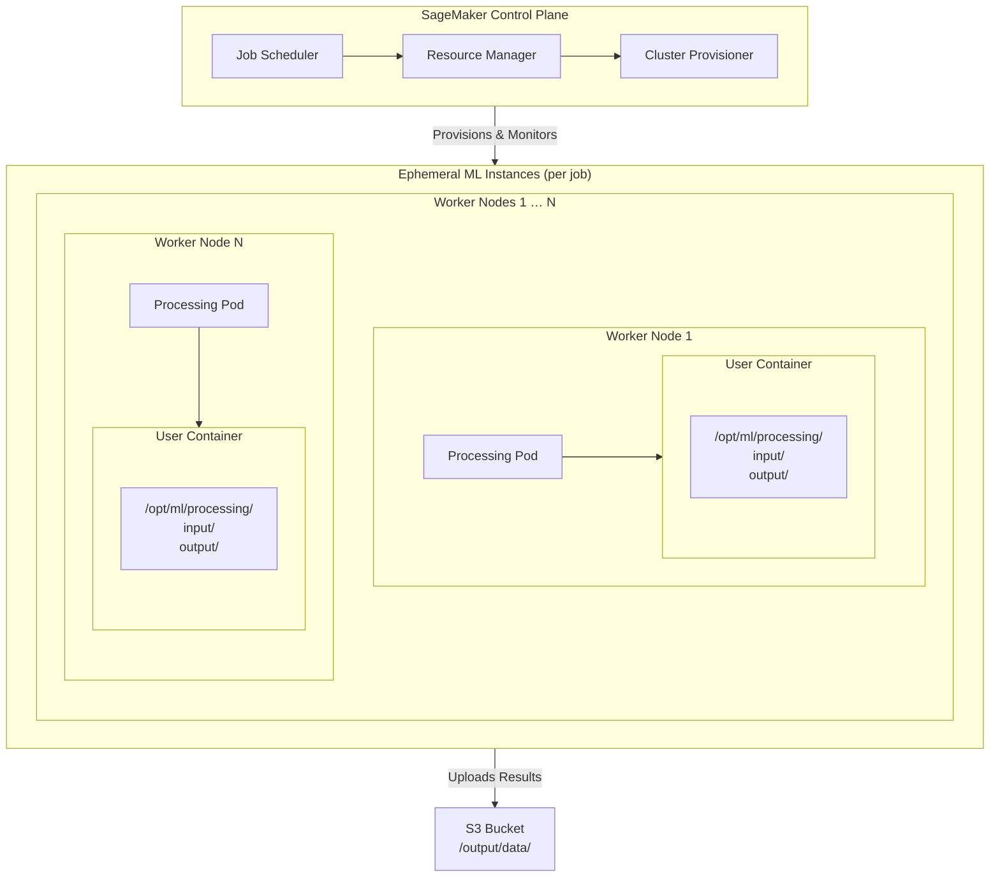

# Lesson 2: Data Preparation Infrastructure

## 1. First-Principles Intuition & Invariants

Machine learning systems live and die by the quality, consistency, and accessibility of their training data. While model architectures and hyperparameter tuning dominate the literature, production ML systems spend the majority of their operational complexity budget on data preparation infrastructure. SageMaker's data preparation stack addresses this reality through a layered architecture that separates concerns across three fundamental axes: computation orchestration, feature materialization, and data quality verification.

At its foundation, SageMaker Processing jobs provide a managed execution substrate for arbitrary data transformation workloads. Unlike training jobs, which assume a specific contract around model artifacts and evaluation metrics, Processing jobs operate as general-purpose distributed compute primitives. They accept input data from S3, execute user-defined transformation logic inside containerized environments, and materialize outputs back to durable storage. This abstraction deliberately decouples data preparation from model training, allowing independent scaling, versioning, and debugging of the ETL pipeline. The execution model follows a MapReduce-inspired pattern where SageMaker provisions a cluster of EC2 instances, distributes input data across workers, executes transformations in parallel, and aggregates results. Critically, the cluster lifecycle is ephemeral—instances spin up at job start and terminate at completion, ensuring cost efficiency and eliminating infrastructure drift.

The second foundational component, Feature Store, introduces temporal consistency guarantees and dual-path serving architecture. Feature engineering in production ML systems confronts a fundamental tension: training requires historical point-in-time correctness to avoid label leakage, while inference demands low-latency access to the most recent feature values. Feature Store resolves this through bifurcated storage backends. The offline store, backed by S3 and Glue Data Catalog integration, maintains immutable time-series feature history with microsecond timestamp precision. Every feature value insertion receives a monotonically increasing event time, enabling precise time-travel queries during training dataset construction. The online store, implemented as a fully managed key-value store with single-digit millisecond read latency, serves real-time inference requests. This dual-write architecture ensures training-serving consistency by guaranteeing that features materialized during training are semantically identical to those retrieved during inference, modulo only the temporal window.

Feature groups form the organizational unit within Feature Store, conceptually analogous to database tables but with critical semantic differences. Each feature group defines a schema mapping feature names to data types (String, Fractional, Integral) and designates one or more record identifier columns plus a mandatory event time column. Unlike relational schemas that enforce normalization, feature groups optimize for denormalized, wide-row access patterns that mirror how inference systems consume features. A single feature group might contain hundreds of columns representing diverse signal sources—user demographics, session behavior aggregates, content embeddings, real-time event counts—all co-located to minimize join overhead during serving. The schema enforcement occurs at ingestion time through validation against the registered schema, rejecting malformed records before they pollute downstream consumers.

Versioning in Feature Store operates at the feature group level rather than individual feature versions, reflecting the reality that features evolve as cohesive logical units. When schema evolution requires adding new features or modifying data types, practitioners create new feature group versions rather than mutating existing definitions. This immutability guarantee ensures that training pipelines referencing a specific feature group version produce reproducible results regardless of when they execute. The offline store maintains complete historical lineage, allowing data scientists to reconstruct training datasets from any point in the past. This temporal versioning becomes critical for debugging model degradation, conducting A/B test analyses, and satisfying regulatory audit requirements around model provenance.

Ground Truth extends the data preparation stack into the human labeling domain, providing managed workflows for annotation campaigns. The fundamental challenge in supervised learning—acquiring high-quality labeled data at scale—remains intractable without structured human-in-the-loop processes. Ground Truth orchestrates this through a three-stage pipeline: work distribution to labeling workforces (internal teams, mechanical turk, or specialized vendors), annotation collection with built-in quality controls, and active learning feedback loops that prioritize uncertain examples. The system tracks inter-annotator agreement, flags low-quality workers, and supports multi-stage review workflows where expert annotators validate crowd-sourced labels. For common tasks like image classification, object detection, and text entity recognition, Ground Truth provides pre-built UI templates and ML-assisted auto-labeling, reducing time-to-annotation from weeks to days.

The architectural invariants across these components converge on several shared principles. First, all data transformations execute within container boundaries, ensuring reproducibility and isolating dependencies from the underlying SageMaker infrastructure. Second, intermediate and final outputs persist exclusively to S3, leveraging its durability guarantees and enabling downstream consumers to access results through standard S3 APIs. Third, IAM roles mediate all cross-service interactions, enforcing least-privilege access controls and maintaining audit trails. Fourth, CloudWatch captures comprehensive execution telemetry—resource utilization, job progress, error rates—enabling observability without instrumenting user code. These invariants form a contract that allows data preparation infrastructure to evolve independently from model training and deployment components while maintaining consistent operational semantics.

## 2. Core Architecture & Mechanics

SageMaker Processing jobs instantiate as short-lived containers running on managed EC2 ML instances, entirely hidden from users behind a managed API surface. When a user submits a Processing job, the request flows through several transformation stages before actual computation begins. The SageMaker API validates the job specification, checks IAM permissions, reserves compute capacity from the underlying EC2 fleet, and provisions ML instances scoped to that specific job execution. These instances remain invisible to the user and are fully managed by the SageMaker control plane.

The container image specified in the job definition determines the runtime environment. SageMaker maintains a registry of pre-built containers for common frameworks—Scikit-learn, Pandas, Spark, Dask, PyTorch—but users frequently supply custom images to incorporate proprietary libraries or specialized dependencies. When the job starts, SageMaker pulls the image from ECR (Elastic Container Registry), mounts input data channels from S3 into the container filesystem at `/opt/ml/processing/input/<channel_name>`, and exposes output directories at `/opt/ml/processing/output/<channel_name>`. User code executes within this containerized sandbox, reading from input paths, performing transformations, and writing results to output paths. Upon container exit, SageMaker uploads all output directory contents back to S3, tears down the ephemeral cluster, and marks the job as completed.

Distributed processing frameworks like Spark and Dask integrate into this architecture through specialized container images that coordinate multi-node clusters within the Processing job. For Spark, SageMaker provides a managed container that automatically configures a master node and worker nodes, setting up the Spark context with optimized memory settings and network configurations. The user supplies a PySpark script as the entry point, and the container bootstraps the Spark runtime before executing the script. Input data channels map directly to Spark DataFrames through automatic S3 file discovery, and Spark's native partitioning mechanisms distribute computation across workers. Output DataFrames write back to S3 using optimized columnar formats like Parquet, which compress well and enable efficient downstream query processing.

Dask integration follows a similar pattern but exposes different parallelism semantics. While Spark operates on resilient distributed datasets with lazy evaluation and built-in fault tolerance, Dask provides a more Pythonic interface with dynamic task graphs and fine-grained scheduling. The SageMaker Dask container starts a Dask scheduler on the master node and workers on remaining instances, establishing network connections for task distribution and result aggregation. User code constructs Dask DataFrames or Arrays, defines transformations, and triggers computation through explicit `.compute()` calls. This lazy execution model gives practitioners tighter control over resource utilization but requires more careful management of intermediate results and memory pressure.

Feature Store's ingestion pipeline converts raw feature values into the dual-store architecture through a multi-stage buffering and transformation process. When a client calls `put_record()` or `batch_put_record()`, the request first hits a validation layer that checks schema conformance and data type correctness. Records that pass validation enter a Kinesis Data Stream acting as a write buffer. This decoupling between API and storage writes serves two critical functions: it provides backpressure resilience during traffic spikes, and it enables asynchronous processing without blocking the client. A fleet of Lambda functions consumes from the Kinesis stream, transforming records into the internal storage format and writing to both the online DynamoDB tables and the offline S3 Parquet files. This dual-write atomicity relies on careful ordering guarantees—the Lambda functions use conditional writes to DynamoDB based on event time, ensuring that late-arriving records do not overwrite newer values.

The offline store organization optimizes for time-travel queries and historical feature reconstruction. Feature values persist in a Parquet-based data lake partitioned by feature group, record identifier, and event time. The Glue Data Catalog maintains metadata mapping feature group names to S3 prefixes and exposing schemas for query engines like Athena. When a data scientist requests historical features for a training dataset, they specify a target timestamp and a list of feature group names. The Feature Store query engine translates this into a series of Athena SQL queries that perform point-in-time correct joins, selecting the most recent feature value before the target timestamp for each record. These queries leverage partition pruning and predicate pushdown to minimize data scanned, but reconstructing large training datasets across many feature groups can still require substantial compute resources and careful query optimization.

The online store serves inference workloads through a distributed key-value interface backed by DynamoDB or SageMaker's internal caching layer. Each feature group maps to a DynamoDB table with a composite primary key consisting of the record identifier columns. Queries specify the identifier values and retrieve the complete feature vector in a single read operation. This denormalized access pattern sacrifices storage efficiency for read latency, a deliberate trade-off justified by inference's latency budget. To maintain consistency between online and offline stores, the ingestion Lambda functions write the same feature values to both destinations, ensuring that a model trained on offline features encounters identical inputs during online serving, modulo temporal drift.

Ground Truth labeling workflows execute as state machines orchestrated by AWS Step Functions. When a practitioner creates a labeling job, they specify an input manifest file listing S3 locations of data objects to label, a task template defining the annotation UI, and a workforce configuration selecting human annotators. Step Functions breaks the input manifest into batches, distributes tasks to workers, collects annotations, and invokes custom logic for automated quality checks and active learning. The system tracks task-level metrics like time per annotation and inter-annotator agreement, using these signals to dynamically adjust batch routing. For high-stakes tasks, Ground Truth supports multi-stage workflows where an initial crowd workforce provides tentative labels, a smaller expert workforce reviews flagged examples, and automated algorithms detect outliers or low-confidence annotations requiring additional review.

Built-in algorithms for preprocessing—like Principal Component Analysis, Random Cut Forest for anomaly detection, and K-Means clustering—integrate into Processing jobs as pre-packaged containers. These containers expose a standardized interface expecting CSV or RecordIO input data and producing JSON metadata alongside transformed outputs. Users invoke them identically to custom processing scripts, but the containers encapsulate optimized implementations tuned for SageMaker's hardware profiles. For example, the K-Means container leverages AVX-512 SIMD instructions on Nitro-based instances to accelerate distance computations, and the PCA implementation uses randomized SVD algorithms that trade off exactness for substantial speedups on high-dimensional data.

## 3. High-Performance Optimization & Failure Modes

Maximizing throughput in Processing jobs requires careful attention to data transfer bottlenecks and resource allocation patterns. S3 acts as both the source and sink for all data movement, making network bandwidth between compute instances and S3 a critical constraint. SageMaker provisions instances with enhanced networking capabilities—up to 100 Gbps on larger instance types—but realizing this bandwidth requires parallelizing S3 operations across many keys. When processing large datasets, practitioners should partition input data into hundreds or thousands of S3 objects rather than a few monolithic files. This sharding enables the S3 client library to issue concurrent GET requests, saturating network links and reducing wall-clock download time by an order of magnitude.

Instance selection profoundly impacts both cost and performance. Compute-optimized instances (C5, C6i families) deliver maximum CPU throughput for CPU-bound transformations like text tokenization or feature engineering logic. Memory-optimized instances (R5, R6i) suit workloads that hold large in-memory indexes or perform group-by aggregations over high-cardinality dimensions. For distributed frameworks, provisioning a single large instance often outperforms a cluster of smaller instances due to reduced inter-node communication overhead. A Spark job processing 1 TB of data completes faster on one r5.24xlarge (768 GB RAM, 96 vCPUs) than on eight r5.4xlarge instances, provided the dataset fits in memory and the transformation logic avoids wide shuffles. However, cost considerations frequently favor the distributed approach—spot instances for worker nodes reduce compute costs by 70-90%, and the elastic scaling properties allow right-sizing clusters to workload demands.

Failure modes in distributed processing fall into three categories: transient infrastructure faults, data quality issues, and resource exhaustion. Transient faults manifest as EC2 instance preemptions on spot fleets, network partitions between workers, or throttling from S3 during high request rates. SageMaker retries failed Processing jobs only when RetryStrategy is configured with MaximumRetryAttempts greater than 0 (the default is no retries), and this retry logic operates at job granularity rather than task granularity. For long-running transformations processing terabytes of data, a single failure near completion forces recomputation of all work. Defensive practitioners checkpoint intermediate results to S3 at regular intervals, enabling manual resumption from the last successful checkpoint rather than full restart. Spark's built-in lineage tracking provides automatic fault recovery within a job execution, but this resilience does not extend across job restarts.

Data quality issues—null values, type mismatches, schema evolution violations—require explicit validation logic within transformation scripts. SageMaker Processing provides no automatic data profiling or anomaly detection; these concerns remain user responsibility. A robust pattern involves separating validation from transformation into distinct Processing jobs. The first job scans input data, computes summary statistics (null rates, cardinality estimates, distribution quantiles), and checks invariants like monotonic timestamp ordering or foreign key referential integrity. Only after validation succeeds does the transformation job execute, confident that input data conforms to expectations. This two-phase approach increases latency but dramatically reduces debugging time when transformations fail on malformed inputs.

Resource exhaustion typically presents as out-of-memory errors or disk space exhaustion on instance volumes. SageMaker allocates a fixed-size root volume to each Processing instance (default 30 GB, configurable up to 16 TB), and transformations that materialize large intermediate datasets must manage this capacity explicitly. Writing outputs incrementally to S3 rather than buffering in local disk prevents volume saturation. For memory pressure, profiling tools like memory_profiler or Py-Spy identify allocation hotspots within user code. Common culprits include loading entire datasets into Pandas DataFrames when streaming row-by-row processing suffices, or accumulating results in Python lists instead of yielding outputs through generators.

Feature Store ingestion throughput scales with the Kinesis stream shard count and Lambda concurrency limits. A single Kinesis shard supports 1,000 records per second and 1 MB/sec of write throughput. Feature groups receiving higher ingestion rates require explicit shard scaling, either through automatic scaling policies or manual resharding operations. The Lambda functions consuming from Kinesis process records in batches, and the batch size parameter trades off latency against throughput. Larger batches amortize function invocation overhead but increase latency until a full batch accumulates. For latency-sensitive applications, configuring smaller batches (10-100 records) ensures features propagate to the online store within seconds of ingestion. High-throughput batch ingestion scenarios tolerate larger batches (1,000-10,000 records) to maximize Lambda efficiency.

Query performance on the offline store degrades as the number of feature groups in a point-in-time query increases. Athena executes each feature group retrieval as an independent subquery, joining results through a series of nested SELECT statements. Beyond approximately ten feature groups, query planning overhead dominates execution time, and practitioners must partition queries into smaller subsets or pre-materialize frequently accessed feature combinations into derived feature groups. Pre-materialization trades storage cost for query performance—a single wide feature group containing pre-joined features eliminates join overhead but duplicates data across the offline store.

The online store confronts the classical cache consistency challenge when feature values update asynchronously. A model making a prediction retrieves features from DynamoDB, but those features may have been updated milliseconds earlier based on new events. This eventual consistency is unavoidable in distributed systems but can cause prediction skew if not anticipated. Systems handling high-stakes decisions (credit approval, fraud detection) implement client-side versioning where inference requests include an explicit feature version or timestamp, and the online store returns the feature vector valid at that version. This approach sacrifices some latency (requires conditional reads checking version fields) but ensures predictions use temporally consistent feature sets.

Ground Truth quality control relies on statistical overlap between annotators. For subjective tasks (sentiment classification, content moderation), agreement metrics like Fleiss' kappa quantify consensus. Low agreement signals ambiguous task definitions, poorly worded instructions, or insufficient annotator training. The remediation process involves refining task templates, providing additional example annotations, and filtering out low-performing workers based on gold-standard test questions embedded in the task stream. Active learning loops that route uncertain examples to multiple annotators concentrate human effort on decision boundaries where labels provide maximum information gain, but these loops introduce selection bias that must be corrected during model training through importance weighting or stratified sampling.

Cost optimization across the data preparation stack focuses on three levers: compute instance selection, storage lifecycle policies, and batching strategies. Processing jobs should utilize spot instances for all fault-tolerant workloads, accepting occasional preemptions in exchange for dramatic cost reductions. Feature Store offline storage accumulates historical feature vectors indefinitely by default; implementing S3 lifecycle policies that transition older data to Glacier or Glacier Deep Archive reduces storage costs by 90% for features accessed infrequently. Ground Truth labeling campaigns minimize cost by routing ambiguous examples to expensive expert annotators while sending clear-cut cases to lower-cost crowd workers, using automated confidence thresholds to make routing decisions.

Monitoring and observability present unique challenges in ephemeral compute environments. Processing jobs emit CloudWatch metrics (CPU utilization, memory consumption, network throughput) only while instances remain active, complicating post-mortem debugging when jobs fail hours after starting. A production-grade approach instruments user code with custom metrics and structured logging that persist to CloudWatch Logs. After job completion, analysis scripts query these logs to reconstruct resource utilization timelines and identify performance bottlenecks. Feature Store ingestion failures appear as Lambda error metrics or Kinesis iterator age increases, both accessible through CloudWatch dashboards. Automated alerting on these signals enables rapid detection of ingestion pipeline degradation before downstream models encounter stale features.
