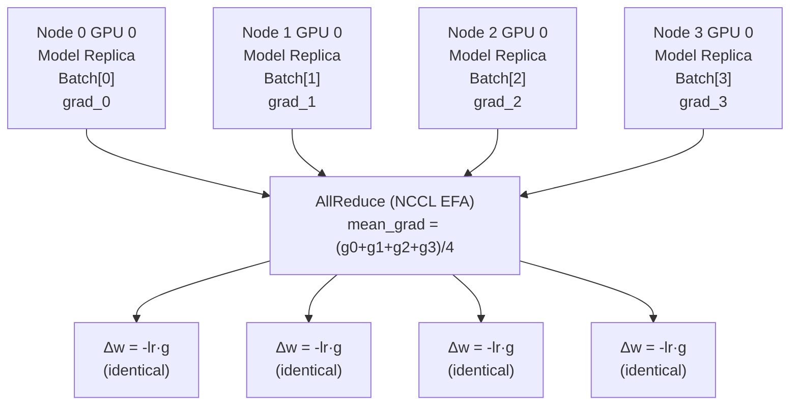

# Lesson 3: Distributed Training Systems

## 1. First-Principles Intuition & Invariants

The fundamental tension at the heart of large-scale model training is a resource allocation problem that scales polynomially. A GPT-class transformer with 175 billion parameters requires roughly 350 GB of memory just to hold the weights in 16-bit precision, before accounting for optimizer states, gradients, and activations. A single NVIDIA A100 offers 80 GB of HBM2e. The arithmetic is unforgiving: you cannot fit the problem on one device, so you must distribute it across many, and in doing so you introduce a new class of costs that did not exist in the single-device regime—inter-device communication latency, synchronization barriers, and the overhead of coordinating a distributed consensus on the direction of gradient descent.

Understanding distributed training rigorously requires that you internalize three physical invariants before you write a single line of code. First, **compute is cheap relative to memory bandwidth**: modern GPUs achieve hundreds of teraFLOPS of matrix-multiply throughput but are gated by HBM bandwidth measured in terabytes per second, meaning that the moment you introduce inter-node communication (PCIe at 64 GB/s, InfiniBand HDR at 200 Gb/s, or EFA at 400 Gb/s), you will almost always be waiting on data movement rather than arithmetic. Second, **gradient synchronization is a collective operation**: in synchronous data-parallel training, every worker must contribute its local gradient tensor to a global mean before any worker can take an optimizer step, making the slowest worker the effective clock rate of the entire cluster. Third, **parallelism strategies compose but do not commute**: combining data parallelism with tensor parallelism with pipeline parallelism creates a three-dimensional topology where the optimal configuration depends on model architecture, batch size, and network topology simultaneously. There is no single correct answer; there is only profiling.

SageMaker's distributed training surface is best understood as a managed reconciliation loop wrapped around these physical realities. When you launch a `CreateTrainingJob` API call with an instance count greater than one, SageMaker's control plane provisions the requested fleet, injects environment variables describing the cluster topology (`SM_HOSTS`, `SM_CURRENT_HOST`, `SM_NUM_GPUS`), bootstraps inter-node networking over AWS Elastic Fabric Adapter, and hands off to your training script inside a container environment where every node already knows its rank, local rank, and world size. This is the foundational contract: SageMaker owns the infrastructure lifecycle; your code owns the gradient computation.

The Elastic Fabric Adapter (EFA) deserves careful attention because it is the substrate on which all high-performance collective operations run. EFA is a network interface that bypasses the OS kernel for inter-node messaging, implementing RDMA (Remote Direct Memory Access) semantics directly between GPU memory regions on separate physical hosts. When NCCL (the NVIDIA Collective Communications Library) executes an `AllReduce` over EFA, the gradient tensor is never copied to CPU memory, never traverses the Linux TCP/IP stack, and never pays a context-switch penalty. The latency of a single NCCL `AllReduce` on a 100-node cluster with EFA is roughly 20–50 milliseconds for a 1 GB tensor, compared to 50–200 milliseconds over standard Ethernet. This two-order-of-magnitude difference is what makes the difference between a training job that scales linearly with node count and one that regresses toward uselessness beyond eight nodes.

---

## 2. Core Architecture & Mechanics

### Training Job Orchestration

The lifecycle of a SageMaker training job proceeds through a well-defined state machine that every serious practitioner must understand to debug effectively. The job begins in `Starting`, where the control plane allocates EC2 instances, attaches EBS volumes, and resolves the ECR container image URI. It transitions to `Downloading` when the training data is being pulled from S3 into the instance's local `/opt/ml/input/data/` hierarchy or when FastFile mode is streaming directly from S3 without materialization. `Training` is the steady-state phase, the only phase where your GPU utilization metric should be non-zero. `Uploading` follows successful training, when model artifacts are written from `/opt/ml/model/` to the output S3 URI. The terminal states are `Completed`, `Failed`, and `Stopped`.

The critical operational insight is that `Downloading` can dominate total wall-clock time for large datasets if you use the default `File` input mode. For datasets exceeding hundreds of gigabytes, you should almost always use `FastFile` mode (which streams S3 objects via FUSE as the training script reads them) or `Pipe` mode (which delivers data as a Unix FIFO stream, though this is now largely superseded by FastFile). The architectural difference matters: in `File` mode, your data pipeline cannot begin until the last byte has been written to local disk; in `FastFile` mode, the first batch of training data is available within seconds of job start, and the network bandwidth from S3 is consumed continuously rather than frontloaded.

```python
import sagemaker
from sagemaker.pytorch import PyTorch
from sagemaker.inputs import TrainingInput

session = sagemaker.Session()
role = "arn:aws:iam::123456789012:role/SageMakerExecutionRole"

estimator = PyTorch(
    entry_point="train.py",
    source_dir="src/",
    role=role,
    instance_type="ml.p4d.24xlarge",
    instance_count=4,
    framework_version="2.1.0",
    py_version="py310",
    volume_size=500,
    max_run=86400,
    output_path="s3://my-bucket/model-artifacts/",
    checkpoint_s3_uri="s3://my-bucket/checkpoints/",
    checkpoint_local_path="/opt/ml/checkpoints/",
    use_spot_instances=True,
    max_wait=172800,
    hyperparameters={
        "epochs": 50,
        "batch-size": 64,
        "learning-rate": 1e-4,
        "model-type": "llama-7b",
    },
    distribution={
        "torch_distributed": {"enabled": True}
    },
    environment={
        "NCCL_DEBUG": "WARN",
        "NCCL_SOCKET_IFNAME": "^lo,docker",
        "TORCH_DISTRIBUTED_DEBUG": "DETAIL",
    },
)

train_data = TrainingInput(
    s3_data="s3://my-bucket/training-data/",
    input_mode="FastFile",
    s3_data_type="S3Prefix",
)

estimator.fit(
    inputs={"training": train_data},
    wait=False,
    job_name="llama-7b-distributed-20240101",
)
```

The `distribution` key in the estimator configuration is the declaration of your parallelism strategy. Setting `torch_distributed` to enabled instructs SageMaker to launch your script with `torchrun` (formerly `torch.distributed.launch`), configure the rendezvous backend to SageMaker's internal endpoint, and pass `MASTER_ADDR`, `MASTER_PORT`, `RANK`, `LOCAL_RANK`, and `WORLD_SIZE` as environment variables that `torchrun` and `torch.distributed.init_process_group` consume automatically.

### Distributed Training Architecture

The three canonical parallelism strategies map to fundamentally different decompositions of the training computation, and their differences are architectural rather than incidental.

**Data parallelism** replicates the entire model on every device and partitions the training dataset across replicas. Each device computes a full forward and backward pass on its local mini-batch, producing a local gradient tensor. A collective `AllReduce` operation then computes the mean gradient across all devices, and every replica applies the same gradient update, ensuring that all replicas remain synchronized. The defining property of data parallelism is that communication volume scales with model size, not dataset size: regardless of how many samples each worker processes, the `AllReduce` payload is always proportional to the number of model parameters. DDP (Distributed Data Parallel) in PyTorch implements this with gradient bucketing: rather than waiting for all gradients to materialize before beginning `AllReduce`, it fires off NCCL collectives for each bucket as the backward pass populates them, overlapping gradient communication with the computation of earlier-layer gradients. This pipelining of communication and computation is the central optimization that makes DDP scale efficiently to hundreds of nodes.



**Tensor parallelism** (also called intra-layer model parallelism) partitions individual weight matrices across devices. Consider a transformer attention layer with a projection matrix $W \in \mathbb{R}^{d \times d}$. In column-parallel partitioning, each of $N$ devices holds a $d \times (d/N)$ shard. The forward pass for each shard can be computed independently, requiring only an `AllGather` collective on the activation output before the next layer. In row-parallel partitioning, each device holds a $(d/N) \times d$ shard, computes a partial output, and requires an `AllReduce` to sum the partials. Megatron-LM pioneered the analysis of which layers benefit from column- versus row-parallelism to minimize the number of collectives per transformer block, and the SageMaker Model Parallel library (SMP) implements this analysis automatically when you configure `tensor_parallel_degree`.

**Pipeline parallelism** partitions the model's layers across devices along the depth dimension, assigning contiguous layer groups (called stages) to each device. A four-stage pipeline assigns layers 0–$L/4$ to device 0, layers $L/4$–$L/2$ to device 1, and so on. The naive sequential execution of this pipeline suffers from severe underutilization: when stage 1 is computing its forward pass for micro-batch $k$, stages 2–4 are idle waiting for activations. Gpipe and Chimera introduced micro-batching to fill this pipeline bubble: by splitting each mini-batch into $M$ micro-batches and streaming them through the pipeline, the fraction of time wasted in the pipeline bubble decreases from $O(1)$ to $O((N-1)/M)$ where $N$ is the number of stages. Setting $M \gg N$ effectively eliminates the bubble at the cost of holding $M$ sets of activations in memory simultaneously.

The composition of these three strategies produces the 3D parallelism topology used by state-of-the-art training frameworks. Within a node, NVLink provides 600 GB/s bidirectional bandwidth, making tensor parallelism (which requires frequent small collectives) ideal for intra-node assignment. Pipeline parallelism boundaries are placed at inter-node boundaries, where EFA bandwidth (200–400 Gb/s) constrains communication to coarse-grained activation tensors rather than gradient shards. Data parallelism is then applied across replicas of the entire 3D-parallel topology. SageMaker's `smdistributed` library encodes this topology decision in its configuration:

```python
distribution = {
    "smdistributed": {
        "modelparallel": {
            "enabled": True,
            "parameters": {
                "microbatches": 8,
                "placement_strategy": "spread",
                "pipeline": "interleaved",
                "optimize": "speed",
                "partitions": 4,
                "tensor_parallel_degree": 8,
                "ddp": True,
            },
        }
    }
}
```

### SageMaker Distributed Training Libraries in Practice

SageMaker ships two production libraries: `smdistributed.dataparallel` (SMDDP), which is an optimized AllReduce backend that replaces NCCL for data-parallel workloads, and `smdistributed.modelparallel` (SMP), which provides automatic and manual model partitioning for tensor and pipeline parallelism.

SMDDP implements an adaptive AllReduce algorithm that selects between ring-AllReduce and tree-AllReduce depending on the gradient tensor size and the network topology. For small tensors (under a threshold, typically 512 KB), tree-AllReduce minimizes latency by halving the number of communication rounds. For large tensors, ring-AllReduce maximizes bandwidth utilization by ensuring every link carries exactly $2(N-1)/N$ of the tensor's data, asymptotically approaching the bandwidth limit. The transition point is tuned automatically based on profiling the actual EFA topology of the cluster, which is a meaningful advantage over static NCCL configuration.

The SMP library's automatic partitioning algorithm analyzes the model's computation graph, estimates the communication volume at each potential partition boundary, and solves a balanced bin-packing problem to minimize the maximum stage execution time while satisfying device memory constraints. For transformer architectures, the optimal solution almost always partitions at transformer block boundaries, assigning a contiguous range of blocks to each pipeline stage. The library also handles the activation checkpointing tradeoff automatically: rather than storing all intermediate activations for the backward pass (which grows linearly with sequence length and model depth), SMP can recompute activations on demand during the backward pass, trading a fixed factor of additional compute for a proportional reduction in activation memory.

```python
# train.py - SageMaker SMP training script for a large language model
import os
import torch
import torch.distributed as dist
import smdistributed.modelparallel.torch as smp
from transformers import AutoModelForCausalLM, AutoConfig

smp.init()

config = AutoConfig.from_pretrained("meta-llama/Llama-2-7b-hf")
config.use_cache = False

with smp.model_creation(
    tensor_parallelism=True,
    dtype=torch.bfloat16,
):
    model = AutoModelForCausalLM.from_config(config)

model = smp.DistributedModel(model, average_grads_across_microbatches=True)

optimizer = torch.optim.AdamW(
    model.parameters(),
    lr=float(os.environ.get("SM_HP_LEARNING_RATE", 1e-4)),
    weight_decay=0.1,
    betas=(0.9, 0.95),
)
scaler = smp.amp.GradScaler()

@smp.step
def train_step(model, optimizer, batch):
    with torch.autocast(device_type="cuda", dtype=torch.bfloat16):
        output = model(**batch)
        loss = output["loss"]
    return loss

def load_checkpoint(checkpoint_dir, model, optimizer):
    checkpoint_path = os.path.join(checkpoint_dir, "checkpoint.pt")
    if os.path.exists(checkpoint_path):
        checkpoint = smp.load(checkpoint_path, partial=True)
        model.load_state_dict(checkpoint["model_state_dict"])
        optimizer.load_state_dict(checkpoint["optimizer_state_dict"])
        return checkpoint.get("epoch", 0), checkpoint.get("step", 0)
    return 0, 0

def save_checkpoint(checkpoint_dir, model, optimizer, epoch, step):
    if smp.rank() == 0:
        os.makedirs(checkpoint_dir, exist_ok=True)
    smp.barrier()
    smp.save(
        {
            "model_state_dict": model.state_dict(),
            "optimizer_state_dict": optimizer.state_dict(),
            "epoch": epoch,
            "step": step,
        },
        os.path.join(checkpoint_dir, "checkpoint.pt"),
        partial=True,
    )

checkpoint_dir = os.environ.get("SM_CHECKPOINT_DIR", "/opt/ml/checkpoints")
start_epoch, start_step = load_checkpoint(checkpoint_dir, model, optimizer)

# training loop: for each batch, optimizer.zero_grad(); loss = train_step(model, optimizer, batch);
# scaler.step(optimizer); scaler.update(); periodic save_checkpoint with checkpoint_dir
```

The `@smp.step` decorator is architecturally significant: it transforms a function that computes loss and gradients for a single batch into one that internally splits the batch into microbatches, executes the pipeline forward and backward passes across all stages, and accumulates gradients before returning. The decorator handles all inter-stage activation and gradient communication transparently, allowing the user-facing training logic to remain agnostic to the parallelism topology.

### Managed Spot Training and Checkpointing

Spot instances represent EC2 capacity that AWS reclaims with a two-minute warning when on-demand demand increases. For training jobs running on `ml.p4d.24xlarge` instances at $32.77/hour per instance, a four-node job costs roughly $131/hour on-demand versus $45–60/hour on spot—a 55–65% cost reduction that is simply too significant to ignore for jobs that run for hours or days. The tradeoff is that interruptions are non-deterministic and unavoidable. Designing your training system to treat spot interruption as a first-class operational condition rather than an exception changes how you think about checkpointing from a defensive measure to a core architectural component.

SageMaker's managed spot training (`use_spot_instances=True`) handles the SIGTERM signal and the two-minute pre-emption window on your behalf: when an interruption is detected, SageMaker uploads everything in the `checkpoint_local_path` directory to `checkpoint_s3_uri` before terminating the instance. When the job resumes on a new instance, SageMaker downloads the checkpoint back to `checkpoint_local_path` before your training script starts. Your training script's only responsibility is to write valid, complete checkpoints to that directory on a schedule that makes the two-minute window survivable. If your checkpoint takes 90 seconds to write, you must write checkpoints more frequently than the typical interruption interval (which varies by instance type and region but is roughly one interruption per 4–8 hours).

The `max_wait` parameter in the estimator configuration is the total wall-clock time SageMaker will wait for the job to complete, counting both active training time and time spent waiting for spot capacity to become available. Setting `max_wait` to twice `max_run` is a reasonable heuristic: it allows for one full re-queue cycle if the initial spot request is not immediately satisfied. If spot capacity is persistently unavailable and `max_wait` is exceeded, the job terminates as `Stopped`.

A production checkpointing strategy for distributed training must account for two complications that do not exist in single-device training. First, model and optimizer state is sharded across devices when using SMP's tensor or pipeline parallelism, meaning you cannot simply call `torch.save(model.state_dict())` from rank 0 and recover a valid checkpoint. The `smp.save` API handles sharded checkpoints by writing a separate shard file per model-parallel rank while ensuring a consistent global snapshot. Second, the checkpoint must include enough metadata (epoch index, global step, RNG state) to exactly reproduce the data loading order, since restarting from an inconsistent dataset position degrades training quality and can cause subtle convergence bugs.

```python
# Checkpoint recovery with dataset reproducibility
import numpy as np

def save_full_checkpoint(checkpoint_dir, model, optimizer, epoch, step, dataloader_state):
    if smp.rank() == 0:
        os.makedirs(checkpoint_dir, exist_ok=True)
    smp.barrier()

    rng_state = {
        "python": None,
        "numpy": np.random.get_state(),
        "torch": torch.get_rng_state(),
        "cuda": torch.cuda.get_rng_state_all(),
    }

    smp.save(
        {
            "model_state_dict": model.state_dict(),
            "optimizer_state_dict": optimizer.state_dict(),
            "scaler_state_dict": scaler.state_dict(),
            "epoch": epoch,
            "step": step,
            "rng_state": rng_state,
            "dataloader_sampler_state": dataloader_state,
        },
        os.path.join(checkpoint_dir, f"checkpoint_step_{step}.pt"),
        partial=True,
    )

    if smp.rank() == 0:
        with open(os.path.join(checkpoint_dir, "latest"), "w") as f:
            f.write(f"checkpoint_step_{step}.pt")
```

---

## 3. High-Performance Optimization & Failure Modes

### Hyperparameter Tuning Architecture

SageMaker Automatic Model Tuning (AMT) is an HPO (hyperparameter optimization) service that wraps your training job in a Bayesian optimization loop. The architecture separates concerns clearly: the tuning job is a meta-job that manages a population of child training jobs, observes their objective metrics, and proposes new hyperparameter configurations through a surrogate model. Each child training job runs your estimator with a specific hyperparameter assignment injected as `SM_HP_*` environment variables, and emits the objective metric (e.g., validation loss) as a line of stdout matching a configurable regex pattern. The AMT service scrapes this metric via CloudWatch Logs and updates the surrogate model after each job completes.

The surrogate model in SageMaker's Bayesian optimization implementation is a Gaussian Process (GP) that maintains a probabilistic estimate of the objective function over the hyperparameter space. After observing $n$ completed trials, the GP posterior defines a mean function $\mu(\theta)$ and variance function $\sigma^2(\theta)$ over the hyperparameter configuration space. The acquisition function—which determines which configuration to evaluate next—is Expected Improvement (EI): $\text{EI}(\theta) = \mathbb{E}[\max(0, f^* - f(\theta))]$ where $f^*$ is the best objective value observed so far. EI balances exploitation (high $\mu$, configurations predicted to be good) against exploration (high $\sigma$, regions where the model is uncertain). This balance is what separates Bayesian optimization from random search: each trial is informed by the full history of previous trials, allowing the optimizer to converge on good hyperparameter regions in $O(\sqrt{n})$ evaluations versus $O(n)$ for random search under standard theoretical assumptions.

Hyperband introduces a third HPO strategy that is not purely a configuration selection algorithm but a resource allocation algorithm. The core insight is that bad hyperparameter configurations typically reveal themselves early in training: a learning rate that is too large will show diverging loss within the first few epochs, while a learning rate that is too small will show near-zero improvement. Hyperband exploits this by running many configurations for a small number of epochs, promoting only the top $1/\eta$ fraction to the next resource level, and repeating this successive halving. With $\eta = 3$ and a maximum resource of 81 epochs, Hyperband runs 81 jobs for 1 epoch, promotes 27 to 3 epochs, promotes 9 to 9 epochs, promotes 3 to 27 epochs, and promotes 1 to 81 epochs. The total compute is roughly $\log_\eta(\text{max\_resource})$ times the compute of a single full run, compared to $n$ times for random search with $n$ trials. SageMaker AMT implements Hyperband in its `HyperbandStrategyConfig` and can suspend and resume training jobs (using checkpoints) to implement the bracket structure without spinning up new instances for promoted configurations.

```python
from sagemaker.tuner import (
    HyperparameterTuner,
    ContinuousParameter,
    IntegerParameter,
    CategoricalParameter,
    HyperbandStrategyConfig,
)

hyperparameter_ranges = {
    "learning-rate": ContinuousParameter(1e-5, 1e-3, scaling_type="Logarithmic"),
    "weight-decay": ContinuousParameter(1e-4, 1e-1, scaling_type="Logarithmic"),
    "warmup-steps": IntegerParameter(100, 2000),
    "batch-size": CategoricalParameter([16, 32, 64, 128]),
    "dropout": ContinuousParameter(0.0, 0.3),
    "gradient-clip-norm": ContinuousParameter(0.5, 2.0),
}

hyperband_config = HyperbandStrategyConfig(
    max_resource=50,
    min_resource=3,
)

tuner = HyperparameterTuner(
    estimator=estimator,
    objective_metric_name="validation:loss",
    objective_type="Minimize",
    hyperparameter_ranges=hyperparameter_ranges,
    max_jobs=50,
    max_parallel_jobs=5,
    strategy="Hyperband",
    strategy_config=hyperband_config,
    metric_definitions=[
        {
            "Name": "validation:loss",
            "Regex": r"validation_loss=([0-9\\.]+)",
        },
        {
            "Name": "train:loss",
            "Regex": r"train_loss=([0-9\\.]+)",
        },
    ],
)

tuner.fit(
    inputs={"training": train_data},
    wait=False,
    job_name="llm-hpo-hyperband-20240101",
)
```

The `early_stopping_type="Auto"` option activates SageMaker's built-in early stopping for Bayesian and random search strategies: if a training job's metric trajectory is significantly worse than the best observed trajectory at the same resource level, AMT terminates it and reallocates the freed capacity to new configurations. This is distinct from Hyperband's structured successive halving; it is an online regression-based classifier that runs continuously rather than at discrete promotion points.

A critical implementation detail for distributed training jobs inside HPO is metric emission. In a multi-node job, every rank emits stdout, but AMT's CloudWatch Logs scraper reads from all ranks. Unless you gate metric logging behind a rank-0 check, your objective metric regex will match multiple times per epoch, and AMT will record an average of all matched values—which may differ if different workers process different data subsets in the final incomplete batch. The correct pattern is strict: only rank 0 should emit the objective metric, and it should emit it exactly once per evaluation period.

```python
# Metric emission - only from rank 0 (or smp.rank() == 0 for SMP jobs)
if dist.get_rank() == 0:
    val_loss = evaluate(model, val_dataloader)
    print(f"validation_loss={val_loss:.6f}", flush=True)
```

### Training Compiler Optimizations

SageMaker Training Compiler integrates XLA (Accelerated Linear Algebra) compilation into PyTorch training via PyTorch/XLA, which is used across NVIDIA GPU instances. The core value proposition is that the compiler can analyze the full computation graph of a training step—not just individual operator calls—and apply cross-operator optimizations that the PyTorch eager execution model cannot. These include operator fusion (combining a matrix multiply, bias add, and activation function into a single CUDA kernel that never materializes the intermediate tensors), memory layout optimization (choosing row-major versus column-major strides to maximize cache line utilization in subsequent operations), and loop tiling (selecting tile sizes for matrix multiply that maximize L2 cache reuse for specific hardware).

Enabling Training Compiler in SageMaker requires a single configuration change to the estimator, but the operational implications are significant. The first training step of a compiled job will be dramatically slower than subsequent steps—potentially 10–60 minutes slower for large models—because XLA or `torch.compile` is tracing the computation graph and emitting CUDA kernels during the first execution. This compilation artifact is deterministic for a given model and input shape, so if you save the compiled artifacts to S3 and restore them on subsequent runs (or on resumed spot instances), you pay the compilation cost only once.

```python
from sagemaker.pytorch import PyTorch

compiler_config = {
    "enabled": True,
    "debug": False,
}

estimator = PyTorch(
    entry_point="train_compiled.py",
    source_dir="src/",
    role=role,
    instance_type="ml.p4d.24xlarge",
    instance_count=1,
    framework_version="2.1.0",
    py_version="py310",
    compiler_config=compiler_config,
    hyperparameters={
        "epochs": 20,
        "batch-size": 32,
    },
)
```

Inside the training script, you must ensure that all input shapes are consistent across batches, because a shape change forces a re-trace and re-compilation of the affected graph region, paying the compilation cost again. For NLP workloads with variable-length sequences, this means you must pad all sequences in a batch to a fixed maximum length rather than to the longest sequence in the batch. The 5–15% memory overhead from padding is almost always preferable to the 100x latency penalty of repeated compilation.

### SageMaker Debugger and Profiling

SageMaker Debugger operates on a fundamentally different model than conventional profiling tools: rather than instrumenting your code with manual timing calls, it installs hooks into the PyTorch computation graph that emit tensors and metrics asynchronously to an S3 output path, where a separate analysis process runs built-in or custom `Rule` objects against the emitted data in near-real-time. This decoupled architecture means that debugging does not add latency to the training loop itself; the hook overhead is bounded by the cost of a non-blocking tensor copy to a pinned CPU buffer.

The built-in rules cover three categories of failure modes. Vanishing and exploding gradients are detected by tracking the L2 norm of gradient tensors across training steps and flagging when the norm falls below $10^{-7}$ or rises above $10^3$. Loss convergence rules detect plateau (insufficient improvement over a configurable window), divergence (monotonic increase), and oscillation (high variance relative to trend). Tensor variance rules flag dead neurons (activations that remain at zero for all inputs in a batch, which indicates a dying ReLU) and saturation (activation distributions heavily concentrated at extremes, which indicates saturated sigmoid or tanh units). Each triggered rule emits a CloudWatch event that can drive an SNS notification, a Lambda function, or a direct call to `StopTrainingJob`.

```python
from sagemaker.debugger import (
    DebuggerHookConfig,
    TensorBoardOutputConfig,
    Rule,
    rule_configs,
    ProfilerConfig,
    FrameworkProfile,
)

debugger_hook_config = DebuggerHookConfig(
    s3_output_path="s3://my-bucket/debug-output/",
    hook_parameters={
        "train.save_interval": "50",
        "eval.save_interval": "10",
    },
    collection_configs=[
        {"CollectionName": "gradients", "SaveConfig": {"SaveInterval": "50"}},
        {"CollectionName": "weights", "SaveConfig": {"SaveInterval": "100"}},
        {"CollectionName": "losses", "SaveConfig": {"SaveInterval": "10"}},
        {"CollectionName": "metrics", "SaveConfig": {"SaveInterval": "10"}},
    ],
)

rules = [
    Rule.sagemaker(rule_configs.loss_not_decreasing()),
    Rule.sagemaker(rule_configs.exploding_tensor()),
    Rule.sagemaker(rule_configs.vanishing_gradient()),
    Rule.sagemaker(
        rule_configs.overfit(),
        rule_parameters={
            "patience": "10",
            "min_delta": "0.001",
            "window": "5",
        },
    ),
]

profiler_config = ProfilerConfig(
    system_monitor_interval_millis=500,
    framework_profile_params=FrameworkProfile(
        num_steps=10,
        start_step=5,
        pytorch_profiler_params={
            "activities": ["CPU", "CUDA"],
            "record_shapes": True,
            "profile_memory": True,
            "with_stack": False,
        },
    ),
)

estimator = PyTorch(
    entry_point="train.py",
    source_dir="src/",
    role=role,
    instance_type="ml.p4d.24xlarge",
    instance_count=4,
    framework_version="2.1.0",
    py_version="py310",
    debugger_hook_config=debugger_hook_config,
    rules=rules,
    profiler_config=profiler_config,
    distribution={"torch_distributed": {"enabled": True}},
)
```

The profiler generates a comprehensive report accessible via SageMaker Studio that renders GPU utilization timelines, CPU-GPU transfer heatmaps, operator-level latency breakdowns, and NCCL communication traces on a unified time axis. The most actionable output is the step timeline view, which makes the boundary between compute and communication immediately visible. A well-optimized distributed training job shows tight interleaving of these phases; a poorly optimized one shows long horizontal bars of GPU idle time aligned with NCCL `AllReduce` calls, indicating that gradient communication is not being overlapped with computation and that increasing the DDP gradient bucket size or adjusting the `find_unused_parameters` setting is warranted.

### Experiment Tracking with SageMaker Experiments

SageMaker Experiments provides a structured metadata layer over training job runs, organizing them into `Experiment` and `Run` objects that capture hyperparameters, system metrics, and custom metrics in a queryable store backed by the SageMaker API. The integration is lightweight: you initialize a `Run` context manager inside your training script, and all metrics logged within it are automatically associated with the parent experiment and the specific training job that produced them.

```python
# Inside train.py, running within a SageMaker training job
from sagemaker.experiments.run import Run, load_run

with load_run() as run:
    # load_run() recovers the Run context from SM_TRAINING_ENV
    # when called from within a SageMaker training job
    
    for epoch in range(start_epoch, num_epochs):
        train_loss = run_training_epoch(model, optimizer, train_dataloader)
        val_loss, val_perplexity = run_evaluation(model, val_dataloader)
        
        run.log_metric(name="train:loss", value=train_loss, step=epoch)
        run.log_metric(name="validation:loss", value=val_loss, step=epoch)
        run.log_metric(name="validation:perplexity", value=val_perplexity, step=epoch)
        run.log_metric(name="learning:rate", value=get_lr(optimizer), step=epoch)
        
        if dist.get_rank() == 0:
            save_full_checkpoint(checkpoint_dir, model, optimizer, epoch, global_step, None)
```

Calling `load_run()` without arguments works because SageMaker injects the experiment and run identifiers into the training container environment when the job was launched with `Run.init()` from the calling notebook. The `Run` object is a distributed cursor into the experiment store; however, `run.log_metric()` is a synchronous API call that blocks, so logging is normally restricted to rank 0 to avoid blocking the training loop on other ranks.

### Scaling Failure Modes and Mitigations

The most common failure mode in distributed training at scale is the **straggler problem**: one node in a synchronous AllReduce cluster runs consistently slower than the others due to hardware heterogeneity, thermal throttling, noisy neighbor interference on shared network fabric, or uneven data preprocessing load. Because AllReduce is a blocking collective, the entire cluster's iteration time is bounded below by the slowest participant. Detecting a straggler requires comparing per-step timing across ranks; the SageMaker profiler's step timeline view makes this visible as one node's compute bar extending past the others before the synchronization point.

The mitigation depends on the root cause. If the straggler is a consistently underperforming instance (a hardware defect), the correct response is to terminate the job and re-launch, since SageMaker's control plane will allocate a fresh fleet. If the straggler is data preprocessing bound (the training script's `DataLoader` workers are spending more time on augmentation than on GPU transfer), the fix is to increase `num_workers` in the `DataLoader`, pre-process data offline and store processed tensors in S3, or move augmentation onto the GPU using libraries like NVIDIA DALI. If the straggler pattern is intermittent and correlated with AllReduce timing, it may indicate network contention, and the mitigation is to adjust the NCCL `NCCL_ALGO` environment variable from `Ring` to `Tree` for the specific tensor sizes where contention occurs, or to reduce the DDP gradient bucket size (e.g., lowering `bucket_cap_mb`) to allow more fine-grained overlap of communication and computation.

**NCCL timeouts** are the second most common failure class. When a collective operation does not complete within `NCCL_TIMEOUT` seconds (default 1800 seconds), all participating processes raise an `ncclInternalError`, and the entire training job terminates. NCCL timeouts are rarely caused by the collective itself; they almost always indicate that one or more processes never reached the collective entry point, typically because of a Python exception, an OOM kill, or a deadlock in custom CUDA code on that rank. The standard debugging protocol is to set `NCCL_DEBUG=INFO` and `NCCL_DEBUG_SUBSYS=ALL` in the job's environment variables to capture the NCCL communication trace in CloudWatch Logs, then identify which rank is missing from the rendezvous log. Setting `TORCH_DISTRIBUTED_DEBUG=DETAIL` additionally logs the collective call stack, making it possible to identify the specific `dist.barrier()` or `dist.all_reduce()` call that hung.

**Out-of-memory (OOM) errors** in distributed training have a nuanced cause structure. If a single rank OOMs while others are healthy, the most likely cause is data imbalance: the last batch in an epoch may have fewer samples on some ranks than others, but if sequence lengths vary and you are padding to per-batch maximum rather than global maximum, the rank that received the longest sequence will allocate significantly more activation memory. The fix is to sort the dataset by sequence length before distributing it and to use a consistent sequence length across all ranks within a batch. If all ranks OOM simultaneously, the model or optimizer state does not fit within the per-device memory budget even with the current parallelism configuration, and you must either increase `tensor_parallel_degree`, enable gradient checkpointing (activation recomputation), reduce the micro-batch size, or switch to CPU offloading for optimizer states via techniques like ZeRO-Offload.

**Checkpoint corruption** is a subtle failure mode that surfaces only on job resumption. If a training job is interrupted during a checkpoint write (possible even with the two-minute spot pre-emption window if the checkpoint is large), the resulting file on S3 may be a valid S3 object but contain a partial or inconsistent model state. The mitigation is to write checkpoints atomically: write to a temporary filename, then rename (or in S3 terms, copy the object to the final key and delete the temporary key) only after the write completes successfully. SageMaker's `smp.save` does not implement this atomicity by default; you must implement it in the checkpoint management layer of your training script, using the `latest` pointer file pattern shown earlier to ensure the job restores from the last verified complete checkpoint rather than the most recently written potentially incomplete one.
