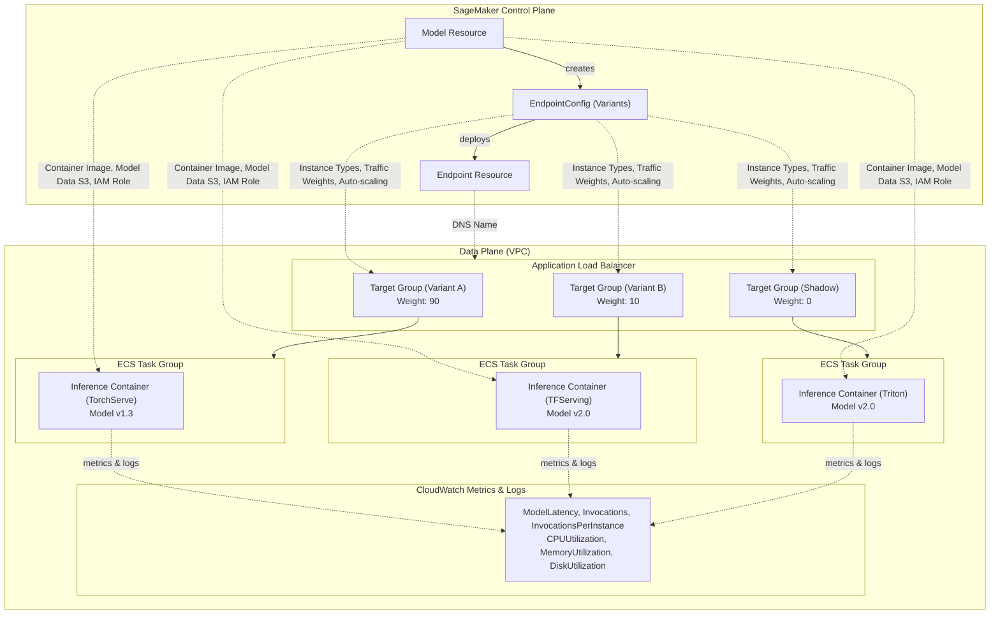

# Lesson 4: Model Deployment Mechanisms

## 1. First-Principles Intuition & Invariants

The deployment of machine learning models represents a fundamental transition from experimental offline training to production-grade serving systems where inference latency, throughput, cost efficiency, and operational reliability become first-class constraints. While training workloads exhibit batch-oriented, embarrassingly parallel computation patterns amenable to preemptible GPU clusters, inference systems demand continuous availability, bounded request latency, auto-scaling elasticity, and graceful degradation under load. Amazon SageMaker's deployment mechanisms bridge these two distinct operational regimes through a suite of primitives that span synchronous real-time endpoints, serverless invocation architectures, asynchronous queue-backed inference, and batch transformation pipelines.

At the architectural core, SageMaker endpoints materialize as managed Amazon Elastic Container Service (ECS) or Elastic Kubernetes Service (EKS) task groups fronted by Application Load Balancers or Network Load Balancers, depending on configuration. The endpoint abstraction decouples the inference runtime container—which embeds the model artifact, serving framework (TorchServe, TensorFlow Serving, Triton Inference Server), and custom inference handlers—from the control plane that orchestrates scaling, health checks, traffic routing, and model updates. This separation enables zero-downtime deployments, A/B traffic splitting, and shadow testing without disrupting active inference requests.

The invariants governing SageMaker deployment mechanisms stem from the CAP theorem's practical manifestations in distributed serving systems. Real-time endpoints prioritize availability and partition tolerance over strict consistency, accepting eventual consistency in auto-scaling decisions and metrics propagation. Batch transform jobs invert this trade-off, favoring throughput and cost efficiency over latency by processing entire datasets through ephemeral compute clusters. Asynchronous inference introduces a queue-based buffering layer that decouples request submission from processing, enabling workload smoothing and elastic backend scaling independent of client concurrency patterns.

Model artifacts in SageMaker follow a content-addressed storage model rooted in Amazon S3, where each model version is identified by an immutable S3 URI. The endpoint configuration references these URIs through model resources, establishing a declarative dependency graph between training jobs, model registries, and serving infrastructure. This immutability contract ensures reproducibility and enables atomic rollbacks by repointing endpoint configurations to previous model versions without data corruption or partial state propagation.

The cost function for deployment architecture selection emerges from the intersection of latency requirements, request rate distributions, and resource utilization efficiency. Real-time endpoints provision dedicated EC2 instances with guaranteed capacity, incurring fixed hourly costs regardless of utilization. Serverless inference amortizes cold-start latencies (typically 500ms to 10 seconds) against variable per-request pricing, achieving cost efficiency for sporadic workloads where average request rates fall below the break-even threshold of approximately 10% sustained instance utilization. Batch transform eliminates interactive latency constraints entirely, packing inference across large datasets into transient Spot Instance clusters that optimize for compute cost per prediction rather than wall-clock time.

Multi-model endpoints introduce a resource multiplexing primitive that dynamically loads and unloads model artifacts from a shared instance fleet based on request patterns, amortizing fixed infrastructure costs across model portfolios. This architecture suits scenarios where hundreds or thousands of models—each serving low individual request rates—would otherwise require prohibitively expensive dedicated endpoints. The loading latency penalty (typically 1-5 seconds for models under 1GB) trades deterministic single-model response times for improved total cost of ownership in long-tail model distribution scenarios.

Multi-container endpoints extend the multiplexing concept orthogonally, co-locating multiple containers within a single endpoint instance to compose inference pipelines (preprocessing, prediction, postprocessing) or ensemble multiple models with distinct framework requirements. Container orchestration occurs at the instance level through Docker networking, enabling low-latency inter-container communication without network round-trips while preserving process isolation for fault containment.

SageMaker Neo represents a compilation-based optimization layer that transforms framework-specific model graphs into hardware-optimized execution plans through operator fusion, memory layout optimization, and backend-specific code generation targeting x86, ARM, NVIDIA GPUs, AWS Inferentia, and embedded edge processors. Neo's compilation process applies classical compiler optimizations—constant folding, dead code elimination, loop unrolling—augmented with domain-specific transformations like convolution-batch normalization fusion and quantization-aware operator replacement. The compiled artifacts eliminate framework overhead, reduce memory footprint, and enable deployment on resource-constrained edge devices where full framework runtimes prove impractical.

Edge deployment through SageMaker Edge Manager extends the model deployment surface beyond cloud infrastructure to IoT devices, mobile clients, and embedded systems. This architecture inverts the typical client-server request pattern, deploying model inference entirely on-device while maintaining cloud connectivity for model updates, telemetry ingestion, and drift detection. The edge agent implements a versioned model cache, atomic update protocols, and fallback strategies for connectivity loss, ensuring inference continuity even during network partitions.

The SageMaker Inference Recommender provides an automated benchmarking and cost optimization framework that empirically profiles model performance across instance families, container configurations, and scaling policies. Rather than relying on heuristic capacity planning or manual load testing, the recommender synthesizes realistic load patterns, measures latency distributions, identifies resource bottlenecks, and solves the multi-objective optimization problem of minimizing cost while satisfying latency SLAs and throughput targets.

A/B testing, shadow variants, and canary deployments constitute the progressive delivery mechanisms that enable low-risk model updates with statistical validation. These patterns acknowledge the fundamental reality that offline evaluation metrics—accuracy, F1, AUC—serve as imperfect proxies for production business outcomes influenced by distribution shift, data quality drift, and emergent user behavior. Shadow variants duplicate production traffic to candidate models without exposing predictions to downstream systems, enabling side-by-side quality comparison without business impact. Canary deployments gradually shift live traffic percentages from incumbent to candidate models, monitoring error rates and business metrics to detect regressions before full rollout. A/B testing formalizes this statistical validation through hypothesis testing frameworks that quantify the significance of observed performance differences.

## 2. Core Architecture & Mechanics

The SageMaker endpoint architecture begins with the control plane's declarative resource model, where operators define Models, EndpointConfigs, and Endpoints as immutable configuration resources. A Model resource binds a container image URI (referencing ECR repositories for pre-built framework containers or custom inference images), model data S3 location, and IAM execution role. The EndpointConfig resource composes one or more ProductionVariants, each specifying a Model, instance type and count, traffic weight, and variant name. The Endpoint resource materializes this specification into running infrastructure, triggering the deployment orchestration workflow.



When a client invokes the endpoint via the `InvokeEndpoint` API, the request traverses the Application Load Balancer, which applies weighted random routing according to the configured traffic distribution. Each production variant maintains an independent target group containing the container instances serving that model version. Shadow variants register with weight zero, causing the load balancer to duplicate incoming requests to shadow targets without incorporating their responses into the client-facing result. This duplication occurs at the load balancer tier through request mirroring, eliminating application-layer coordination overhead.

Real-time endpoint auto-scaling integrates Application Auto Scaling policies with CloudWatch metrics through closed-loop control systems. The scaling policy defines a target tracking metric—typically `SageMakerVariantInvocationsPerInstance` or custom CloudWatch metrics derived from model-specific business logic—and threshold values that trigger scale-out or scale-in actions. The auto-scaling algorithm implements a proportional-integral controller that computes desired capacity based on current utilization, applies configurable cooldown periods to prevent oscillation, and issues EC2 launch or termination requests through the SageMaker control plane.

The auto-scaling decision cycle operates on 60-second CloudWatch metric aggregation windows, introducing inherent lag between load spikes and capacity additions. For workloads with predictable diurnal patterns, scheduled scaling policies pre-provision capacity ahead of anticipated traffic increases, eliminating warm-up latency. The instance launch sequence—AMI boot, Docker image pull, model artifact download from S3, framework initialization, health check validation—typically requires 4-8 minutes for first-time deployments and 2-4 minutes for subsequent scale-outs with cached images.

Multi-model endpoints fundamentally alter this architecture by maintaining a model cache and dynamic loading subsystem within each container instance. The inference container runs a model server (typically a customized TorchServe or multi-model server implementation) that exposes HTTP endpoints for both prediction requests and model lifecycle management. When a prediction request arrives specifying a target model via the `TargetModel` header, the server checks its in-memory cache. On cache miss, the server downloads the model artifact from S3, deserializes the framework-specific graph, allocates GPU memory if applicable, and registers the model with the serving framework. Cache eviction follows a least-recently-used policy, offloading models to free memory for new arrivals.

```python
import boto3
import json
from datetime import datetime

sagemaker = boto3.client('sagemaker')
runtime = boto3.client('sagemaker-runtime')

# Define model resources for A/B testing scenario
model_v1 = sagemaker.create_model(
    ModelName=f'recommendation-model-v1-{int(datetime.now().timestamp())}',
    PrimaryContainer={
        'Image': '763104351884.dkr.ecr.us-east-1.amazonaws.com/pytorch-inference:2.0.0-gpu-py310',
        'ModelDataUrl': 's3://ml-models-production/recommendations/v1.3.2/model.tar.gz',
        'Environment': {
            'SAGEMAKER_PROGRAM': 'inference.py',
            'SAGEMAKER_SUBMIT_DIRECTORY': 's3://ml-models-production/recommendations/v1.3.2/source.tar.gz',
            'SAGEMAKER_REGION': 'us-east-1',
            'MODEL_SERVER_TIMEOUT': '300',
            'MODEL_SERVER_WORKERS': '4',
            'SAGEMAKER_MODEL_SERVER_TIMEOUT': '300'
        }
    },
    ExecutionRoleArn='arn:aws:iam::123456789012:role/SageMakerExecutionRole'
)

model_v2 = sagemaker.create_model(
    ModelName=f'recommendation-model-v2-{int(datetime.now().timestamp())}',
    PrimaryContainer={
        'Image': '763104351884.dkr.ecr.us-east-1.amazonaws.com/pytorch-inference:2.0.0-gpu-py310',
        'ModelDataUrl': 's3://ml-models-production/recommendations/v2.0.0/model.tar.gz',
        'Environment': {
            'SAGEMAKER_PROGRAM': 'inference.py',
            'SAGEMAKER_SUBMIT_DIRECTORY': 's3://ml-models-production/recommendations/v2.0.0/source.tar.gz',
            'SAGEMAKER_REGION': 'us-east-1',
            'MODEL_SERVER_TIMEOUT': '300',
            'MODEL_SERVER_WORKERS': '4'
        }
    },
    ExecutionRoleArn='arn:aws:iam::123456789012:role/SageMakerExecutionRole'
)

# Create endpoint configuration with canary deployment: 90% v1, 10% v2, shadow v2
endpoint_config = sagemaker.create_endpoint_config(
    EndpointConfigName=f'recommendation-endpoint-config-{int(datetime.now().timestamp())}',
    ProductionVariants=[
        {
            'VariantName': 'production-stable',
            'ModelName': model_v1['ModelArn'].split('/')[-1],
            'InstanceType': 'ml.g4dn.xlarge',
            'InitialInstanceCount': 2,
            'InitialVariantWeight': 90,
            'RoutingConfig': {
                'RoutingStrategy': 'LEAST_OUTSTANDING_REQUESTS'
            }
        },
        {
            'VariantName': 'canary-candidate',
            'ModelName': model_v2['ModelArn'].split('/')[-1],
            'InstanceType': 'ml.g4dn.xlarge',
            'InitialInstanceCount': 1,
            'InitialVariantWeight': 10,
            'RoutingConfig': {
                'RoutingStrategy': 'LEAST_OUTSTANDING_REQUESTS'
            }
        },
        {
            'VariantName': 'shadow-validation',
            'ModelName': model_v2['ModelArn'].split('/')[-1],
            'InstanceType': 'ml.g4dn.xlarge',
            'InitialInstanceCount': 1,
            'InitialVariantWeight': 0,
            'RoutingConfig': {
                'RoutingStrategy': 'LEAST_OUTSTANDING_REQUESTS'
            }
        }
    ],
    DataCaptureConfig={
        'EnableCapture': True,
        'InitialSamplingPercentage': 100,
        'DestinationS3Uri': 's3://ml-inference-logs/recommendation-endpoint/datacapture',
        'CaptureOptions': [
            {'CaptureMode': 'Input'},
            {'CaptureMode': 'Output'}
        ],
        'CaptureContentTypeHeader': {
            'JsonContentTypes': ['application/json']
        }
    }
)

# Create or update endpoint
endpoint_name = 'recommendation-endpoint-production'
try:
    sagemaker.create_endpoint(
        EndpointName=endpoint_name,
        EndpointConfigName=endpoint_config['EndpointConfigArn'].split('/')[-1]
    )
    waiter = sagemaker.get_waiter('endpoint_in_service')
    waiter.wait(EndpointName=endpoint_name)
except sagemaker.exceptions.ClientError:
    sagemaker.update_endpoint(
        EndpointName=endpoint_name,
        EndpointConfigName=endpoint_config['EndpointConfigArn'].split('/')[-1],
        RetainAllVariantProperties=False
    )
    waiter = sagemaker.get_waiter('endpoint_in_service')
    waiter.wait(EndpointName=endpoint_name)

# Configure auto-scaling for production variant
autoscaling = boto3.client('application-autoscaling')

autoscaling.register_scalable_target(
    ServiceNamespace='sagemaker',
    ResourceId=f'endpoint/{endpoint_name}/variant/production-stable',
    ScalableDimension='sagemaker:variant:DesiredInstanceCount',
    MinCapacity=2,
    MaxCapacity=10
)

autoscaling.put_scaling_policy(
    PolicyName='recommendation-endpoint-scaling-policy',
    ServiceNamespace='sagemaker',
    ResourceId=f'endpoint/{endpoint_name}/variant/production-stable',
    ScalableDimension='sagemaker:variant:DesiredInstanceCount',
    PolicyType='TargetTrackingScaling',
    TargetTrackingScalingPolicyConfiguration={
        'TargetValue': 750.0,
        'CustomizedMetricSpecification': {
            'MetricName': 'SageMakerVariantInvocationsPerInstance',
            'Namespace': 'AWS/SageMaker',
            'Dimensions': [
                {'Name': 'EndpointName', 'Value': endpoint_name},
                {'Name': 'VariantName', 'Value': 'production-stable'}
            ],
            'Statistic': 'Average'
        },
        'ScaleOutCooldown': 60,
        'ScaleInCooldown': 600
    }
)

# Invoke endpoint with request routing
response = runtime.invoke_endpoint(
    EndpointName=endpoint_name,
    ContentType='application/json',
    Body=json.dumps({
        'user_id': 'user_12345',
        'context': {
            'device': 'mobile',
            'time_of_day': 'evening',
            'location': 'home'
        },
        'candidate_items': [101, 102, 103, 104, 105]
    })
)

predictions = json.loads(response['Body'].read().decode())
invoked_variant = response['ResponseMetadata']['HTTPHeaders'].get('x-amzn-invoked-production-variant')
print(f"Prediction from variant {invoked_variant}: {predictions}")
```

Multi-container endpoints implement a serial inference pipeline where the load balancer routes requests to a primary container, which then forwards intermediate results to secondary containers via localhost HTTP calls. The endpoint configuration specifies a chain of ContainerDefinitions with explicit ordering, and SageMaker's container orchestration ensures all containers co-locate on the same instance with Docker bridge networking.

```python
# Multi-container endpoint for preprocessing + inference + postprocessing pipeline
preprocess_model = sagemaker.create_model(
    ModelName=f'preprocessing-{int(datetime.now().timestamp())}',
    PrimaryContainer={
        'Image': '123456789012.dkr.ecr.us-east-1.amazonaws.com/ml-preprocessing:latest',
        'Environment': {
            'PREPROCESSING_MODE': 'production',
            'FEATURE_STORE_ENDPOINT': 'https://featurestore.internal.company.com'
        }
    },
    ExecutionRoleArn='arn:aws:iam::123456789012:role/SageMakerExecutionRole'
)

inference_containers = [
    {
        'ContainerHostname': 'preprocessing',
        'Image': '123456789012.dkr.ecr.us-east-1.amazonaws.com/ml-preprocessing:latest',
        'Environment': {
            'PREPROCESSING_MODE': 'production'
        }
    },
    {
        'ContainerHostname': 'inference',
        'Image': '763104351884.dkr.ecr.us-east-1.amazonaws.com/pytorch-inference:2.0.0-gpu-py310',
        'ModelDataUrl': 's3://ml-models-production/nlp-classifier/model.tar.gz',
        'Environment': {
            'SAGEMAKER_PROGRAM': 'inference.py',
            'SAGEMAKER_SUBMIT_DIRECTORY': 's3://ml-models-production/nlp-classifier/source.tar.gz'
        }
    },
    {
        'ContainerHostname': 'postprocessing',
        'Image': '123456789012.dkr.ecr.us-east-1.amazonaws.com/ml-postprocessing:latest',
        'Environment': {
            'POSTPROCESS_THRESHOLD': '0.85',
            'RESULT_FORMATTING': 'json_v2'
        }
    }
]

pipeline_model = sagemaker.create_model(
    ModelName=f'nlp-pipeline-{int(datetime.now().timestamp())}',
    Containers=inference_containers,
    ExecutionRoleArn='arn:aws:iam::123456789012:role/SageMakerExecutionRole'
)

pipeline_endpoint_config = sagemaker.create_endpoint_config(
    EndpointConfigName=f'nlp-pipeline-config-{int(datetime.now().timestamp())}',
    ProductionVariants=[
        {
            'VariantName': 'primary',
            'ModelName': pipeline_model['ModelArn'].split('/')[-1],
            'InstanceType': 'ml.g4dn.2xlarge',
            'InitialInstanceCount': 1
        }
    ]
)
```

Serverless inference eliminates the fixed instance provisioning model by leveraging AWS Lambda-style compute allocation where SageMaker provisions capacity on-demand in response to invocation requests. The underlying architecture deploys model artifacts and inference containers to a managed pool, maintaining warm container instances for frequently accessed endpoints while cold-starting containers for sporadic requests. The cold start latency encompasses container initialization, model deserialization, and framework warm-up, with total latency ranging from 500ms for small scikit-learn models to 30+ seconds for large transformer models exceeding 10GB.

```python
# Serverless inference configuration
serverless_config = sagemaker.create_endpoint_config(
    EndpointConfigName=f'serverless-fraud-detection-{int(datetime.now().timestamp())}',
    ProductionVariants=[
        {
            'VariantName': 'serverless',
            'ModelName': 'fraud-detection-model-v3',
            'ServerlessConfig': {
                'MemorySizeInMB': 4096,
                'MaxConcurrency': 20,
                'ProvisionedConcurrency': 2
            }
        }
    ]
)

sagemaker.create_endpoint(
    EndpointName='fraud-detection-serverless',
    EndpointConfigName=serverless_config['EndpointConfigArn'].split('/')[-1]
)
```

Batch transform jobs represent the offline batch inference primitive optimized for processing large datasets without interactive latency requirements. The transform job specification defines an input S3 prefix, output S3 location, instance configuration, and optional data splitting strategy. SageMaker launches an ephemeral compute cluster, distributes input files across instances using a work queue, executes inference in parallel, and writes results to S3 with configurable output formatting.

```python
# Batch transform for large-scale video classification
transformer_config = {
    'TransformJobName': f'video-classification-batch-{int(datetime.now().timestamp())}',
    'ModelName': 'video-classification-resnet3d-v2',
    'TransformInput': {
        'DataSource': {
            'S3DataSource': {
                'S3DataType': 'S3Prefix',
                'S3Uri': 's3://video-processing-input/raw-videos/'
            }
        },
        'ContentType': 'video/mp4',
        'CompressionType': 'None',
        'SplitType': 'None'
    },
    'TransformOutput': {
        'S3OutputPath': 's3://video-processing-output/classifications/',
        'AssembleWith': 'Line',
        'Accept': 'application/json'
    },
    'TransformResources': {
        'InstanceType': 'ml.p3.2xlarge',
        'InstanceCount': 10
    },
    'BatchStrategy': 'MultiRecord',
    'MaxPayloadInMB': 100,
    'MaxConcurrentTransforms': 8,
    'DataProcessing': {
        'InputFilter': '$',
        'OutputFilter': '$.predictions',
        'JoinSource': 'Input'
    }
}

transform_job = sagemaker.create_transform_job(**transformer_config)

# Monitor job progress
waiter = sagemaker.get_waiter('transform_job_completed_or_stopped')
waiter.wait(TransformJobName=transformer_config['TransformJobName'])

job_status = sagemaker.describe_transform_job(
    TransformJobName=transformer_config['TransformJobName']
)
print(f"Processed {job_status['TransformOutput']['S3OutputPath']}")
```

Asynchronous inference introduces a queue-based architecture that decouples request submission from processing, enabling workloads with variable latency requirements and payload sizes exceeding synchronous endpoint limits. Clients submit requests by uploading input data to S3 and invoking the endpoint with the S3 URI, receiving an immediate acknowledgment with an output location. SageMaker enqueues the request to an internal SQS queue, processes requests according to configured concurrency and timeout limits, and writes results to the specified output S3 location. Optional SNS notifications signal completion or failure.

```python
# Asynchronous inference for document processing with large payloads
async_endpoint_config = sagemaker.create_endpoint_config(
    EndpointConfigName=f'document-ocr-async-{int(datetime.now().timestamp())}',
    ProductionVariants=[
        {
            'VariantName': 'async-primary',
            'ModelName': 'document-ocr-model-v4',
            'InstanceType': 'ml.g4dn.xlarge',
            'InitialInstanceCount': 1
        }
    ],
    AsyncInferenceConfig={
        'OutputConfig': {
            'S3OutputPath': 's3://document-processing/ocr-results/',
            'NotificationConfig': {
                'SuccessTopic': 'arn:aws:sns:us-east-1:123456789012:ocr-success',
                'ErrorTopic': 'arn:aws:sns:us-east-1:123456789012:ocr-failure'
            }
        },
        'ClientConfig': {
            'MaxConcurrentInvocationsPerInstance': 4
        }
    }
)

sagemaker.create_endpoint(
    EndpointName='document-ocr-async',
    EndpointConfigName=async_endpoint_config['EndpointConfigArn'].split('/')[-1]
)

# Submit asynchronous inference request
import uuid
request_id = str(uuid.uuid4())
input_s3_path = f's3://document-processing/input/{request_id}/document.pdf'

# Upload input document to S3 (omitted for brevity)

response = runtime.invoke_endpoint_async(
    EndpointName='document-ocr-async',
    InputLocation=input_s3_path,
    InvocationTimeoutSeconds=3600,
    RequestTTLSeconds=21600
)

output_location = response['OutputLocation']
failure_location = response.get('FailureLocation')
print(f"Request queued. Output will be available at: {output_location}")
```

SageMaker Neo compilation targets the model optimization and cross-platform deployment problem by transforming framework-specific model graphs into optimized executables for target hardware. The compilation process ingests models in TensorFlow, PyTorch, ONNX, MXNet, XGBoost, or scikit-learn formats and applies a multi-stage optimization pipeline that includes operator-level optimizations (kernel fusion, constant folding), memory layout transformations (NCHW to NHWC conversions for mobile), quantization (FP32 to INT8), and backend code generation for target instruction sets.

```python
# Compile PyTorch model for edge deployment to NVIDIA Jetson
compilation_job = sagemaker.create_compilation_job(
    CompilationJobName=f'object-detection-edge-compile-{int(datetime.now().timestamp())}',
    RoleArn='arn:aws:iam::123456789012:role/SageMakerExecutionRole',
    InputConfig={
        'S3Uri': 's3://ml-models/object-detection/pytorch-model.tar.gz',
        'DataInputConfig': '{"input0":[1,3,640,640]}',
        'Framework': 'PYTORCH',
        'FrameworkVersion': '2.0'
    },
    OutputConfig={
        'S3OutputLocation': 's3://compiled-models/object-detection/',
        'TargetDevice': 'jetson_nano',
        'CompilerOptions': json.dumps({
            'quantization': 'int8',
            'precision': 'fp16',
            'trt_version': '8.5'
        })
    },
    StoppingCondition={
        'MaxRuntimeInSeconds': 900
    }
)

# Compilation for AWS Inferentia
inferentia_compilation = sagemaker.create_compilation_job(
    CompilationJobName=f'nlp-transformer-inferentia-{int(datetime.now().timestamp())}',
    RoleArn='arn:aws:iam::123456789012:role/SageMakerExecutionRole',
    InputConfig={
        'S3Uri': 's3://ml-models/nlp-transformer/model.tar.gz',
        'DataInputConfig': '{"input_ids":[1,512],"attention_mask":[1,512]}',
        'Framework': 'PYTORCH',
        'FrameworkVersion': '2.0'
    },
    OutputConfig={
        'S3OutputLocation': 's3://compiled-models/nlp-transformer/',
        'TargetDevice': 'ml_inf1',
        'CompilerOptions': json.dumps({
            'dtype': 'float16',
            'num_neuroncores': 4,
            'compiler_version': '2.12'
        })
    },
    StoppingCondition={
        'MaxRuntimeInSeconds': 1800
    }
)
```

Edge deployment through SageMaker Edge Manager extends the deployment boundary to resource-constrained devices by packaging compiled models with a lightweight inference agent that manages model loading, prediction serving, telemetry collection, and cloud synchronization. The edge agent maintains a versioned model cache, implements atomic model updates through a two-phase commit protocol, and buffers telemetry data for periodic upload during connectivity windows.

```python
# Package compiled model for edge deployment
edge_packaging_job = sagemaker.create_edge_packaging_job(
    EdgePackagingJobName=f'smart-camera-edge-package-{int(datetime.now().timestamp())}',
    CompilationJobName='object-detection-edge-compile-1234567890',
    RoleArn='arn:aws:iam::123456789012:role/SageMakerExecutionRole',
    ModelName='smart-camera-detector-v3',
    ModelVersion='3.2.1',
    OutputConfig={
        'S3OutputLocation': 's3://edge-deployment/packages/',
        'PresetDeploymentType': 'GreengrassV2Component'
    }
)

# Create edge device fleet for centralized management
device_fleet = sagemaker.create_device_fleet(
    DeviceFleetName='smart-camera-fleet-production',
    RoleArn='arn:aws:iam::123456789012:role/SageMakerEdgeRole',
    OutputConfig={
        'S3OutputLocation': 's3://edge-telemetry/smart-cameras/'
    },
    Description='Production fleet of smart security cameras'
)

# Register edge devices
sagemaker.register_devices(
    DeviceFleetName='smart-camera-fleet-production',
    Devices=[
        {
            'DeviceName': 'camera-lobby-01',
            'IotThingName': 'smart-camera-lobby-01'
        },
        {
            'DeviceName': 'camera-parking-01',
            'IotThingName': 'smart-camera-parking-01'
        }
    ]
)
```

The Inference Recommender automates the capacity planning and cost optimization process through systematic load testing across instance type configurations. The recommendation workflow launches ephemeral endpoints for each candidate configuration, synthesizes realistic request patterns based on provided payload samples, measures latency percentiles and throughput, monitors resource utilization, and computes the Pareto frontier of cost-performance trade-offs.

```python
# Launch inference recommendation job
recommendation_job = sagemaker.create_inference_recommendations_job(
    JobName=f'recommendation-model-sizing-{int(datetime.now().timestamp())}',
    JobType='Default',
    RoleArn='arn:aws:iam::123456789012:role/SageMakerExecutionRole',
    InputConfig={
        'ModelPackageVersionArn': 'arn:aws:sagemaker:us-east-1:123456789012:model-package/recommendation-model/1',
        'JobDurationInSeconds': 3600,
        'TrafficPattern': {
            'TrafficType': 'PHASES',
            'Phases': [
                {
                    'InitialNumberOfUsers': 10,
                    'SpawnRate': 5,
                    'DurationInSeconds': 600
                },
                {
                    'InitialNumberOfUsers': 100,
                    'SpawnRate': 20,
                    'DurationInSeconds': 1200
                },
                {
                    'InitialNumberOfUsers': 500,
                    'SpawnRate': 50,
                    'DurationInSeconds': 1200
                }
            ]
        },
        'ResourceLimit': {
            'MaxNumberOfTests': 20,
            'MaxParallelOfTests': 5
        },
        'EndpointConfigurations': [
            {
                'InstanceType': 'ml.c5.xlarge'
            },
            {
                'InstanceType': 'ml.c5.2xlarge'
            },
            {
                'InstanceType': 'ml.g4dn.xlarge'
            },
            {
                'InstanceType': 'ml.inf1.xlarge'
            }
        ]
    },
    StoppingConditions={
        'MaxInvocations': 1000000,
        'ModelLatencyThresholds': [
            {
                'Percentile': 'P95',
                'ValueInMilliseconds': 200
            }
        ]
    }
)

# Retrieve recommendations after completion
waiter = sagemaker.get_waiter('inference_recommendations_job_completed')
waiter.wait(JobName=recommendation_job['JobArn'].split('/')[-1])

recommendations = sagemaker.describe_inference_recommendations_job(
    JobName=recommendation_job['JobArn'].split('/')[-1]
)

for rec in recommendations['InferenceRecommendations']:
    print(f"Instance: {rec['EndpointConfiguration']['InstanceType']}")
    print(f"  Cost per hour: ${rec['Metrics']['CostPerHour']:.2f}")
    print(f"  P50 latency: {rec['Metrics']['ModelLatency']}ms")
    print(f"  Max invocations: {rec['Metrics']['MaxInvocations']}")
    print(f"  CPU utilization: {rec['Metrics']['CpuUtilization']:.1f}%")
    print()
```

## 3. High-Performance Optimization & Failure Modes

Real-time endpoint latency decomposes into several components that each require distinct optimization strategies. Network round-trip time from client to AWS region contributes 20-100ms depending on geographic proximity and intermediate proxy layers. Load balancer routing and connection establishment add 5-15ms. The actual model inference time varies from microseconds for simple linear models to seconds for large transformer networks. Request serialization, framework overhead, and post-processing introduce additional overhead of 10-50ms. To minimize total latency, deploy endpoints in regions co-located with client applications, leverage AWS PrivateLink for VPC-native connectivity, enable HTTP keep-alive to amortize connection setup, and optimize model inference through quantization, pruning, or distillation.

GPU utilization for inference workloads often suffers from poor batching efficiency when request arrival rates fall below saturation levels. Unlike training workloads that process fixed-size batches, real-time serving systems must trade off latency against throughput by accumulating requests into larger batches before dispatching to GPU kernels. SageMaker's built-in batching capabilities in TorchServe and Triton enable dynamic batching with configurable maximum wait times. The optimal batch size balances GPU compute saturation (larger batches improve utilization) against head-of-line latency penalties (requests wait for batch formation). For models with static compute graphs, compile-time optimizations like TensorRT can reduce per-request latency by 2-5x through kernel fusion and memory layout optimization.

Multi-model endpoints introduce cache thrashing pathologies when request distributions exhibit high skew or rapid temporal shifts. The LRU eviction policy performs well for Zipfian request distributions where a small subset of models receives the majority of traffic, but degrades for uniform or adversarial patterns. The model loading latency penalty—typically 1-5 seconds for models under 1GB—becomes amplified when cache capacity proves insufficient for the working set. Monitoring CloudWatch metrics for `ModelLoadingWaitTime`, `ModelCacheHit`, and individual model invocation counts enables detection of thrashing behavior. Mitigation strategies include increasing instance memory to expand cache capacity, implementing application-layer request coalescing for the same model, or partitioning models across multiple dedicated endpoints for high-traffic models.

Auto-scaling oscillation emerges from the interaction between CloudWatch metric lag, scale-out provisioning delay, and load-dependent request rates. When traffic spikes trigger scale-out, the 4-8 minute instance launch latency causes sustained overload on existing instances. If the traffic burst proves transient, newly launched capacity arrives after load subsides, triggering immediate scale-in and potential thrashing. The stabilization cooldown periods (typically 60s for scale-out, 600s for scale-in) introduce hysteresis that dampens oscillation but increases over-provisioning duration. For traffic patterns with predictable daily or weekly cycles, scheduled scaling policies pre-provision capacity before anticipated peaks. For unpredictable spikes, increasing cooldown periods and implementing target tracking on a moving average metric reduces oscillation at the cost of slower response to sustained load changes.

Shadow variant overhead warrants careful consideration in high-throughput production environments. Load balancer request mirroring duplicates the full request body to shadow targets, doubling ingress bandwidth consumption and increasing load balancer CPU utilization. Shadow variants consume full instance resources while producing unused predictions, effectively doubling infrastructure costs during validation periods. The request duplication occurs asynchronously to avoid increasing client-perceived latency, but shadow variant failures do not propagate to clients. For cost-sensitive deployments, consider shadow testing only a sampled subset of production traffic through application-layer filtering before load balancer routing.

Canary deployment risk management requires statistical rigor to distinguish genuine model regressions from noise in business metrics. With only 10% canary traffic allocation, even moderate effect sizes require extended observation periods to achieve statistical significance. The sequential probability ratio test (SPRT) provides a framework for early stopping when sufficient evidence accumulates for either acceptance or rejection. However, multiple testing across numerous metrics (latency, error rate, conversion rate, revenue per request) inflates false positive rates without Bonferroni correction or false discovery rate control. Implement automated canary analysis frameworks like Kayenta or AWS CloudWatch Synthetics that evaluate predefined thresholds on key performance indicators and automatically roll back on regression detection.

A/B testing between model variants introduces the cold-start problem where newly deployed candidates lack sufficient historical data for personalization features or contextual bandits that incorporate user-specific state. This transient degradation can bias A/B test results in favor of incumbent models during the warm-up period. Pre-warming strategies include backfilling historical features before traffic allocation, implementing shared feature layers that transfer learning across variants, or phasing in new models through a burn-in period with shadow traffic before live A/B allocation.

Batch transform failure modes cluster around resource exhaustion and data skew. When input files vary significantly in size—common in video processing, document OCR, or time-series forecasting—default work distribution assigns files uniformly across instances, causing load imbalance where some instances finish quickly while others remain saturated. The `SplitType` configuration enables splitting of large files into smaller chunks (for CSV or RecordIO formats), improving load balancing at the cost of increased S3 API overhead. Out-of-memory errors arise when individual payloads exceed instance memory, particularly for models with large intermediate activations or batch sizes. Monitoring CloudWatch Logs for OOMKilled containers and adjusting `MaxPayloadInMB` or instance types mitigates this failure mode.

Asynchronous inference queue depth monitoring proves critical for capacity planning and latency SLA management. The internal SQS queue accumulates requests during burst periods, smoothing load and enabling aggressive instance count optimization. However, unbounded queue depth can lead to runaway latency when sustained request rates exceed processing capacity. CloudWatch metrics expose `ApproximateAgeOfOldestRequest` and `NumberOfMessagesVisible`, enabling alerting on queue depth thresholds. The `MaxConcurrentInvocationsPerInstance` configuration constrains concurrency to prevent memory exhaustion but may require tuning based on model memory footprint and instance capacity.

Model compilation through Neo occasionally fails for models using unsupported operators, dynamic control flow, or framework-specific extensions outside the standard ONNX operator set. The compilation error messages reference the problematic graph nodes, guiding remediation through operator replacement, graph surgery, or selective subgraph compilation. For models with unsupported operators, consider compiling only the core computation subgraph while implementing custom operators in the pre/post-processing container logic. Compilation time scales super-linearly with model size and complexity, with large transformer models exceeding 10GB potentially requiring 30+ minute compilation times and hitting the 900-second default timeout.

Edge deployment introduces network partition resilience requirements where devices must continue operating during extended cloud disconnection periods. The edge agent implements a versioned model cache with configurable retention policies, ensuring availability of multiple model versions for rollback scenarios. Telemetry buffering during offline periods requires careful capacity planning based on prediction volume and device storage constraints. The two-phase commit protocol for model updates ensures atomic transitions without serving inconsistent predictions during update operations, but requires sufficient local storage for concurrent storage of both active and candidate model versions.

Inference Recommender cost optimization reveals non-obvious trade-offs between instance types. CPU-based instances (C5, C6i) may outperform GPU instances (G4dn) for small models where inference time falls below GPU kernel launch overhead. AWS Inferentia instances (Inf1) achieve lowest cost-per-inference for supported model architectures through custom ASIC optimization, but impose longer cold-start times and framework restrictions. The Pareto frontier analysis quantifies these trade-offs, but business requirements around latency SLAs, cost budgets, and throughput targets dictate the final selection. For multi-tenant serving systems, consider cost allocation models that apportion endpoint costs across model consumers based on invocation volumes or latency consumption.

The convergence of these deployment mechanisms enables sophisticated production ML architectures that compose primitives according to workload characteristics. Latency-sensitive recommender systems demand real-time endpoints with aggressive auto-scaling and regional distribution. Periodic fraud detection batch jobs leverage Spot Instance transform jobs for cost efficiency. Asynchronous document processing tolerates queue-backed latency in exchange for handling large payloads and smoothing irregular request patterns. Edge-deployed computer vision models optimize for local inference latency and bandwidth reduction by processing video streams on-device and uploading only predictions or anomaly detections. The architectural decision framework balances latency requirements, cost constraints, scale patterns, and operational complexity to select appropriate deployment primitives and compose them into production-grade inference systems.
