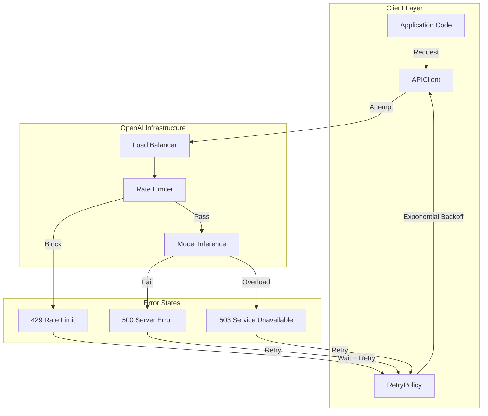
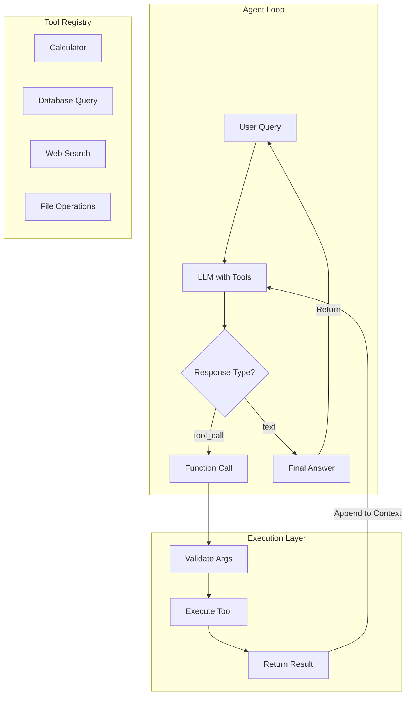

# Labs

## Foundations: Understanding Token-Level Computation and API Contracts

Before implementing practical systems with ChatGPT and OpenAI APIs, we establish the formal computational model underlying modern language model APIs. These systems operate on **discrete token sequences** rather than continuous text, transforming input sequences $\mathbf{x} = (x_1, x_2, \ldots, x_n)$ into probability distributions over output tokens through learned parameter matrices.

### The Transformer Architecture Invariant

The core computational primitive is the attention mechanism, which for each position $i$ computes:

$$\text{Attention}(Q, K, V) = \text{softmax}\left(\frac{QK^T}{\sqrt{d_k}}\right)V$$

where $Q$, $K$, $V$ are query, key, and value matrices derived from input embeddings, and $d_k$ is the key dimension. This operation satisfies the **permutation equivariance** property: reordering input positions reorders outputs correspondingly, preserving relational structure.

The full transformer block composes:

$$\text{TransformerBlock}(\mathbf{x}) = \text{FFN}(\text{LayerNorm}(\mathbf{x} + \text{MultiHeadAttention}(\mathbf{x})))$$

with residual connections ensuring gradient flow across $L$ stacked layers. The API contract abstracts this entirely: clients submit sequences, receive completions, and pay proportional to $\text{tokens}_{\text{input}} + \text{tokens}_{\text{output}}$.

### Token Economics and Rate Limit Algebra

OpenAI APIs enforce constraints as a system of inequalities. For GPT-4 Turbo, the limits form:

$$\begin{aligned}
\text{RPM} &\leq 10{,}000 \quad \text{(requests per minute)} \\
\text{TPM} &\leq 2{,}000{,}000 \quad \text{(tokens per minute)} \\
\text{RPD} &\leq 10{,}000{,}000 \quad \text{(requests per day)}
\end{aligned}$$

A compliant client must satisfy all constraints simultaneously. For a workload generating requests of average size $\bar{t}$ tokens at rate $r$ requests/minute:

$$r \leq \min\left(\text{RPM}, \frac{\text{TPM}}{\bar{t}}, \frac{\text{RPD}}{1440}\right)$$

This forms a **linear programming feasibility problem** where the solution space shrinks as $\bar{t}$ increases.

## Lab 1: Minimal API Integration and Error Handling

### Objective

Implement a production-grade client handling authentication, retries with exponential backoff, and structured error recovery.

### Architecture



### Implementation: Python Client with Tenacity

```python
import os
import time
from typing import Optional, Dict, Any, List
from dataclasses import dataclass
from enum import Enum
import json

from openai import OpenAI, APIError, RateLimitError, APIConnectionError
from tenacity import (
    retry,
    stop_after_attempt,
    wait_exponential,
    retry_if_exception_type,
    before_sleep_log
)
import logging

# Configure structured logging
logging.basicConfig(
    level=logging.INFO,
    format='%(asctime)s - %(name)s - %(levelname)s - %(message)s'
)
logger = logging.getLogger(__name__)


class ModelFamily(Enum):
    """Enumeration of available model families with token limits."""
    GPT_4_TURBO = ("gpt-4-turbo-preview", 128_000)
    GPT_4 = ("gpt-4", 8_192)
    GPT_35_TURBO = ("gpt-3.5-turbo", 16_385)
    GPT_4O = ("gpt-4o", 128_000)
    GPT_4O_MINI = ("gpt-4o-mini", 128_000)
    
    def __init__(self, model_id: str, context_window: int):
        self.model_id = model_id
        self.context_window = context_window


@dataclass
class TokenUsage:
    """Token consumption metrics for cost tracking."""
    prompt_tokens: int
    completion_tokens: int
    total_tokens: int
    
    def cost_usd(self, model: ModelFamily) -> float:
        """Calculate cost based on current pricing (as of Nov 2026)."""
        # Pricing per 1K tokens (example rates)
        pricing = {
            ModelFamily.GPT_4O: (0.005, 0.015),  # (input, output)
            ModelFamily.GPT_4O_MINI: (0.00015, 0.0006),
            ModelFamily.GPT_4_TURBO: (0.01, 0.03),
            ModelFamily.GPT_35_TURBO: (0.0005, 0.0015),
        }
        
        if model not in pricing:
            return 0.0
        
        input_price, output_price = pricing[model]
        return (self.prompt_tokens / 1000 * input_price + 
                self.completion_tokens / 1000 * output_price)


@dataclass
class CompletionResult:
    """Structured response from completion API."""
    content: str
    model: str
    usage: TokenUsage
    finish_reason: str
    response_id: str
    created_at: int


class OpenAIClient:
    """
    Production-grade OpenAI API client with retry logic and error handling.
    
    Implements exponential backoff for transient errors and structured
    error propagation for client code.
    """
    
    def __init__(
        self,
        api_key: Optional[str] = None,
        organization: Optional[str] = None,
        max_retries: int = 5,
        timeout: float = 60.0
    ):
        """
        Initialize client with authentication and retry parameters.
        
        Args:
            api_key: OpenAI API key (defaults to OPENAI_API_KEY env var)
            organization: Organization ID for billing
            max_retries: Maximum retry attempts for transient failures
            timeout: Request timeout in seconds
        """
        self.api_key = api_key or os.getenv("OPENAI_API_KEY")
        if not self.api_key:
            raise ValueError("API key required: set OPENAI_API_KEY or pass api_key")
        
        self.client = OpenAI(
            api_key=self.api_key,
            organization=organization,
            timeout=timeout,
            max_retries=0  # We handle retries ourselves
        )
        self.max_retries = max_retries
        self.timeout = timeout
    
    @retry(
        retry=retry_if_exception_type((RateLimitError, APIConnectionError, APIError)),
        wait=wait_exponential(multiplier=1, min=2, max=60),
        stop=stop_after_attempt(5),
        before_sleep=before_sleep_log(logger, logging.WARNING),
        reraise=True
    )
    def _call_with_retry(self, **kwargs) -> Any:
        """Internal method wrapping API call with retry logic."""
        return self.client.chat.completions.create(**kwargs)
    
    def complete(
        self,
        messages: List[Dict[str, str]],
        model: ModelFamily = ModelFamily.GPT_4O_MINI,
        temperature: float = 1.0,
        max_tokens: Optional[int] = None,
        top_p: float = 1.0,
        frequency_penalty: float = 0.0,
        presence_penalty: float = 0.0,
        stream: bool = False,
        **kwargs
    ) -> CompletionResult:
        """
        Generate chat completion with automatic retry on transient errors.
        
        Args:
            messages: List of message dicts with 'role' and 'content'
            model: Model family to use
            temperature: Sampling temperature (0.0 to 2.0)
            max_tokens: Maximum tokens to generate
            top_p: Nucleus sampling threshold
            frequency_penalty: Penalty for token frequency (-2.0 to 2.0)
            presence_penalty: Penalty for token presence (-2.0 to 2.0)
            stream: Enable streaming responses
            **kwargs: Additional API parameters
            
        Returns:
            CompletionResult with content and usage metrics
            
        Raises:
            APIError: On non-retryable API errors
            ValueError: On invalid parameters
        """
        if not messages:
            raise ValueError("Messages list cannot be empty")
        
        # Validate message structure
        for msg in messages:
            if 'role' not in msg or 'content' not in msg:
                raise ValueError(f"Invalid message format: {msg}")
            if msg['role'] not in ('system', 'user', 'assistant', 'function'):
                raise ValueError(f"Invalid role: {msg['role']}")
        
        try:
            response = self._call_with_retry(
                model=model.model_id,
                messages=messages,
                temperature=temperature,
                max_tokens=max_tokens,
                top_p=top_p,
                frequency_penalty=frequency_penalty,
                presence_penalty=presence_penalty,
                stream=stream,
                **kwargs
            )
            
            choice = response.choices[0]
            usage = response.usage
            
            return CompletionResult(
                content=choice.message.content,
                model=response.model,
                usage=TokenUsage(
                    prompt_tokens=usage.prompt_tokens,
                    completion_tokens=usage.completion_tokens,
                    total_tokens=usage.total_tokens
                ),
                finish_reason=choice.finish_reason,
                response_id=response.id,
                created_at=response.created
            )
            
        except RateLimitError as e:
            logger.error(f"Rate limit exceeded after retries: {e}")
            raise
        except APIConnectionError as e:
            logger.error(f"Connection error after retries: {e}")
            raise
        except APIError as e:
            logger.error(f"API error: {e}")
            raise
    
    def complete_streaming(
        self,
        messages: List[Dict[str, str]],
        model: ModelFamily = ModelFamily.GPT_4O_MINI,
        **kwargs
    ):
        """
        Generate streaming completion yielding chunks as they arrive.
        
        Yields:
            str: Content chunks from the model
        """
        try:
            stream = self._call_with_retry(
                model=model.model_id,
                messages=messages,
                stream=True,
                **kwargs
            )
            
            for chunk in stream:
                if chunk.choices[0].delta.content is not None:
                    yield chunk.choices[0].delta.content
                    
        except Exception as e:
            logger.error(f"Streaming error: {e}")
            raise


def example_basic_completion():
    """Example: Simple completion with error handling."""
    client = OpenAIClient()
    
    messages = [
        {"role": "system", "content": "You are a helpful assistant that explains complex topics simply."},
        {"role": "user", "content": "Explain how transformers work in 2-3 sentences."}
    ]
    
    try:
        result = client.complete(
            messages=messages,
            model=ModelFamily.GPT_4O_MINI,
            temperature=0.7,
            max_tokens=150
        )
        
        print(f"Response: {result.content}")
        print(f"Tokens used: {result.usage.total_tokens}")
        print(f"Cost: ${result.usage.cost_usd(ModelFamily.GPT_4O_MINI):.6f}")
        
    except Exception as e:
        print(f"Error: {e}")


def example_streaming_completion():
    """Example: Streaming response for real-time display."""
    client = OpenAIClient()
    
    messages = [
        {"role": "user", "content": "Count from 1 to 10 slowly with explanations."}
    ]
    
    print("Streaming response:")
    for chunk in client.complete_streaming(messages, model=ModelFamily.GPT_4O_MINI):
        print(chunk, end='', flush=True)
    print()


def example_conversation_with_history():
    """Example: Multi-turn conversation maintaining context."""
    client = OpenAIClient()
    
    # Conversation history maintains context
    conversation = [
        {"role": "system", "content": "You are a math tutor."},
        {"role": "user", "content": "What is the derivative of x^2?"},
    ]
    
    # First turn
    result1 = client.complete(conversation, model=ModelFamily.GPT_4O_MINI)
    print(f"Assistant: {result1.content}\n")
    
    # Add to history and continue
    conversation.append({"role": "assistant", "content": result1.content})
    conversation.append({"role": "user", "content": "What about x^3?"})
    
    # Second turn
    result2 = client.complete(conversation, model=ModelFamily.GPT_4O_MINI)
    print(f"Assistant: {result2.content}\n")
    
    # Total cost across conversation
    total_cost = (result1.usage.cost_usd(ModelFamily.GPT_4O_MINI) + 
                  result2.usage.cost_usd(ModelFamily.GPT_4O_MINI))
    print(f"Total conversation cost: ${total_cost:.6f}")


if __name__ == "__main__":
    # Run examples
    print("=== Basic Completion ===")
    example_basic_completion()
    
    print("\n=== Streaming Completion ===")
    example_streaming_completion()
    
    print("\n=== Conversation with History ===")
    example_conversation_with_history()
```

### Key Implementation Principles

1. **Idempotent Retries**: The retry decorator ensures transient failures (rate limits, network issues) are automatically handled without manual intervention.

2. **Structured Error Types**: Distinguishing `RateLimitError`, `APIConnectionError`, and `APIError` allows differentiated handling strategies.

3. **Token Accounting**: Every response includes usage metrics, enabling cost tracking at arbitrary granularity.

4. **Type Safety**: Using `dataclass` and `Enum` provides compile-time guarantees about message structure.

## Lab 2: Function Calling and Tool Integration

### Conceptual Model

Function calling transforms the language model into a **structured output generator** constrained by a JSON schema. The model observes available functions $\mathcal{F} = \{f_1, f_2, \ldots, f_n\}$ where each $f_i$ has signature:

$$f_i: \text{Args}_i \rightarrow \text{Result}_i$$

with $\text{Args}_i$ defined by a JSON schema. The model's task becomes selecting $f_j \in \mathcal{F}$ and generating valid $\text{args} \in \text{Args}_j$ satisfying the schema constraints.

### Architecture: Agent Loop with Tool Execution



### Implementation: Function-Calling Agent

```python
import json
import math
import requests
from typing import List, Dict, Any, Callable, Optional
from dataclasses import dataclass
from openai import OpenAI
import logging

logger = logging.getLogger(__name__)


@dataclass
class Tool:
    """Function tool definition with schema and implementation."""
    name: str
    description: str
    parameters: Dict[str, Any]
    function: Callable


class FunctionCallingAgent:
    """
    Agent that can invoke external tools via function calling.
    
    Implements the ReAct pattern: Reasoning + Acting in iterative loop.
    """
    
    def __init__(self, api_key: Optional[str] = None, model: str = "gpt-4o"):
        self.client = OpenAI(api_key=api_key)
        self.model = model
        self.tools: Dict[str, Tool] = {}
        self.max_iterations = 10
    
    def register_tool(self, tool: Tool):
        """Register a tool for the agent to use."""
        self.tools[tool.name] = tool
        logger.info(f"Registered tool: {tool.name}")
    
    def _tools_to_openai_format(self) -> List[Dict[str, Any]]:
        """Convert tools to OpenAI function calling format."""
        return [
            {
                "type": "function",
                "function": {
                    "name": tool.name,
                    "description": tool.description,
                    "parameters": tool.parameters
                }
            }
            for tool in self.tools.values()
        ]
    
    def _execute_tool(self, name: str, arguments: Dict[str, Any]) -> str:
        """Execute a tool by name with provided arguments."""
        if name not in self.tools:
            return f"Error: Tool '{name}' not found"
        
        try:
            tool = self.tools[name]
            result = tool.function(**arguments)
            return json.dumps({"result": result})
        except Exception as e:
            logger.error(f"Tool execution error in {name}: {e}")
            return json.dumps({"error": str(e)})
    
    def run(
        self,
        user_message: str,
        system_message: Optional[str] = None
    ) -> str:
        """
        Run agent loop until task completion or max iterations.
        
        Args:
            user_message: User query or instruction
            system_message: System prompt for agent behavior
            
        Returns:
            Final response content
        """
        messages = []
        
        if system_message:
            messages.append({"role": "system", "content": system_message})
        
        messages.append({"role": "user", "content": user_message})
        
        for iteration in range(self.max_iterations):
            logger.info(f"Agent iteration {iteration + 1}")
            
            # Call model with available tools
            response = self.client.chat.completions.create(
                model=self.model,
                messages=messages,
```
