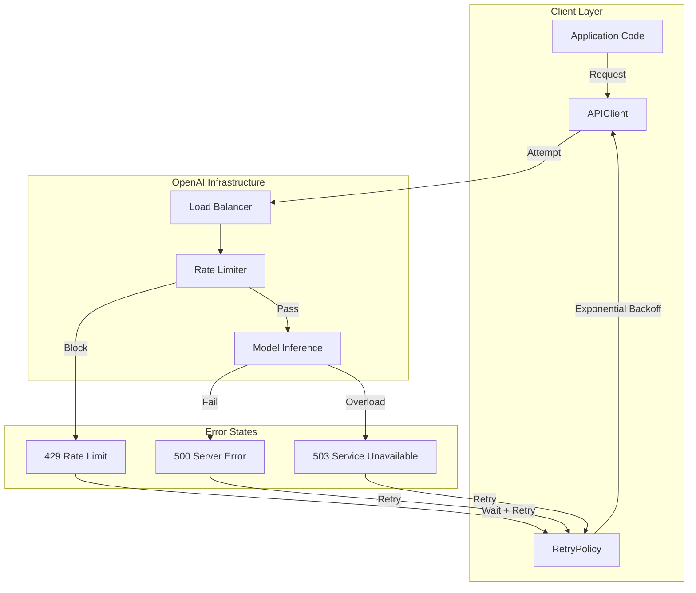
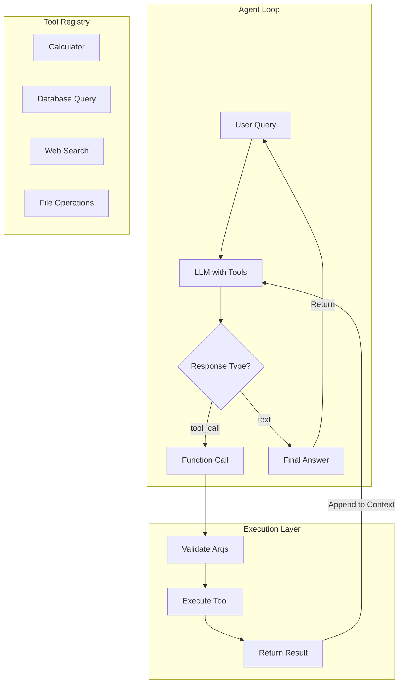
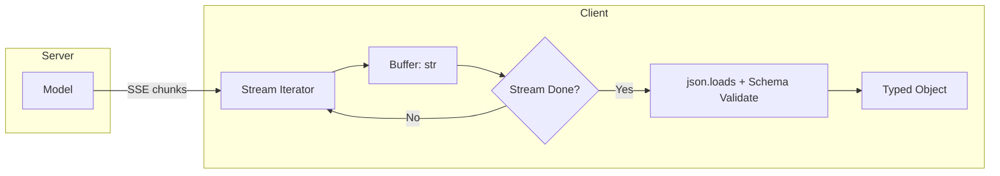
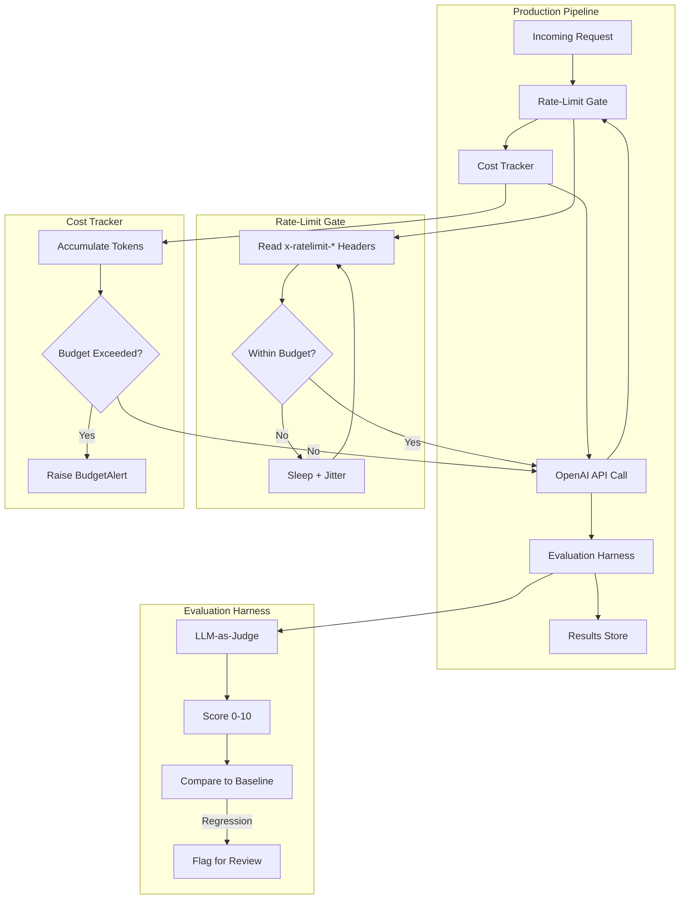

# Labs

## Foundations: Understanding Token-Level Computation and API Contracts

Before implementing practical systems with ChatGPT and OpenAI APIs, we establish the formal computational model underlying modern language model APIs. These systems operate on **discrete token sequences** rather than continuous text, transforming input sequences $\mathbf{x} = (x_1, x_2, \ldots, x_n)$ into probability distributions over output tokens through learned parameter matrices.

### The Transformer Architecture Invariant

The core computational primitive is the attention mechanism, which for each position $i$ computes:

$$\text{Attention}(Q, K, V) = \text{softmax}\left(\frac{QK^T}{\sqrt{d_k}}\right)V$$

where $Q$, $K$, $V$ are query, key, and value matrices derived from input embeddings, and $d_k$ is the key dimension. This operation satisfies the **permutation equivariance** property: reordering input positions reorders outputs correspondingly, preserving relational structure.

The full transformer block composes:

$$\text{TransformerBlock}(\mathbf{x}) = \text{FFN}(\text{LayerNorm}(\mathbf{x} + \text{MultiHeadAttention}(\mathbf{x})))$$

with residual connections ensuring gradient flow across $L$ stacked layers. The API contract abstracts this entirely: clients submit sequences, receive completions, and pay proportional to $\text{tokens}_{\text{input}} + \text{tokens}_{\text{output}}$.

### Token Economics and Rate Limit Algebra

OpenAI APIs enforce constraints as a system of inequalities. For GPT-4 Turbo, the limits form:

$$\begin{aligned}
\text{RPM} &\leq 10{,}000 \quad \text{(requests per minute)} \\
\text{TPM} &\leq 2{,}000{,}000 \quad \text{(tokens per minute)} \\
\text{RPD} &\leq 10{,}000{,}000 \quad \text{(requests per day)}
\end{aligned}$$

A compliant client must satisfy all constraints simultaneously. For a workload generating requests of average size $\bar{t}$ tokens at rate $r$ requests/minute:

$$r \leq \min\left(\text{RPM}, \frac{\text{TPM}}{\bar{t}}, \frac{\text{RPD}}{1440}\right)$$

This forms a **linear programming feasibility problem** where the solution space shrinks as $\bar{t}$ increases.

## Lab 1: Minimal API Integration and Error Handling

### Objective

Implement a production-grade client handling authentication, retries with exponential backoff, and structured error recovery.

### Architecture



### Implementation: Python Client with Tenacity

```python
import os
import time
from typing import Optional, Dict, Any, List
from dataclasses import dataclass
from enum import Enum
import json

from openai import OpenAI, APIError, RateLimitError, APIConnectionError
from tenacity import (
    retry,
    stop_after_attempt,
    wait_exponential,
    retry_if_exception_type,
    before_sleep_log
)
import logging

# Configure structured logging
logging.basicConfig(
    level=logging.INFO,
    format='%(asctime)s - %(name)s - %(levelname)s - %(message)s'
)
logger = logging.getLogger(__name__)


class ModelFamily(Enum):
    """Enumeration of available model families with token limits."""
    GPT_4_TURBO = ("gpt-4-turbo-preview", 128_000)
    GPT_4 = ("gpt-4", 8_192)
    GPT_35_TURBO = ("gpt-3.5-turbo", 16_385)
    GPT_4O = ("gpt-4o", 128_000)
    GPT_4O_MINI = ("gpt-4o-mini", 128_000)
    
    def __init__(self, model_id: str, context_window: int):
        self.model_id = model_id
        self.context_window = context_window


@dataclass
class TokenUsage:
    """Token consumption metrics for cost tracking."""
    prompt_tokens: int
    completion_tokens: int
    total_tokens: int
    
    def cost_usd(self, model: ModelFamily) -> float:
        """Calculate cost based on current pricing (as of Nov 2026)."""
        # Pricing per 1K tokens (example rates)
        pricing = {
            ModelFamily.GPT_4O: (0.005, 0.015),  # (input, output)
            ModelFamily.GPT_4O_MINI: (0.00015, 0.0006),
            ModelFamily.GPT_4_TURBO: (0.01, 0.03),
            ModelFamily.GPT_35_TURBO: (0.0005, 0.0015),
        }
        
        if model not in pricing:
            return 0.0
        
        input_price, output_price = pricing[model]
        return (self.prompt_tokens / 1000 * input_price + 
                self.completion_tokens / 1000 * output_price)


@dataclass
class CompletionResult:
    """Structured response from completion API."""
    content: str
    model: str
    usage: TokenUsage
    finish_reason: str
    response_id: str
    created_at: int


class OpenAIClient:
    """
    Production-grade OpenAI API client with retry logic and error handling.
    
    Implements exponential backoff for transient errors and structured
    error propagation for client code.
    """
    
    def __init__(
        self,
        api_key: Optional[str] = None,
        organization: Optional[str] = None,
        timeout: float = 60.0
    ):
        """
        Initialize client with authentication and retry parameters.
        
        Args:
            api_key: OpenAI API key (defaults to OPENAI_API_KEY env var)
            organization: Organization ID for billing
            max_retries: Maximum retry attempts for transient failures
            timeout: Request timeout in seconds
        """
        self.api_key = api_key or os.getenv("OPENAI_API_KEY")
        if not self.api_key:
            raise ValueError("API key required: set OPENAI_API_KEY or pass api_key")
        
        self.client = OpenAI(
            api_key=self.api_key,
            organization=organization,
            timeout=timeout,
            max_retries=0  # We handle retries ourselves
        )
        self.max_retries = max_retries
        self.timeout = timeout
    
    @retry(
        retry=retry_if_exception_type((RateLimitError, APIConnectionError)),
        wait=wait_exponential(multiplier=1, min=2, max=60),
        stop=stop_after_attempt(5),
        before_sleep=before_sleep_log(logger, logging.WARNING),
        reraise=True
    )
    def _call_with_retry(self, **kwargs) -> Any:
        """Internal method wrapping API call with retry logic."""
        return self.client.chat.completions.create(**kwargs)
    
    def complete(
        self,
        messages: List[Dict[str, str]],
        model: ModelFamily = ModelFamily.GPT_4O_MINI,
        temperature: float = 1.0,
        max_tokens: Optional[int] = None,
        top_p: float = 1.0,
        frequency_penalty: float = 0.0,
        presence_penalty: float = 0.0,
        stream: bool = False,
        **kwargs
    ) -> CompletionResult:
        """
        Generate chat completion with automatic retry on transient errors.
        
        Args:
            messages: List of message dicts with 'role' and 'content'
            model: Model family to use
            temperature: Sampling temperature (0.0 to 2.0)
            max_tokens: Maximum tokens to generate
            top_p: Nucleus sampling threshold
            frequency_penalty: Penalty for token frequency (-2.0 to 2.0)
            presence_penalty: Penalty for token presence (-2.0 to 2.0)
            stream: Enable streaming responses
            **kwargs: Additional API parameters
            
        Returns:
            CompletionResult with content and usage metrics
            
        Raises:
            APIError: On non-retryable API errors
            ValueError: On invalid parameters
        """
        if not messages:
            raise ValueError("Messages list cannot be empty")
        
        # Validate message structure
        for msg in messages:
            if 'role' not in msg or 'content' not in msg:
                raise ValueError(f"Invalid message format: {msg}")
            if msg['role'] not in ('system', 'user', 'assistant', 'function'):
                raise ValueError(f"Invalid role: {msg['role']}")
        
        try:
            response = self._call_with_retry(
                model=model.model_id,
                messages=messages,
                temperature=temperature,
                max_tokens=max_tokens,
                top_p=top_p,
                frequency_penalty=frequency_penalty,
                presence_penalty=presence_penalty,
                stream=stream,
                **kwargs
            )
            
            choice = response.choices[0]
            usage = response.usage
            
            return CompletionResult(
                content=choice.message.content,
                model=response.model,
                usage=TokenUsage(
                    prompt_tokens=usage.prompt_tokens,
                    completion_tokens=usage.completion_tokens,
                    total_tokens=usage.total_tokens
                ),
                finish_reason=choice.finish_reason,
                response_id=response.id,
                created_at=response.created
            )
            
        except RateLimitError as e:
            logger.error(f"Rate limit exceeded after retries: {e}")
            raise
        except APIConnectionError as e:
            logger.error(f"Connection error after retries: {e}")
            raise
        except APIError as e:
            logger.error(f"API error: {e}")
            raise
    
    def complete_streaming(
        self,
        messages: List[Dict[str, str]],
        model: ModelFamily = ModelFamily.GPT_4O_MINI,
        **kwargs
    ):
        """
        Generate streaming completion yielding chunks as they arrive.
        
        Yields:
            str: Content chunks from the model
        """
        try:
            stream = self._call_with_retry(
                model=model.model_id,
                messages=messages,
                stream=True,
                **kwargs
            )
            
            for chunk in stream:
                if chunk.choices[0].delta.content is not None:
                    yield chunk.choices[0].delta.content
                    
        except Exception as e:
            logger.error(f"Streaming error: {e}")
            raise


def example_basic_completion():
    """Example: Simple completion with error handling."""
    client = OpenAIClient()
    
    messages = [
        {"role": "system", "content": "You are a helpful assistant that explains complex topics simply."},
        {"role": "user", "content": "Explain how transformers work in 2-3 sentences."}
    ]
    
    try:
        result = client.complete(
            messages=messages,
            model=ModelFamily.GPT_4O_MINI,
            temperature=0.7,
            max_tokens=150
        )
        
        print(f"Response: {result.content}")
        print(f"Tokens used: {result.usage.total_tokens}")
        print(f"Cost: ${result.usage.cost_usd(ModelFamily.GPT_4O_MINI):.6f}")
        
    except Exception as e:
        print(f"Error: {e}")


def example_streaming_completion():
    """Example: Streaming response for real-time display."""
    client = OpenAIClient()
    
    messages = [
        {"role": "user", "content": "Count from 1 to 10 slowly with explanations."}
    ]
    
    print("Streaming response:")
    for chunk in client.complete_streaming(messages, model=ModelFamily.GPT_4O_MINI):
        print(chunk, end='', flush=True)
    print()


def example_conversation_with_history():
    """Example: Multi-turn conversation maintaining context."""
    client = OpenAIClient()
    
    # Conversation history maintains context
    conversation = [
        {"role": "system", "content": "You are a math tutor."},
        {"role": "user", "content": "What is the derivative of x^2?"},
    ]
    
    # First turn
    result1 = client.complete(conversation, model=ModelFamily.GPT_4O_MINI)
    print(f"Assistant: {result1.content}\n")
    
    # Add to history and continue
    conversation.append({"role": "assistant", "content": result1.content})
    conversation.append({"role": "user", "content": "What about x^3?"})
    
    # Second turn
    result2 = client.complete(conversation, model=ModelFamily.GPT_4O_MINI)
    print(f"Assistant: {result2.content}\n")
    
    # Total cost across conversation
    total_cost = (result1.usage.cost_usd(ModelFamily.GPT_4O_MINI) + 
                  result2.usage.cost_usd(ModelFamily.GPT_4O_MINI))
    print(f"Total conversation cost: ${total_cost:.6f}")


if __name__ == "__main__":
    # Run examples
    print("=== Basic Completion ===")
    example_basic_completion()
    
    print("\n=== Streaming Completion ===")
    example_streaming_completion()
    
    print("\n=== Conversation with History ===")
    example_conversation_with_history()
```

### Key Implementation Principles

1. **Idempotent Retries**: The retry decorator ensures transient failures (rate limits, network issues) are automatically handled without manual intervention.

2. **Structured Error Types**: Distinguishing `RateLimitError`, `APIConnectionError`, and `APIError` allows differentiated handling strategies.

3. **Token Accounting**: Every response includes usage metrics, enabling cost tracking at arbitrary granularity.

4. **Type Safety**: Using `dataclass` and `Enum` documents the response and model parameter shapes; type hints and the runtime validation loop catch malformed messages at call time.

## Lab 2: Function Calling and Tool Integration

### Conceptual Model

Function calling transforms the language model into a **structured output generator** constrained by a JSON schema. The model observes available functions $\mathcal{F} = \{f_1, f_2, \ldots, f_n\}$ where each $f_i$ has signature:

$$f_i: \text{Args}_i \rightarrow \text{Result}_i$$

with $\text{Args}_i$ defined by a JSON schema. The model's task becomes selecting $f_j \in \mathcal{F}$ and generating valid $\text{args} \in \text{Args}_j$ satisfying the schema constraints.

### Architecture: Agent Loop with Tool Execution



### Implementation: Function-Calling Agent

```python
import json
import math
import requests
from typing import List, Dict, Any, Callable, Optional
from dataclasses import dataclass
from openai import OpenAI
import logging

logger = logging.getLogger(__name__)


@dataclass
class Tool:
    """Function tool definition with schema and implementation."""
    name: str
    description: str
    parameters: Dict[str, Any]
    function: Callable


class FunctionCallingAgent:
    """
    Agent that can invoke external tools via function calling.
    
    Implements the ReAct pattern: Reasoning + Acting in iterative loop.
    """
    
    def __init__(self, api_key: Optional[str] = None, model: str = "gpt-4o"):
        self.client = OpenAI(api_key=api_key)
        self.model = model
        self.tools: Dict[str, Tool] = {}
        self.max_iterations = 10
    
    def register_tool(self, tool: Tool):
        """Register a tool for the agent to use."""
        self.tools[tool.name] = tool
        logger.info(f"Registered tool: {tool.name}")
    
    def _tools_to_openai_format(self) -> List[Dict[str, Any]]:
        """Convert tools to OpenAI function calling format."""
        return [
            {
                "type": "function",
                "function": {
                    "name": tool.name,
                    "description": tool.description,
                    "parameters": tool.parameters
                }
            }
            for tool in self.tools.values()
        ]
    
    def _execute_tool(self, name: str, arguments: Dict[str, Any]) -> str:
        """Execute a tool by name with provided arguments."""
        if name not in self.tools:
            return f"Error: Tool '{name}' not found"
        
        try:
            tool = self.tools[name]
            result = tool.function(**arguments)
            return json.dumps({"result": result})
        except Exception as e:
            logger.error(f"Tool execution error in {name}: {e}")
            return json.dumps({"error": str(e)})
    
    def run(
        self,
        user_message: str,
        system_message: Optional[str] = None
    ) -> str:
        """
        Run agent loop until task completion or max iterations.
        
        Args:
            user_message: User query or instruction
            system_message: System prompt for agent behavior
            
        Returns:
            Final response content
        """
        messages = []
        
        if system_message:
            messages.append({"role": "system", "content": system_message})
        
        messages.append({"role": "user", "content": user_message})
        
        for iteration in range(self.max_iterations):
            logger.info(f"Agent iteration {iteration + 1}")
            
            # Call model with available tools
            response = self.client.chat.completions.create(
                model=self.model,
                messages=messages,
                tools=self._tools_to_openai_format() or None,
            )
            message = response.choices[0].message

            # No tool calls: the model has produced its final answer
            if not message.tool_calls:
                return message.content or ""

            # Record the assistant turn (with its tool calls), then each result
            messages.append(message.model_dump(exclude_none=True))
            for call in message.tool_calls:
                try:
                    arguments = json.loads(call.function.arguments or "{}")
                except json.JSONDecodeError as e:
                    result = json.dumps({"error": f"Invalid JSON arguments: {e}"})
                else:
                    result = self._execute_tool(call.function.name, arguments)
                messages.append({
                    "role": "tool",
                    "tool_call_id": call.id,
                    "content": result,
                })

        logger.warning("Agent stopped after reaching max_iterations")
        return "Stopped: maximum number of iterations reached without a final answer."
```


### Verification

Run the agent with a calculator tool to confirm the loop terminates correctly:

```python
if __name__ == "__main__":
    agent = FunctionCallingAgent(model="gpt-4o-mini")

    agent.register_tool(Tool(
        name="calculate",
        description="Evaluate a mathematical expression and return the numeric result.",
        parameters={
            "type": "object",
            "properties": {
                "expression": {
                    "type": "string",
                    "description": "A mathematical expression, e.g. '2**10 + 3'"
                }
            },
            "required": ["expression"]
        },
        # Demo only: never eval() model-supplied text in production; use a real expression parser.
        function=lambda expression: eval(expression, {"__builtins__": {}}, {"abs": abs, "round": round})
    ))

    answer = agent.run(
        user_message="What is 2 to the power of 10, plus 3?",
        system_message="You are a precise math assistant. Use the calculate tool for any arithmetic."
    )
    print(answer)
```

Expected behaviour: the model emits a `tool_call` for `calculate` with `{"expression": "2**10 + 3"}`, the agent executes it, appends the result as a `tool`-role message, and on the next iteration the model produces a plain-text final answer. If the model never stops calling tools, the loop halts at `max_iterations` and returns the sentinel string.

---

## Lab 3: Streaming Responses and Structured Outputs

### Objective

By the end of this lab you will:

1. Implement a streaming client that shows partial JSON fragments as they arrive and parses them into a Python object once the stream ends.
2. Use the `response_format` parameter to constrain the model to a JSON schema, eliminating the need for post-hoc regex extraction.
3. Combine streaming with structured output so that a downstream consumer receives validated objects as soon as the final token arrives, while still benefiting from low time-to-first-token.

### Architecture

Two concerns interact here: **incremental delivery** (streaming) and **schema enforcement** (structured output). The OpenAI API supports both simultaneously—`stream=True` together with `response_format={"type": "json_schema", ...}`—but the client must accumulate the JSON string across chunks and parse only when the stream closes.



Key invariant: the buffer is a **prefix-closed** string. At any point during streaming, `buffer` is a valid prefix of the final JSON document, but not necessarily valid JSON itself. Parsing must be deferred until `finish_reason == "stop"`.

### Implementation: Streaming Structured-Output Client

```python
import json
import logging
from dataclasses import dataclass, field
from enum import Enum
from typing import Any, Callable, Dict, Optional

from openai import OpenAI

logger = logging.getLogger(__name__)

@dataclass
class StructuredResponse:
    """Wrapper that pairs a parsed object with usage metadata."""
    data: Any
    finish_reason: str
    usage: Optional[Dict[str, int]] = None


class StructuredStreamClient:
    """
    Streams a chat completion constrained to a JSON schema, passes each
    fragment to an optional callback, and returns the parsed object.
    """

    def __init__(self, api_key: Optional[str] = None, model: str = "gpt-4o-mini"):
        self.client = OpenAI(api_key=api_key)
        self.model = model

    def stream_structured(
        self,
        messages: list[Dict[str, str]],
        schema: Dict[str, Any],
        schema_name: str = "response",
        temperature: float = 0.0,
        max_tokens: int = 1024,
        on_fragment: Optional[Callable[[str], None]] = None,
    ) -> StructuredResponse:
        """
        Stream a JSON-schema-constrained completion.

        on_fragment receives each partial JSON fragment (for progress display).
        Returns the fully parsed object.
        """
        stream = self.client.chat.completions.create(
            model=self.model,
            messages=messages,
            response_format={
                "type": "json_schema",
                "json_schema": {
                    "name": schema_name,
                    "schema": schema,
                    "strict": True,
                },
            },
            stream=True,
            stream_options={"include_usage": True},  # final chunk carries usage
            temperature=temperature,
            max_tokens=max_tokens,
        )

        buffer = ""
        finish_reason = ""
        usage: Optional[Dict[str, int]] = None

        for chunk in stream:
            delta = chunk.choices[0].delta if chunk.choices else None
            if delta and delta.content:
                buffer += delta.content
                if on_fragment:
                    on_fragment(delta.content)

            if chunk.choices and chunk.choices[0].finish_reason:
                finish_reason = chunk.choices[0].finish_reason

            # The usage-only final chunk has an empty choices list
            if chunk.usage:
                usage = {
                    "prompt_tokens": chunk.usage.prompt_tokens,
                    "completion_tokens": chunk.usage.completion_tokens,
                    "total_tokens": chunk.usage.total_tokens,
                }

        if finish_reason != "stop":
            raise RuntimeError(
                f"Stream ended with finish_reason={finish_reason!r}; "
                "response may be truncated or invalid."
            )

        try:
            parsed = json.loads(buffer)
        except json.JSONDecodeError as exc:
            raise RuntimeError(
                f"Model produced malformed JSON despite schema constraint: {exc}"
            ) from exc

        return StructuredResponse(data=parsed, finish_reason=finish_reason, usage=usage)


# ---------------------------------------------------------------------------
# Example schema: a "diagnosis" object for a medical triage assistant
# ---------------------------------------------------------------------------

DIAGNOSIS_SCHEMA: Dict[str, Any] = {
    "type": "object",
    "properties": {
        "symptoms": {
            "type": "array",
            "items": {"type": "string"},
            "description": "List of symptoms the patient reported.",
        },
        "severity": {
            "type": "string",
            "enum": ["low", "moderate", "high", "critical"],
        },
        "recommended_action": {
            "type": "string",
            "description": "One-sentence recommendation.",
        },
        "confidence": {
            "type": "number",
            "description": "Between 0 and 1.",
        },
    },
    "required": ["symptoms", "severity", "recommended_action", "confidence"],
    "additionalProperties": False,
}


def example_streaming_structured():
    """Triage a patient report with a streaming, schema-constrained response."""
    client = StructuredStreamClient(model="gpt-4o-mini")

    messages = [
        {
            "role": "system",
            "content": (
                "You are a medical triage assistant. "
                "Return a JSON object matching the provided schema. "
                "Do not include any text outside the JSON."
            ),
        },
        {
            "role": "user",
            "content": (
                "Patient reports: persistent headache for 3 days, mild nausea, "
                "sensitivity to light, no fever. Blood pressure 130/85."
            ),
        },
    ]

    print("Streaming JSON (partial fragments):")
    result: StructuredResponse = client.stream_structured(
        messages=messages,
        schema=DIAGNOSIS_SCHEMA,
        schema_name="triage_diagnosis",
        temperature=0.0,
        on_fragment=lambda s: print(s, end="", flush=True),
    )

    print(f"\n--- Parsed result ---")
    print(f"  Severity:   {result.data['severity']}")
    print(f"  Symptoms:   {result.data['symptoms']}")
    print(f"  Action:     {result.data['recommended_action']}")
    print(f"  Confidence: {result.data['confidence']:.2f}")
    print(f"  Tokens:     {result.usage['total_tokens'] if result.usage else 'N/A'}")


if __name__ == "__main__":
    example_streaming_structured()
```

### Verification

1. **Schema conformance.** Because `strict: True` is set, the model is constrained to emit only the keys declared in `DIAGNOSIS_SCHEMA` with the correct types. Run the example multiple times; `json.loads` must succeed every time and the parsed dict must contain exactly the four required keys.

2. **Truncation detection.** Set `max_tokens=5` and confirm that `finish_reason` becomes `"length"` and the client raises `RuntimeError` rather than silently returning a partial object.

3. **Streaming semantics.** Pass `on_fragment=lambda s: print(repr(s))` to observe that fragments arrive as partial JSON (e.g. `"{\"symptoms\": [\"headache`, `\", \"nausea\"`), confirming that no single chunk is a complete JSON document.

4. **Negative test.** Change the schema to `"additionalProperties": True` and keep `strict: True`: the API rejects the request with a 400 error, because strict mode requires every object to set `additionalProperties: false` and list all its keys in `required`. Then set `strict: False` and ask for a fifth field: the model may add it, since the schema is now only a hint. This shows where enforcement ends.

---

## Lab 4: Cost, Rate Limits, and Evaluation in Production

### Objective

By the end of this lab you will:

1. Implement a **cost tracker** that accumulates token usage across a batch of requests and raises a budget alert when a threshold is exceeded.
2. Implement a **rate-limit-aware client** that reads the `x-ratelimit-*` response headers and applies exponential backoff with jitter, respecting both RPM (requests-per-minute) and TPM (tokens-per-minute) ceilings.
3. Build a lightweight **evaluation harness** that scores model outputs against a reference using an LLM-as-judge pattern, enabling regression detection when prompts or models change.

### Architecture



### Implementation: Cost Tracker, Rate-Limit Gate, and Evaluation Harness

```python
import json
import logging
import math
import random
import time
from dataclasses import dataclass, field
from typing import Any, Callable, Dict, List, Optional

from openai import OpenAI, APIStatusError, APIConnectionError, RateLimitError

logger = logging.getLogger(__name__)

# ---------------------------------------------------------------------------
# 1. Cost Tracker
# ---------------------------------------------------------------------------

# Approximate USD per 1 M tokens (input / output). Update periodically.
# Source: OpenAI pricing page. Values here are illustrative; verify before
# deploying to production.
PRICING_PER_MILLION: Dict[str, Dict[str, float]] = {
    "gpt-4o-mini": {"input": 0.15, "output": 0.60},
    "gpt-4o":      {"input": 2.50, "output": 10.00},
}


class BudgetExceededError(Exception):
    """Raised when accumulated spend crosses the configured ceiling."""
    pass


@dataclass
class CostTracker:
    """
    Accumulates token usage and enforces a per-session budget.

    Usage:
        tracker = CostTracker(budget_usd=5.0)
        tracker.record("gpt-4o-mini", prompt_tokens=120, completion_tokens=80)
        assert tracker.total_usd < tracker.budget_usd
    """
    budget_usd: float
    _spend: float = field(default=0.0, init=False)
    _call_count: int = field(default=0, init=False)
    _per_model: Dict[str, float] = field(default_factory=dict, init=False)

    def record(self, model: str, prompt_tokens: int, completion_tokens: int) -> float:
        """Record a single call and return the incremental cost in USD."""
        pricing = PRICING_PER_MILLION.get(model)
        if pricing is None:
            logger.warning("No pricing entry for %r; skipping cost accounting.", model)
            return 0.0

        cost = (
            prompt_tokens * pricing["input"] / 1_000_000
            + completion_tokens * pricing["output"] / 1_000_000
        )
        self._spend += cost
        self._call_count += 1
        self._per_model[model] = self._per_model.get(model, 0.0) + cost

        if self._spend > self.budget_usd:
            raise BudgetExceededError(
                f"Budget ${self.budget_usd:.4f} exceeded "
                f"(current spend: ${self._spend:.6f} over {self._call_count} calls)"
            )
        return cost

    @property
    def total_usd(self) -> float:
        return self._spend

    @property
    def remaining_usd(self) -> float:
        return max(0.0, self.budget_usd - self._spend)

    def summary(self) -> str:
        lines = [f"Total spend: ${self._spend:.6f} / ${self.budget_usd:.4f}"]
        for model, cost in sorted(self._per_model.items()):
            lines.append(f"  {model}: ${cost:.6f}")
        return "\n".join(lines)


# ---------------------------------------------------------------------------
# 2. Rate-Limit-Aware Client
# ---------------------------------------------------------------------------

@dataclass
class RateLimitState:
    """Tracks remaining quota from the most recent response headers."""
    requests_remaining: int = 0
    tokens_remaining: int = 0
    requests_reset: str = ""   # duration until reset, e.g. "1s" or "6m0s"
    tokens_reset: str = ""


class RateLimitAwareClient:
    """
    Wraps an OpenAI client and enforces RPM/TPM limits using the
    x-ratelimit-* headers returned by the API.

    Backoff strategy: exponential backoff with full jitter.
    """

    def __init__(
        self,
        api_key: Optional[str] = None,
        model: str = "gpt-4o-mini",
        max_retries: int = 5,
        base_delay: float = 1.0,
        max_delay: float = 60.0,
    ):
        self.client = OpenAI(api_key=api_key)
        self.model = model
        self.max_retries = max_retries
        self.base_delay = base_delay
        self.max_delay = max_delay
        self.state = RateLimitState()

    def _parse_rate_limit_headers(self, headers) -> None:
        """Update internal state from response headers."""
        try:
            self.state.requests_remaining = int(headers.get("x-ratelimit-remaining-requests", 0))
            self.state.tokens_remaining = int(headers.get("x-ratelimit-remaining-tokens", 0))
            self.state.requests_reset = headers.get("x-ratelimit-reset-requests", "")
            self.state.tokens_reset = headers.get("x-ratelimit-reset-tokens", "")
        except (ValueError, TypeError):
            pass  # headers may be absent on error responses

    def _compute_backoff(self, attempt: int) -> float:
        """Exponential backoff with full jitter."""
        exp_delay = min(self.max_delay, self.base_delay * (2 ** attempt))
        return random.uniform(0, exp_delay)

    def chat(
        self,
        messages: List[Dict[str, str]],
        **kwargs: Any,
    ) -> Dict[str, Any]:
        """
        Send a chat completion with automatic rate-limit handling.

        Returns the parsed response dict. Raises after max_retries.
        """
        for attempt in range(self.max_retries):
            try:
                # with_raw_response exposes the HTTP headers next to the parsed body
                raw = self.client.chat.completions.with_raw_response.create(
                    model=self.model,
                    messages=messages,
                    **kwargs,
                )
                self._parse_rate_limit_headers(raw.headers)
                if self.state.tokens_remaining and self.state.tokens_remaining < 1000:
                    logger.info("Token quota nearly used up; resets in %s", self.state.tokens_reset)
                return raw.parse().model_dump()

            except RateLimitError as exc:
                delay = self._compute_backoff(attempt)
                logger.warning(
                    "Rate limited (attempt %d/%d). Sleeping %.2fs.",
                    attempt + 1, self.max_retries, delay,
                )
                time.sleep(delay)

            except APIStatusError as exc:
                if exc.status_code >= 500:
                    delay = self._compute_backoff(attempt)
                    logger.warning(
                    "Server error %d (attempt %d/%d). Sleeping %.2fs.",
                    exc.status_code, attempt + 1, self.max_retries, delay,
                )
                    time.sleep(delay)
                else:
                    raise  # 4xx (except 429) is not retryable

            except APIConnectionError:
                delay = self._compute_backoff(attempt)
                logger.warning("Connection error (attempt %d/%d). Sleeping %.2fs.",
                              attempt + 1, self.max_retries, delay)
                time.sleep(delay)

        raise RuntimeError(
            f"All {self.max_retries} retries exhausted. "
            f"Last state: req_remaining={self.state.requests_remaining}, "
            f"tok_remaining={self.state.tokens_remaining}"
        )


# ---------------------------------------------------------------------------
# 3. Evaluation Harness (LLM-as-Judge)
# ---------------------------------------------------------------------------

@dataclass
class EvalResult:
    prompt_id: str
    model_output: str
    reference: str
    score: float          # 0.0 – 10.0
    rationale: str
    passed: bool


JUDGE_SYSTEM_PROMPT = """\
You are an impartial evaluator. Score the model's response on a scale of 0-10 \
where 10 means the response is fully correct, complete, and well-structured, \
and 0 means it is entirely wrong or missing. \
Return ONLY a JSON object with keys "score" (float) and "rationale" (string). \
Do not include any text outside the JSON."""


def llm_judge(
    client: OpenAI,
    prompt: str,
    model_output: str,
    reference: str,
    judge_model: str = "gpt-4o",
) -> EvalResult:
    """
    Score a model output against a reference using an LLM-as-judge.

    The judge is asked to return a JSON object; we parse it and extract
    the numeric score.
    """
    user_msg = (
        f"Prompt: {prompt}\n\n"
        f"Model output: {model_output}\n\n"
        f"Reference answer: {reference}\n\n"
        "Score the model output. Return JSON: {\"score\": <float>, \"rationale\": \"<str>\"}"
    )

    response = client.chat.completions.create(
        model=judge_model,
        messages=[
            {"role": "system", "content": JUDGE_SYSTEM_PROMPT},
            {"role": "user", "content": user_msg},
        ],
        temperature=0.0,
        max_tokens=256,
        response_format={"type": "json_object"},
    )

    raw = response.choices[0].message.content or "{}"
    try:
        parsed = json.loads(raw)
        score = float(parsed.get("score", 0.0))
        rationale = parsed.get("rationale", "")
    except (json.JSONDecodeError, ValueError):
        score = 0.0
        rationale = f"Judge output was not valid JSON: {raw[:120]}"

    return EvalResult(
        prompt_id="",  # caller should set this
        model_output=model_output,
        reference=reference,
        score=score,
        rationale=rationale,
        passed=score >= 7.0,
    )


def run_eval_suite(
    client: OpenAI,
    test_cases: List[Dict[str, str]],
    model_under_test: str = "gpt-4o-mini",
    judge_model: str = "gpt-4o",
    pass_threshold: float = 7.0,
) -> List[EvalResult]:
    """
    Run a batch of prompt/reference pairs through the model under test,
    then score each with the judge.

    Args:
        test_cases: List of dicts with keys "id", "prompt", "reference".
        model_under_test: The model being evaluated.
        judge_model: The model acting as evaluator.
        pass_threshold: Minimum score for a case to pass.

    Returns:
        List of EvalResult objects.
    """
    results: List[EvalResult] = []

    for case in test_cases:
        # 1. Get the model-under-test response
        resp = client.chat.completions.create(
            model=model_under_test,
            messages=[{"role": "user", "content": case["prompt"]}],
            temperature=0.0,
            max_tokens=512,
        )
        output = resp.choices[0].message.content or ""

        # 2. Judge it
        result = llm_judge(
            client=client,
            prompt=case["prompt"],
            model_output=output,
            reference=case["reference"],
            judge_model=judge_model,
        )
        result.prompt_id = case["id"]
        result.passed = result.score >= pass_threshold
        results.append(result)

        status = "PASS" if result.passed else "FAIL"
        logger.info("[%s] %s  score=%.1f  %s", status, case["id"], result.score, result.rationale[:80])

    return results


# ---------------------------------------------------------------------------
# Example usage
# ---------------------------------------------------------------------------

def example_cost_tracking():
    tracker = CostTracker(budget_usd=0.05)
    tracker.record("gpt-4o-mini", prompt_tokens=500, completion_tokens=300)
    tracker.record("gpt-4o-mini", prompt_tokens=200, completion_tokens=150)
    print(tracker.summary())
    print(f"Remaining budget: ${tracker.remaining_usd:.6f}")


def example_eval_suite():
    client = OpenAI()  # uses OPENAI_API_KEY env var

    test_cases = [
        {
            "id": "math-001",
            "prompt": "What is 17 * 23? Answer with just the number.",
            "reference": "391",
        },
        {
            "id": "geo-001",
            "prompt": "What is the capital of Australia? One word.",
            "reference": "Canberra",
        },
        {
            "id": "code-001",
            "prompt": "Write a Python one-liner to reverse a string 'hello'.",
            "reference": "s[::-1]",
        },
    ]

    results = run_eval_suite(
        client=client,
        test_cases=test_cases,
        model_under_test="gpt-4o-mini",
        judge_model="gpt-4o",
    )

    passed = sum(1 for r in results if r.passed)
    print(f"\nSuite: {passed}/{len(results)} passed")
    for r in results:
        print(f"  {r.prompt_id}: {r.score:.1f}  ({'PASS' if r.passed else 'FAIL'})")


if __name__ == "__main__":
    example_cost_tracking()
    # Uncomment to run the eval suite (requires API key and network):
    # example_eval_suite()
```

### Verification

1. **Cost tracker.** Instantiate `CostTracker(budget_usd=0.001)` and call `record("gpt-4o-mini", 1000, 1000)`. The cost is `1000 * 0.15 / 1e6 + 1000 * 0.60 / 1e6 = 0.00075`, which is under budget. A second identical call pushes spend to `0.0015`, exceeding the `0.001` ceiling and raising `BudgetExceededError`.

2. **Rate-limit backoff.** Mock the `OpenAI` client so that the first two calls raise `RateLimitError` and the third succeeds. Confirm that the client sleeps (use `unittest.mock.patch("time.sleep")` to avoid real delays) and that the sleep durations follow the jittered exponential pattern: `delay_1 ∈ [0, base_delay]`, `delay_2 ∈ [0, 2 * base_delay]`.

3. **Eval harness determinism.** Run `run_eval_suite` with `temperature=0.0` for both the model under test and the judge. Execute the suite twice; scores should be identical (or within ±0.5 due to judge non-determinism on borderline cases). This confirms the harness is reproducible enough for CI gating.

4. **Regression detection.** Intentionally corrupt one reference answer (e.g., change `"391"` to `"392"`) and re-run. The corresponding `EvalResult.passed` should flip to `False`, demonstrating that the harness catches prompt or model regressions.

---

## Closing Remarks

The four labs in this module trace a progression from **single-call integration** (Lab 1) through **agentic tool use** (Lab 2), **structured streaming** (Lab 3), to **production-grade operational concerns** (Lab 4). Several cross-cutting themes deserve emphasis:

- **Treat the API as a contract, not a black box.** Every response carries usage metadata, rate-limit headers, and a `finish_reason`. Ignoring any of these fields is a latent production bug.
- **Schema constraints reduce post-processing.** The `response_format` parameter with `strict: True` eliminates an entire class of parsing failures that would otherwise require regex extraction and defensive `try/except` blocks.
- **Evaluation is a first-class concern.** A prompt that works in a notebook can regress silently after a model update. The LLM-as-judge pattern, combined with a fixed test suite and a pass threshold, provides a lightweight but effective regression gate suitable for CI pipelines.
- **Cost is a design parameter, not an afterthought.** The `CostTracker` pattern should be embedded in every production service that calls an LLM API. A single unbounded agent loop can exhaust a monthly budget in minutes; a per-session ceiling with an alert threshold prevents that failure mode.

When extending these patterns to multi-agent systems, batch inference, or fine-tuned model endpoints, the same invariants hold: validate inputs against a schema, account for every token, respect rate limits, and evaluate before shipping.