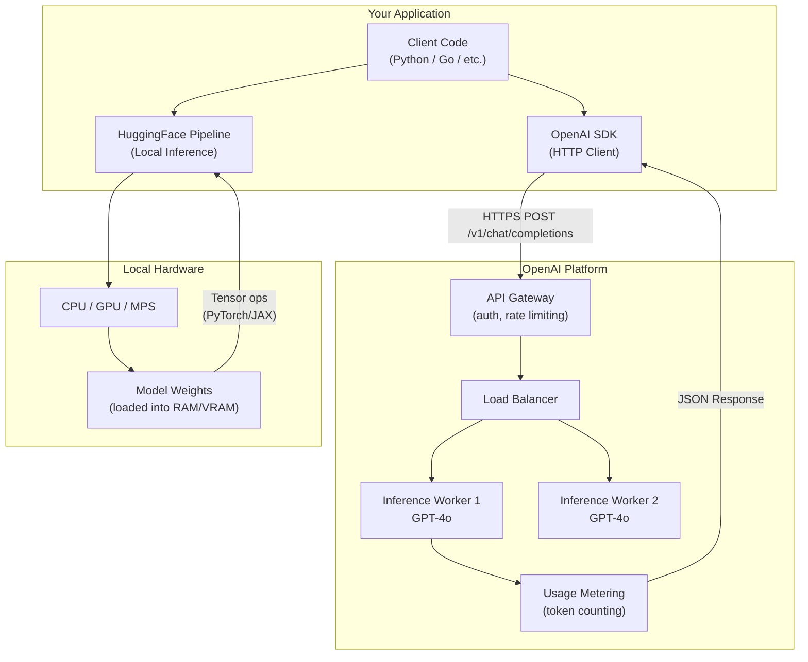
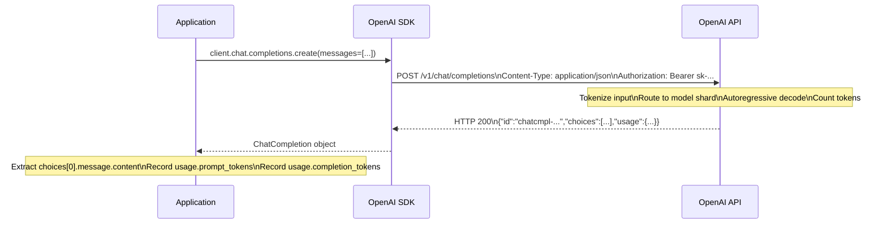

```markdown
# Operational Verification Labs: ChatGPT & OpenAI APIs

## Conceptual Foundation

Before writing a single line of code, understanding the architectural reality of what you are calling is essential. The OpenAI API is not a library wrapper around a local model — it is a stateless HTTP inference service. Each call crosses a network boundary, hits load-balanced inference clusters, and returns a response whose shape is governed by a strict JSON schema. The `openai` Python SDK is a thin HTTP client. The `transformers` library from Hugging Face is a completely separate ecosystem for running models locally. Conflating them, as much introductory material does, produces code that is simultaneously incorrect about both.

This lab covers three distinct systems:

1. **OpenAI API (cloud inference)** — GPT-4o, GPT-4-turbo, GPT-3.5-turbo via authenticated HTTPS requests.
2. **Local inference via Hugging Face Transformers** — open-weight models (GPT-2, Llama, Mistral) running on your hardware.
3. **The integration layer** — production patterns for retry logic, cost accounting, observability, and failure mitigation that apply to either backend.



### The Chat Completions Object Model

Every call to `POST /v1/chat/completions` takes a list of **messages** and returns a **completion**. The message list is the entire conversational context — the model has no session memory. You are responsible for assembling and truncating this list on every request.



The `usage` field in every response is authoritative for billing. `prompt_tokens` counts the entire message list you sent, not just the user turn. This is the most common source of cost surprises in production.

---

## Environment Setup

### Dependencies

```bash
# Pin versions for reproducibility
pip install \
    openai==1.35.3 \
    tiktoken==0.7.0 \
    transformers==4.42.3 \
    torch==2.3.1 \
    numpy==1.26.4 \
    polars==0.20.31 \
    tenacity==8.3.0 \
    rich==13.7.1
```

> **Why these specific packages?**
> - `tiktoken` is OpenAI's own tokenizer library. It lets you count tokens locally before making API calls, enabling pre-flight cost estimation and context window management without a network round trip.
> - `tenacity` is the standard retry library for Python. Rolling your own retry logic with `time.sleep` is error-prone and does not handle exponential backoff with jitter correctly.
> - `rich` enables structured console output for observability during benchmarking.

### API Key Configuration

Never hardcode credentials. The recommended pattern is a `.env` file (excluded from version control) sourced at process startup.

```bash
# .env — add this file to .gitignore immediately
OPENAI_API_KEY="sk-proj-..."
OPENAI_ORG_ID="org-..."          # optional, for multi-org accounts
OPENAI_DEFAULT_MODEL="gpt-4o-mini"
```

```bash
export $(grep -v '^#' .env | xargs)
```

The `openai` SDK automatically reads `OPENAI_API_KEY` from the environment. You do not need to assign it in your Python code.

---

## Exercise 1: Production-Grade OpenAI API Client

### Why the Naive Client Fails in Production

A bare `client.chat.completions.create()` call will fail silently or loudly under these common conditions:

| Failure Mode | HTTP Status | Cause |
|---|---|---|
| Rate limit exceeded | 429 | Requests-per-minute or tokens-per-minute quota hit |
| Server overload | 500 / 503 | Transient infrastructure issue on OpenAI's side |
| Timeout | N/A (socket) | Inference took longer than your socket timeout |
| Context overflow | 400 | `prompt_tokens + max_tokens > model context window` |
| Invalid request | 400 | Malformed message structure |

The correct response to 429 and 5xx is exponential backoff with jitter. The correct response to 400 is to surface the error immediately — retrying will not fix a malformed request.

### Complete Implementation

```python
"""
exercise_01_openai_client.py

Production-grade OpenAI Chat Completions client with:
- Automatic retry with exponential backoff + jitter (tenacity)
- Pre-flight token counting via tiktoken
- Structured response logging
- Type-safe interfaces
"""

from __future__ import annotations

import os
import sys
import time
import logging
from dataclasses import dataclass, field
from typing import Any

import tiktoken
from openai import OpenAI, RateLimitError, APIStatusError, APITimeoutError
from tenacity import (
    retry,
    stop_after_attempt,
    wait_random_exponential,
    retry_if_exception_type,
    before_sleep_log,
)

# ---------------------------------------------------------------------------
# Logging
# ---------------------------------------------------------------------------
logging.basicConfig(
    level=logging.INFO,
    format="%(asctime)s [%(levelname)s] %(name)s: %(message)s",
    stream=sys.stdout,
)
logger = logging.getLogger("openai_client")

# ---------------------------------------------------------------------------
# Client singleton — reuse the same HTTP connection pool across calls
# ---------------------------------------------------------------------------
_client = OpenAI(
    timeout=60.0,          # seconds before socket timeout
    max_retries=0,         # we handle retries ourselves via tenacity
)

# ---------------------------------------------------------------------------
# Token counting
# ---------------------------------------------------------------------------

def count_tokens(messages: list[dict[str, str]], model: str) -> int:
    """
    Count the number of tokens in a message list using tiktoken.

    This replicates the token counting logic described in OpenAI's
    cookbook (https://github.com/openai/openai-cookbook). Each message
    has a fixed overhead of 3 tokens for the role/content envelope, and
    the reply itself is primed with 3 tokens.

    Args:
        messages: List of {"role": ..., "content": ...} dicts.
        model:    The target model name (determines BPE vocabulary).

    Returns:
        Estimated token count for the entire message list.
    """
    try:
        encoding = tiktoken.encoding_for_model(model)
    except KeyError:
        # Fall back to cl100k_base, which covers gpt-4 / gpt-3.5 families
        encoding = tiktoken.get_encoding("cl100k_base")

    tokens_per_message = 3  # every message: <|start|>{role}\n{content}<|end|>\n
    tokens_per_name = 1     # if "name" key is present

    num_tokens = 3  # reply priming
    for message in messages:
        num_tokens += tokens_per_message
        for key, value in message.items():
            num_tokens += len(encoding.encode(str(value)))
            if key == "name":
                num_tokens += tokens_per_name

    return num_tokens


# ---------------------------------------------------------------------------
# Context-window limits by model (tokens, as of mid-2024)
# ---------------------------------------------------------------------------
MODEL_CONTEXT_WINDOWS: dict[str, int] = {
    "gpt-4o":           128_000,
    "gpt-4o-mini":      128_000,
    "gpt-4-turbo":      128_000,
    "gpt-4":              8_192,
    "gpt-3.5-turbo":    16_385,
}


# ---------------------------------------------------------------------------
# Data classes for structured I/O
# ---------------------------------------------------------------------------

@dataclass
class CompletionRequest:
    messages: list[dict[str, str]]
    model: str = "gpt-4o-mini"
    temperature: float = 0.7
    max_tokens: int = 512
    system_prompt: str = "You are a helpful assistant."

    def to_message_list(self) -> list[dict[str, str]]:
        return [{"role": "system", "content": self.system_prompt}] + self.messages


@dataclass
class CompletionResult:
    content: str
    model: str
    prompt_tokens: int
    completion_tokens: int
    total_tokens: int
    latency_ms: float
    finish_reason: str
    request_id: str = ""

    @property
    def estimated_cost_usd(self) -> float:
        """
        Approximate cost in USD. Prices as of July 2024.
        Always verify against https://openai.com/pricing for billing decisions.
        """
        pricing = {
            "gpt-4o":       (5.00, 15.00),    # (input $/1M, output $/1M)
            "gpt-4o-mini":  (0.15,  0.60),
            "gpt-4-turbo":  (10.00, 30.00),
            "gpt-3.5-turbo":(0.50,  1.50),
        }
        input_price, output_price = pricing.get(self.model, (0.0, 0.0))
        return (self.prompt_tokens / 1_000_000 * input_price +
                self.completion_tokens / 1_000_000 * output_price)


# ---------------------------------------------------------------------------
# Core completion function with retry
# ---------------------------------------------------------------------------

@retry(
    retry=retry_if_exception_type((RateLimitError, APITimeoutError)),
    wait=wait_random_exponential(multiplier=1, min=2, max=60),
    stop=stop_after_attempt(6),
    before_sleep=before_sleep_log(logger, logging.WARNING),
    reraise=True,
)
def _call_api(request: CompletionRequest) -> CompletionResult:
    """
    Inner function: single API call, decorated with retry logic.
    Only retries on transient errors (429, timeout). Raises immediately
    on 400-level errors that indicate a bad request.
    """
    messages = request.to_message_list()

    # Pre-flight: validate context window
    prompt_tokens_estimate = count_tokens(messages, request.model)
    context_limit = MODEL_CONTEXT_WINDOWS.get(request.model, 8192)
    if prompt_tokens_estimate + request.max_tokens > context_limit:
        raise ValueError(
            f"Estimated prompt ({prompt_tokens_estimate}) + max_tokens "
            f"({request.max_tokens}) = {prompt_tokens_estimate + request.max_tokens} "
            f"exceeds {request.model} context window ({context_limit})."
        )

    t0 = time.perf_counter()
    response = _client.chat.completions.create(
        model=request.model,
        messages=messages,
        temperature=request.temperature,
        max_tokens=request.max_tokens,
    )
    latency_ms = (time.perf_counter() - t0) * 1000.0

    choice = response.choices[0]
    usage = response.usage

    return CompletionResult(
        content=choice.message.content or "",
        model=response.model,
        prompt_tokens=usage.prompt_tokens,
        completion_tokens=usage.completion_tokens,
        total_tokens=usage.total_tokens,
        latency_ms=latency_ms,
        finish_reason=choice.finish_reason,
        request_id=response.id,
    )


def complete(request: CompletionRequest) -> CompletionResult:
    """
    Public entry point. Wraps _call_api and translates non-retryable
    APIStatusErrors into clearer application-level exceptions.
    """
    try:
        return _call_api(request)
    except APIStatusError as exc:
        if exc.status_code == 400:
            logger.error("Bad request (non-retryable): %s", exc.message)
            raise ValueError(f"OpenAI rejected request: {exc.message}") from exc
        raise


# ---------------------------------------------------------------------------
# Demo
# ---------------------------------------------------------------------------

if __name__ == "__main__":
    req = CompletionRequest(
        messages=[{"role": "user", "content": "Explain the transformer attention mechanism in two sentences."}],
        model=os.getenv("OPENAI_DEFAULT_MODEL", "gpt-4o-mini"),
        temperature=0.3,
        max_tokens=200,
    )

    result = complete(req)
    print(f"\n--- Response ---\n{result.content}")
    print(f"\n--- Telemetry ---")
    print(f"Model         : {result.model}")
    print(f"Finish reason : {result.finish_reason}")
    print(f"Tokens        : {result.prompt_tokens}p + {result.completion_tokens}c = {result.total_tokens} total")
    print(f"Latency       : {result.latency_ms:.1f} ms")
    print(f"Est. cost     : ${result.estimated_cost_usd:.6f}")
    print(f"Request ID    : {result.request_id}")
```

---

## Exercise 2: Hyperparameter Tuning & Empirical Benchmarking

### What the Parameters Actually Control

The OpenAI sampling parameters are not abstract knobs — they directly control the probability distribution over the next token at each decoding step.

```mermaid
graph LR
    subgraph "Logit Processing Pipeline (per token)"
        A["Raw logits\n(one per vocab token)"] --> B["÷ temperature\nscales distribution"]
        B --> C["Top-p nucleus filter\nkeep smallest set\nwith cum
