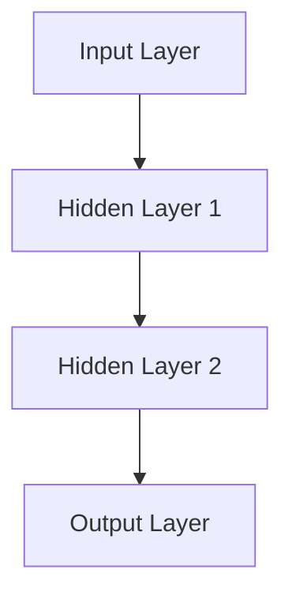
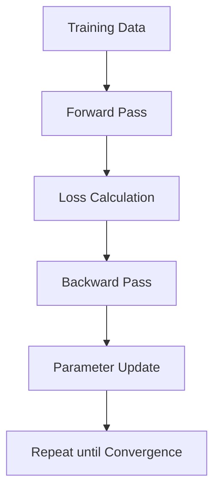

# Lesson 1: Fundamentals of AI

## 1. First-Principles Intuition & Invariants

Artificial Intelligence (AI) represents a profound and transformative paradigm shift in the realm of computing, enabling machines to perform tasks that traditionally required human intelligence. This lesson delves into the foundational principles of AI, encompassing machine learning (ML) and deep learning (DL), to provide a comprehensive understanding of the theoretical underpinnings and practical applications.

At its core, AI seeks to emulate human cognitive processes, such as learning, reasoning, and perception, through computational models. The problem space of AI is vast, encompassing a multitude of domains, including natural language processing, computer vision, robotics, and autonomous systems. Central to the study of AI is the concept of intelligence itself, which can be broadly defined as the ability to acquire and apply knowledge and skills to solve complex problems.

The theoretical grounding of AI is deeply rooted in mathematics and computer science. Key mathematical concepts include linear algebra, probability theory, and optimization, which form the bedrock of algorithms used in machine learning. Linear algebra provides the tools to manipulate and analyze large datasets, while probability theory enables the modeling of uncertainty and the development of probabilistic models. Optimization techniques, such as gradient descent, are crucial for training machine learning models by minimizing error functions.

A fundamental invariant in AI is the distinction between supervised and unsupervised learning. In supervised learning, the model is trained on labeled data, where the input data is paired with the correct output. This approach is effective for tasks such as classification and regression, where the goal is to predict a specific output given an input. In contrast, unsupervised learning involves training on unlabeled data, where the model must discover patterns and structures within the data. This approach is useful for tasks such as clustering and dimensionality reduction, where the goal is to understand the underlying distribution of the data.

Another critical invariant in AI is the concept of generalization. A well-designed AI model should not only perform well on the training data but also generalize to new, unseen data. This requires careful selection of model architecture, regularization techniques, and validation strategies to prevent overfitting, where the model becomes too specialized to the training data and fails to perform well on new data.

## 2. Core Architecture & Mechanics

The architecture and mechanics of AI systems are intricately linked to the underlying mathematical models and algorithms. At a high level, an AI system consists of a data pipeline, a model architecture, and a training process. The data pipeline involves collecting, preprocessing, and transforming raw data into a format suitable for training. The model architecture defines the structure and parameters of the computational model, while the training process involves optimizing the model parameters to minimize the error on the training data.

One of the most widely used model architectures in AI is the neural network, which is inspired by the structure and function of the human brain. A neural network consists of layers of interconnected nodes, or neurons, where each node performs a simple computation on its input and passes the result to the next layer. The output of the final layer is the prediction of the model. The most common type of neural network is the feedforward neural network, where the data flows in one direction from the input layer to the output layer.

A more advanced architecture is the convolutional neural network (CNN), which is specifically designed for processing grid-like data, such as images. CNNs use convolutional layers to extract local features from the input data, followed by pooling layers to reduce the spatial dimensions. This architecture is highly effective for tasks such as image classification and object detection.

Another important architecture is the recurrent neural network (RNN), which is designed to process sequential data, such as time series or natural language. RNNs use feedback connections to maintain a hidden state that captures information about the previous inputs. This allows the model to make predictions based on the entire sequence of inputs, rather than just the current input. A variant of RNNs, the long short-term memory (LSTM) network, addresses the vanishing gradient problem and is capable of capturing long-range dependencies in the data.

To illustrate the architecture of a simple neural network, we can use a Mermaid diagram:

In this diagram, the input layer receives the raw data, which is then processed by two hidden layers before producing the final output. Each layer consists of a set of neurons that perform computations on the input data and pass the results to the next layer.

The training process of a neural network involves optimizing the model parameters to minimize the error on the training data. This is typically done using gradient descent, which iteratively updates the parameters in the direction that reduces the error. The error is measured using a loss function, such as mean squared error or cross-entropy loss, which quantifies the difference between the predicted output and the true output.

The training process can be visualized as follows:

In this diagram, the training data is fed into the model, and the forward pass computes the predicted output. The loss calculation measures the error between the predicted output and the true output, and the backward pass computes the gradients of the loss with respect to the model parameters. The parameter update step adjusts the parameters in the direction that reduces the error, and the process is repeated until the model converges to a minimum error.

## 3. High-Performance Optimization & Failure Modes

High-performance optimization is critical for deploying AI systems in real-world applications, where large datasets and complex models require significant computational resources. One of the key challenges in optimizing AI systems is parallelism, which involves distributing the workload across multiple processors or GPUs to speed up the training and inference processes.

Parallelism can be achieved through various techniques, such as data parallelism, where the data is split into batches and processed in parallel, and model parallelism, where the model is split into sub-models and processed in parallel. Data parallelism is commonly used in training deep neural networks, where the input data is divided into mini-batches and processed in parallel across multiple GPUs. Model parallelism is useful for very large models that cannot fit into the memory of a single GPU.

Another important aspect of optimization is memory management, which involves efficiently allocating and deallocating memory for the model parameters and intermediate activations. Memory management is critical for minimizing memory usage and avoiding out-of-memory errors, which can occur when the model requires more memory than is available on the device.

To illustrate the impact of parallelism and memory management, consider the training of a deep neural network using a GPU. The GPU can process multiple mini-batches in parallel, significantly speeding up the training process. However, the GPU has limited memory, so the model parameters and intermediate activations must be carefully managed to fit within the available memory. This can be achieved through techniques such as gradient checkpointing, where intermediate activations are recomputed during the backward pass to save memory, and mixed precision training, where the model parameters and activations are stored in lower precision to reduce memory usage.

In addition to optimization, it is crucial to consider the failure modes of AI systems, which can arise from various sources, such as data quality, model bias, and adversarial attacks. Data quality is critical for training accurate models, as poor-quality data can lead to overfitting, underfitting, or biased predictions. Model bias can occur when the training data is not representative of the entire population, leading to unfair or discriminatory predictions. Adversarial attacks involve intentionally perturbing the input data to deceive the model, leading to incorrect predictions.

To mitigate these failure modes, it is important to carefully preprocess the data, ensure diversity and representativeness, and use robust evaluation metrics. Data preprocessing involves cleaning and transforming the raw data to remove noise and outliers, and ensure consistency and quality. Ensuring diversity and representativeness involves collecting data from a wide range of sources and domains, and using techniques such as data augmentation to increase the diversity of the training data. Robust evaluation metrics involve using multiple metrics to evaluate the performance of the model, such as accuracy, precision, recall, and F1-score, and considering the trade-offs between different metrics.

In conclusion, the fundamentals of AI encompass a wide range of theoretical and practical concepts, from the mathematical foundations to the architectural and optimization challenges. By understanding the core principles and mechanics of AI, senior software engineers, systems programmers, and domain architects can design and deploy robust and efficient AI systems that solve complex problems and drive innovation in various domains.
