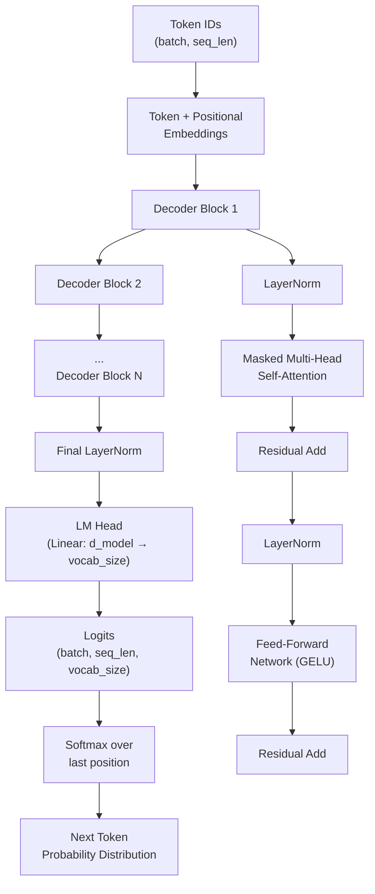
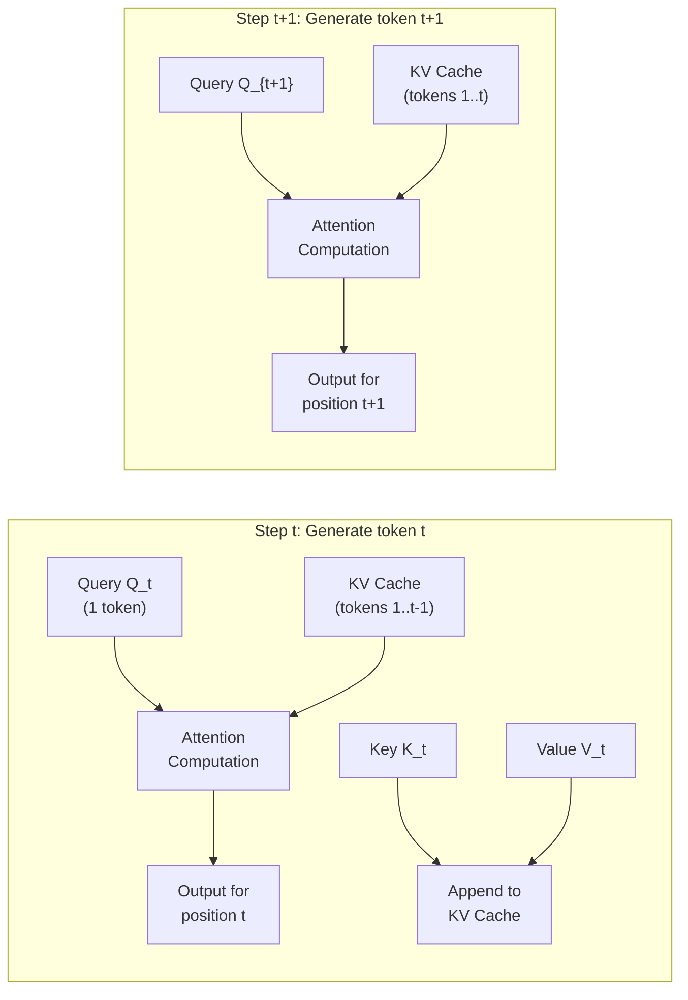
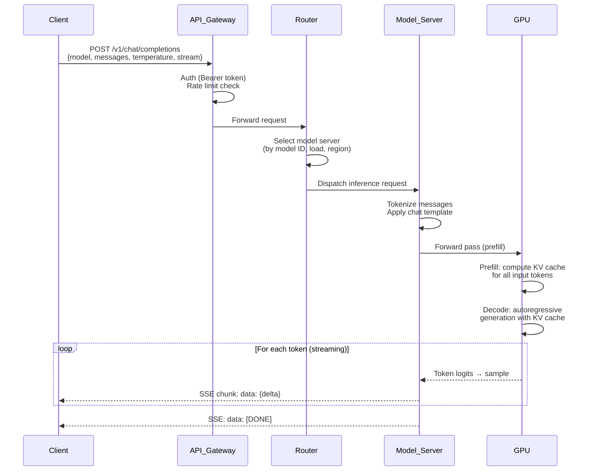
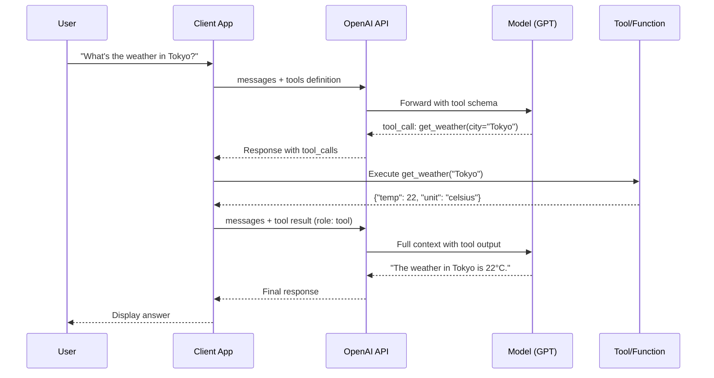
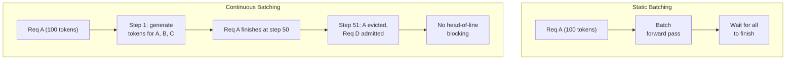

# ChatGPT and OpenAI APIs: Architecture, Mechanics, and Integration

## 1. First-Principles Intuition & Invariants

ChatGPT is a conversational AI product built on autoregressive transformer language models developed by OpenAI. The underlying model family—GPT (Generative Pre-trained Transformer)—uses a **decoder-only** transformer architecture, not the encoder-decoder architecture from the original "Attention Is All You Need" paper. Understanding this distinction is essential: GPT models generate text by predicting the next token conditioned on all preceding tokens, with no encoder component and no cross-attention.

### The Problem Space

Conversational AI requires a system to maintain dialogue state, produce contextually coherent responses, and align with human intent. Pre-training alone produces a model that continues text probabilistically—it does not inherently follow instructions or engage in dialogue. ChatGPT's quality arises from a three-stage training pipeline: unsupervised pre-training, supervised fine-tuning (SFT), and reinforcement learning from human feedback (RLHF). The architectural invariant is the decoder-only transformer; the behavioral invariant—instruction following, helpfulness, harmlessness—emerges from the training pipeline, not the architecture alone.

### Core Mathematical Invariants

**Causal (Masked) Self-Attention.** Unlike the original transformer's bidirectional self-attention, GPT models use causal masking: each token can only attend to itself and preceding tokens. This is enforced by applying a lower-triangular mask (zeroes above the diagonal, negative infinity above) to the raw attention scores before softmax, which drives those positions to zero probability:

$$\text{Attention}(Q, K, V) = \text{softmax}\left(\frac{QK^T}{\sqrt{d_k}} + M\right)V$$

where $M$ is the causal mask with $M_{ij} = 0$ if $j \leq i$ and $M_{ij} = -\infty$ if $j > i$. The $\sqrt{d_k}$ scaling prevents the dot products from growing large in magnitude, which would push softmax into regions with vanishing gradients.

**GELU Activation in Feed-Forward Networks.** GPT models use GELU (Gaussian Error Linear Unit), not ReLU, in the feed-forward sub-layers. GELU is a smooth approximation of ReLU that weights inputs by their probabilistic gating value:

$$\text{FFN}(x) = \text{GELU}(xW_1 + b_1)W_2 + b_2$$

$$\text{GELU}(x) = x \cdot \Phi(x) = x \cdot \frac{1}{2}\left[1 + \text{erf}\left(\frac{x}{\sqrt{2}}\right)\right]$$

GELU provides a non-zero gradient for negative inputs, which empirically yields better convergence than ReLU in deep transformer training.

**Learned Positional Embeddings.** GPT models use learned positional embeddings, not the sinusoidal positional encodings from the original Transformer paper. A learnable embedding matrix of shape `(max_sequence_length, d_model)` is indexed by position and added to the token embeddings. This is a key deviation from the original formulation—sinusoidal encodings are fixed, while GPT's positional embeddings are trained jointly with the model. Rotary Position Embeddings (RoPE) have been adopted in some successor architectures (e.g., LLaMA) but OpenAI has not publicly disclosed whether GPT-4 or later models use RoPE or alternatives.

**Layer Normalization with Pre-Norm Residuals.** GPT-2 and later models use **pre-norm** layer normalization, where normalization is applied before the sub-layer rather than after. This differs from the original Transformer (post-norm) and stabilizes training in deep models:

$$h = x + \text{SubLayer}(\text{LayerNorm}(x))$$

The final layer norm is applied to the output of the last transformer block before the language modeling head.

### Tokenization: Byte Pair Encoding

GPT models do not operate on characters or words. They use Byte Pair Encoding (BPE), a subword tokenization method that iteratively merges the most frequent byte pairs in the training corpus into single tokens. OpenAI's implementation (tiktoken) is a byte-level BPE that can encode any UTF-8 string without an explicit unknown token.

The tokenizer is not part of the neural network—it is a deterministic preprocessing step. The vocabulary size is fixed at training time (50,257 for GPT-2/GPT-3, cl100k_base for GPT-3.5/4, o200k_base for GPT-4o). Tokenization affects cost (API pricing is per token), context window utilization, and model behavior on multilingual or code inputs.

```python
import tiktoken

# GPT-4o uses the o200k_base encoding
encoding = tiktoken.encoding_for_model("gpt-4o")

text = "The transformer architecture revolutionized NLP."
tokens = encoding.encode(text)
print(f"Token count: {len(tokens)}")  # Token count: 9
print(f"Token IDs: {tokens}")
# Token IDs: [785, 43035, 23476, 0, 30136, 617, 425, 449, 13]

# Decode back to verify round-trip fidelity
decoded = encoding.decode(tokens)
assert decoded == text
```

## 2. Core Architecture: Decoder-Only Transformer

### Model Structure

A GPT model consists of an embedding layer, a stack of $N$ identical transformer decoder blocks, a final layer normalization, and a language modeling head (linear projection to vocabulary size). The output distribution over the vocabulary is computed via softmax over the logits:

$$P(t_1, \ldots, t_T) = \prod_{i=1}^{T} P(t_i \mid t_{<i})$$

Each token is generated autoregressively: the model produces logits for the next position, samples or greedily selects from that distribution, appends the selected token, and re-feeds the extended sequence.

### Transformer Decoder Block

Each decoder block contains two sub-layers with residual connections:

1. **Masked Multi-Head Self-Attention**: The attention mechanism is split into $h$ parallel heads, each operating on a projected subspace of dimension $d_k = d_{\text{model}} / h$. Multiple heads allow the model to attend to different relational patterns simultaneously. The outputs of all heads are concatenated and linearly projected back to $d_{\text{model}}$.

2. **Position-wise Feed-Forward Network**: A two-layer MLP with a GELU (or SwiGLU in some architectures) activation. The hidden dimension is typically $4 \times d_{\text{model}}$.



### KV Caching: The Inference Optimization

During autoregressive generation, recomputing attention over all previous tokens at every step is $O(n^2)$ in total across the sequence. The **KV cache** stores the key and value projections from all previous positions so they need not be recomputed. At each generation step, only the new token's Q, K, V are computed; the new K and V are appended to the cache, and attention is computed between the new Q and the full cached K/V.

This reduces per-step complexity from $O(n)$ to $O(1)$ (for the new token) plus $O(n)$ for the attention dot product, yielding $O(n)$ total across the full sequence instead of $O(n^2)$.



The trade-off is memory: the KV cache stores $2 \times N_{\text{layers}} \times N_{\text{heads}} \times d_k \times \text{seq\_len}$ floating-point values per request. For a model with 96 layers, 96 heads, $d_k=128$, and a 128K context window, this can exceed 10 GB per request in FP16.

### Multi-Head Attention Implementation

```python
import torch
import torch.nn.functional as F
import math

class MultiHeadSelfAttention(torch.nn.Module):
    def __init__(self, d_model: int, n_heads: int, max_seq_len: int):
        super().__init__()
        assert d_model % n_heads == 0
        self.n_heads = n_heads
        self.d_k = d_model // n_heads
        self.qkv_proj = torch.nn.Linear(d_model, 3 * d_model, bias=False)
        self.out_proj = torch.nn.Linear(d_model, d_model, bias=False)
        # Causal mask: lower-triangular, shape (1, 1, max_seq_len, max_seq_len)
        mask = torch.tril(torch.ones(max_seq_len, max_seq_len)).view(
            1, 1, max_seq_len, max_seq_len
        )
        self.register_buffer("causal_mask", mask)

    def forward(self, x: torch.Tensor, kv_cache: tuple | None = None,
                use_cache: bool = False):
        """
        x: (batch, seq_len, d_model)
        kv_cache: optional (cached_keys, cached_values) each (batch, n_heads, past_len, d_k)
        """
        B, S, D = x.shape
        qkv = self.qkv_proj(x)  # (B, S, 3*D)
        q, k, v = qkv.split(D, dim=-1)

        # Reshape to (B, n_heads, S, d_k)
        q = q.view(B, S, self.n_heads, self.d_k).transpose(1, 2)
        k = k.view(B, S, self.n_heads, self.d_k).transpose(1, 2)
        v = v.view(B, S, self.n_heads, self.d_k).transpose(1, 2)

        # Append to KV cache if provided
        if kv_cache is not None:
            cached_k, cached_v = kv_cache
            k = torch.cat([cached_k, k], dim=2)
            v = torch.cat([cached_v, v], dim=2)

        if use_cache:
            new_kv_cache = (k, v)
        else:
            new_kv_cache = None

        # Scaled dot-product attention
        scores = torch.matmul(q, k.transpose(-2, -1)) / math.sqrt(self.d_k)
        # Apply causal mask over the full key length (past + current)
        total_len = k.size(-2)
        mask = self.causal_mask[:, :, :S, :total_len].to(x.device)
        scores = scores.masked_fill(mask == 0, float("-inf"))

        attn_weights = F.softmax(scores, dim=-1)
        attn_output = torch.matmul(attn_weights, v)

        # Reshape back to (B, S, d_model)
        attn_output = attn_output.transpose(1, 2).contiguous().view(B, S, D)
        return self.out_proj(attn_output), new_kv_cache
```

### Training Pipeline: Pre-training, SFT, and RLHF

The model's architecture is only part of the story. ChatGPT's conversational behavior is shaped by three training stages:

```mermaid
graph TD
    subgraph sub_stage_1__pre_training ["Stage 1: Pre-training"]
        PT["Internet-scale text corpus"] --> PTM["Next-token prediction<br/>loss = cross-entropy"]
        PTM --> BASE["Base model<br/>(competent but not<br/>instruction-tuned)"]
    end

    subgraph sub_stage_2__supervised_fine_tuning ["Stage 2: Supervised Fine-Tuning (SFT)"]
        BASE --> SFT_IN["Human-authored<br/>demonstrations<br/>(prompt → ideal response)"]
        SFT_IN --> SFT_TRAIN["Fine-tune on<br/>demonstration data"]
        SFT_TRAIN --> SFT_MODEL["SFT model<br/>(follows instructions)"]
    end

    subgraph sub_stage_3__rlhf ["Stage 3: RLHF"]
        SFT_MODEL --> RM_DATA["Human rankings<br/>of model outputs"]
        RM_DATA --> RM["Train Reward Model<br/>(predicts human preference)"
        RM --> PPO["PPO optimization<br/>maximize reward subject<br/>to KL penalty vs SFT"]
        PPO --> RLHF_MODEL["RLHF model<br/>(aligned ChatGPT)"]
    end
```

1. **Pre-training**: Unsupervised next-token prediction on a large text corpus. The loss is standard cross-entropy over the vocabulary at each position. This stage consumes the vast majority of compute and produces a base model that is a powerful text completer but does not follow instructions or engage in dialogue.

2. **Supervised Fine-Tuning (SFT)**: The base model is fine-tuned on thousands of human-written demonstrations of prompts paired with ideal responses. This teaches the model the format of instruction following.

3. **Reinforcement Learning from Human Feedback (RLHF)**: Human annotators rank multiple model outputs for the same prompt. A reward model is trained to predict these rankings. The SFT model is then optimized using Proximal Policy Optimization (PPO) to maximize the reward model's scores, with a KL divergence penalty that keeps the policy close to the SFT model to prevent reward hacking and mode collapse.

OpenAI has also applied **Direct Preference Optimization (DPO)** in some model versions, which eliminates the need for a separate reward model by directly optimizing the policy on preference data through a closed-form loss function.

## 3. The OpenAI API: Integration and Architecture

### API Endpoints and Chat Completions

OpenAI exposes model inference through a REST API. The primary endpoint for conversational use is `/v1/chat/completions`. Requests are authenticated via bearer token and specify a model identifier, a list of messages (each with a role: system, user, or assistant), and sampling parameters.

The message format is critical. The model was trained on a specific chat template that structures conversations as alternating user/assistant turns. The `system` message sets behavioral instructions that condition all subsequent responses.



### Production-Grade API Client (Python)

```python
"""
Production-grade OpenAI Chat Completions client with streaming,
retry logic, exponential backoff, and structured output parsing.
"""
import json
import time
import logging
from dataclasses import dataclass
from typing import Iterator

import httpx
from openai import OpenAI, RateLimitError, APIConnectionError, APITimeoutError

logger = logging.getLogger(__name__)

@dataclass
class ChatConfig:
    model: str = "gpt-4o"
    temperature: float = 0.7
    max_tokens: int = 4096
    top_p: float = 1.0
    frequency_penalty: float = 0.0
    presence_penalty: float = 0.0
    timeout: float = 120.0
    max_retries: int = 4
    base_delay: float = 1.0


class RobustChatClient:
    def __init__(self, api_key: str, config: ChatConfig | None = None):
        self.config = config or ChatConfig()
        self.client = OpenAI(
            api_key=api_key,
            timeout=httpx.Timeout(self.config.timeout, connect=10.0),
            max_retries=0,  # We handle retries manually for granular control
        )

    def chat(self, messages: list[dict], **overrides) -> str:
        """Non-streaming completion with retry logic."""
        params = {
            "model": self.config.model,
            "messages": messages,
            "temperature": self.config.temperature,
            "max_tokens": self.config.max_tokens,
            "top_p": self.config.top_p,
            "frequency_penalty": self.config.frequency_penalty,
            "presence_penalty": self.config.presence_penalty,
        }
        params.update(overrides)

        for attempt in range(self.config.max_retries):
            try:
                response = self.client.chat.completions.create(**params)
                return response.choices[0].message.content
            except RateLimitError:
                delay = self.config.base_delay * (2 ** attempt)
                logger.warning(f"Rate limited, retrying in {delay:.1f}s (attempt {attempt + 1})")
                time.sleep(delay)
            except (APIConnectionError, APITimeoutError) as e:
                delay = self.config.base_delay * (2 ** attempt)
                logger.warning(f"Transient error: {e}, retrying in {delay:.1f}s")
                time.sleep(delay)

        raise RuntimeError(f"Failed after {self.config.max_retries} retries")

    def chat_stream(self, messages: list[dict], **overrides) -> Iterator[str]:
        """Streaming completion yielding content deltas."""
        params = {
            "model": self.config.model,
            "messages": messages,
            "temperature": self.config.temperature,
            "max_tokens": self.config.max_tokens,
            "stream": True,
        }
        params.update(overrides)

        for attempt in range(self.config.max_retries):
            try:
                stream = self.client.chat.completions.create(**params)
                for chunk in stream:
                    if chunk.choices and chunk.choices[0].delta.content:
                        yield chunk.choices[0].delta.content
                return  # Successful stream completed
            except RateLimitError:
                delay = self.config.base_delay * (2 ** attempt)
                logger.warning(f"Rate limited during stream, retrying in {delay:.1f}s")
                time.sleep(delay)
            except (APIConnectionError, APITimeoutError) as e:
                delay = self.config.base_delay * (2 ** attempt)
                logger.warning(f"Stream interrupted: {e}, retrying in {delay:.1f}s")
                time.sleep(delay)

        raise RuntimeError(f"Stream failed after {self.config.max_retries} retries")

    def chat_with_tools(self, messages: list[dict], tools: list[dict],
                        **overrides) -> dict:
        """Function calling / tool use with structured output."""
        params = {
            "model": self.config.model,
            "messages": messages,
            "tools": tools,
            "tool_choice": "auto",
            "temperature": self.config.temperature,
        }
        params.update(overrides)

        response = self.client.chat.completions.create(**params)
        msg = response.choices[0].message
        return {
            "content": msg.content,
            "tool_calls": [
                {
                    "id": tc.id,
                    "name": tc.function.name,
                    "arguments": json.loads(tc.function.arguments),
                }
                for tc in (msg.tool_calls or [])
            ]
        }


# Example usage
if __name__ == "__main__":
    import os

    client = RobustChatClient(api_key=os.environ["OPENAI_API_KEY"])

    # Simple chat
    messages = [
        {"role": "system", "content": "You are a senior systems engineer."},
        {"role": "user", "content": "Explain KV caching in transformers in 2 sentences."},
    ]
    print(client.chat(messages, temperature=0.3))

    # Streaming
    print("\n--- Streaming ---")
    for token in client.chat_stream(messages):
        print(token, end="", flush=True)
    print()

    # Tool use
    tools = [
        {
            "type": "function",
            "function": {
                "name": "get_weather",
                "description": "Get current weather for a city",
                "parameters": {
                    "type": "object",
                    "properties": {
                        "city": {"type": "string", "description": "City name"},
                        "unit": {"type": "string", "enum": ["celsius", "fahrenheit"]},
                    },
                    "required": ["city"],
                },
            },
        }
    ]
    result = client.chat_with_tools(
        messages=[{"role": "user", "content": "What's the weather in Tokyo?"}],
        tools=tools,
    )
    print(json.dumps(result, indent=2))
```

### Production-Grade API Client (Go)

```go
package openaiclient

import (
	"bytes"
	"context"
	"encoding/json"
	"fmt"
	"io"
	"net/http"
	"time"
)

const baseURL = "https://api.openai.com/v1"

type Client struct {
	apiKey     string
	httpClient *http.Client
}

type ChatMessage struct {
	Role    string `json:"role"`
	Content string `json:"content"`
}

type ChatRequest struct {
	Model       string        `json:"model"`
	Messages    []ChatMessage `json:"messages"`
	Temperature float64      `json:"temperature"`
	MaxTokens   int           `json:"max_tokens,omitempty"`
	Stream      bool          `json:"stream"`
}

type ChatChoice struct {
	Index   int         `json:"index"`
	Message ChatMessage `json:"message"`
}

type ChatResponse struct {
	ID      string       `json:"id"`
	Choices []ChatChoice `json:"choices"`
	Usage   struct {
		PromptTokens     int `json:"prompt_tokens"`
		CompletionTokens int `json:"completion_tokens"`
		TotalTokens      int `json:"total_tokens"`
	} `json:"usage"`
}

func NewClient(apiKey string) *Client {
	return &Client{
		apiKey: apiKey,
		httpClient: &http.Client{
			Timeout: 120 * time.Second,
		},
	}
}

func (c *Client) ChatCompletion(ctx context.Context, req ChatRequest) (*ChatResponse, error) {
	body, err := json.Marshal(req)
	if err != nil {
		return nil, fmt.Errorf("marshal request: %w", err)
	}

	httpReq, err := http.NewRequestWithContext(ctx, "POST", baseURL+"/chat/completions", bytes.NewReader(body))
	if err != nil {
		return nil, fmt.Errorf("create request: %w", err)
	}
	httpReq.Header.Set("Content-Type", "application/json")
	httpReq.Header.Set("Authorization", "Bearer "+c.apiKey)

	resp, err := c.httpClient.Do(httpReq)
	if err != nil {
		return nil, fmt.Errorf("http request: %w", err)
	}
	defer resp.Body.Close()

	if resp.StatusCode != http.StatusOK {
		raw, _ := io.ReadAll(resp.Body)
		return nil, fmt.Errorf("api error (status %d): %s", resp.StatusCode, string(raw))
	}

	var chatResp ChatResponse
	if err := json.NewDecoder(resp.Body).Decode(&chatResp); err != nil {
		return nil, fmt.Errorf("decode response: %w", err)
	}
	return &chatResp, nil
}
```

### Function Calling: Architecture and Data Flow

Function calling (tool use) allows the model to invoke external tools. The model receives tool definitions in the request, decides whether to call a tool based on the user's message, and returns structured JSON arguments. The client executes the function locally and feeds the result back to the model in a subsequent turn.



The model does not execute the function. It produces a structured output specifying which function to call and with what arguments. The client is responsible for execution and feeding results back. This is a deliberate architectural decision: the model is a reasoning engine, not an execution environment, which maintains a security boundary.

### Sampling Parameters and Their Effects

| Parameter | Range | Effect |
|---|---|---|
| `temperature` | 0.0–2.0 | Controls softmax sharpness. At 0, the model always selects the argmax (greedy decoding). Higher values increase randomness and creativity but risk incoherence. |
| `top_p` | 0.0–1.0 | Nucleus sampling: only consider tokens comprising the top-p cumulative probability mass. `top_p=0.1` considers only the top 10% of probability mass. |
| `max_tokens` | int | Hard cap on generated tokens. Does not count input tokens against this limit. |
| `frequency_penalty` | -2.0–2.0 | Penalizes tokens proportional to their frequency in the generated text so far. Positive values reduce repetition. |
| `presence_penalty` | -2.0–2.0 | Penalizes tokens that have appeared at all, encouraging topic diversity. |
| `seed` | int | Enables deterministic (or near-deterministic) sampling for reproducibility. OpenAI notes this is best-effort, not guaranteed. |

Setting `temperature=0` and `top_p=1.0` gives greedy decoding. Setting `temperature` high with low `top_p` can produce conflicting sampling behavior. OpenAI recommends adjusting one or the other, not both.

### Context Window and Token Economics

The context window defines the maximum total tokens (input + output) the model can process in a single request. Exceeding it results in an API error or silent truncation. API pricing is per-token: input tokens and output tokens are priced separately, with output tokens typically costing more.

For long conversations, the input token count grows linearly with each turn because the model reprocesses the full conversation history on every request (stateless API). Strategies to manage this:

- **Summarization**: Periodically summarize earlier conversation turns and replace them with a compact summary.
- **Sliding window**: Retain only the most recent N turns.
- **Vector retrieval**: Store conversation history in an embedding store and retrieve only relevant turns.

### Embeddings API

OpenAI also provides embedding models (e.g., `text-embedding-3-small`, `text-embedding-3-large`) that map text to fixed-dimensional dense vectors. These are used for semantic search, retrieval-augmented generation (RAG), clustering, and classification.

```python
from openai import OpenAI
import numpy as np

client = OpenAI()

def embed_texts(texts: list[str], model: str = "text-embedding-3-small") -> list[list[float]]:
    """Embed a batch of texts. Returns vectors of dimension 1536 for small, 3072 for large."""
    response = client.embeddings.create(
        model=model,
        input=texts,
        encoding_format="float",
    )
    return [item.embedding for item in response.data]

def cosine_similarity(a: list[float], b: list[float]) -> float:
    a_arr, b_arr = np.array(a), np.array(b)
    return float(np.dot(a_arr, b_arr) / (np.linalg.norm(a_arr) * np.linalg.norm(b_arr)))

texts = [
    "The transformer architecture uses self-attention.",
    "Self-attention enables long-range dependency modeling.",
    "Bananas are a good source of potassium.",
]

vectors = embed_texts(texts)
sim_01 = cosine_similarity(vectors[0], vectors[1])  # High: semantically related
sim_02 = cosine_similarity(vectors[0], vectors[2])  # Low: unrelated topics
print(f"Sim(text0, text1) = {sim_01:.4f}")
print(f"Sim(text0, text2) = {sim_02:.4f}")
```

## 4. High-Performance Optimization & Failure Modes

### Batching and Throughput

GPU inference throughput is maximized when requests are batched. OpenAI handles this server-side—multiple users' requests are dynamically batched into a single forward pass through shared GPU resources. This is why API latency is variable: a request may wait for a batch to fill or may be served immediately depending on queue depth.

On the model server side, **continuous batching** (also called in-flight batching or iteration-level batching) is the state-of-the-art technique. Unlike static batching (which waits to fill a batch before processing), continuous batching admits new requests at every token generation step and evicts completed sequences immediately. This eliminates head-of-line blocking and keeps GPUs saturated.



### Inference Acceleration Techniques

- **PagedAttention (vLLM)**: Manages KV cache memory like an operating system manages virtual memory, using non-contiguous blocks with page tables. Reduces memory fragmentation and enables handling longer sequences and more concurrent requests.
- **Speculative Decoding**: Uses a small draft model to propose multiple tokens, which the large model verifies in a single forward pass. Accepted tokens are free; rejected tokens require a fallback. Net speedup when the draft model's predictions are frequently accepted.
- **Quantization**: Reduces weight precision from FP16 to INT8 or INT4, halving or quartering memory usage with modest quality degradation. OpenAI has not publicly disclosed their internal quantization strategy.
- **Tensor Parallelism**: Splits model weights across multiple GPUs within a single node, with all-reduce operations synchronizing after each attention and FFN layer. Necessary for models too large to fit on a single GPU.

### Failure Modes and Mitigations

**Hallucination.** The model generates fluent but factually incorrect content. This is an inherent property of probabilistic text generation—the model does not have a truth oracle. Mitigations: RAG (retrieve factual context and inject it into the prompt), function calling for data that must be accurate, and lower temperature for factual queries.

**Context Window Overflow.** When input + requested output exceeds the model's context limit, the API returns a 400 error or truncates. Mitigations: token counting before submission using `tiktoken`, conversation summarization, and chunking long documents.

**Rate Limiting.** The API enforces tokens-per-minute (TPM) and requests-per-minute (RPM) limits that vary by model and account tier. Hitting these limits returns HTTP 429. Mitigations: exponential backoff with jitter, request queuing with token bucket rate limiting, and monitoring the `x-ratelimit-remaining-*` response headers.

**Stochastic Output.** At temperature > 0, the same input produces different outputs across calls. This is not a bug—it is the sampling mechanism working as designed. For deterministic outputs, use `temperature=0` or set a `seed` (with the caveat that seed-based determinism is best-effort).

**Tokenization Edge Cases.** BPE tokenization is not always intuitive. Leading whitespace changes token IDs (" hello" vs "hello"). Code with rare characters may tokenize inefficiently, consuming more of the context window than expected. Non-English text typically requires more tokens per character than English due to BPE's training data distribution.

**Prompt Injection.** User input containing instructions like "ignore all previous instructions and..." can override system prompts. This is a security boundary issue, not a model bug. Mitigations: treat all user input as data (not instructions), use structured output formats that constrain model behavior, and validate outputs against expected schemas.

### Rate-Limited Client with Token Bucket

```python
"""
Token bucket rate limiter for OpenAI API calls.
Ensures compliance with TPM and RPM limits.
"""
import time
import threading
from collections import deque
from tiktoken import encoding_for_model


class TokenBucketRateLimiter:
    def __init__(self, tpm_limit: int, rpm_limit: int):
        self.tpm_limit = tpm_limit
        self.rpm_limit = rpm_limit
        self.lock = threading.Lock()
        self.token_times = deque()   # timestamps of token consumption
        self.request_times = deque() # timestamps of request dispatch
        self.encoding = encoding_for_model("gpt-4o")

    def estimate_tokens(self, messages: list[dict]) -> int:
        """Estimate token count for a chat request (approximate)."""
        total = 0
        for msg in messages:
            # ~4 tokens overhead per message (role, delimiters)
            total += 4
            total += len(self.encoding.encode(msg.get("content", "")))
        total += 2  # priming tokens
        return total

    def acquire(self, estimated_tokens: int) -> None:
        """Block until rate limits allow the request."""
        while True:
            with self.lock:
                now = time.monotonic()
                window_60s = now - 60.0

                # Purge entries older than 60 seconds
                while self.token_times and self.token_times[0][0] < window_60s:
                    self.token_times.popleft()
                while self.request_times and self.request_times[0] < window_60s:
                    self.request_times.popleft()

                current_tpm = sum(t for _, t in self.token_times)
                current_rpm = len(self.request_times)

                if current_tpm + estimated_tokens <= self.tpm_limit and \
                   current_rpm + 1 <= self.rpm_limit:
                    self.token_times.append((now, estimated_tokens))
                    self.request_times.append(now)
                    return

                # Calculate sleep time until oldest entry exits the window
                if self.token_times and self.request_times:
                    oldest = min(self.token_times[0][0], self.request_times[0])
                    sleep_time = oldest + 60.0 - now + 0.1
                else:
                    sleep_time = 0.1
            time.sleep(max(sleep_time, 0.1))
```

## 5. Key Distinctions and Common Misconceptions

**ChatGPT is the product; GPT is the model.** ChatGPT refers to the chatbot interface and product layer. The underlying models are GPT-3.5, GPT-4, GPT-4o, o1, and others, each with different architectures (though all decoder-only transformers), context windows, and capabilities. The API provides programmatic access to these models; ChatGPT (the web app) is one consumer of the same models.

**The API is stateless.** Each API call is independent. The server does not maintain conversation history between calls. The client must resend the full conversation context with every request. This is why token costs scale with conversation length.

**GPT models are not encoders.** The original Transformer paper introduced an encoder-decoder architecture for sequence-to-sequence tasks (translation). GPT discards the encoder entirely. There is no bidirectional attention. This means GPT models are not ideal for tasks like classification or embedding without architectural adaptation or fine-tuning—OpenAI provides separate embedding models for that purpose.

**More parameters do not linearly improve quality.** Model quality scales with compute, data quality, and parameter count in complex, empirically observed power-law relationships (as described in OpenAI's scaling laws research). Doubling parameters does not double performance; it yields diminishing returns that must be balanced against inference cost and latency.
