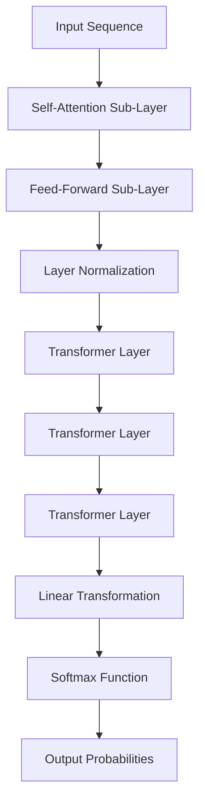

# Lesson 2: ChatGPT Architecture

## 1. First-Principles Intuition & Invariants

The advent of ChatGPT marks a significant milestone in the evolution of natural language processing (NLP) and artificial intelligence (AI). At its core, ChatGPT is a sophisticated transformer-based language model designed to understand and generate human-like text. To fully appreciate the architecture and mechanisms of ChatGPT, it is essential to delve into the theoretical foundations and mathematical invariants that underpin its design.

### The Problem Space

The problem space of building a conversational AI system is multifaceted. It involves not only understanding the nuances of human language but also generating coherent, contextually relevant responses. This requires the model to capture semantic meaning, maintain conversational context, and generate text that is both informative and engaging. The challenge lies in balancing these requirements while ensuring that the model is efficient, scalable, and robust.

### Mathematical and System Invariants

At the heart of ChatGPT's architecture are transformer models, a class of neural networks that have revolutionized NLP. Transformer models are based on the self-attention mechanism, which allows the model to weigh the importance of different words in a sentence relative to each other. This mechanism is grounded in the mathematical concept of dot products and softmax functions, which enable the model to dynamically focus on relevant parts of the input data.

The transformer architecture is characterized by several key invariants:
1. **Self-Attention Mechanism**: This mechanism allows the model to weigh the importance of different words in a sentence, enabling it to capture long-range dependencies and context.
2. **Layer Normalization**: This technique ensures that the inputs to each layer of the network have a consistent distribution, which helps stabilize training and improve convergence.
3. **Positional Encoding**: Since transformers do not inherently capture the order of words, positional encoding is used to inject information about the position of each word in the input sequence.
4. **Feed-Forward Neural Networks**: These networks are applied to each position separately and identically, allowing the model to learn complex transformations of the input data.

These invariants form the bedrock of the transformer architecture, enabling ChatGPT to process and generate text with remarkable accuracy and fluency.

## 2. Core Architecture & Mechanics

The architecture of ChatGPT is a complex interplay of transformer layers, self-attention mechanisms, and feed-forward neural networks. To understand the internal data structures and algorithms, we will dissect the architecture in detail.

### Transformer Layers

The core of ChatGPT's architecture consists of multiple transformer layers, each of which contains two sub-layers: a self-attention sub-layer and a feed-forward sub-layer. These layers are stacked to form a deep neural network that can capture complex patterns in the input data.

#### Self-Attention Sub-Layer

The self-attention sub-layer is the cornerstone of the transformer architecture. It allows the model to weigh the importance of different words in a sentence relative to each other. The self-attention mechanism is implemented using the following steps:

1. **Query, Key, and Value Vectors**: For each word in the input sequence, the model computes three vectors: the query vector, the key vector, and the value vector. These vectors are learned during training and capture different aspects of the word's meaning.
2. **Dot Product Attention**: The dot product between the query vector and the key vector is computed for each pair of words in the input sequence. This results in a matrix of attention scores, which indicate the importance of each word relative to the others.
3. **Softmax Function**: The attention scores are passed through a softmax function to normalize them and ensure that they sum to 1. This results in a probability distribution that indicates the relative importance of each word.
4. **Weighted Sum**: The value vectors are weighted by the attention scores and summed to produce the final output vector for each word.

The self-attention mechanism is implemented using the following formula:

\[ \text{Attention}(Q, K, V) = \text{softmax}\left(\frac{QK^T}{\sqrt{d_k}}\right)V \]

where \( Q \), \( K \), and \( V \) are the query, key, and value matrices, respectively, and \( d_k \) is the dimensionality of the key vectors.

#### Feed-Forward Sub-Layer

The feed-forward sub-layer is a simple feed-forward neural network that is applied to each position separately and identically. It consists of two linear transformations with a ReLU activation function in between. The feed-forward sub-layer is implemented using the following formula:

\[ \text{FFN}(x) = \max(0, xW_1 + b_1)W_2 + b_2 \]

where \( x \) is the input vector, \( W_1 \) and \( W_2 \) are weight matrices, and \( b_1 \) and \( b_2 \) are bias vectors.

### Positional Encoding

Since transformers do not inherently capture the order of words, positional encoding is used to inject information about the position of each word in the input sequence. Positional encoding is implemented using the following formula:

\[ PE_{(pos, 2i)} = \sin\left(\frac{pos}{10000^{2i/d_{\text{model}}}}\right) \]
\[ PE_{(pos, 2i+1)} = \cos\left(\frac{pos}{10000^{2i/d_{\text{model}}}}\right) \]

where \( pos \) is the position of the word in the input sequence, \( i \) is the dimension of the positional encoding, and \( d_{\text{model}} \) is the dimensionality of the model.

### Layer Normalization

Layer normalization is a technique that ensures that the inputs to each layer of the network have a consistent distribution. This helps stabilize training and improve convergence. Layer normalization is implemented using the following formula:

\[ \hat{x} = \frac{x - \mu}{\sqrt{\sigma^2 + \epsilon}} \]
\[ y = \gamma \hat{x} + \beta \]

where \( x \) is the input vector, \( \mu \) and \( \sigma^2 \) are the mean and variance of the input vector, \( \epsilon \) is a small constant for numerical stability, and \( \gamma \) and \( \beta \) are learnable parameters.

### Execution Model

The execution model of ChatGPT involves processing the input sequence through multiple transformer layers, each of which applies the self-attention and feed-forward sub-layers. The output of the final layer is passed through a linear transformation and a softmax function to produce the final output probabilities for each word in the vocabulary.

The execution model can be visualized using the following Mermaid diagram:

## 3. High-Performance Optimization & Failure Modes

To ensure that ChatGPT is efficient, scalable, and robust, several high-performance optimizations and failure mitigations are employed.

### Concurrency

ChatGPT is designed to handle large-scale concurrent requests. This is achieved through the use of distributed computing and parallel processing. The model is deployed on a cluster of GPUs, each of which processes a subset of the input data in parallel. The results are then combined to produce the final output.

### Resource Scaling

To ensure that ChatGPT can handle varying levels of demand, resource scaling is employed. This involves dynamically adjusting the number of GPUs and other resources based on the current load. This is achieved through the use of auto-scaling mechanisms, which automatically adjust the number of resources based on predefined metrics.

### Boundary Edge Cases

ChatGPT is designed to handle a wide range of input data, including edge cases such as rare words, misspellings, and grammatical errors. To handle these edge cases, the model is trained on a diverse dataset that includes a wide range of text samples. The model is also designed to handle ambiguous inputs by generating multiple possible responses and selecting the most likely one based on the context.

### Failure Mitigations

To ensure that ChatGPT is robust and reliable, several failure mitigations are employed. These include:

1. **Redundancy**: The model is deployed on multiple GPUs to ensure that it can continue to operate even if one of the GPUs fails.
2. **Monitoring**: The system is monitored for performance and availability using a variety of metrics, including response time, error rate, and resource utilization.
3. **Fault Tolerance**: The system is designed to be fault-tolerant, with mechanisms in place to recover from failures and ensure that the model can continue to operate without interruption.

In conclusion, the architecture of ChatGPT is a sophisticated interplay of transformer layers, self-attention mechanisms, and feed-forward neural networks. By understanding the theoretical foundations and mathematical invariants that underpin the design, we can gain a deeper appreciation of the mechanisms that enable ChatGPT to generate human-like text with remarkable accuracy and fluency.
