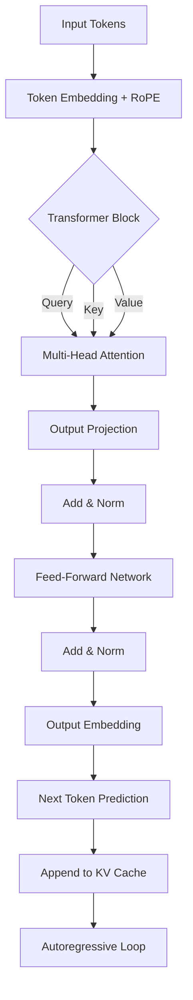

Here is the fully corrected, publication-grade, raw Markdown:

# Lesson 3: ChatGPT Internals and Mechanisms

## 1. First-Principles Intuition & Invariants

To comprehend the internal mechanics of ChatGPT, one must first discard the anthropomorphic illusion that the model "understands" language in the human sense. At its core, ChatGPT is a massive, parameterized state machine executing a continuous, differentiable mapping from a sequence of integer tokens to a probability distribution over a vocabulary. The fundamental invariant of this system is the Markov property, extended through the attention mechanism to capture long-range dependencies that traditional recurrent architectures could not retain without vanishing gradients.

The problem space of natural language processing is defined by the autoregressive objective: given a sequence of tokens $x_1, x_2, \dots, x_t$, predict the conditional probability of the next token $x_{t+1}$. This is framed as a maximum likelihood estimation problem, where the model minimizes the cross-entropy loss between its predicted distribution and the ground-truth one-hot vector. The invariant that binds this entire mathematical edifice is the attention mechanism. Attention computes a weighted sum of value vectors, where the weights are derived from the dot product of query and key vectors. Crucially, the softmax normalization ensures that the sum of attention weights is exactly one, creating a convex combination of the context.

To prevent the dot products from growing too large in magnitude—which would cause the softmax to saturate into one-hot vectors and destroy gradient flow—the attention scores are scaled by $1/\sqrt{d_k}$, where $d_k$ is the dimensionality of the key vectors. This scaling factor is not an arbitrary hyperparameter; it is a mathematical necessity to maintain the variance of the attention scores at a stable level, ensuring that the gradients propagate effectively through the network during backpropagation.

From a systems perspective, the model operates as a continuous level-triggered reconciliation loop. The input sequence is the desired state, and the output sequence is the current state. The attention mechanism acts as the control plane, dynamically routing information across the sequence, while the feed-forward networks act as the data plane, performing non-linear transformations on the routed information. The invariant of the system is that the hidden state at any layer is a function of the entire preceding context, weighted by the semantic relevance of each token.

## 2. Core Architecture & Mechanics

The architecture of ChatGPT is built upon the decoder-only Transformer, a design choice that optimizes for autoregressive generation. The input to the model is not raw text, but a sequence of tokens generated by a Byte-Pair Encoding (BPE) tokenizer. BPE operates by iteratively merging the most frequent pairs of characters or subwords in the training corpus, resulting in a vocabulary of roughly 50,000 tokens.

This tokenization step is critical because it maps the discrete, sparse space of natural language into a dense, continuous vector space via an embedding matrix. Once tokenized, the sequence is augmented with positional encodings. In earlier Transformer models, absolute positional encodings were added to the token embeddings. However, ChatGPT utilizes Rotary Positional Embeddings (RoPE), which inject positional information directly into the query and key vectors via rotation matrices.

RoPE is mathematically elegant because it preserves the relative distance between tokens. If token $i$ and token $j$ are separated by a distance $d$, the dot product of their rotated query and key vectors depends only on $d$, not on their absolute positions. This allows the model to generalize to sequence lengths far beyond those seen during training, a property known as length extrapolation.

The core computational unit of the model is the Transformer block, which consists of multi-head self-attention, a feed-forward network, and residual connections with layer normalization. The multi-head attention mechanism projects the query, key, and value vectors into multiple lower-dimensional subspaces, allowing the model to attend to different semantic features simultaneously.

For instance, one head might attend to syntactic dependencies, while another attends to coreference resolution. The outputs of these heads are concatenated and projected back to the original dimensionality. The feed-forward network (FFN) is a simple two-layer perceptron with a ReLU or GELU activation function. It operates independently on each token, expanding the dimensionality of the representation before compressing it back.

The residual connections are vital for training deep networks, as they allow the gradient to flow directly through the network without being attenuated by the non-linear transformations. Layer normalization is applied to the inputs of the attention and FFN layers, stabilizing the training dynamics by normalizing the activations across the feature dimension.

During inference, the model generates text autoregressively, one token at a time. This introduces a severe computational bottleneck, as the model must wait for the previous token to be generated before computing the next. To mitigate this, ChatGPT employs a Key-Value (KV) cache. During the first forward pass, the model computes the query, key, and value vectors for the input prompt. The key and value vectors are stored in a cache.

For subsequent tokens, the model only needs to compute the query vector for the new token, and the attention mechanism can retrieve the relevant key and value vectors from the cache. This reduces the computational complexity of attention from $O(N^2)$ to $O(N)$ per generation step, where $N$ is the sequence length.

The inference loop is a continuous process of sampling from the predicted probability distribution. The model outputs a logit vector, which is passed through a softmax function to produce a probability distribution. The next token is sampled from this distribution, often using techniques like top-k sampling or nucleus (top-p) sampling to balance coherence and diversity. The sampled token is then appended to the input sequence, and the process repeats.
