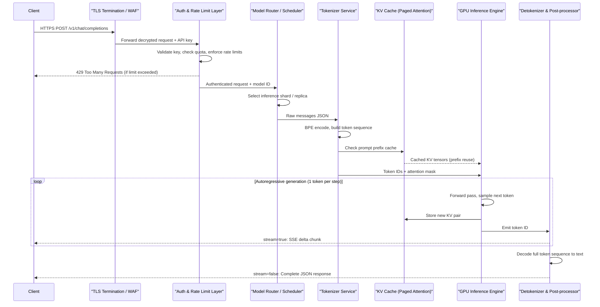
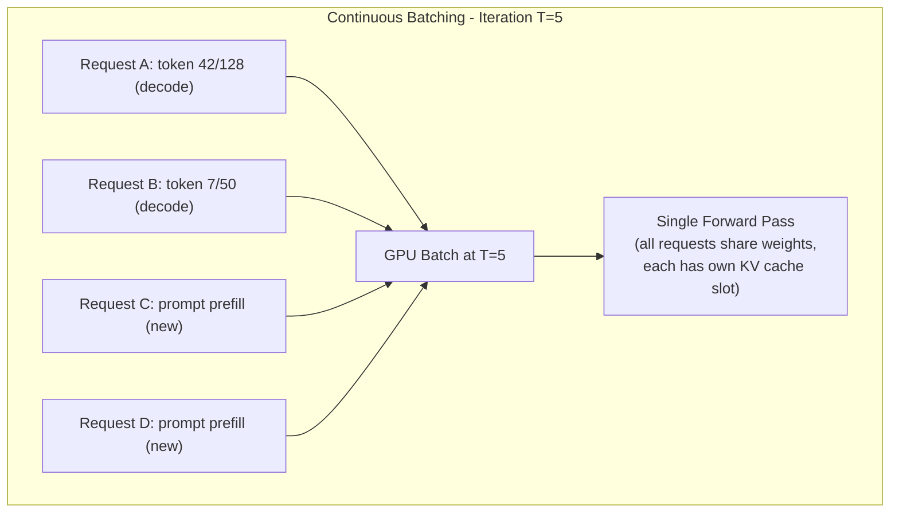
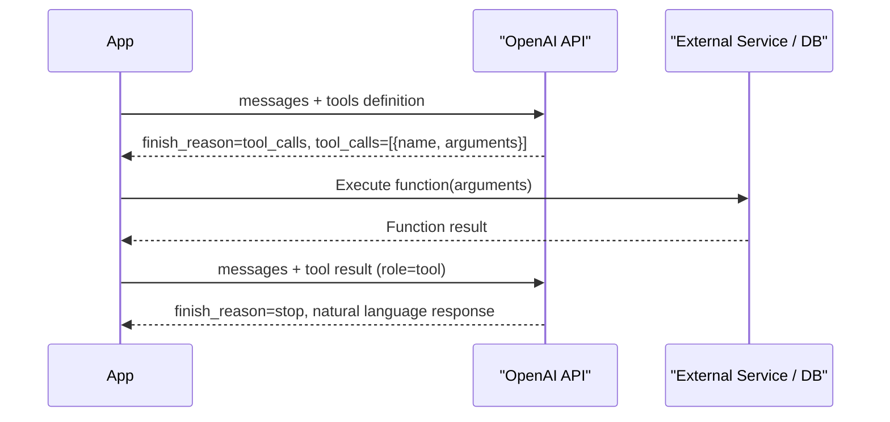
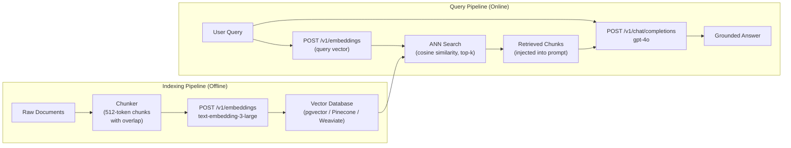
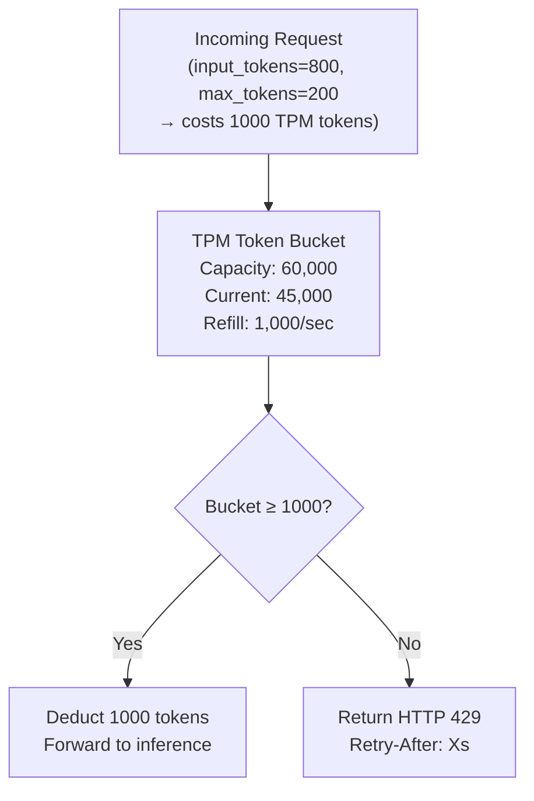
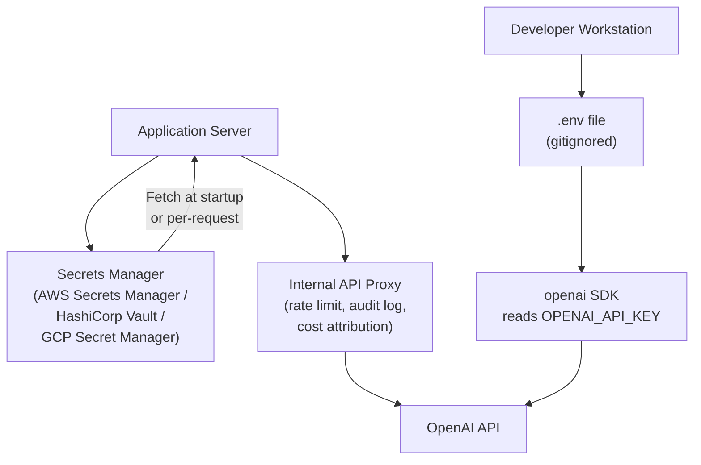

# Lesson 3: OpenAI API — Architecture, Mechanics, and Production Engineering

---

## 1. First-Principles Foundations

### What the API Actually Is

The OpenAI API is an HTTPS-based inference service that exposes large language model (LLM) inference as a stateless remote procedure call. From an engineering standpoint, it is a thin orchestration layer sitting atop a distributed GPU inference cluster, translating JSON-encoded requests into autoregressive token generation and returning the results as structured JSON (or a token stream over Server-Sent Events).

The architectural invariants that govern every interaction are:

**Statelesness.** Every HTTP request is self-contained. The server maintains no session, no memory of prior turns, and no per-client routing affinity. Conversational history is the client's responsibility; the illusion of "memory" is achieved by concatenating prior turns into the `messages` array on each new request. This is not a limitation—it is what enables horizontal scale-out without synchronization cost.

**Token-centrality.** The atom of computation is the *token*, not the character or word. All pricing, all context limits, all throughput metrics, and all latency guarantees are defined in tokens. A token is roughly 4 bytes of UTF-8 English text under the GPT-4 family's `cl100k_base` tokenizer, but this varies dramatically for code, non-Latin scripts, and whitespace-heavy content. Understanding tokenization at a mechanical level is prerequisite to reasoning about cost, latency, and context window management.

**Autoregressive generation.** GPT-family models generate output one token at a time, left to right. Each forward pass through the transformer takes the full context (prompt + tokens generated so far) and produces a probability distribution over the vocabulary; the next token is sampled from that distribution according to the decoding strategy (greedy, top-p, top-k, beam search). This is why latency scales with output length, not just input length.

**Bounded context.** Each model has a fixed context window measured in tokens (e.g., `gpt-4o` supports 128,000 tokens as of 2024). Input tokens plus output tokens must fit within this window. The window is not an arbitrary API limit—it is a hard architectural constraint of the transformer's attention mechanism, whose memory and compute requirements scale quadratically with sequence length without specialized approximations.

### Tokenization in Depth

OpenAI's tokenizer for GPT-3.5 and GPT-4 family models is `cl100k_base`, a Byte-Pair Encoding (BPE) tokenizer with a vocabulary of 100,277 tokens. BPE works by:

1. Starting with a vocabulary of individual bytes (256 tokens).
2. Iteratively merging the most frequent adjacent byte-pair in the training corpus into a new token.
3. Repeating until the target vocabulary size is reached.

The result is a vocabulary where common English words map to a single token (`" the"` → token 279), uncommon strings are split into subword pieces, and arbitrary bytes are representable via fallback byte tokens. The tokenizer is deterministic and publicly available via the `tiktoken` library.

```python
import tiktoken

enc = tiktoken.get_encoding("cl100k_base")

text = "The transformer architecture scales quadratically with sequence length."
tokens = enc.encode(text)

print(f"Text   : {text}")
print(f"Tokens : {tokens}")
print(f"Count  : {len(tokens)}")

# Decode individual tokens to inspect the vocabulary segmentation
for tok_id in tokens:
    print(f"  {tok_id:6d}  →  {repr(enc.decode([tok_id]))}")
```

Understanding which strings produce many tokens versus few is critical for prompt engineering and cost control. The string `" aaaaaaaaaa"` produces 10 tokens; `" the"` produces 1.

---

## 2. The API Surface: Endpoints, Models, and Request Schema

### Endpoint Taxonomy

The OpenAI API (as of mid-2024) exposes the following primary inference endpoints:

| Endpoint | Purpose | Primary Parameters |
|---|---|---|
| `POST /v1/chat/completions` | Multi-turn conversational inference | `model`, `messages`, `temperature`, `max_tokens`, `tools`, `stream` |
| `POST /v1/completions` | Legacy single-string completion (older models) | `model`, `prompt`, `temperature`, `max_tokens` |
| `POST /v1/embeddings` | Dense vector embeddings for semantic search / RAG | `model`, `input` |
| `POST /v1/images/generations` | DALL·E image generation | `model`, `prompt`, `size`, `quality`, `n` |
| `POST /v1/audio/transcriptions` | Whisper speech-to-text | `model`, `file`, `language` |
| `POST /v1/audio/speech` | Text-to-speech synthesis | `model`, `input`, `voice` |
| `POST /v1/moderations` | Content policy classification | `model`, `input` |
| `POST /v1/fine_tuning/jobs` | Fine-tuning job management | `model`, `training_file`, `hyperparameters` |
| `POST /v1/batches` | Asynchronous batch inference (up to 24h SLA) | `input_file_id`, `endpoint`, `completion_window` |

The `/v1/chat/completions` endpoint is the canonical interface for GPT-3.5-turbo, GPT-4, GPT-4o, and all successor models. The legacy `/v1/completions` endpoint targets older base models like `davinci-002` and should not be used for new development.

### The Chat Completions Request Schema

```json
{
  "model": "gpt-4o",
  "messages": [
    {
      "role": "system",
      "content": "You are a precise technical assistant. Answer only what is asked."
    },
    {
      "role": "user",
      "content": "Explain the difference between top-p and temperature sampling."
    }
  ],
  "temperature": 0.2,
  "top_p": 1.0,
  "max_tokens": 512,
  "n": 1,
  "stream": false,
  "stop": null,
  "presence_penalty": 0.0,
  "frequency_penalty": 0.0,
  "logprobs": false,
  "top_logprobs": null,
  "seed": 42,
  "user": "user-acct-7f3a"
}
```

**Sampling parameter semantics:**

`temperature` scales the logits before the softmax that produces the next-token probability distribution. At `temperature=0`, the model is deterministic (always selects the highest-probability token—greedy decoding). At `temperature=1`, the raw model probabilities are used unmodified. At `temperature>1`, the distribution is flattened (more random); at `temperature<1`, it is sharpened (less random, more peaked around the highest-probability tokens).

`top_p` (nucleus sampling) restricts sampling to the smallest set of tokens whose cumulative probability mass meets or exceeds `p`. With `top_p=0.9`, the model only samples from the top-90% of the probability mass, dynamically adjusting the candidate set size per token. This is generally preferred over temperature for controlling output diversity because it adapts to the model's confidence.

**Do not set both `temperature` and `top_p` to non-default values simultaneously.** OpenAI's documentation explicitly recommends altering one or the other. Combining them produces unpredictable compounding effects.

`presence_penalty` and `frequency_penalty` are applied as additive logit biases after temperature scaling. `presence_penalty` applies a flat penalty to any token that has appeared at least once in the output so far; `frequency_penalty` applies a penalty proportional to that token's current count. Both reduce repetition but via different mechanisms.

`seed` enables reproducible outputs (best-effort; the API does not guarantee exact determinism across infrastructure changes).

---

## 3. System Architecture and Request Lifecycle

The following diagram traces a single chat completion request from client to response, illustrating the major components and their interactions.



### Key Subsystems Explained

**TLS Termination and WAF.** All traffic is encrypted in transit. The edge layer handles TLS offloading, DDoS mitigation, and content-level filtering before requests reach internal services.

**Auth and Rate Limit Layer.** API keys are validated against a credential store. Rate limits are enforced per organization using a token bucket algorithm: each account accumulates "rate limit tokens" at a fixed rate (e.g., 60,000 tokens per minute for tier-1) and each request consumes tokens proportional to its input + output token count. When the bucket is empty, the layer returns HTTP 429 with a `Retry-After` header indicating when capacity will be restored.

**Model Router / Scheduler.** Routes the request to an inference replica serving the requested model. For models like GPT-4o, this involves selecting among potentially hundreds of replicas. The scheduler applies load balancing while also accounting for KV cache locality—sending requests with common prompt prefixes to the same replica improves cache hit rates.

**KV Cache (Paged Attention).** This is the most important performance subsystem. The transformer attention mechanism requires storing Key and Value tensors for every token in the context. For a long conversation, recomputing these on every generation step would be prohibitively expensive. The KV cache stores these tensors in GPU SRAM/HBM, keyed by token sequence prefix. If a new request shares a prefix with a cached entry, the prefill phase (computing KV tensors for the prompt) is partially or fully skipped. Modern systems implement *paged attention* (as in the vLLM framework) to manage KV cache memory in fixed-size pages, preventing fragmentation and enabling efficient sharing.

**GPU Inference Engine.** Executes the transformer forward pass. For large models (GPT-4 scale, estimated at ~1.8 trillion parameters in a Mixture-of-Experts configuration, though OpenAI has not confirmed exact architecture details), inference is parallelized across multiple GPUs using tensor parallelism (splitting weight matrices across GPUs) and pipeline parallelism (assigning different transformer layers to different GPU groups).

**Continuous Batching.** A naive inference server processes one request at a time, leaving GPUs idle during I/O. Modern LLM serving systems use *continuous batching* (also called iteration-level scheduling): rather than batching whole requests, the scheduler batches individual *decode steps* across multiple in-flight requests. A request that is mid-generation (in its decode phase) is batched with new requests entering their prefill phase. This dramatically improves GPU utilization and throughput.



---

## 4. Production Python Client: Robust, Observable, and Correct

The official `openai` Python SDK (v1.x, released November 2023) replaced the legacy module-level function API (`openai.ChatCompletion.create(...)`) with an object-oriented client. The examples below use the current SDK.

### Installation and Environment

```bash
pip install openai>=1.30.0 tiktoken>=0.7.0 tenacity>=8.2.0
```

### Core Chat Completion with Full Error Handling

```python
"""
production_chat.py — Robust OpenAI chat completion client.

Handles rate limits, transient errors, token counting, and streaming.
"""

import os
import time
import logging
from typing import Generator

import tiktoken
from openai import OpenAI, APIError, RateLimitError, APITimeoutError, APIConnectionError
from tenacity import (
    retry,
    stop_after_attempt,
    wait_exponential,
    retry_if_exception_type,
    before_sleep_log,
)

logging.basicConfig(level=logging.INFO)
logger = logging.getLogger(__name__)

# Initialize client. Reads OPENAI_API_KEY from environment by default.
# Never hardcode API keys in source; use environment variables or a secrets manager.
client = OpenAI(
    api_key=os.environ["OPENAI_API_KEY"],
    timeout=60.0,          # Total request timeout in seconds
    max_retries=0,         # We manage retries ourselves via tenacity
)

ENCODING = tiktoken.get_encoding("cl100k_base")
MODEL = "gpt-4o"


def count_tokens(messages: list[dict]) -> int:
    """
    Estimate token count for a messages list as the API would count it.
    
    Per-message overhead: 3 tokens for role/content delimiters + content tokens.
    Applies to gpt-3.5-turbo and gpt-4 family models.
    See: https://platform.openai.com/docs/guides/text-generation/managing-tokens
    """
    num_tokens = 0
    for message in messages:
        num_tokens += 3  # role, content delimiters
        for value in message.values():
            num_tokens += len(ENCODING.encode(str(value)))
    num_tokens += 3  # reply priming tokens
    return num_tokens


@retry(
    retry=retry_if_exception_type((RateLimitError, APITimeoutError, APIConnectionError)),
    wait=wait_exponential(multiplier=1, min=2, max=60),
    stop=stop_after_attempt(6),
    before_sleep=before_sleep_log(logger, logging.WARNING),
    reraise=True,
)
def chat_completion(
    messages: list[dict],
    model: str = MODEL,
    temperature: float = 0.2,
    max_tokens: int = 1024,
    seed: int | None = None,
) -> dict:
    """
    Execute a chat completion with automatic retry on transient errors.
    
    Returns the full response object as a dict for downstream processing.
    Raises APIError subclasses on non-retryable failures (e.g., 400 Bad Request,
    401 Unauthorized, 404 Not Found).
    """
    prompt_tokens = count_tokens(messages)
    logger.info(f"Sending request: model={model}, estimated_prompt_tokens={prompt_tokens}")

    start = time.monotonic()
    try:
        response = client.chat.completions.create(
            model=model,
            messages=messages,
            temperature=temperature,
            max_tokens=max_tokens,
            seed=seed,
        )
    except APIError as e:
        logger.error(f"API error: status={e.status_code}, message={e.message}")
        raise

    latency_ms = (time.monotonic() - start) * 1000
    usage = response.usage

    logger.info(
        f"Response received: "
        f"latency={latency_ms:.0f}ms, "
        f"prompt_tokens={usage.prompt_tokens}, "
        f"completion_tokens={usage.completion_tokens}, "
        f"total_tokens={usage.total_tokens}, "
        f"finish_reason={response.choices[0].finish_reason}"
    )

    return {
        "content": response.choices[0].message.content,
        "finish_reason": response.choices[0].finish_reason,
        "usage": {
            "prompt_tokens": usage.prompt_tokens,
            "completion_tokens": usage.completion_tokens,
            "total_tokens": usage.total_tokens,
        },
        "model": response.model,
        "id": response.id,
        "system_fingerprint": response.system_fingerprint,
    }


def stream_chat_completion(
    messages: list[dict],
    model: str = MODEL,
    temperature: float = 0.7,
    max_tokens: int = 2048,
) -> Generator[str, None, None]:
    """
    Stream a chat completion, yielding text deltas as they arrive.
    
    Uses Server-Sent Events under the hood. Yields each token's text content.
    The caller is responsible for accumulating the full response.
    """
    with client.chat.completions.stream(
        model=model,
        messages=messages,
        temperature=temperature,
        max_tokens=max_tokens,
    ) as stream:
        for text in stream.text_stream:
            yield text


# ── Example usage ────────────────────────────────────────────────────────────

if __name__ == "__main__":
    messages = [
        {
            "role": "system",
            "content": (
                "You are a compiler engineer. Provide precise, technically accurate "
                "answers about language runtimes and virtual machines."
            ),
        },
        {
            "role": "user",
            "content": "Explain how CPython's GIL interacts with C extension threads.",
        },
    ]

    # Non-streaming
    result = chat_completion(messages, temperature=0.1, max_tokens=512)
    print(result["content"])
    print(f"\n[Tokens used: {result['usage']['total_tokens']}]")

    # Streaming
    print("\n--- Streaming output ---")
    full_response = ""
    for delta in stream_chat_completion(messages, temperature=0.1):
        print(delta, end="", flush=True)
        full_response += delta
    print()
```

### Finish Reason Handling

The `finish_reason` field in the response requires explicit handling in production:

| `finish_reason` | Meaning | Required Action |
|---|---|---|
| `stop` | Model reached a natural stopping point or a configured stop sequence | None; output is complete |
| `length` | Output was truncated at `max_tokens` | Increase `max_tokens`, or implement continuation logic |
| `content_filter` | Output was blocked by content policy | Log, alert, do not surface to user |
| `tool_calls` | Model is requesting a function/tool call | Parse `tool_calls`, execute, and continue the conversation |
| `null` | Stream is still in progress | Continue consuming stream |

```python
def handle_response(result: dict) -> str:
    match result["finish_reason"]:
        case "stop":
            return result["content"]
        case "length":
            logger.warning(
                f"Response truncated at max_tokens. "
                f"completion_tokens={result['usage']['completion_tokens']}"
            )
            # Optionally implement continuation: append the partial response
            # and re-submit with updated messages.
            return result["content"] + " [TRUNCATED]"
        case "content_filter":
            logger.error("Response blocked by content filter.")
            raise ValueError("Content policy violation in model output.")
        case "tool_calls":
            # Handled by the tool-calling pipeline; not a plain text response.
            return result["content"] or ""
        case _:
            logger.error(f"Unexpected finish_reason: {result['finish_reason']}")
            raise RuntimeError(f"Unknown finish_reason: {result['finish_reason']}")
```

---

## 5. Tool Calling (Function Calling)

Tool calling is the mechanism by which a model can request execution of external functions—APIs, database queries, computations—rather than generating a pure text response. The model does not execute code; it emits a structured JSON object describing what function to call and with what arguments. The client executes the function and returns the result in a subsequent API call.



```python
"""
Tool calling example: model-driven weather lookup.
"""

import json
import os
from openai import OpenAI

client = OpenAI(api_key=os.environ["OPENAI_API_KEY"])

# Tool definitions use JSON Schema to describe parameters.
TOOLS = [
    {
        "type": "function",
        "function": {
            "name": "get_current_weather",
            "description": (
                "Returns current weather conditions for a given location. "
                "Use this whenever the user asks about current weather."
            ),
            "parameters": {
                "type": "object",
                "properties": {
                    "location": {
                        "type": "string",
                        "description": "City and country, e.g. 'Berlin, Germany'",
                    },
                    "unit": {
                        "type": "string",
                        "enum": ["celsius", "fahrenheit"],
                        "description": "Temperature unit.",
                    },
                },
                "required": ["location"],
                "additionalProperties": False,
            },
            "strict": True,  # Enforces schema adherence (Structured Outputs)
        },
    }
]


def get_current_weather(location: str, unit: str = "celsius") -> dict:
    """Stub: replace with real weather API call."""
    return {
        "location": location,
        "temperature": 18,
        "unit": unit,
        "condition": "Partly cloudy",
        "humidity_pct": 62,
    }


FUNCTION_REGISTRY = {
    "get_current_weather": get_current_weather,
}


def run_tool_loop(user_message: str) -> str:
    """
    Run the full tool-calling loop for a single user message.
    
    Continues until the model returns finish_reason='stop'
    (i.e., no more tool calls needed).
    """
    messages = [{"role": "user", "content": user_message}]

    while True:
        response = client.chat.completions.create(
            model="gpt-4o",
            messages=messages,
            tools=TOOLS,
            tool_choice="auto",  # "auto" | "none" | {"type":"function","function":{"name":"..."}}
        )
        choice = response.choices[0]

        if choice.finish_reason == "stop":
            return choice.message.content

        if choice.finish_reason == "tool_calls":
            # Append the assistant's tool_calls message before adding tool results.
            messages.append(choice.message)

            for tool_call in choice.message.tool_calls:
                fn_name = tool_call.function.name
                fn_args = json.loads(tool_call.function.arguments)

                if fn_name not in FUNCTION_REGISTRY:
                    raise ValueError(f"Unknown tool: {fn_name}")

                result = FUNCTION_REGISTRY[fn_name](**fn_args)

                messages.append({
                    "role": "tool",
                    "tool_call_id": tool_call.id,
                    "content": json.dumps(result),
                })
        else:
            raise RuntimeError(f"Unexpected finish_reason: {choice.finish_reason}")


if __name__ == "__main__":
    answer = run_tool_loop("What is the weather like in Tokyo right now?")
    print(answer)
```

---

## 6. Embeddings and Retrieval-Augmented Generation

The `/v1/embeddings` endpoint converts text into dense floating-point vectors (embeddings) that encode semantic meaning. These vectors are the foundation of retrieval-augmented generation (RAG): a system that augments the model's context with relevant documents retrieved from a vector database, overcoming the context window constraint and grounding responses in up-to-date, proprietary data.

The current recommended embedding model is `text-embedding-3-large` (3072 dimensions, Matryoshka representation learning) and `text-embedding-3-small` (1536 dimensions, more cost-efficient). The legacy `text-embedding-ada-002` model (1536 dimensions) is still widely deployed but should not be chosen for new systems.



```python
"""
Minimal RAG implementation using OpenAI embeddings and numpy for ANN search.
In production, replace numpy with pgvector, Pinecone, Qdrant, or Weaviate.
"""

import os
import numpy as np
from openai import OpenAI

client = OpenAI(api_key=os.environ["OPENAI_API_KEY"])

EMBED_MODEL = "text-embedding-3-large"
CHAT_MODEL = "gpt-4o"


def embed(texts: list[str], model: str = EMBED_MODEL) -> np.ndarray:
    """
    Embed a list of texts. Returns a float32 array of shape (len(texts), dim).
    
    The API accepts up to 2048 inputs per request and up to 8192 tokens per input
    for text-embedding-3-large.
    """
    response = client.embeddings.create(
        model=model,
        input=texts,
        encoding_format="float",  # "float" or "base64"
    )
    vectors = [item.embedding for item in sorted(response.data, key=lambda x: x.index)]
    return np.array(vectors, dtype=np.float32)


def cosine_similarity(query_vec: np.ndarray, corpus_vecs: np.ndarray) -> np.ndarray:
    """Compute cosine similarity between a single query and a corpus matrix."""
    query_norm = query_vec / (np.linalg.norm(query_vec) + 1e-10)
    corpus_norms = corpus_vecs / (np.linalg.norm(corpus_vecs, axis=1, keepdims=True) + 1e-10)
    return corpus_norms @ query_norm


class NaiveVectorStore:
    """In-memory vector store for demonstration. Not for production scale."""

    def __init__(self):
        self.chunks: list[str] = []
        self.embeddings: np.ndarray | None = None

    def add(self, chunks: list[str]) -> None:
        self.chunks.extend(chunks)
        new_vecs = embed(chunks)
        if self.embeddings is None:
            self.embeddings = new_vecs
        else:
            self.embeddings = np.vstack([self.embeddings, new_vecs])

    def search(self, query: str, top_k: int = 5) -> list[tuple[float, str]]:
        query_vec = embed([query])[0]
        scores = cosine_similarity(query_vec, self.embeddings)
        top_indices = np.argsort(scores)[::-1][:top_k]
        return [(float(scores[i]), self.chunks[i]) for i in top_indices]


def rag_query(store: NaiveVectorStore, user_question: str, top_k: int = 4) -> str:
    """Answer a question using retrieved context."""
    retrieved = store.search(user_question, top_k=top_k)

    context_block = "\n\n---\n\n".join(
        f"[Similarity: {score:.3f}]\n{chunk}"
        for score, chunk in retrieved
    )

    messages = [
        {
            "role": "system",
            "content": (
                "You are a precise assistant. Answer the user's question using ONLY "
                "the provided context. If the context does not contain the answer, "
                "say 'The provided documents do not contain this information.'"
            ),
        },
        {
            "role": "user",
            "content": f"Context:\n{context_block}\n\nQuestion: {user_question}",
        },
    ]

    response = client.chat.completions.create(
        model=CHAT_MODEL,
        messages=messages,
        temperature=0.0,  # Maximize factual grounding
        max_tokens=1024,
    )
    return response.choices[0].message.content


if __name__ == "__main__":
    store = NaiveVectorStore()
    store.add([
        "The transformer architecture was introduced in 'Attention Is All You Need' (Vaswani et al., 2017).",
        "BERT uses bidirectional attention and is pre-trained on masked language modeling and next-sentence prediction.",
        "GPT models use unidirectional (causal) attention and are pre-trained on next-token prediction.",
        "The context window of gpt-4o is 128,000 tokens as of 2024.",
    ])

    answer = rag_query(store, "What is the context window size of gpt-4o?")
    print(answer)
```

---

## 7. Rate Limits, Quotas, and the Token Bucket Algorithm

OpenAI enforces rate limits along two dimensions: **requests per minute (RPM)** and **tokens per minute (TPM)**. Both are enforced simultaneously; a request is rejected if either bucket is empty. Limits are tiered by account usage history (Tier 1–5) and by model.

The token bucket algorithm works as follows:

- A bucket has capacity `C` tokens (the burst limit).
- Tokens refill at rate `R` tokens/second (derived from the per-minute limit).
- Each request consumes tokens equal to `input_tokens + max_tokens` (the reservation is based on `max_tokens`, not actual output tokens).
- If the bucket has insufficient tokens, the request is rejected with HTTP 429 and a `Retry-After` header.



### Production Retry Strategy

Naive retry loops (fixed sleep) waste time and amplify load on the API. The correct approach is exponential backoff with jitter.

```python
import random
import time
from openai import RateLimitError

def retry_with_backoff(fn, *args, max_attempts: int = 8, base_delay: float = 1.0, **kwargs):
    """
    Retry fn(*args, **kwargs) with full jitter exponential backoff.
    
    Full jitter formula: sleep = random(0, min(cap, base * 2^attempt))
    This spreads retry storms across clients, reducing thundering herd effects.
    See: https://aws.amazon.com/blogs/architecture/exponential-backoff-and-jitter/
    """
    cap = 60.0
    for attempt in range(max_attempts):
        try:
            return fn(*args, **kwargs)
        except RateLimitError as e:
            if attempt == max_attempts - 1:
                raise
            # Respect Retry-After header if present
            retry_after = getattr(e, "retry_after", None)
            if retry_after:
                sleep_time = float(retry_after)
            else:
                sleep_time = random.uniform(0, min(cap, base_delay * (2 ** attempt)))
            time.sleep(sleep_time)
```

### Throughput Optimization Patterns

**Parallel requests.** If you have N independent prompts to process, use `asyncio` with `openai`'s async client to issue them concurrently up to the rate limit.

```python
import asyncio
import os
from openai import AsyncOpenAI

async_client = AsyncOpenAI(api_key=os.environ["OPENAI_API_KEY"])

async def process_batch(prompts: list[str], concurrency: int = 20) -> list[str]:
    """
    Process a list of prompts concurrently, bounded by a semaphore.
    
    Set concurrency based on your TPM limit:
    concurrency = floor(TPM_limit / avg_tokens_per_request)
    """
    semaphore = asyncio.Semaphore(concurrency)

    async def single(prompt: str) -> str:
        async with semaphore:
            response = await async_client.chat.completions.create(
                model="gpt-4o",
                messages=[{"role": "user", "content": prompt}],
                max_tokens=256,
                temperature=0.0,
            )
            return response.choices[0].message.content

    return await asyncio.gather(*[single(p) for p in prompts])


if __name__ == "__main__":
    test_prompts = [f"Summarize the concept of {topic} in one sentence."
                    for topic in ["recursion", "memoization", "tail-call optimization"]]
    results = asyncio.run(process_batch(test_prompts))
    for prompt, result in zip(test_prompts, results):
        print(f"Q: {prompt}\nA: {result}\n")
```

**Batch API.** For workloads that tolerate up to 24 hours of latency (evaluation pipelines, offline annotation, bulk data processing), the Batch API provides 50% cost reduction. Requests are submitted as JSONL files, processed asynchronously, and results retrieved via polling.

```python
import json
import os
import time
from openai import OpenAI

client = OpenAI(api_key=os.environ["OPENAI_API_KEY"])


def run_batch(prompts: list[str], model: str = "gpt-4o") -> list[str]:
    """Submit a batch job and poll until complete."""
    # Build JSONL request file
    jsonl_lines = []
    for i, prompt in enumerate(prompts):
        jsonl_lines.append(json.dumps({
            "custom_id": f"req-{i}",
            "method": "POST",
            "url": "/v1/chat/completions",
            "body": {
                "model": model,
                "messages": [{"role": "user", "content": prompt}],
                "max_tokens": 256,
            }
        }))

    jsonl_content = "\n".join(jsonl_lines).encode("utf-8")

    # Upload input file
    file_obj = client.files.create(
        file=("batch_input.jsonl", jsonl_content, "application/jsonl"),
        purpose="batch",
    )

    # Create batch job
    batch = client.batches.create(
        input_file_id=file_obj.id,
        endpoint="/v1/chat/completions",
        completion_window="24h",
    )

    print(f"Batch submitted: id={batch.id}")

    # Poll for completion (use a webhook or queue in production)
    while True:
        batch = client.batches.retrieve(batch.id)
        print(f"Status: {batch.status} | "
              f"completed={batch.request_counts.completed}/"
              f"{batch.request_counts.total}")
        if batch.status == "completed":
            break
        if batch.status in ("failed", "expired", "cancelled"):
            raise RuntimeError(f"Batch failed with status: {batch.status}")
        time.sleep(30)

    # Retrieve and parse results
    result_content = client.files.content(batch.output_file_id).text
    results_by_id = {}
    for line in result_content.splitlines():
        item = json.loads(line)
        custom_id = item["custom_id"]
        content = item["response"]["body"]["choices"][0]["message"]["content"]
        results_by_id[custom_id] = content

    # Return results in original order
    return [results_by_id[f"req-{i}"] for i in range(len(prompts))]
```

---

## 8. Structured Outputs

Structured Outputs (released August 2024) guarantees that the model's response conforms exactly to a JSON Schema. This is distinct from the older `response_format: { type: "json_object" }` which only ensures valid JSON, not schema compliance. Structured Outputs achieves schema compliance by modifying the sampling process: at each decoding step, tokens that would violate the schema are masked to zero probability, forcing the model to stay within the valid grammar.

```python
"""
Structured Outputs using Pydantic for schema generation.
"""

import os
from pydantic import BaseModel, Field
from openai import OpenAI

client = OpenAI(api_key=os.environ["OPENAI_API_KEY"])


class BugReport(BaseModel):
    title: str = Field(description="Short, descriptive bug title (< 80 chars)")
    severity: str = Field(description="One of: critical, high, medium, low")
    affected_component: str = Field(description="The subsystem or module affected")
    root_cause: str = Field(description="Technical explanation of the root cause")
    reproduction_steps: list[str] = Field(description="Ordered steps to reproduce")
    proposed_fix: str = Field(description="Suggested remediation approach")


def analyze_bug(error_description: str) -> BugReport:
    response = client.beta.chat.completions.parse(
        model="gpt-4o-2024-08-06",  # Structured Outputs requires this model or later
        messages=[
            {
                "role": "system",
                "content": "You are a senior software engineer performing root cause analysis.",
            },
            {
                "role": "user",
                "content": f"Analyze this bug report and produce a structured analysis:\n\n{error_description}",
            },
        ],
        response_format=BugReport,
        temperature=0.1,
    )
    return response.choices[0].message.parsed


if __name__ == "__main__":
    error = """
    Our payment service is throwing NullPointerException in production when processing
    refunds for orders placed before the 2024-01-15 database migration. The error
    occurs in RefundProcessor.calculateRefundAmount() when accessing order.discountCode,
    which is null for pre-migration orders because the discount_code column was added
    in the migration. The issue affects ~3% of refund requests.
    """
    report = analyze_bug(error)
    print(report.model_dump_json(indent=2))
```

---

## 9. Failure Modes and Error Taxonomy

The OpenAI API uses standard HTTP status codes augmented with structured error bodies. Every error response has the form:

```json
{
  "error": {
    "message": "You exceeded your current quota...",
    "type": "insufficient_quota",
    "param": null,
    "code": "insufficient_quota"
  }
}
```

The complete error taxonomy:

| HTTP Status | `type` | Cause | Correct Response |
|---|---|---|---|
| 400 | `invalid_request_error` | Malformed JSON, missing required field, invalid parameter value | Fix the request; do not retry |
| 401 | `invalid_request_error` | Missing or invalid API key | Check key; do not retry |
| 403 | `permission_error` | Key lacks permission for the requested model or operation | Check organization permissions |
| 404 | `invalid_request_error` | Model not found, file not found | Verify model ID |
| 422 | `invalid_request_error` | Request body parseable but semantically invalid | Fix request parameters |
| 429 | `rate_limit_error` | RPM or TPM limit exceeded | Exponential backoff; respect `Retry-After` |
| 429 | `insufficient_quota` | Monthly spending limit reached | Increase account limits or reduce usage |
| 500 | `server_error` | Internal API error | Retry with backoff (transient) |
| 503 | `server_error` | Service temporarily unavailable / overloaded | Retry with backoff |

**Context length exceeded** is a 400 error with `code: "context_length_exceeded"`. The error message includes the token count of the submitted request and the model's maximum. The correct response is to truncate or summarize older messages in the conversation history.

**Content policy violation** (input) returns a 400 with `code: "content_policy_violation"`. The request was rejected before inference occurred. This must not be retried with the same content.

---

## 10. Security and Key Management

API keys are bearer tokens: anyone who possesses a key can make API calls charged to the associated account. They must be treated with the same rigor as database credentials.

**What not to do:**
- Hardcode keys in source code or configuration files committed to version control.
- Embed keys in client-side JavaScript, mobile app binaries, or any code distributed to end users.
- Use a single key across all environments (development, staging, production).
- Log request headers (which may contain the Authorization header).

**Production key management pattern:**



The internal API proxy pattern is valuable in organizations with multiple teams: rather than distributing the master API key, each team authenticates to the proxy, which enforces per-team rate limits, logs all requests for cost attribution, and holds the actual OpenAI key in one secure location.

Additional security practices:
- Rotate API keys on a schedule (monthly) and immediately upon suspected compromise.
- Create separate keys per environment and per application. OpenAI's dashboard supports project-scoped API keys.
- Set spending limits on the account dashboard to bound blast radius from a leaked key.
- Validate and sanitize user-supplied content before incorporating it into prompts. Prompt injection attacks embed instructions in user input designed to override system prompts or extract sensitive information.

---

## 11. Cost Modeling and Optimization

OpenAI charges per token, with separate rates for input (prompt) and output (completion) tokens. As of mid-2024, representative rates:

| Model | Input ($/1M tokens) | Output ($/1M tokens) |
|---|---|---|
| `gpt-4o` | $5.00 | $15.00 |
| `gpt-4o-mini` | $0.15 | $0.60 |
| `gpt-4-turbo` | $10.00 | $30.00 |
| `gpt-3.5-turbo` | $0.50 | $1.50 |
| `text-embedding-3-large` | $0.13 | — |
| `text-embedding-3-small` | $0.02 | — |

*Prices change; always verify at platform.openai.com/pricing.*

Output tokens cost 3–4× more than input tokens because output generation is compute-bound (sequential autoregressive decoding) while input processing (the prefill phase) is parallelizable and faster.

**Cost reduction strategies:**

Prompt compression reduces input tokens. Techniques include removing redundant whitespace, using concise system prompts, and leveraging prompt caching (OpenAI caches prompt prefixes ≥1024 tokens and charges 50% of the input rate for cache hits).

```python
def estimate_cost(
    prompt_tokens: int,
    completion_tokens: int,
    model: str = "gpt-4o",
) -> float:
    """
    Estimate USD cost for a single API call.
    Rates as of 2024-06; verify current rates at platform.openai.com/pricing.
    """
    RATES = {
        "gpt-4o":           (5.00,  15.00),
        "gpt-4o-mini":      (0.15,   0.60),
        "gpt-4-turbo":     (10.00,  30.00),
        "gpt-3.5-turbo":    (0.50,   1.50),
    }
    if model not in RATES:
        raise ValueError(f"Unknown model for cost estimation: {model}")

    input_rate, output_rate = RATES[model]
    cost = (prompt_tokens * input_rate + completion_tokens * output_rate) / 1_000_000
    return cost


def should_upgrade_model(task_requires_reasoning: bool, expected_tokens: int) -> str:
    """
    Simple model selection heuristic.
    
    Use gpt-4o-mini for classification, extraction, and formatting tasks
    where accuracy requirements are moderate and volume is high.
    Reserve gpt-4o for tasks requiring complex multi-step reasoning.
    """
    if not task_requires_reasoning and expected_tokens < 1000:
        return "gpt-4o-mini"
    return "gpt-4o"
```

**Caching.** For applications that repeatedly issue identical or near-identical prompts (e.g., document summarization of the same documents), implement application-level caching keyed on the exact message list. A content-addressed cache (keyed by SHA-256 of the serialized messages) prevents redundant API calls entirely.

```python
import hashlib
import json
import sqlite3
from functools import lru_cache

class APIResponseCache:
    """
    SQLite-backed response cache for deterministic API calls (temperature=0, seed set).
    
    Only cache responses with finish_reason='stop' and known seed/temperature values.
    Do not cache non-deterministic or streaming responses.
    """

    def __init__(self, db_path: str = "api_cache.db"):
        self.conn = sqlite3.connect(db_path, check_same_thread=False)
        self.conn.execute("""
            CREATE TABLE IF NOT EXISTS cache (
                key TEXT PRIMARY KEY,
                response TEXT NOT NULL,
                created_at INTEGER NOT NULL,
                hit_count INTEGER DEFAULT 0
            )
        """)
        self.conn.commit()

    def _make_key(self, messages: list[dict], model: str, temperature: float, seed: int) -> str:
        payload = json.dumps(
            {"messages": messages, "model": model, "temperature": temperature, "seed": seed},
            sort_keys=True,
        )
        return hashlib.sha256(payload.encode()).hexdigest()

    def get(self, messages: list[dict], model: str, temperature: float, seed: int) -> str | None:
        key = self._make_key(messages, model, temperature, seed)
        row = self.conn.execute(
            "SELECT response FROM cache WHERE key = ?", (key,)
        ).fetchone()
        if row:
            self.conn.execute(
                "UPDATE cache SET hit_count = hit_count + 1 WHERE key = ?", (key,)
            )
            self.conn.commit()
            return row[0]
        return None

    def set(self, messages: list[dict], model: str, temperature: float, seed: int, response: str) -> None:
        key = self._make_key(messages, model, temperature, seed)
        import time
        self.conn.execute(
            "INSERT OR REPLACE INTO cache (key, response, created_at) VALUES (?, ?, ?)",
            (key, response, int(time.time())),
        )
        self.conn.commit()
```

---

## 12. Architecture Patterns for LLM-Powered Applications

Understanding the API in isolation is insufficient; production systems combine multiple API calls into higher-order patterns.

```mermaid
graph TD
    subgraph "Pattern 1: Simple Chain"
        P1_IN["User Input"] --> P1_A["Prompt A: Extract intent"]
        P1_A --> P1_B["Prompt B: Generate response"]
        P1_B --> P1_OUT["Final Output"]
    end

    subgraph "Pattern 2: Map-Reduce"
        P2_IN["Large Document"] --> P2_SPLIT["Chunker"]
        P2_SPLIT --> P2_M1["Summarize chunk 1"]
        P2_SPLIT --> P2_M2["Summarize chunk 2"]
        P2_SPLIT --> P2_MN["Summarize chunk N"]
        P2_M1 --> P2_RED["Reduce: Synthesize summaries"]
        P2_M2 --> P2_RED
        P2_MN --> P2_RED
        P2_RED --> P2_OUT["Final Summary"]
    end

    subgraph "Pattern 3: Agent Loop"
        P3_IN["Goal"] --> P3_PLAN["Plan next action"]
        P3_PLAN --> P3_EXEC{Tool needed?}
        P3_EXEC -- Yes --> P3_TOOL["Execute tool\n(search, code, API)"]
        P3_TOOL --> P3_OBS["Observe result"]
        P3_OBS --> P3_PLAN
        P3_EXEC -- No --> P3_OUT["Final Answer"]
    end
```



**Simple Chain** is appropriate for well-defined two-stage tasks: a cheap classification or extraction pass followed by a more expensive generation pass. Routing the second prompt to the appropriate specialized prompt based on the first response reduces cost and improves quality.

**Map-Reduce** handles documents exceeding the context window. The map phase is fully parallelizable. The reduce phase must fit all summaries within the model's context, so chunk summaries must be aggressively compressed.

**Agent Loop** (ReAct pattern) enables the model to iteratively use tools to solve open-ended problems. Each loop iteration involves a think-act-observe cycle. The critical engineering challenge is loop termination: the model must reliably emit a "done" signal rather than spinning indefinitely. Setting a maximum iteration count and implementing a timeout is mandatory.

---

## Summary

The OpenAI API is a stateless HTTPS inference service built on autoregressive transformer models. Its core invariants—token-centrality, stateless request semantics, bounded context windows, and per-token pricing—drive every architectural decision in systems that consume it. Effective engineering against this API requires deep familiarity with tokenization, sampling parameters, finish reason semantics, rate limit mechanics, structured output constraints, and security-conscious key management. The patterns presented here—from token-aware cost estimation to tool-calling loops to vector-augmented retrieval—constitute the production engineering foundation for LLM-powered applications.
