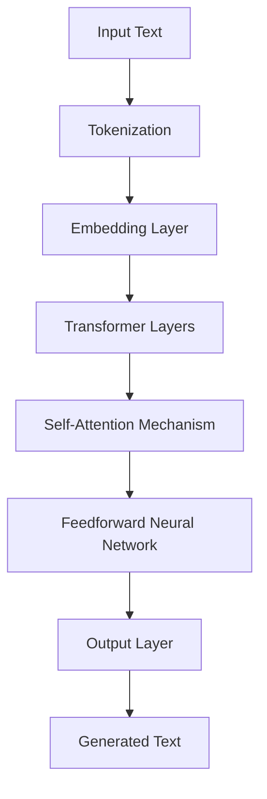

# Lesson 1: Overview of AI Claude API

## 1. First-Principles Intuition & Invariants

In the realm of artificial intelligence, the Claude API by Anthropic represents a significant milestone in the evolution of conversational AI systems. To fully appreciate its capabilities and potential, it is essential to delve into the foundational principles that underpin its design and operation. At its core, Claude is a large language model (LLM) that has been trained on a diverse corpus of text data, enabling it to generate human-like text based on the input it receives. This capability is rooted in the mathematical and computational invariants that govern the training and inference processes of LLMs.

The Claude API is built upon the principles of deep learning, specifically leveraging transformer architectures. These architectures are characterized by their ability to capture complex patterns and dependencies within large datasets through self-attention mechanisms. The self-attention mechanism allows the model to weigh the importance of different parts of the input data when generating a response, enabling it to produce contextually relevant and coherent text. This is a fundamental invariant that ensures Claude's responses are not only syntactically correct but also semantically meaningful.

Another critical invariant in the Claude API is its ability to handle a wide range of use cases while maintaining consistency and reliability. This is achieved through a combination of advanced natural language processing (NLP) techniques and robust engineering practices. The model is trained to understand and generate text in multiple languages, making it a versatile tool for international applications. Additionally, Claude is designed to adhere to ethical guidelines, ensuring that its outputs are safe, respectful, and free from harmful content. This ethical alignment is a non-negotiable invariant that sets Claude apart from other AI systems.

## 2. Core Architecture & Mechanics

The Claude API is built on a sophisticated architecture that integrates state-of-the-art machine learning techniques with efficient software engineering practices. At the heart of this architecture is the transformer model, which is composed of multiple layers of self-attention mechanisms and feedforward neural networks. Each layer of the transformer model processes the input data in parallel, allowing the model to capture intricate patterns and dependencies within the data.

To illustrate the internal data structures and algorithms of the Claude API, we can use a simplified Mermaid diagram:

In this diagram, the input text is first tokenized into a sequence of tokens, which are then embedded into a high-dimensional vector space. These embeddings are processed through multiple transformer layers, each of which consists of a self-attention mechanism and a feedforward neural network. The self-attention mechanism allows the model to focus on different parts of the input sequence when generating each token of the output, while the feedforward neural network applies non-linear transformations to the output of the self-attention mechanism. Finally, the output layer generates the final sequence of tokens, which is then decoded into human-readable text.

The Claude API also incorporates several advanced techniques to enhance its performance and reliability. One such technique is the use of knowledge distillation, which involves training a smaller, more efficient model to mimic the behavior of a larger, more complex model. This allows the Claude API to achieve high performance while maintaining low latency and resource usage. Another technique is the use of reinforcement learning from human feedback (RLHF), which involves training the model to generate text that aligns with human preferences and values. This ensures that the outputs of the Claude API are not only accurate and informative but also ethical and responsible.

## 3. High-Performance Optimization & Failure Modes

To ensure that the Claude API performs optimally in a wide range of scenarios, it incorporates several high-performance optimizations and failure mitigations. One of the key optimizations is the use of efficient data structures and algorithms, which allow the model to process input data quickly and accurately. For example, the use of sparse matrices and hash tables can significantly reduce the memory footprint and computational overhead of the model.

Another important optimization is the use of parallel processing techniques, which allow the model to leverage multiple CPU cores and GPUs to accelerate the inference process. This is particularly important for handling large-scale applications, such as chatbots and virtual assistants, which require real-time responses. The Claude API is designed to scale seamlessly across multiple nodes, allowing it to handle high volumes of traffic and maintain low latency even under heavy load.

Despite these optimizations, the Claude API is not immune to failure modes. One potential failure mode is the occurrence of adversarial attacks, which involve the manipulation of input data to produce unintended or harmful outputs. To mitigate this risk, the Claude API incorporates several security measures, such as input validation and sanitization, which ensure that only well-formed and safe inputs are processed by the model. Additionally, the Claude API is designed to be robust against common attack vectors, such as buffer overflows and injection attacks, through the use of memory safety techniques and secure coding practices.

Another potential failure mode is the occurrence of ethical violations, which involve the generation of harmful or inappropriate content. To mitigate this risk, the Claude API incorporates several ethical safeguards, such as content filtering and moderation, which ensure that the outputs of the model adhere to ethical guidelines and values. Additionally, the Claude API is designed to be transparent and accountable, allowing users to understand and control the behavior of the model through the use of explainable AI techniques and user feedback mechanisms.

In conclusion, the Claude API by Anthropic represents a powerful and versatile tool for building conversational AI applications. Its capabilities are rooted in the principles of deep learning and NLP, and its architecture is designed to handle a wide range of use cases while maintaining consistency and reliability. Through the use of advanced optimizations and failure mitigations, the Claude API is able to deliver high-performance and ethical outputs, making it a valuable asset for senior software engineers, systems programmers, and domain architects.
