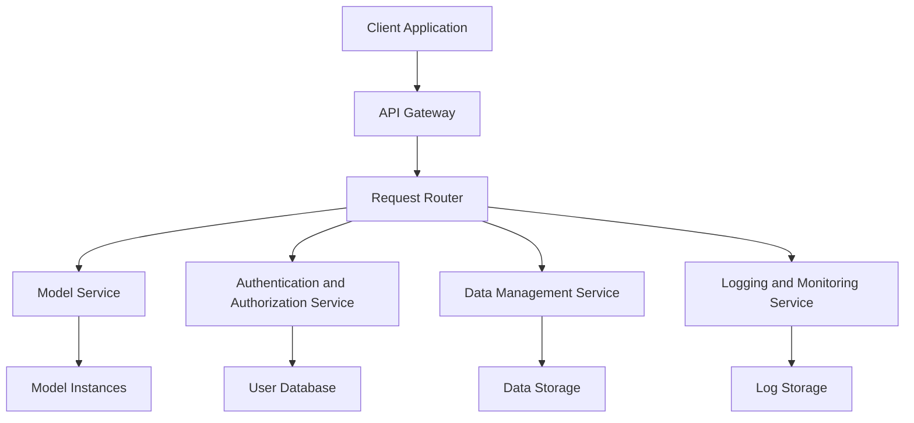

# Lesson 2: Integrating Anthropic API into Applications

## 1. First-Principles Intuition & Invariants

Integrating the Anthropic API into software applications represents a pivotal juncture in the evolution of intelligent systems. This integration is not merely about appending a new feature but about embedding a sophisticated decision-making engine that can interpret, generate, and interact with human language. To fully grasp the implications and nuances of this integration, it is essential to delve into the foundational principles that underpin the Anthropic API and its role within the broader landscape of artificial intelligence.

At its core, the Anthropic API is a manifestation of advanced natural language processing (NLP) capabilities, designed to facilitate seamless interaction between machines and humans. The API leverages state-of-the-art models trained on vast corpora of text data, enabling tasks such as text generation, sentiment analysis, language translation, and conversational agents. The theoretical grounding of these models is rooted in deep learning, specifically in the domain of transformer architectures, which have revolutionized NLP by providing a robust framework for understanding and generating human-like text.

The problem space addressed by the Anthropic API is multifaceted. On one hand, it seeks to enhance user experiences by providing intelligent and contextually relevant interactions. On the other hand, it aims to automate complex tasks that require human-like understanding and decision-making. The invariants that govern the integration of the Anthropic API into applications are centered around reliability, scalability, and security. These invariants ensure that the API can be seamlessly integrated into existing systems, handle large volumes of data, and maintain the integrity and confidentiality of user interactions.

To achieve these invariants, the Anthropic API is designed with a modular architecture that allows for flexible integration. It provides a well-defined interface that abstracts the complexities of the underlying models, enabling developers to focus on building applications rather than delving into the intricacies of NLP. The API supports various programming languages and frameworks, ensuring broad compatibility and ease of use. Additionally, the Anthropic API includes robust error handling and logging mechanisms, which are crucial for diagnosing and resolving issues that may arise during integration.

## 2. Core Architecture & Mechanics

The core architecture of the Anthropic API is built around a microservices-based design, which allows for efficient scaling and maintenance. The API is composed of several key components, each responsible for a specific aspect of its functionality. These components interact through well-defined interfaces, ensuring loose coupling and high modularity.

### 1. **Model Service**

The Model Service is the heart of the Anthropic API, housing the NLP models that power its capabilities. These models are trained on diverse datasets and are capable of performing a wide range of tasks, from text generation to sentiment analysis. The Model Service is designed to be highly scalable, leveraging containerization and orchestration technologies to manage the deployment and scaling of models. This ensures that the API can handle varying loads and provide consistent performance.

### 2. **Request Router**

The Request Router is responsible for routing incoming API requests to the appropriate model service. It acts as a load balancer, distributing requests across multiple instances of the Model Service to ensure efficient utilization of resources. The Request Router also includes a caching mechanism to reduce latency and improve performance for frequently requested queries.

### 3. **Authentication and Authorization Service**

The Authentication and Authorization Service ensures that only authorized users can access the Anthropic API. It implements a robust authentication mechanism, such as OAuth2, to verify user identities. Additionally, it enforces access control policies to ensure that users have the appropriate permissions to perform specific actions. This service plays a critical role in maintaining the security and integrity of the API.

### 4. **Data Management Service**

The Data Management Service is responsible for managing the data that is processed by the Anthropic API. It includes mechanisms for data ingestion, storage, and retrieval, ensuring that data is handled efficiently and securely. The Data Management Service also includes data validation and cleansing mechanisms to ensure that the data processed by the API is of high quality.

### 5. **Logging and Monitoring Service**

The Logging and Monitoring Service is responsible for collecting and analyzing logs generated by the Anthropic API. It provides real-time monitoring of the API's performance and health, allowing for proactive issue resolution. The Logging and Monitoring Service also includes alerting mechanisms to notify administrators of any anomalies or issues that may arise.

To illustrate the architecture of the Anthropic API, we can use a Mermaid diagram:

In this diagram, the Client Application sends requests to the API Gateway, which routes them to the Request Router. The Request Router then forwards the requests to the appropriate services, including the Model Service, Authentication and Authorization Service, Data Management Service, and Logging and Monitoring Service. The Model Service processes the requests using the underlying NLP models, while the other services handle authentication, data management, and logging.

## 3. High-Performance Optimization & Failure Modes

Integrating the Anthropic API into applications requires careful consideration of high-performance optimization and failure modes. The API is designed to handle large volumes of data and provide consistent performance, but there are several factors that can impact its performance and reliability.

### 1. **Concurrency**

Concurrency is a critical aspect of high-performance optimization in the Anthropic API. The API is designed to handle multiple requests simultaneously, leveraging containerization and orchestration technologies to manage the deployment and scaling of services. The Request Router acts as a load balancer, distributing requests across multiple instances of the Model Service to ensure efficient utilization of resources. This allows the API to handle varying loads and provide consistent performance.

### 2. **Resource Scaling**

Resource scaling is another critical aspect of high-performance optimization in the Anthropic API. The API is designed to be highly scalable, leveraging containerization and orchestration technologies to manage the deployment and scaling of services. The Model Service, in particular, is designed to handle large volumes of data and provide consistent performance. The Request Router includes a caching mechanism to reduce latency and improve performance for frequently requested queries.

### 3. **Boundary Edge Cases**

Boundary edge cases are a critical aspect of high-performance optimization and failure modes in the Anthropic API. The API is designed to handle a wide range of inputs and edge cases, but there are several scenarios that can impact its performance and reliability. For example, the API may experience performance degradation when processing large volumes of data or when handling complex queries. Additionally, the API may experience failures when processing malformed requests or when encountering unexpected errors.

### 4. **Failure Mitigations**

Failure mitigations are a critical aspect of high-performance optimization and failure modes in the Anthropic API. The API includes robust error handling and logging mechanisms to diagnose and resolve issues that may arise during integration. The Logging and Monitoring Service provides real-time monitoring of the API's performance and health, allowing for proactive issue resolution. The Logging and Monitoring Service also includes alerting mechanisms to notify administrators of any anomalies or issues that may arise.

In conclusion, integrating the Anthropic API into applications requires a deep understanding of its core architecture and mechanics, as well as careful consideration of high-performance optimization and failure modes. By leveraging the Anthropic API's modular architecture and robust error handling mechanisms, developers can build intelligent and contextually relevant applications that enhance user experiences and automate complex tasks.
