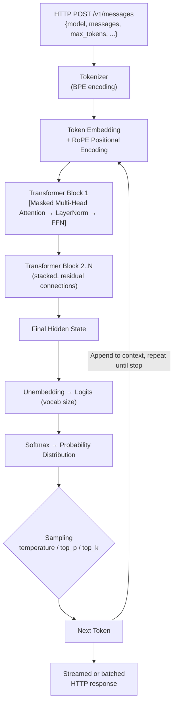
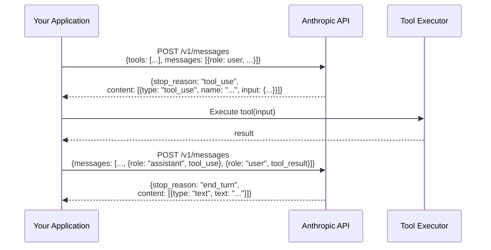
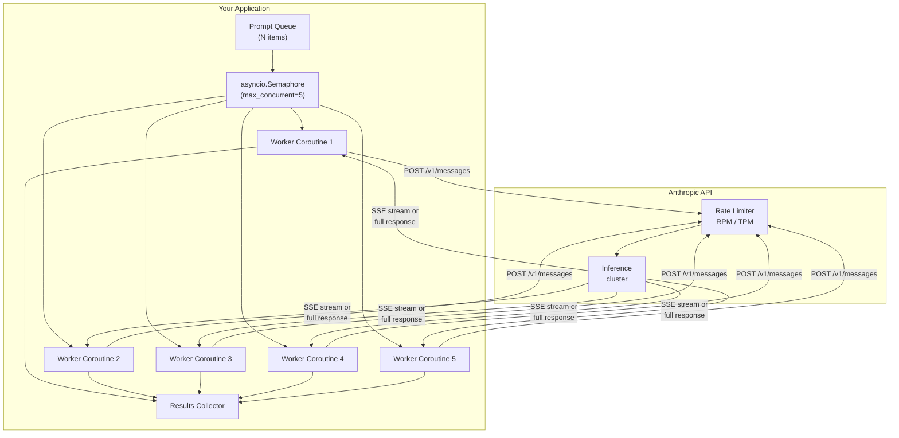
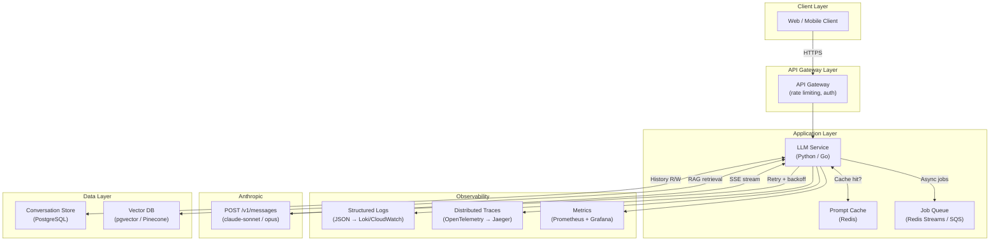

# Lesson 4: Advanced Usage and Optimization of the Anthropic API

---

## 1. First-Principles Architecture: What Claude Actually Is

Before optimizing API usage, you need an accurate mental model of what you are calling. The original lesson's framing — that the Anthropic API is a "Bayesian inference engine" or a "probabilistic modeling engine" — is a category error. Claude is a large language model (LLM) based on the transformer architecture, trained with supervised fine-tuning and reinforcement learning from human feedback (RLHF), specifically a variant Anthropic calls Constitutional AI (CAI). It does not perform Bayesian inference at inference time in any operational sense relevant to API usage.

### What Actually Happens at Inference Time

When you POST a request to `https://api.anthropic.com/v1/messages`, the following computational pipeline executes:

1. **Tokenization**: Your prompt string is segmented into subword tokens using a byte-pair encoding (BPE) vocabulary. Each token maps to an integer ID.
2. **Embedding lookup**: Each token ID is projected into a high-dimensional embedding vector (a dense float tensor of dimension `d_model`).
3. **Positional encoding**: Positional information is injected, allowing the model to distinguish token order. Modern Claude models use rotary positional embeddings (RoPE).
4. **Transformer forward pass**: The embedding sequence is passed through `N` stacked transformer decoder blocks. Each block applies:
   - Multi-head causal self-attention (masked so each position only attends to preceding positions)
   - Layer normalization
   - A position-wise feed-forward network (FFN), typically with a SwiGLU activation
5. **Language modeling head**: The final hidden state for the last token position is projected through an unembedding matrix to produce logits over the vocabulary.
6. **Sampling**: A probability distribution is computed via softmax over logits, then a token is sampled. The process repeats autoregressively until a stop condition is met.

The only "probabilistic" mechanism at your disposal as an API consumer is the `temperature` and `top_p` / `top_k` sampling parameters, which control the shape of the sampling distribution over the vocabulary at each step.



The backward pass (gradient descent, backpropagation) described in the original lesson is a training-time operation. It does not occur during inference and is entirely opaque to API consumers. Conflating training mechanics with inference mechanics is a common source of confusion and incorrect optimization strategies.

### Constitutional AI and RLHF: The Behavioral Layer

Claude's response tendencies — helpfulness, harmlessness, refusals — are shaped by Constitutional AI, Anthropic's training methodology. During fine-tuning, the model is trained against a set of explicit principles (a "constitution") via AI feedback, then further refined with RLHF. For API consumers, this matters because:

- **System prompts are not arbitrary strings**. They are processed in the same context window as user messages, but the model has been trained to weight them as behavioral constraints. Anthropic processes the `system` field separately from the `messages` array in the API, but both are part of the same token context.
- **Refusals are not bugs**. They are model outputs shaped by fine-tuning. If you are hitting consistent refusals for a legitimate use case, re-examine your prompt framing, not the sampling parameters.
- **Model variants differ in capability and policy**. `claude-opus-4`, `claude-sonnet-4`, and `claude-haiku-3-5` are distinct checkpoints with different context windows, capability profiles, and cost/latency characteristics.

---

## 2. The Anthropic Messages API: Authoritative Reference

Anthropic provides one primary inference endpoint: `POST /v1/messages`. The older `POST /v1/complete` (text completion) endpoint is deprecated and should not be used in new code.

### Request Schema

```python
# Full production-grade request using the official anthropic Python SDK
import anthropic
import os

client = anthropic.Anthropic(api_key=os.environ["ANTHROPIC_API_KEY"])

response = client.messages.create(
    model="claude-opus-4-5",             # Required. Use the exact model string from Anthropic's docs.
    max_tokens=4096,                      # Required. Hard ceiling on generated tokens.
    system="You are a terse, precise technical assistant.",  # Optional system prompt.
    messages=[
        {
            "role": "user",
            "content": "Explain the difference between TCP and UDP at the socket level."
        }
    ],
    temperature=0.3,          # 0.0–1.0. Lower = more deterministic. Default: 1.0.
    top_p=0.9,                # Nucleus sampling. Mutually exclusive with top_k in practice.
    top_k=40,                 # Sample from top-k tokens by probability.
    stop_sequences=["\n\n"],  # Optional list of strings that halt generation.
    stream=False,             # Set True for streaming (see below).
    # metadata={"user_id": "user-abc123"},  # Optional. For abuse tracking.
)

print(response.content[0].text)
print(f"Input tokens:  {response.usage.input_tokens}")
print(f"Output tokens: {response.usage.output_tokens}")
print(f"Stop reason:   {response.stop_reason}")  # "end_turn", "max_tokens", "stop_sequence"
```

### Multi-Turn Conversation State

The Messages API is **stateless**. The API does not maintain session state between requests. The entire conversation history must be included in every request.

```python
# Production multi-turn conversation with explicit history management
from anthropic import Anthropic
from typing import List

client = Anthropic()

def chat(
    history: List[dict],
    user_message: str,
    model: str = "claude-sonnet-4-5",
    system: str = "",
    max_tokens: int = 2048,
) -> tuple[str, List[dict]]:
    """
    Sends a message, appends to history, and returns the assistant reply
    along with the updated history. Callers own the history list.
    """
    history.append({"role": "user", "content": user_message})

    kwargs = {
        "model": model,
        "max_tokens": max_tokens,
        "messages": history,
    }
    if system:
        kwargs["system"] = system

    response = client.messages.create(**kwargs)
    assistant_reply = response.content[0].text

    history.append({"role": "assistant", "content": assistant_reply})
    return assistant_reply, history


if __name__ == "__main__":
    history: List[dict] = []
    system = "You are an expert systems programmer. Answer concisely."

    topics = [
        "What is a file descriptor?",
        "How does dup2() use them?",
        "What happens to file descriptors across a fork()?",
    ]

    for topic in topics:
        reply, history = chat(history, topic, system=system)
        print(f"User:      {topic}")
        print(f"Assistant: {reply}\n")
        print(f"[Context window: ~{sum(len(m['content']) for m in history)} chars accumulated]")
```

The critical invariant: input token cost scales linearly with conversation length. A 10-turn conversation where each turn is 500 tokens means turn 10 costs ~10× more input tokens than turn 1.

### Multimodal Input: Vision

Claude models support image input directly in the `content` array. Images are embedded as base64 data or referenced via URL.

```python
import anthropic
import base64
from pathlib import Path

def analyze_image(image_path: str, question: str) -> str:
    client = anthropic.Anthropic()

    image_data = base64.standard_b64encode(Path(image_path).read_bytes()).decode("utf-8")
    # Supported media types: image/jpeg, image/png, image/gif, image/webp
    media_type = "image/png"

    response = client.messages.create(
        model="claude-opus-4-5",
        max_tokens=1024,
        messages=[
            {
                "role": "user",
                "content": [
                    {
                        "type": "image",
                        "source": {
                            "type": "base64",
                            "media_type": media_type,
                            "data": image_data,
                        },
                    },
                    {
                        "type": "text",
                        "text": question,
                    },
                ],
            }
        ],
    )
    return response.content[0].text
```

---

## 3. Streaming: Architecture and Correct Implementation

Streaming is not merely a UX optimization — it is a fundamental change in the HTTP transport model. Without streaming, the TCP connection is held open until the entire response is generated server-side, then the full payload is delivered. With streaming, the server sends Server-Sent Events (SSE) as each token is generated.

### Why Streaming Matters for Latency

Time-to-first-token (TTFT) is the latency between sending the request and receiving the first visible output byte. For a response with 1,000 output tokens at a generation speed of 50 tok/s:

| Mode | TTFT | Total visible latency |
|---|---|---|
| Non-streaming | ~20 seconds | ~20 seconds |
| Streaming | ~200ms (first token) | ~20 seconds (but user sees progress) |

For any user-facing application, streaming is non-negotiable.

### SSE Event Types

The streaming endpoint emits the following event types in sequence:

```
event: message_start         # Contains full Message object (empty content)
event: content_block_start   # Marks start of a content block (text, tool_use, etc.)
event: ping                  # Keepalive. Ignore for content processing.
event: content_block_delta   # Contains the incremental text delta
event: content_block_stop    # Marks end of a content block
event: message_delta         # Contains stop_reason and usage stats
event: message_stop          # Terminal event
```

```python
import anthropic
import sys

client = anthropic.Anthropic()

def stream_response(prompt: str, model: str = "claude-sonnet-4-5") -> str:
    """
    Streams a response, printing tokens as they arrive.
    Returns the complete accumulated text.
    """
    full_text = ""
    input_tokens = 0
    output_tokens = 0

    with client.messages.stream(
        model=model,
        max_tokens=2048,
        messages=[{"role": "user", "content": prompt}],
    ) as stream:
        for text_delta in stream.text_stream:
            print(text_delta, end="", flush=True)
            full_text += text_delta

        # Final message contains usage stats
        final_message = stream.get_final_message()
        input_tokens = final_message.usage.input_tokens
        output_tokens = final_message.usage.output_tokens

    print()  # newline after stream ends
    print(f"\n[Usage] in={input_tokens} out={output_tokens}", file=sys.stderr)
    return full_text


if __name__ == "__main__":
    stream_response("Write a detailed explanation of POSIX file locking mechanisms.")
```

### Low-Level SSE Streaming in Go

For services where you control the full HTTP stack, here is a production-grade Go implementation using the raw API:

```go
package main

import (
	"bufio"
	"bytes"
	"encoding/json"
	"fmt"
	"io"
	"net/http"
	"os"
	"strings"
)

const anthropicAPIURL = "https://api.anthropic.com/v1/messages"
const anthropicVersion = "2023-06-01"

type Message struct {
	Role    string `json:"role"`
	Content string `json:"content"`
}

type RequestBody struct {
	Model     string    `json:"model"`
	MaxTokens int       `json:"max_tokens"`
	Messages  []Message `json:"messages"`
	Stream    bool      `json:"stream"`
}

type ContentBlockDelta struct {
	Type  string `json:"type"`
	Index int    `json:"index"`
	Delta struct {
		Type string `json:"type"`
		Text string `json:"text"`
	} `json:"delta"`
}

func streamCompletion(prompt string) error {
	apiKey := os.Getenv("ANTHROPIC_API_KEY")
	if apiKey == "" {
		return fmt.Errorf("ANTHROPIC_API_KEY not set")
	}

	body := RequestBody{
		Model:     "claude-sonnet-4-5",
		MaxTokens: 1024,
		Messages:  []Message{{Role: "user", Content: prompt}},
		Stream:    true,
	}

	bodyBytes, err := json.Marshal(body)
	if err != nil {
		return fmt.Errorf("marshal error: %w", err)
	}

	req, err := http.NewRequest("POST", anthropicAPIURL, bytes.NewReader(bodyBytes))
	if err != nil {
		return fmt.Errorf("request creation error: %w", err)
	}

	req.Header.Set("x-api-key", apiKey)
	req.Header.Set("anthropic-version", anthropicVersion)
	req.Header.Set("content-type", "application/json")

	client := &http.Client{}
	resp, err := client.Do(req)
	if err != nil {
		return fmt.Errorf("HTTP error: %w", err)
	}
	defer resp.Body.Close()

	if resp.StatusCode != http.StatusOK {
		body, _ := io.ReadAll(resp.Body)
		return fmt.Errorf("API error %d: %s", resp.StatusCode, string(body))
	}

	scanner := bufio.NewScanner(resp.Body)
	for scanner.Scan() {
		line := scanner.Text()
		if !strings.HasPrefix(line, "data: ") {
			continue
		}

		data := strings.TrimPrefix(line, "data: ")
		if data == "[DONE]" {
			break
		}

		// We only care about content_block_delta events
		var event struct {
			Type string `json:"type"`
		}
		if err := json.Unmarshal([]byte(data), &event); err != nil {
			continue
		}

		if event.Type == "content_block_delta" {
			var delta ContentBlockDelta
			if err := json.Unmarshal([]byte(data), &delta); err == nil {
				if delta.Delta.Type == "text_delta" {
					fmt.Print(delta.Delta.Text)
				}
			}
		}
	}
	fmt.Println()
	return scanner.Err()
}

func main() {
	if err := streamCompletion("Explain epoll vs select for high-concurrency I/O in Linux."); err != nil {
		fmt.Fprintf(os.Stderr, "Error: %v\n", err)
		os.Exit(1)
	}
}
```

---

## 4. Tool Use (Function Calling): Architecture and Implementation

Tool use allows Claude to request execution of external functions rather than generating a text answer directly. This is the primary mechanism for grounding LLM outputs in real data sources, computational tools, or business logic.

### Protocol Flow



The critical architectural point: Claude does not execute tools. It emits a structured `tool_use` block containing the function name and arguments as JSON. Your application is responsible for dispatching to the actual implementation, capturing the result, and returning it in a `tool_result` content block with the matching `tool_use_id`.

### Production Tool Use Implementation

```python
import anthropic
import json
import subprocess
from typing import Any

client = anthropic.Anthropic()

# --- Tool definitions (JSON Schema) ---
tools = [
    {
        "name": "run_shell_command",
        "description": (
            "Executes a read-only shell command and returns stdout. "
            "Only safe, non-destructive commands are permitted. "
            "Do not use for commands that modify system state."
        ),
        "input_schema": {
            "type": "object",
            "properties": {
                "command": {
                    "type": "string",
                    "description": "The shell command to execute. Must be non-destructive."
                }
            },
            "required": ["command"],
        },
    },
    {
        "name": "get_file_contents",
        "description": "Returns the contents of a local file given its path.",
        "input_schema": {
            "type": "object",
            "properties": {
                "path": {
                    "type": "string",
                    "description": "Absolute or relative path to the file."
                }
            },
            "required": ["path"],
        },
    },
]

# --- Tool executor (your code, not Anthropic's) ---
ALLOWED_COMMANDS = {"uname", "hostname", "date", "df", "uptime", "ps", "ls", "cat"}

def execute_tool(name: str, tool_input: dict[str, Any]) -> str:
    """Dispatch tool calls to their implementations with basic security controls."""
    if name == "run_shell_command":
        cmd = tool_input["command"]
        # Minimal allowlist guard — replace with proper sandboxing in production
        base_cmd = cmd.split()[0]
        if base_cmd not in ALLOWED_COMMANDS:
            return f"Error: Command '{base_cmd}' is not in the allowed list."
        try:
            result = subprocess.run(
                cmd, shell=True, capture_output=True, text=True, timeout=5
            )
            return result.stdout or result.stderr or "(no output)"
        except subprocess.TimeoutExpired:
            return "Error: Command timed out."
        except Exception as e:
            return f"Error: {e}"

    elif name == "get_file_contents":
        path = tool_input["path"]
        try:
            with open(path, "r") as f:
                return f.read()
        except FileNotFoundError:
            return f"Error: File not found: {path}"
        except PermissionError:
            return f"Error: Permission denied: {path}"
        except Exception as e:
            return f"Error: {e}"

    return f"Error: Unknown tool '{name}'"


def run_agentic_loop(user_query: str) -> str:
    """
    Runs the tool-use agentic loop until Claude reaches end_turn
    or a maximum iteration limit.
    """
    messages = [{"role": "user", "content": user_query}]
    max_iterations = 10  # Prevent runaway loops

    for iteration in range(max_iterations):
        response = client.messages.create(
            model="claude-opus-4-5",
            max_tokens=4096,
            tools=tools,
            messages=messages,
        )

        # Append the full assistant message (may contain text + tool_use blocks)
        messages.append({"role": "assistant", "content": response.content})

        if response.stop_reason == "end_turn":
            # Extract the final text response
            for block in response.content:
                if block.type == "text":
                    return block.text
            return "(No text in final response)"

        if response.stop_reason != "tool_use":
            return f"Unexpected stop reason: {response.stop_reason}"

        # Process all tool_use blocks in this response
        tool_results = []
        for block in response.content:
            if block.type == "tool_use":
                print(f"[Tool call] {block.name}({json.dumps(block.input)})")
                result = execute_tool(block.name, block.input)
                print(f"[Tool result] {result[:200]}...")
                tool_results.append({
                    "type": "tool_result",
                    "tool_use_id": block.id,
                    "content": result,
                })

        # Return all tool results in a single user message
        messages.append({"role": "user", "content": tool_results})

    return "Error: Exceeded maximum iteration limit."


if __name__ == "__main__":
    answer = run_agentic_loop(
        "What operating system is this running on, and how much disk space is available?"
    )
    print(f"\nFinal answer:\n{answer}")
```

---

## 5. Context Window Management and Token Optimization

### Context Window Limits by Model

As of mid-2025, Anthropic's production models have the following context windows:

| Model | Context Window | Max Output Tokens |
|---|---|---|
| claude-opus-4-5 | 200,000 tokens | 32,000 |
| claude-sonnet-4-5 | 200,000 tokens | 64,000 |
| claude-haiku-3-5 | 200,000 tokens | 8,192 |

A "token" in Claude's BPE vocabulary is roughly 3–4 characters of English text, or approximately 0.75 words. 1,000 tokens ≈ 750 words. Code is typically more token-dense than prose.

### The Token Cost Accumulation Problem

In a multi-turn application, every request re-sends the entire conversation history. This creates a quadratic cost profile relative to conversation turns if each turn has similar token volume.

```
Turn 1:  500 tokens in  → $0.0015
Turn 5:  2,500 tokens in → $0.0075
Turn 20: 10,000 tokens in → $0.030
```

The strategies to manage this:

**1. Sliding Window Truncation**: Discard the oldest messages once the context exceeds a threshold. Simple but loses early context, which may be important.

```python
def truncate_history(
    messages: list[dict],
    max_tokens: int = 100_000,
    chars_per_token: float = 3.5,
) -> list[dict]:
    """
    Drops oldest messages (excluding the first user message) until
    the estimated token count is below max_tokens.
    """
    max_chars = int(max_tokens * chars_per_token)
    while len(messages) > 1:
        total = sum(len(m["content"]) if isinstance(m["content"], str) else
                    sum(len(b.get("text","")) for b in m["content"] if isinstance(b, dict))
                    for m in messages)
        if total <= max_chars:
            break
        # Remove second message (preserve the first user turn)
        messages.pop(1)
    return messages
```

**2. Summarization**: Replace a block of old messages with a single summary, generated by a cheap model (e.g., Haiku).

```python
def summarize_history_block(messages: list[dict]) -> dict:
    """Summarizes a block of messages into a single system-injected summary."""
    transcript = "\n".join(
        f"{m['role'].upper()}: {m['content']}"
        for m in messages
        if isinstance(m["content"], str)
    )
    response = client.messages.create(
        model="claude-haiku-3-5",
        max_tokens=512,
        messages=[{
            "role": "user",
            "content": f"Summarize this conversation concisely, preserving key facts:\n\n{transcript}",
        }],
    )
    return {
        "role": "user",
        "content": f"[Previous conversation summary]: {response.content[0].text}",
    }
```

**3. Prompt Caching**: Anthropic supports prompt caching, which allows stable prefixes (system prompts, long documents, tool definitions) to be cached server-side. Cached tokens are billed at a significantly reduced rate on re-use. Mark a content block with `"cache_control": {"type": "ephemeral"}` to request caching.

```python
response = client.messages.create(
    model="claude-opus-4-5",
    max_tokens=1024,
    system=[
        {
            "type": "text",
            "text": very_long_system_prompt,  # e.g., 50,000 tokens of documentation
            "cache_control": {"type": "ephemeral"},  # Cache this prefix
        }
    ],
    messages=[{"role": "user", "content": user_question}],
)
```

The cache TTL is approximately 5 minutes. Requests within the TTL reuse the cached KV state, reducing both latency and cost.

---

## 6. Concurrency, Rate Limits, and Retry Architecture

### Anthropic Rate Limit Tiers

Anthropic enforces rate limits on two dimensions simultaneously:

- **RPM (Requests per Minute)**: Number of API calls per minute.
- **TPM (Tokens per Minute)**: Total input + output tokens per minute.
- **TPD (Tokens per Day)**: Total tokens per day (applies to some tiers).

Rate limits vary by usage tier (Tier 1 through 4, plus custom enterprise agreements). Exceeding either limit returns HTTP 429 with a `Retry-After` header.

### Production Retry Logic with Exponential Backoff

The correct response to a 429 or 529 (overloaded) is exponential backoff with jitter. Naive fixed-interval retry creates thundering herd problems.

```python
import anthropic
import time
import random
import logging
from typing import Any

logger = logging.getLogger(__name__)

def call_with_retry(
    client: anthropic.Anthropic,
    max_retries: int = 5,
    base_delay: float = 1.0,
    max_delay: float = 60.0,
    **kwargs: Any,
) -> anthropic.types.Message:
    """
    Calls client.messages.create with exponential backoff + full jitter.
    Raises the last exception if all retries are exhausted.
    """
    last_exception = None

    for attempt in range(max_retries):
        try:
            return client.messages.create(**kwargs)

        except anthropic.RateLimitError as e:
            last_exception = e
            # Respect the Retry-After header if present
            retry_after = float(e.response.headers.get("retry-after", 0))
            delay = max(retry_after, base_delay * (2 ** attempt))
            # Full jitter: sleep for a random duration in [0, delay]
            jitter_delay = random.uniform(0, min(delay, max_delay))
            logger.warning(
                "Rate limit hit (attempt %d/%d). Retrying in %.2fs.",
                attempt + 1, max_retries, jitter_delay,
            )
            time.sleep(jitter_delay)

        except anthropic.APIStatusError as e:
            if e.status_code == 529:  # Overloaded
                last_exception = e
                delay = min(base_delay * (2 ** attempt), max_delay)
                jitter_delay = random.uniform(0, delay)
                logger.warning(
                    "API overloaded (attempt %d/%d). Retrying in %.2fs.",
                    attempt + 1, max_retries, jitter_delay,
                )
                time.sleep(jitter_delay)
            else:
                raise  # Non-retriable errors propagate immediately

        except (anthropic.APIConnectionError, anthropic.APITimeoutError) as e:
            last_exception = e
            delay = min(base_delay * (2 ** attempt), max_delay)
            jitter_delay = random.uniform(0, delay)
            logger.warning(
                "Connection error (attempt %d/%d). Retrying in %.2fs.",
                attempt + 1, max_retries, jitter_delay,
            )
            time.sleep(jitter_delay)

    raise last_exception
```

### Concurrent Request Processing with asyncio

For batch workloads (processing many independent inputs), use asyncio with a semaphore to bound concurrency and avoid spiking TPM:

```python
import asyncio
import anthropic
from typing import Sequence

async def process_batch(
    prompts: Sequence[str],
    model: str = "claude-haiku-3-5",
    max_concurrent: int = 5,  # Tune based on your rate limit tier
    max_tokens: int = 512,
) -> list[str]:
    """
    Processes a batch of prompts concurrently, respecting a concurrency cap.
    Returns responses in the same order as the input prompts.
    """
    client = anthropic.AsyncAnthropic()
    semaphore = asyncio.Semaphore(max_concurrent)

    async def call_one(prompt: str) -> str:
        async with semaphore:
            response = await client.messages.create(
                model=model,
                max_tokens=max_tokens,
                messages=[{"role": "user", "content": prompt}],
            )
            return response.content[0].text

    tasks = [asyncio.create_task(call_one(p)) for p in prompts]
    results = await asyncio.gather(*tasks, return_exceptions=True)

    # Surface exceptions rather than silently dropping them
    return [
        r if not isinstance(r, Exception) else f"ERROR: {r}"
        for r in results
    ]


if __name__ == "__main__":
    sample_prompts = [
        "Summarize TCP handshake in one sentence.",
        "What is a semaphore?",
        "Define idempotency.",
        "Explain CAP theorem briefly.",
        "What is a memory barrier?",
    ]
    responses = asyncio.run(process_batch(sample_prompts))
    for prompt, reply in zip(sample_prompts, responses):
        print(f"Q: {prompt}\nA: {reply}\n")
```

### Concurrency Architecture Diagram



---

## 7. Prompt Engineering at the Systems Level

Prompt engineering is not about magic phrases. It is about managing the model's context, activating relevant training distributions, and constraining the output space to match your requirements.

### Role of the System Prompt

The system prompt is processed before the conversation messages and is the primary mechanism for:
- Defining the model's persona and behavioral constraints
- Injecting static context (documentation, API specs, business rules)
- Specifying output format requirements
- Setting the response length contract with the user

```python
SYSTEM_PROMPT = """You are a production database query analyzer.

**Rules:**
- Respond ONLY with valid JSON matching the schema: {"issues": [...], "severity": "low|medium|high", "recommendation": "..."}
- Do not add prose before or after the JSON.
- If the query is safe, return: {"issues": [], "severity": "low", "recommendation": "Query appears safe."}
- Severity: "high" if the query could cause table scans on large tables, missing indexes, or data loss.

**Context:** PostgreSQL 15, tables can have up to 500M rows.
"""

def analyze_query(sql: str) -> dict:
    import json
    response = client.messages.create(
        model="claude-sonnet-4-5",
        max_tokens=512,
        system=SYSTEM_PROMPT,
        messages=[{"role": "user", "content": f"```sql\n{sql}\n```"}],
        temperature=0.0,  # Deterministic output for structured data extraction
    )
    text = response.content[0].text.strip()
    # Strip potential markdown code fences
    if text.startswith("```"):
        text = text.split("```")[1]
        if text.startswith("json"):
            text = text[4:]
    return json.loads(text)
```

### Chain-of-Thought and Extended Thinking

For complex reasoning tasks, instructing Claude to reason step-by-step before answering consistently improves accuracy. Claude's extended thinking feature (available on Opus) exposes a separate `thinking` content block containing the model's internal reasoning chain.

```python
response = client.messages.create(
    model="claude-opus-4-5",
    max_tokens=16000,
    thinking={
        "type": "enabled",
        "budget_tokens": 10000,  # Max tokens Claude can use for internal reasoning
    },
    messages=[{
        "role": "user",
        "content": "Prove that there are infinitely many prime numbers.",
    }],
)

for block in response.content:
    if block.type == "thinking":
        print("=== Internal Reasoning ===")
        print(block.thinking)
    elif block.type == "text":
        print("=== Final Answer ===")
        print(block.text)
```

The `thinking` block is generated first, invisible to the user by default. The subsequent `text` block contains the final response, informed by the reasoning.

---

## 8. Error Taxonomy and Failure Modes

A complete error taxonomy for production systems:

| HTTP Status | SDK Exception | Cause | Action |
|---|---|---|---|
| 400 | `BadRequestError` | Malformed request, invalid parameters, context too long | Fix the request. Do not retry. |
| 401 | `AuthenticationError` | Invalid or missing API key | Check key validity. Alert ops. Do not retry. |
| 403 | `PermissionDeniedError` | Model access not granted for your tier | Contact Anthropic support. |
| 404 | `NotFoundError` | Invalid model string or endpoint | Check model name in Anthropic docs. |
| 422 | `UnprocessableEntityError` | Request is valid JSON but semantically invalid | Fix the request structure. |
| 429 | `RateLimitError` | RPM or TPM exceeded | Exponential backoff + jitter. |
| 500 | `InternalServerError` | Anthropic server error | Retry with backoff. Alert if persistent. |
| 529 | `APIStatusError` (529) | Anthropic API overloaded | Retry with backoff. |

```python
import anthropic

client = anthropic.Anthropic()

def safe_complete(prompt: str) -> str | None:
    try:
        response = client.messages.create(
            model="claude-haiku-3-5",
            max_tokens=256,
            messages=[{"role": "user", "content": prompt}],
        )
        return response.content[0].text

    except anthropic.BadRequestError as e:
        # Often means context window exceeded or invalid content
        logger.error("Bad request: %s", e.message)
        return None

    except anthropic.AuthenticationError:
        logger.critical("API key invalid. Halting.")
        raise SystemExit(1)

    except anthropic.RateLimitError:
        # Caller should use call_with_retry instead
        logger.warning("Rate limited — use retry wrapper.")
        raise

    except anthropic.APIStatusError as e:
        logger.error("Anthropic API error %d: %s", e.status_code, e.message)
        raise

    except anthropic.APIConnectionError as e:
        logger.error("Connection failed: %s", e)
        raise
```

---

## 9. Production System Design: End-to-End Architecture

A complete production deployment of an Anthropic-powered service requires more than API calls. The following architecture illustrates the layers a robust system requires:



### Observability Requirements

Every API call to Anthropic should emit the following telemetry:

```python
import time
import logging
from dataclasses import dataclass, asdict

@dataclass
class LLMCallMetrics:
    model: str
    input_tokens: int
    output_tokens: int
    latency_ms: float
    stop_reason: str
    cache_hit: bool
    error: str | None = None

def instrumented_call(client, **kwargs) -> anthropic.types.Message:
    start = time.monotonic()
    error_str = None
    response = None

    try:
        response = client.messages.create(**kwargs)
        return response
    except Exception as e:
        error_str = type(e).__name__
        raise
    finally:
        latency = (time.monotonic() - start) * 1000
        metrics = LLMCallMetrics(
            model=kwargs.get("model", "unknown"),
            input_tokens=response.usage.input_tokens if response else 0,
            output_tokens=response.usage.output_tokens if response else 0,
            latency_ms=round(latency, 2),
            stop_reason=response.stop_reason if response else "error",
            cache_hit=bool(
                response and
                hasattr(response.usage, "cache_read_input_tokens") and
                response.usage.cache_read_input_tokens > 0
            ) if response else False,
            error=error_str,
        )
        logging.getLogger("llm.metrics").info(asdict(metrics))
```

---

## 10. Cost Modeling and Optimization

Anthropic charges per token on both input and output. Output tokens are more expensive than input tokens. As of mid-2025, representative pricing (verify current rates at anthropic.com):

| Model | Input (per MTok) | Output (per MTok) | Cache Write | Cache Read |
|---|---|---|---|---|
| claude-opus-4-5 | $15.00 | $75.00 | $18.75 | $1.50 |
| claude-sonnet-4-5 | $3.00 | $15.00 | $3.75 | $0.30 |
| claude-haiku-3-5 | $0.80 | $4.00 | $1.00 | $0.08 |

The cost optimization hierarchy, in order of impact:

1. **Model selection**: Switching from Opus to Haiku for a task reduces cost by ~19×. Use the cheapest model that meets your quality bar. Use Haiku for classification, routing, and summarization. Use Opus only for tasks requiring deep reasoning.
2. **Prompt caching**: For applications with large stable prefixes (RAG context, long system prompts, documentation), prompt caching can reduce effective input cost by up to 90% on cached tokens.
3. **Context window management**: Implement summarization or sliding window truncation for long conversations.
4. **Output token control**: Set `max_tokens` as low as your use case permits. Use structured output formats (JSON) rather than verbose prose where possible. Set `temperature=0.0` for structured extraction to reduce sampling variance and enable consistent formatting.
5. **Request batching**: For offline workloads with relaxed latency requirements, the Anthropic Batch API allows async processing at 50% reduced cost and higher throughput limits.

```python
# Batch API for high-volume, latency-tolerant workloads
import anthropic

client = anthropic.Anthropic()

def submit_batch(prompts: list[str]) -> str:
    """Submits a batch job. Returns the batch ID for polling."""
    requests = [
        anthropic.types.message_create_params.MessageCreateParamsNonStreaming(
            custom_id=f"item-{i}",
            params={
                "model": "claude-haiku-3-5",
                "max_tokens": 256,
                "messages": [{"role": "user", "content": p}],
            }
        )
        for i, p in enumerate(prompts)
    ]

    batch = client.messages.batches.create(requests=requests)
    print(f"Batch submitted: {batch.id} ({len(requests)} requests)")
    return batch.id


def poll_batch(batch_id: str) -> list[str]:
    """Polls until batch completes and returns results in order."""
    import time
    while True:
        batch = client.messages.batches.retrieve(batch_id)
        print(f"Status: {batch.processing_status} | "
              f"Completed: {batch.request_counts.succeeded} / "
              f"{batch.request_counts.succeeded + batch.request_counts.errored + batch.request_counts.processing}")
        if batch.processing_status == "ended":
            break
        time.sleep(30)

    results = {}
    for result in client.messages.batches.results(batch_id):
        if result.result.type == "succeeded":
            results[result.custom_id] = result.result.message.content[0].text
        else:
            results[result.custom_id] = f"ERROR: {result.result.error}"

    # Return in original order
    return [results[f"item-{i}"] for i in range(len(results))]
```

---

## Summary

The Anthropic Messages API is a stateless, token-in/token-out HTTP interface to a transformer-based language model. Effective production usage requires:

- **Accurate mental model**: Claude is an autoregressive transformer performing next-token prediction, not a Bayesian inference engine. Training mechanics (backprop, gradient descent) are irrelevant to inference-time API consumers.
- **Stateless protocol mastery**: You own conversation state. Every request pays for the full history in input tokens.
- **Streaming by default**: For user-facing applications, SSE streaming is non-negotiable for perceived latency.
- **Tool use discipline**: Claude proposes tool calls; your code executes them. The agentic loop is your responsibility to bound and secure.
- **Cost-aware model selection**: Use the cheapest model that meets quality requirements. Prompt caching and the Batch API are the two highest-leverage cost levers.
- **Operational rigor**: Rate limit errors require exponential backoff with jitter. All calls must emit structured telemetry for cost accounting and debugging.
