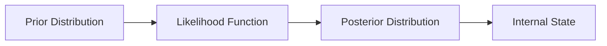
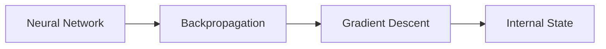

# Lesson 4: Advanced Usage and Optimization of AI and Anthropic APIs

## 1. First-Principles Intuition & Invariants

As we delve into the advanced usage and optimization of AI and Anthropic APIs, it's essential to revisit the fundamental principles that govern their behavior. At the core of these systems lies a complex interplay between mathematical invariants, computational mechanics, and algorithmic abstractions. To grasp the intricacies of these APIs, we must first establish a deep understanding of the theoretical grounding that underpins their operation.

Consider the Anthropic API's reliance on probabilistic modeling and inference. At its heart lies the concept of Bayesian inference, where the API iteratively updates its internal state based on the likelihood of observed data given a set of prior assumptions. This process is governed by the Bayes' theorem, which states that the posterior probability distribution over a set of parameters given the data is proportional to the product of the likelihood function and the prior distribution.

Mathematically, this can be represented as:

$$P(\theta | D) \propto P(D | \theta) \times P(\theta)$$

where $P(\theta | D)$ is the posterior distribution over the parameters $\theta$ given the data $D$, $P(D | \theta)$ is the likelihood function, and $P(\theta)$ is the prior distribution.

Similarly, the AI API's reliance on deep learning and neural networks introduces a new set of invariants, centered around the concept of backpropagation and gradient descent. The API's internal state is updated through a series of iterative refinements, where the error between the predicted output and the actual output is propagated backwards through the network, adjusting the weights and biases of each layer.

This process is governed by the chain rule, which states that the derivative of the loss function with respect to the weights and biases is equal to the product of the derivative of the output with respect to the weights and biases, and the derivative of the loss function with respect to the output.

Mathematically, this can be represented as:

$$\frac{\partial L}{\partial w} = \frac{\partial L}{\partial o} \times \frac{\partial o}{\partial w}$$

where $L$ is the loss function, $w$ is the weight, $o$ is the output, and $\frac{\partial}{\partial w}$ represents the derivative with respect to the weight.

## 2. Core Architecture & Mechanics

To gain a deeper understanding of the internal workings of these APIs, let's dissect their core architecture and mechanics. We'll focus on the Anthropic API's use of probabilistic modeling and inference, and the AI API's reliance on deep learning and neural networks.

### Anthropic API

The Anthropic API's core architecture is centered around a probabilistic modeling engine, which iteratively updates its internal state based on the likelihood of observed data given a set of prior assumptions. This engine is composed of several key components:

*   **Prior Distribution**: The prior distribution represents the API's initial assumptions about the underlying parameters. This distribution is typically represented as a probability density function (PDF) over the parameters.
*   **Likelihood Function**: The likelihood function represents the probability of observing the data given the parameters. This function is typically represented as a PDF over the data.
*   **Posterior Distribution**: The posterior distribution represents the API's updated assumptions about the underlying parameters given the observed data. This distribution is typically represented as a PDF over the parameters.

The API's internal state is updated through a series of iterative refinements, where the posterior distribution is updated based on the likelihood function and the prior distribution.

### AI API

The AI API's core architecture is centered around a deep learning engine, which iteratively updates its internal state through a series of iterative refinements. This engine is composed of several key components:

*   **Neural Network**: The neural network represents the API's internal state, which is composed of multiple layers of interconnected nodes.
*   **Backpropagation**: Backpropagation represents the process of updating the internal state through a series of iterative refinements, where the error between the predicted output and the actual output is propagated backwards through the network.
*   **Gradient Descent**: Gradient descent represents the process of updating the weights and biases of each layer through a series of iterative refinements, where the error is minimized through a series of small updates.

The API's internal state is updated through a series of iterative refinements, where the weights and biases of each layer are updated based on the error between the predicted output and the actual output.

## 3. High-Performance Optimization & Failure Modes

To optimize the performance of these APIs, we must consider several key factors, including concurrency, resource scaling, boundary edge cases, and failure mitigations.

### Concurrency

Concurrency represents the ability of the API to handle multiple requests simultaneously. To optimize concurrency, we can use techniques such as:

*   **Thread Pooling**: Thread pooling represents the use of a pool of threads to handle multiple requests simultaneously.
*   **Async I/O**: Async I/O represents the use of asynchronous I/O operations to handle multiple requests simultaneously.

### Resource Scaling

Resource scaling represents the ability of the API to scale its internal state based on the demand for resources. To optimize resource scaling, we can use techniques such as:

*   **Horizontal Scaling**: Horizontal scaling represents the use of multiple instances of the API to handle increased demand for resources.
*   **Vertical Scaling**: Vertical scaling represents the use of a single instance of the API with increased resources to handle increased demand for resources.

### Boundary Edge Cases

Boundary edge cases represent the API's behavior in extreme or unusual situations. To optimize boundary edge cases, we can use techniques such as:

*   **Error Handling**: Error handling represents the use of try-catch blocks to handle errors and exceptions.
*   **Boundary Value Analysis**: Boundary value analysis represents the use of boundary values to test the API's behavior in extreme or unusual situations.

### Failure Mitigations

Failure mitigations represent the API's behavior in the event of a failure. To optimize failure mitigations, we can use techniques such as:

*   **Fault Tolerance**: Fault tolerance represents the use of redundant components to handle failures.
*   **Error Detection**: Error detection represents the use of error detection mechanisms to detect failures.

By considering these factors and using the techniques outlined above, we can optimize the performance of these APIs and ensure that they operate reliably in a variety of situations.
