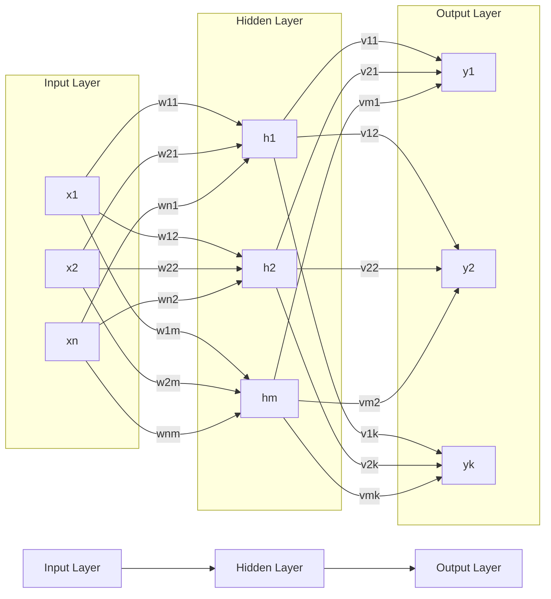

# Lesson 2: Forward Propagation

## 1. First-Principles Intuition & Invariants

In the realm of artificial neural networks, the process of forward propagation is the fundamental mechanism by which input data is transformed into output predictions. This transformation is achieved through a series of mathematical operations that pass the input data through a network of interconnected nodes, or neurons, organized into layers. The essence of forward propagation lies in its ability to compute the output of each neuron in the network, layer by layer, until the final output is generated. This process is both deterministic and reversible, allowing for the computation of gradients during backpropagation, which is crucial for training the network.

At the heart of forward propagation is the concept of a neuron, which can be mathematically modeled as a linear transformation followed by a non-linear activation function. The linear transformation is typically a weighted sum of the inputs, where each input is multiplied by a corresponding weight, and a bias term is added. This weighted sum is then passed through an activation function, which introduces non-linearity into the model, enabling it to learn complex patterns in the data. The choice of activation function is critical, as it determines the network's ability to approximate a wide range of functions and its convergence properties during training.

The invariants of forward propagation are rooted in the mathematical properties of the operations involved. For instance, the linearity of the weighted sum ensures that the network can learn linear relationships between inputs and outputs, while the non-linearity introduced by the activation function allows the network to learn non-linear relationships. These invariants are preserved across all layers of the network, ensuring that the output of each layer serves as the input to the next layer, forming a continuous flow of data through the network.

From a computational perspective, forward propagation is a series of matrix multiplications and element-wise operations. Given an input vector \(\mathbf{x}\) and a weight matrix \(\mathbf{W}\), the output of a layer can be expressed as \(\mathbf{z} = \mathbf{Wx} + \mathbf{b}\), where \(\mathbf{b}\) is the bias vector. The activation function \(\sigma\) is then applied element-wise to \(\mathbf{z}\) to produce the output of the layer, \(\mathbf{a} = \sigma(\mathbf{z})\). This process is repeated for each layer in the network, with the output of one layer serving as the input to the next.

The theoretical grounding of forward propagation is deeply rooted in the field of numerical analysis and optimization. The goal of forward propagation is to compute the output of the network efficiently and accurately, while minimizing computational overhead. This requires careful consideration of the mathematical properties of the operations involved, as well as the numerical stability and precision of the computations. By understanding these invariants, we can design neural networks that are both effective and efficient, capable of learning complex patterns in large datasets.

## 2. Core Architecture & Mechanics

To gain a deeper understanding of forward propagation, let us dissect the internal architecture and mechanics of a multilayer perceptron (MLP). An MLP is a type of feedforward neural network consisting of an input layer, one or more hidden layers, and an output layer. Each layer is composed of neurons, which are connected to the neurons in the next layer through weighted connections.

Consider a simple MLP with an input layer of size \(n\), a single hidden layer of size \(m\), and an output layer of size \(k\). The input vector \(\mathbf{x} \in \mathbb{R}^n\) is passed through the network, layer by layer, until the final output vector \(\mathbf{y} \in \mathbb{R}^k\) is generated. The architecture of this MLP can be visualized using a Mermaid diagram:

In this diagram, the input layer consists of \(n\) neurons, each representing a feature of the input data. The hidden layer consists of \(m\) neurons, each of which is connected to all neurons in the input layer through weighted connections. The output layer consists of \(k\) neurons, each of which is connected to all neurons in the hidden layer through weighted connections. The weights of these connections are represented by the matrices \(\mathbf{W}^{(1)} \in \mathbb{R}^{m \times n}\) and \(\mathbf{W}^{(2)} \in \mathbb{R}^{k \times m}\), where \(\mathbf{W}^{(1)}\) is the weight matrix connecting the input layer to the hidden layer, and \(\mathbf{W}^{(2)}\) is the weight matrix connecting the hidden layer to the output layer.

The forward propagation process begins with the input vector \(\mathbf{x}\), which is passed through the input layer. The output of the input layer is simply the input vector itself, \(\mathbf{a}^{(0)} = \mathbf{x}\). The output of the hidden layer is computed as follows:

\[
\mathbf{z}^{(1)} = \mathbf{W}^{(1)} \mathbf{a}^{(0)} + \mathbf{b}^{(1)}
\]

\[
\mathbf{a}^{(1)} = \sigma(\mathbf{z}^{(1)})
\]

Here, \(\mathbf{z}^{(1)}\) is the weighted sum of the inputs to the hidden layer, \(\mathbf{a}^{(1)}\) is the output of the hidden layer after applying the activation function \(\sigma\), and \(\mathbf{b}^{(1)}\) is the bias vector for the hidden layer. The activation function \(\sigma\) is applied element-wise to \(\mathbf{z}^{(1)}\), introducing non-linearity into the model.

The output of the hidden layer is then passed through the output layer. The output of the output layer is computed as follows:

\[
\mathbf{z}^{(2)} = \mathbf{W}^{(2)} \mathbf{a}^{(1)} + \mathbf{b}^{(2)}
\]

\[
\mathbf{a}^{(2)} = \sigma(\mathbf{z}^{(2)})
\]

Here, \(\mathbf{z}^{(2)}\) is the weighted sum of the inputs to the output layer, \(\mathbf{a}^{(2)}\) is the output of the output layer after applying the activation function \(\sigma\), and \(\mathbf{b}^{(2)}\) is the bias vector for the output layer. The final output of the network is \(\mathbf{a}^{(2)}\).

The choice of activation function \(\sigma\) is critical to the performance of the network. Common activation functions include the sigmoid function, the hyperbolic tangent function, and the rectified linear unit (ReLU) function. The sigmoid function is defined as \(\sigma(z) = \frac{1}{1 + e^{-z}}\), and it maps the input to a value between 0 and 1. The hyperbolic tangent function is defined as \(\sigma(z) = \tanh(z)\), and it maps the input to a value between -1 and 1. The ReLU function is defined as \(\sigma(z) = \max(0, z)\), and it introduces sparsity into the network by setting negative values to zero.

The ReLU function is particularly popular in deep neural networks due to its simplicity and effectiveness. It is computationally efficient, as it only involves a single comparison and a conditional assignment, and it helps to mitigate the vanishing gradient problem, which can occur when using sigmoid or hyperbolic tangent functions. The vanishing gradient problem arises when the gradients of the activation function become very small, making it difficult for the network to learn long-range dependencies in the data.

In summary, the forward propagation process in a multilayer perceptron involves a series of matrix multiplications and element-wise operations, with each layer computing the weighted sum of its inputs, adding a bias term, and applying an activation function. The choice of activation function is critical to the performance of the network, and the ReLU function is particularly popular due to its simplicity and effectiveness.

## 3. High-Performance Optimization & Failure Modes

The performance of forward propagation is critical to the overall efficiency and effectiveness of a neural network. In practice, neural networks can have millions or even billions of parameters, and the forward propagation process can be computationally intensive. Therefore, it is essential to optimize the forward propagation process to minimize computational overhead and maximize throughput.

One of the key optimizations for forward propagation is the use of vectorized operations. Instead of computing the output of each neuron individually, vectorized operations allow us to compute the output of an entire layer in a single operation. This is achieved through the use of matrix multiplications and element-wise operations, which can be efficiently implemented using specialized hardware, such as GPUs or TPUs. By leveraging vectorized operations, we can significantly reduce the computational overhead of forward propagation, enabling us to train larger networks on larger datasets.

Another optimization for forward propagation is the use of efficient memory access patterns. Neural networks typically involve large matrices and vectors, and the performance of forward propagation is heavily dependent on the memory access patterns used to access these data structures. By optimizing memory access patterns, we can reduce cache misses and improve data locality, which can significantly improve the performance of forward propagation. For example, we can use techniques such as loop unrolling and blocking to improve memory access patterns and reduce cache misses.

In addition to optimizing the forward propagation process, it is also essential to consider the failure modes that can arise during forward propagation. One common failure mode is numerical instability, which can occur when the values of the activations become too large or too small. Numerical instability can lead to overflow or underflow errors, which can cause the network to produce incorrect outputs. To mitigate numerical instability, we can use techniques such as normalization and regularization to keep the values of the activations within a reasonable range.

Another failure mode is overfitting, which can occur when the network becomes too complex and starts to memorize the training data instead of learning general patterns. Overfitting can lead to poor generalization performance, where the network performs well on the training data but poorly on new, unseen data. To mitigate overfitting, we can use techniques such as dropout, data augmentation, and early stopping to prevent the network from becoming too complex.

In summary, the performance of forward propagation is critical to the overall efficiency and effectiveness of a neural network. By optimizing the forward propagation process using vectorized operations and efficient memory access patterns, we can significantly reduce computational overhead and maximize throughput. Additionally, by considering the failure modes that can arise during forward propagation, such as numerical instability and overfitting, we can design neural networks that are both effective and robust, capable of learning complex patterns in large datasets.
