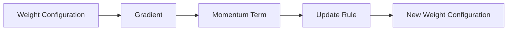

# Lesson 4: Optimization Techniques in Neural Networks

## 1. First-Principles Intuition & Invariants

As we delve into the realm of multilayer perceptrons and backpropagation, it's essential to grasp the fundamental principles governing the optimization of neural networks. At its core, the goal of training a neural network is to minimize the difference between the predicted output and the actual output, while navigating the vast, complex landscape of possible weight configurations.

The problem space is defined by the objective function, typically a mean squared error (MSE) or cross-entropy loss function, which quantifies the discrepancy between the model's predictions and the true labels. The optimization process is an iterative search for the optimal weight configuration that minimizes this objective function.

Mathematically, the optimization problem can be framed as a minimization of the following objective function:

L(w) = E[(y_pred - y_true)^2]

where L(w) is the loss function, w represents the weight configuration, y_pred is the predicted output, and y_true is the actual output.

To navigate this complex landscape, we employ optimization algorithms that iteratively update the weight configuration to minimize the loss function. The choice of optimization algorithm has a profound impact on the training efficiency and model performance.

## 2. Core Architecture & Mechanics

Let's dissect the internal data structures and algorithms used in optimization techniques. We'll focus on the momentum-based optimization algorithm, which is a fundamental building block for more advanced techniques.

Momentum-based optimization uses a combination of the current gradient and the previous gradient to update the weight configuration. This is achieved through the introduction of a momentum term, which is a fraction of the previous gradient.

The update rule for the weight configuration can be expressed as:

w_new = w_old - learning_rate * (gradient + momentum * previous_gradient)

where w_new is the new weight configuration, w_old is the previous weight configuration, learning_rate is the learning rate, gradient is the current gradient, and momentum is the momentum term.

The momentum term helps to smooth out the optimization process, allowing the algorithm to escape local minima and converge to the global minimum.

Here's a simplified Mermaid diagram illustrating the momentum-based optimization algorithm:

## 3. High-Performance Optimization & Failure Modes

As we push the boundaries of optimization techniques, it's essential to consider the high-performance implications and potential failure modes.

Concurrency and resource scaling are critical factors in optimizing neural network training. As the size of the model and dataset grows, the computational requirements increase exponentially. To mitigate this, we can employ distributed training, where the model is split across multiple GPUs or machines.

However, distributed training introduces new challenges, such as communication overhead, synchronization, and data partitioning. To address these challenges, we can employ techniques like data parallelism, model parallelism, and gradient accumulation.

Boundary edge cases and failure modes are also critical considerations. For example, the optimization algorithm may converge to a suboptimal solution due to insufficient exploration of the weight space. To mitigate this, we can employ techniques like regularization, which adds a penalty term to the objective function to discourage overfitting.

In conclusion, optimization techniques in neural networks are a rich and complex field, requiring a deep understanding of the underlying mathematics and algorithms. By grasping the fundamental principles and employing advanced techniques like momentum, adaptive learning rates, and regularization, we can improve training efficiency and model performance.

### Lab Exercise: Implementing Momentum-Based Optimization

Implement the momentum-based optimization algorithm using a deep learning framework like TensorFlow or PyTorch. Experiment with different learning rates, momentum terms, and regularization techniques to observe the impact on training efficiency and model performance.

### Further Reading

* "Deep Learning" by Ian Goodfellow, Yoshua Bengio, and Aaron Courville
* "Neural Networks and Deep Learning" by Michael Nielsen
* "Optimization Techniques for Deep Learning" by Razvan Vadan and Bogdan Ionescu
