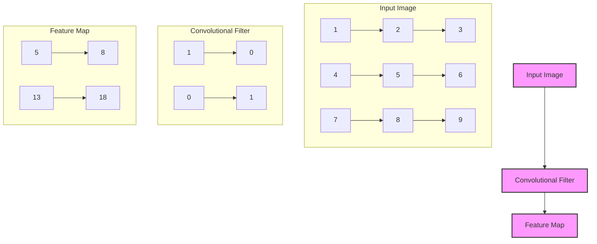

# Lesson 1: Convolutional Layers

## 1. First-Principles Intuition & Invariants

Convolutional Neural Networks (CNNs) are a cornerstone of modern deep learning, particularly in the domain of image processing and computer vision. At their core, CNNs leverage the power of convolutional layers to automatically and adaptively learn spatial hierarchies of features from input images. To fully grasp the mechanics of convolutional layers, we must delve into the fundamental principles that underpin their operation.

The primary invariant of convolutional layers is their ability to capture local patterns and spatial hierarchies within input data. This is achieved through the application of convolutional filters, which slide over the input data to produce feature maps. These feature maps highlight the presence of specific patterns, such as edges, textures, and shapes, at various levels of abstraction. The convolution operation itself is a mathematical operation that combines the input data with the filter through element-wise multiplication and summation, effectively computing a weighted sum of the input data within the filter's receptive field.

The invariance to translation is another critical property of convolutional layers. By applying the same filter across different spatial locations in the input data, convolutional layers can detect features regardless of their position within the image. This property is crucial for tasks such as object recognition, where the location of an object within an image should not affect the network's ability to identify it.

From a mathematical perspective, the convolution operation can be expressed as follows:

\[ (f * g)(x, y) = \sum_{i=-\infty}^{\infty} \sum_{j=-\infty}^{\infty} f(i, j) \cdot g(x-i, y-j) \]

In the context of CNNs, \( f \) represents the input image, and \( g \) represents the convolutional filter. The operation computes the dot product between the filter and the corresponding region of the input image, producing a single scalar value that is placed in the output feature map.

The choice of filter size and the number of filters are critical design decisions that impact the network's ability to learn meaningful features. Larger filters can capture more complex patterns but may also increase the risk of overfitting, especially when the input data is limited. Conversely, smaller filters can capture finer details but may require more filters to learn a comprehensive set of features.

## 2. Core Architecture & Mechanics

The architecture of a convolutional layer is centered around the application of convolutional filters to the input data. Each filter is a small matrix of weights that is applied to the input data through the convolution operation. The filters are learned during the training process, allowing the network to adapt to the specific characteristics of the input data.

To illustrate the mechanics of a convolutional layer, consider a simple example where the input data is a grayscale image with dimensions \( W \times H \), and the convolutional filter has dimensions \( F \times F \). The convolution operation involves sliding the filter over the input image, computing the dot product between the filter and the corresponding region of the input image, and placing the result in the output feature map.

The following Mermaid diagram illustrates the convolution operation:



In this example, the input image is a \( 3 \times 3 \) matrix, and the convolutional filter is a \( 2 \times 2 \) matrix. The convolution operation involves sliding the filter over the input image and computing the dot product between the filter and the corresponding region of the input image. The resulting feature map has dimensions \( 2 \times 2 \), as the filter can only fit in two positions along each dimension of the input image.

The stride parameter is another critical aspect of the convolutional layer architecture. The stride determines the step size by which the filter is moved across the input image. A stride of 1 means that the filter is moved one pixel at a time, while a stride of 2 means that the filter is moved two pixels at a time. Increasing the stride reduces the spatial dimensions of the output feature map, which can help to reduce the computational complexity of the network and the risk of overfitting.

The following Mermaid diagram illustrates the effect of different stride values on the output feature map:

```mermaid
graph TD
    A[Input Image] --> B[Stride 1]
    A --> C[Stride 2]
    B --> D[Feature Map (Stride 1)]
    C --> E[Feature Map (Stride 2)]
    subgraph Input Image
        direction LR
        I1[1] --> I2[2] --> I3[3]
        I4[4] --> I5[5] --> I6[6]
        I7[7] --> I8[8] --> I9[9]
    end
    subgraph Convolutional Filter
        direction LR
        F1[1] --> F2[0]
        F3[0] --> F4[1]
    end
    subgraph Feature Map (Stride 1)
        direction LR
        O1[5] --> O2[8]
        O3[13] --> O4[18]
    end
    subgraph Feature Map (Stride 2)
        direction LR
        O5[5] --> O6[13]
    end
    style A fill:#f9f,stroke:#333,stroke-width:2px
    style B fill:#f9f,stroke:#333,stroke-width:2px
    style C fill:#f9f,stroke:#333,stroke-width:2px
    style D fill:#f9f,stroke:#333,stroke-width:2px
    style E fill:#f9f,stroke:#333,stroke-width:2px
```

In this example, the input image is a \( 3 \times 3 \) matrix, and the convolutional filter is a \( 2 \times 2 \) matrix. The stride parameter is set to 1 and 2, respectively, illustrating the effect of different stride values on the output feature map. A stride of 1 produces a \( 2 \times 2 \) feature map, while a stride of 2 produces a \( 1 \times 1 \) feature map.

## 3. High-Performance Optimization & Failure Modes

Optimizing the performance of convolutional layers is critical for achieving high throughput and low latency in deep learning applications. Several techniques can be employed to improve the performance of convolutional layers, including efficient memory access patterns, parallelization, and hardware acceleration.

One of the primary challenges in optimizing convolutional layers is efficient memory access. Convolutional operations involve accessing large regions of the input data and the filter weights, which can lead to cache misses and increased memory latency. To mitigate this issue, techniques such as spatial blocking and loop tiling can be employed to improve memory locality and reduce cache misses.

Parallelization is another critical aspect of optimizing convolutional layers. Convolutional operations can be parallelized across multiple processing units, such as CPUs, GPUs, and TPUs, to improve throughput and reduce latency. Techniques such as data parallelism and model parallelism can be employed to distribute the workload across multiple processing units, allowing the network to leverage the full computational power of the available hardware.

Hardware acceleration is another critical aspect of optimizing convolutional layers. Modern GPUs and TPUs are designed to accelerate convolutional operations through specialized hardware accelerators, such as tensor cores and matrix multiplication units. These accelerators can significantly improve the performance of convolutional layers by offloading the computationally intensive operations to the hardware.

Despite the many optimizations available, convolutional layers are not immune to failure modes. One common failure mode is overfitting, where the network learns to memorize the training data rather than generalizing to new data. Overfitting can be mitigated through techniques such as regularization, dropout, and data augmentation.

Another common failure mode is vanishing and exploding gradients, which can occur during the training of deep convolutional networks. Vanishing gradients can make it difficult for the network to learn long-range dependencies, while exploding gradients can cause the network to diverge during training. Techniques such as gradient clipping, batch normalization, and careful initialization can be employed to mitigate these issues.

In conclusion, convolutional layers are a fundamental building block of deep learning, enabling the automatic and adaptive learning of spatial hierarchies of features from input data. By understanding the mechanics of convolutional layers, including filters, feature maps, and stride, we can design and optimize deep learning models that are robust, efficient, and effective in solving complex problems in image processing and computer vision.
