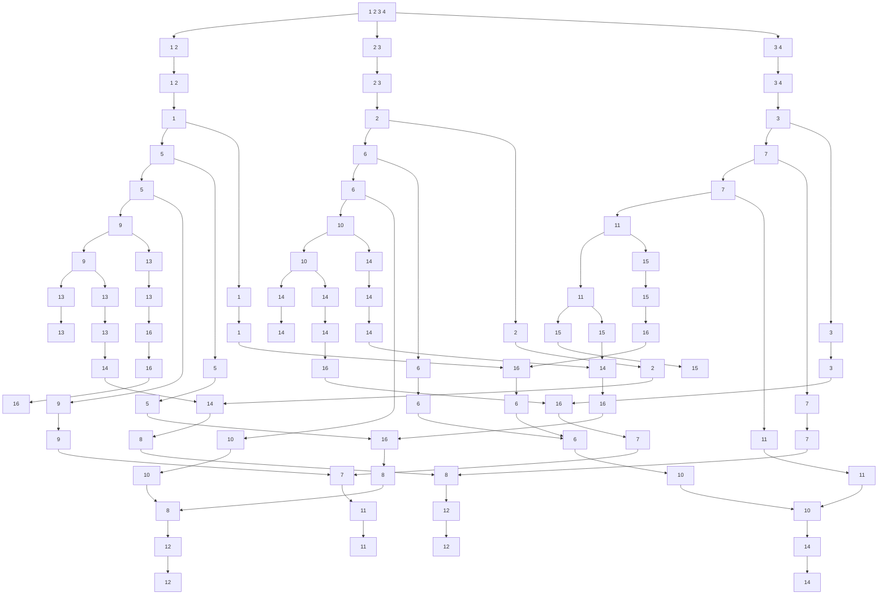

# Lesson 2: Pooling Layers

## 1. First-Principles Intuition & Invariants

In the realm of Convolutional Neural Networks (CNNs), the primary objective is to extract meaningful features from input data, typically images, in a hierarchical manner. As we delve deeper into the network, the features become more abstract and less spatially detailed. This abstraction is crucial for tasks such as image classification, where the network needs to recognize objects regardless of their position within the image. However, as the network processes deeper layers, the spatial dimensions of the feature maps grow larger, leading to increased computational complexity and memory usage. To mitigate this, pooling layers are introduced to reduce the spatial dimensions of the feature maps while retaining the essential information.

Pooling layers serve as downsampling operations that reduce the spatial resolution of the feature maps, thereby decreasing the number of parameters and computations in the network. This reduction is vital for several reasons. Firstly, it helps in controlling overfitting by reducing the model's capacity. Secondly, it makes the network more computationally efficient, allowing for faster training and inference. Lastly, pooling introduces a form of translation invariance, meaning that the network becomes less sensitive to small shifts in the input data.

The two most common types of pooling layers are max pooling and average pooling. Max pooling selects the maximum value within a specified window (or pooling region) of the input feature map, while average pooling computes the average value within the same window. Both techniques effectively reduce the spatial dimensions of the feature maps, but they do so in different ways that can influence the network's performance.

Max pooling is particularly effective in capturing the most salient features within a region, as it retains the highest value, which often corresponds to the most prominent feature. This makes max pooling a popular choice for many CNN architectures. On the other hand, average pooling provides a more balanced representation of the features within a region, which can be beneficial in certain scenarios where the overall distribution of features is more important than the presence of a single dominant feature.

From a mathematical perspective, pooling layers can be described as non-linear operations that apply a specific function (max or average) over a sliding window of the input feature map. The window size and stride (the number of pixels by which the window moves at each step) are hyperparameters that can be tuned to optimize the network's performance. The choice of window size and stride affects the degree of downsampling and the amount of information retained.

## 2. Core Architecture & Mechanics

To understand the mechanics of pooling layers, let us consider a simple example using max pooling. Suppose we have a 4x4 feature map with the following values:

```
| 1 | 2 | 3 | 4 |
|---|---|---|---|
| 5 | 6 | 7 | 8 |
| 9 | 10| 11| 12|
| 13| 14| 15| 16|
```

We apply a 2x2 max pooling operation with a stride of 2. The pooling process involves sliding a 2x2 window over the feature map and selecting the maximum value within each window. The resulting pooled feature map will be 2x2, as shown below:

```
| 6 | 8 |
|---|---|
| 14| 16|
```

The first value in the pooled feature map (6) is the maximum of the values in the top-left 2x2 window (1, 2, 5, 6). The second value (8) is the maximum of the top-right 2x2 window (2, 3, 6, 7), and so on.

To visualize this process, we can use a Mermaid diagram to illustrate the sliding window mechanism:



In this diagram, the nodes represent the values in the feature map, and the edges represent the sliding window mechanism. The max pooling operation selects the maximum value within each 2x2 window, resulting in the pooled feature map.

Average pooling works similarly, but instead of selecting the maximum value, it computes the average value within each window. For the same 4x4 feature map, the average pooling operation with a 2x2 window and stride of 2 would result in the following pooled feature map:

```
| 4.5 | 5.5 |
|-----|-----|
| 11.5| 13.5|
```

The first value in the pooled feature map (4.5) is the average of the values in the top-left 2x2 window (1, 2, 5, 6). The second value (5.5) is the average of the top-right 2x2 window (2, 3, 6, 7), and so on.

## 3. High-Performance Optimization & Failure Modes

The performance of pooling layers is influenced by several factors, including the choice of pooling operation, window size, stride, and the underlying hardware architecture. Max pooling is generally more computationally efficient than average pooling because it involves a simple comparison operation, whereas average pooling requires additional arithmetic operations to compute the mean.

To optimize the performance of pooling layers, it is essential to carefully select the hyperparameters. A larger window size and stride can lead to more aggressive downsampling, which can reduce the computational complexity but may also result in a loss of important spatial information. Conversely, a smaller window size and stride can preserve more spatial details but may increase the computational burden.

In terms of hardware optimization, pooling layers can be efficiently implemented using parallel processing techniques, such as SIMD (Single Instruction, Multiple Data) instructions or GPU acceleration. These techniques leverage the parallel processing capabilities of modern CPUs and GPUs to perform the pooling operations on multiple data points simultaneously, significantly reducing the execution time.

However, pooling layers are not without their failure modes. One common issue is the loss of spatial information, which can occur when the window size and stride are too large. This loss of information can lead to a degradation in the network's performance, especially for tasks that require fine-grained spatial details. To mitigate this issue, it is essential to carefully balance the window size and stride to preserve the necessary spatial information while still achieving the desired level of downsampling.

Another potential failure mode is the introduction of artifacts or distortions in the pooled feature maps. This can occur when the pooling operation is applied to feature maps with high-frequency patterns or noise. To address this issue, it is important to preprocess the input data to remove noise and ensure that the feature maps are smooth and well-behaved.

In conclusion, pooling layers play a crucial role in reducing the spatial dimensions of feature maps in CNNs, thereby decreasing computational complexity and memory usage. By carefully selecting the pooling operation, window size, and stride, and leveraging parallel processing techniques, pooling layers can be optimized for high performance. However, it is essential to be aware of the potential failure modes and take steps to mitigate them to ensure the network's performance and accuracy.
