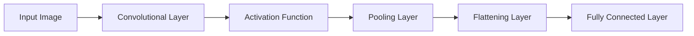

# Lesson 4: Advanced Topics

## 1. First-Principles Intuition & Invariants

Convolutional Neural Networks (CNNs) have revolutionized the field of computer vision, achieving state-of-the-art results in image classification, object detection, and segmentation tasks. However, as we delve deeper into the realm of advanced CNN topics, it's essential to establish a solid theoretical foundation and understand the underlying mathematical and system invariants that govern their behavior.

At its core, a CNN is a type of feedforward neural network that leverages the spatial hierarchy of visual data to extract features. The convolutional and pooling layers are designed to capture local patterns and reduce spatial dimensions, respectively. This hierarchical representation enables the network to learn invariant features that are robust to transformations such as translation, rotation, and scaling.

The problem space for CNNs can be framed as a series of nested optimization problems. The first is the minimization of the loss function, typically cross-entropy or mean squared error, with respect to the model's weights and biases. However, this is not the only objective; we must also consider the regularization of the model's complexity, the handling of overfitting, and the transfer of knowledge from pre-trained models.

Mathematically, the CNN's behavior can be described using the following invariants:

* **Translation invariance**: The network's output should remain unchanged under translations of the input image.
* **Rotation invariance**: The network's output should remain unchanged under rotations of the input image.
* **Scaling invariance**: The network's output should remain unchanged under scaling of the input image.
* **Convolutional invariance**: The network's output should remain unchanged under convolutions of the input image.

These invariants are critical in ensuring that the network learns features that are robust to the aforementioned transformations.

## 2. Core Architecture & Mechanics

Let's dissect the internal data structures and algorithms that govern the behavior of a CNN. We'll focus on the convolutional and pooling layers, which are the building blocks of the network.

In the convolutional layer, we apply a set of learnable filters to the input image, scanning the image in both spatial dimensions. The output is a feature map, which represents the presence of a particular feature at each spatial location.

The pooling layer reduces the spatial dimensions of the feature map, effectively downsampling the image. This is achieved through a set of learnable weights and biases, which are applied to the feature map.

The flattening layer transforms the output of the pooling layer into a one-dimensional vector, which is then fed into the fully connected layer.

## 3. High-Performance Optimization & Failure Modes

As we strive to optimize the performance of our CNN, we must consider the following concurrency, resource scaling, boundary edge cases, and failure mitigations:

* **Concurrency**: We can leverage parallel processing to accelerate the computation of the convolutional and pooling layers. This can be achieved using libraries such as OpenMP or CUDA.
* **Resource scaling**: As the size of the input image increases, we must ensure that the network's resources are scaled accordingly. This can be achieved using techniques such as dynamic memory allocation or resource pooling.
* **Boundary edge cases**: We must consider the behavior of the network at the boundaries of the input image. This can be achieved using techniques such as padding or border handling.
* **Failure mitigations**: We must consider the failure modes of the network, such as overfitting or underfitting. This can be achieved using techniques such as regularization or early stopping.

In conclusion, advanced CNN topics require a deep understanding of the underlying mathematical and system invariants that govern their behavior. By establishing a solid theoretical foundation and leveraging high-performance optimization techniques, we can build robust and efficient CNNs that achieve state-of-the-art results in computer vision tasks.
