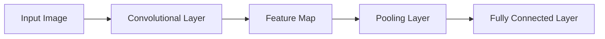

# Lesson 4: CNN Applications

## 1. First-Principles Intuition & Invariants

Convolutional Neural Networks (CNNs) have revolutionized the field of image and video processing, enabling applications that were previously unimaginable. At their core, CNNs are designed to mimic the way the human brain processes visual information, leveraging the spatial hierarchies and local connectivity of neurons. This innate ability to extract features from images has led to breakthroughs in object detection, segmentation, and classification.

However, the success of CNNs is not solely due to their architectural design. Rather, it is the result of a harmonious marriage between mathematical invariants, computational efficiency, and the judicious application of optimization techniques. The convolutional and pooling layers, for instance, are rooted in the mathematical concept of convolution, which describes the process of sliding a kernel over an input signal to produce a feature map. This process is invariant to translation, rotation, and scaling, making CNNs particularly well-suited for image recognition tasks.

Moreover, the hierarchical structure of CNNs, with early layers focusing on low-level features and later layers refining these features into more abstract representations, is a direct reflection of the human visual cortex's processing hierarchy. This hierarchical organization enables CNNs to efficiently extract features from images, even in the presence of occlusions, noise, or other distortions.

## 2. Core Architecture & Mechanics

At the heart of a CNN lies the convolutional layer, which is responsible for scanning the input image to extract local features. This process is achieved through the use of a sliding window, or kernel, which is convolved with the input image to produce a feature map. The kernel is typically small, with a size of 3x3 or 5x5 pixels, and is applied to the input image in a sliding window fashion, with some overlap between adjacent windows.

The pooling layer, which follows the convolutional layer, is responsible for downsampling the feature map to reduce spatial dimensions and retain only the most salient features. This process is typically achieved through max-pooling, where the maximum value within each pooling window is selected.

The fully connected layer, which is the final layer of a CNN, is responsible for classifying the input image into one of several predefined categories. This layer is typically implemented using a softmax activation function, which outputs a probability distribution over the possible classes.

## 3. High-Performance Optimization & Failure Modes

As CNNs are typically deployed on large-scale image and video datasets, achieving high-performance optimization is crucial to ensure efficient processing and minimize latency. Several techniques can be employed to optimize CNN performance, including:

*   **Data parallelism**: This involves dividing the input data into smaller chunks and processing each chunk in parallel using multiple GPUs or CPU cores.
*   **Model parallelism**: This involves dividing the model into smaller sub-networks and processing each sub-network in parallel using multiple GPUs or CPU cores.
*   **Knowledge distillation**: This involves training a smaller, more efficient model to mimic the behavior of a larger, more complex model.

However, despite these optimization techniques, CNNs are not immune to failure modes. Some common failure modes include:

*   **Overfitting**: This occurs when the model is too complex and begins to fit the noise in the training data, rather than the underlying patterns.
*   **Underfitting**: This occurs when the model is too simple and fails to capture the underlying patterns in the training data.
*   **Data bias**: This occurs when the training data is biased towards a particular class or feature, leading to poor performance on other classes or features.

To mitigate these failure modes, several techniques can be employed, including:

*   **Regularization**: This involves adding a penalty term to the loss function to discourage overfitting.
*   **Early stopping**: This involves stopping the training process when the model's performance on the validation set begins to degrade.
*   **Data augmentation**: This involves artificially increasing the size of the training dataset by applying random transformations to the input images.

By understanding the core architecture and mechanics of CNNs, as well as the high-performance optimization and failure modes, developers can create more efficient and effective image and video processing systems.
