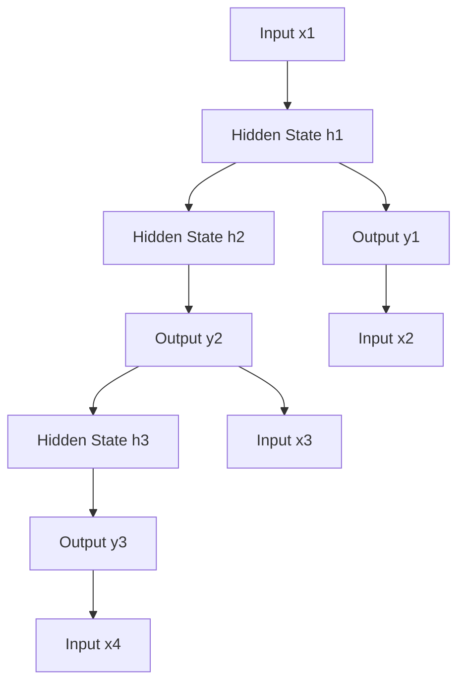

# Lesson 1: Introduction to Recurrent Neural Networks

## 1. First-Principles Intuition & Invariants

Recurrent Neural Networks (RNNs) represent a class of artificial neural networks designed to handle sequential data, where the order and context of the data points are crucial. Unlike traditional feedforward neural networks, which process data in a static manner, RNNs maintain a hidden state that captures information about previous inputs in the sequence. This hidden state is updated as the network processes each new input, allowing the network to exhibit temporal dependencies and memory-like behavior.

The problem space for RNNs is vast and varied, encompassing applications such as natural language processing, speech recognition, time series forecasting, and bioinformatics. In these domains, the sequence of data points is inherently ordered, and the relationships between consecutive elements are often non-trivial. For instance, in natural language processing, understanding the meaning of a sentence requires considering the sequence of words and their grammatical structure. Similarly, in speech recognition, the temporal dynamics of sound waves are essential for accurately transcribing spoken language.

At the heart of RNNs lies the principle of recurrence, which allows the network to retain information about past inputs through its hidden state. This hidden state acts as a memory that is updated iteratively as the network processes each new input in the sequence. The mathematical invariant that underpins this behavior is the recursive update equation of the hidden state, which can be expressed as:

\[ h_t = \sigma(W_h h_{t-1} + W_x x_t + b) \]

where \( h_t \) is the hidden state at time \( t \), \( x_t \) is the input at time \( t \), \( W_h \) and \( W_x \) are weight matrices, \( b \) is a bias vector, and \( \sigma \) is a non-linear activation function such as the hyperbolic tangent or ReLU. This equation captures the essence of recurrence, as the hidden state at time \( t \) depends not only on the current input \( x_t \) but also on the previous hidden state \( h_{t-1} \).

The role of time in sequence prediction is pivotal, as it introduces the concept of temporal dependencies. In many real-world scenarios, the output at a given time step is influenced by the sequence of inputs up to that point. For example, in language modeling, the probability of the next word in a sentence depends on the preceding words. RNNs are well-suited to capturing these temporal dependencies, as they can maintain a memory of past inputs through their hidden state, allowing them to make predictions based on the entire sequence rather than individual data points.

## 2. Core Architecture & Mechanics

The architecture of a Recurrent Neural Network is characterized by its recurrent connections, which allow information to persist across time steps. At each time step \( t \), the network receives an input \( x_t \) and produces an output \( y_t \), while updating its hidden state \( h_t \). The hidden state serves as a memory that captures the information from previous inputs, enabling the network to exhibit temporal dependencies.

To illustrate the core architecture of an RNN, consider the following diagram:

In this diagram, the network processes a sequence of inputs \( x_1, x_2, x_3, x_4 \) and produces corresponding outputs \( y_1, y_2, y_3, y_4 \). The hidden state \( h_t \) is updated at each time step based on the current input \( x_t \) and the previous hidden state \( h_{t-1} \). The recurrent connections (represented by the arrows from \( h_t \) to \( h_{t+1} \)) allow the network to maintain a memory of past inputs, enabling it to capture temporal dependencies.

The mechanics of an RNN can be understood through the recursive update equation of the hidden state:

\[ h_t = \sigma(W_h h_{t-1} + W_x x_t + b) \]

where \( h_t \) is the hidden state at time \( t \), \( x_t \) is the input at time \( t \), \( W_h \) and \( W_x \) are weight matrices, \( b \) is a bias vector, and \( \sigma \) is a non-linear activation function. This equation captures the essence of recurrence, as the hidden state at time \( t \) depends not only on the current input \( x_t \) but also on the previous hidden state \( h_{t-1} \).

The output at each time step \( t \) is generated by applying a linear transformation followed by a non-linear activation function to the hidden state:

\[ y_t = \sigma(W_y h_t + c) \]

where \( y_t \) is the output at time \( t \), \( W_y \) is a weight matrix, and \( c \) is a bias vector. This equation captures the relationship between the hidden state and the output, allowing the network to produce predictions based on the sequence of inputs.

## 3. High-Performance Optimization & Failure Modes

Optimizing the performance of Recurrent Neural Networks involves addressing several challenges, including vanishing and exploding gradients, memory management, and computational efficiency. These challenges arise from the recursive nature of RNNs, which can lead to difficulties in training and inference.

One of the most significant challenges in training RNNs is the vanishing gradient problem, which occurs when the gradients of the loss function with respect to the weights become very small as they are propagated back through time. This can make it difficult for the network to learn long-term dependencies, as the gradients become too small to effectively update the weights. To mitigate this issue, several techniques have been developed, including gradient clipping, which limits the magnitude of the gradients during backpropagation, and the use of specialized architectures such as Long Short-Term Memory (LSTM) networks and Gated Recurrent Units (GRUs), which are designed to capture long-term dependencies more effectively.

Another challenge in training RNNs is the exploding gradient problem, which occurs when the gradients of the loss function with respect to the weights become very large as they are propagated back through time. This can lead to numerical instability and make it difficult to train the network. To mitigate this issue, gradient clipping can also be used, as well as techniques such as weight normalization and layer normalization, which help to stabilize the training process.

Memory management is another important consideration in the optimization of RNNs, as the network must maintain a memory of past inputs through its hidden state. In practice, this can lead to significant memory usage, especially for long sequences. To address this issue, techniques such as truncated backpropagation through time (TBPTT) can be used, which limit the number of time steps that are considered during backpropagation, reducing the memory requirements of the network.

Computational efficiency is also a critical consideration in the optimization of RNNs, as the recursive nature of the network can lead to significant computational overhead. To address this issue, techniques such as parallelization and vectorization can be used to accelerate the training and inference processes. Additionally, specialized hardware accelerators such as GPUs and TPUs can be leveraged to further improve the performance of RNNs.

In terms of failure modes, RNNs can exhibit several issues, including overfitting, underfitting, and poor generalization. Overfitting occurs when the network becomes too complex and fits the training data too closely, leading to poor performance on new data. To mitigate this issue, techniques such as regularization, dropout, and early stopping can be used. Underfitting occurs when the network is too simple and fails to capture the underlying patterns in the data. To mitigate this issue, techniques such as increasing the network complexity, using more expressive architectures, and improving the quality of the training data can be used. Poor generalization occurs when the network fails to perform well on new data, even when it has been trained on a large and diverse dataset. To mitigate this issue, techniques such as data augmentation, transfer learning, and ensemble methods can be used.

In conclusion, Recurrent Neural Networks represent a powerful class of neural networks that are well-suited to handling sequential data. By maintaining a hidden state that captures information about past inputs, RNNs can exhibit temporal dependencies and memory-like behavior, making them ideal for applications such as natural language processing, speech recognition, and time series forecasting. However, optimizing the performance of RNNs involves addressing several challenges, including vanishing and exploding gradients, memory management, and computational efficiency. By understanding the core architecture and mechanics of RNNs, as well as the techniques for optimizing their performance, senior software engineers, systems programmers, and domain architects can effectively leverage these powerful models to solve complex problems in a wide range of domains.
