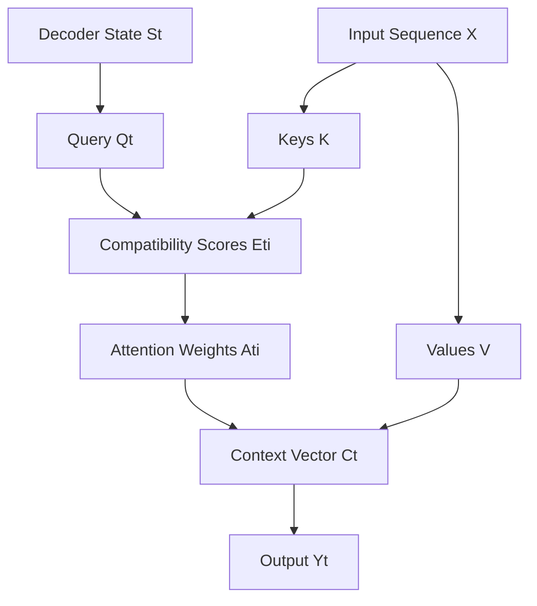

# Lesson 1: Introduction to Attention Mechanisms

## 1. First-Principles Intuition & Invariants

In the realm of artificial intelligence and deep learning, the ability of neural networks to process and generate human-like text has been a pivotal area of research. Traditional sequence-to-sequence models, such as those based on recurrent neural networks (RNNs) and their variants like Long Short-Term Memory (LSTM) and Gated Recurrent Units (GRUs), have been instrumental in tasks like machine translation, text summarization, and speech recognition. However, these models often struggle with long-range dependencies, where information from the beginning of a sequence is crucial for understanding the end. This limitation arises because RNNs process sequences sequentially, which can lead to vanishing or exploding gradients, making it difficult for them to capture dependencies over long distances.

The introduction of attention mechanisms marked a significant breakthrough in addressing these challenges. Attention mechanisms allow neural networks to focus on specific parts of the input sequence when generating each element of the output sequence. This capability is particularly powerful in tasks where the relationship between input and output elements is not strictly sequential, such as in machine translation where a word in the target language might depend on multiple words in the source language.

At a fundamental level, attention mechanisms introduce a form of dynamic memory that enables models to selectively attend to different parts of the input sequence. This is achieved through a series of operations that compute a weighted sum of the input sequence, where the weights are determined by the relevance of each input element to the current output element. The relevance is typically measured using a compatibility function, often implemented as a dot product or a more complex scoring function, which quantifies the similarity between the current output state and each input element.

The theoretical grounding of attention mechanisms is rooted in information theory and the principles of optimal substructure. By allowing the model to focus on relevant parts of the input, attention mechanisms effectively reduce the complexity of the problem and improve the model's ability to capture long-range dependencies. This is particularly evident in the context of sequence-to-sequence models, where the attention mechanism can be seen as a form of adaptive feature selection that dynamically adjusts the input representation based on the current output state.

## 2. Core Architecture & Mechanics

The architecture of attention mechanisms is elegantly simple yet profoundly powerful. At its core, an attention mechanism consists of three main components: the query, the keys, and the values. These components are typically derived from the input sequence and the current state of the decoder in a sequence-to-sequence model.

To illustrate the mechanics of an attention mechanism, consider a simplified example using a dot-product attention function. Suppose we have an input sequence \( X = \{x_1, x_2, \ldots, x_n\} \) and a current decoder state \( s_t \). The attention mechanism computes a set of weights \( \alpha_{t,1}, \alpha_{t,2}, \ldots, \alpha_{t,n} \) that determine the importance of each input element \( x_i \) for generating the current output element \( y_t \).

The process can be broken down into the following steps:

1. **Compute Queries, Keys, and Values:**
   - The query \( q_t \) is derived from the current decoder state \( s_t \).
   - The keys \( k_i \) and values \( v_i \) are derived from the input sequence elements \( x_i \).

2. **Compute Compatibility Scores:**
   - The compatibility score \( e_{t,i} \) between the query \( q_t \) and each key \( k_i \) is computed using a dot product:
     \[
     e_{t,i} = q_t^T k_i
     \]

3. **Compute Attention Weights:**
   - The compatibility scores are transformed into attention weights \( \alpha_{t,i} \) using a softmax function:
     \[
     \alpha_{t,i} = \frac{\exp(e_{t,i})}{\sum_{j=1}^{n} \exp(e_{t,j})}
     \]

4. **Compute Context Vector:**
   - The context vector \( c_t \) is a weighted sum of the values \( v_i \), where the weights are the attention weights \( \alpha_{t,i} \):
     \[
     c_t = \sum_{i=1}^{n} \alpha_{t,i} v_i
     \]

5. **Generate Output:**
   - The context vector \( c_t \) is combined with the current decoder state \( s_t \) to generate the output element \( y_t \).

This process can be visualized using a Mermaid diagram:

In this diagram, the input sequence \( X \) is transformed into keys \( K \) and values \( V \). The decoder state \( s_t \) is transformed into a query \( q_t \). The compatibility scores \( e_{t,i} \) are computed as the dot product of the query and each key. These scores are then transformed into attention weights \( \alpha_{t,i} \) using a softmax function. The context vector \( c_t \) is computed as a weighted sum of the values, and this context vector is combined with the decoder state to generate the output element \( y_t \).

## 3. High-Performance Optimization & Failure Modes

The performance of attention mechanisms is critical for their adoption in large-scale applications. Several optimizations and techniques have been developed to enhance the efficiency and scalability of attention mechanisms.

### Concurrency and Parallelization

One of the primary challenges in implementing attention mechanisms is the computational cost of computing compatibility scores and attention weights. This cost can be mitigated through parallelization and vectorization techniques. Modern hardware accelerators, such as GPUs and TPUs, are well-suited for these operations due to their ability to perform large-scale matrix multiplications and element-wise operations in parallel.

### Resource Scaling

Attention mechanisms can be resource-intensive, particularly in terms of memory usage. The storage of keys, values, and compatibility scores can quickly become a bottleneck as the length of the input sequence increases. To address this, techniques such as memory-efficient attention mechanisms and sparse attention have been proposed. Memory-efficient attention mechanisms reduce the memory footprint by using techniques like hashing-based attention or low-rank factorization. Sparse attention mechanisms, on the other hand, limit the number of compatibility scores that need to be computed by focusing only on a subset of the input sequence.

### Boundary Edge Cases and Failure Mitigations

Attention mechanisms are not immune to failure modes, particularly in edge cases where the input sequence is very short or very long. In the case of very short sequences, the attention mechanism may not have enough information to compute meaningful attention weights, leading to suboptimal performance. In the case of very long sequences, the computational cost and memory usage can become prohibitive, making it difficult to apply attention mechanisms in practice.

To mitigate these issues, several strategies can be employed. For short sequences, techniques such as positional encoding can be used to provide additional information to the attention mechanism. For long sequences, techniques such as segment-based attention or hierarchical attention can be used to break the sequence into smaller, more manageable chunks.

In conclusion, attention mechanisms have revolutionized the field of deep learning by enabling models to capture long-range dependencies and focus on relevant parts of the input sequence. Their architecture is grounded in first-principles intuition and invariants, and they have been optimized for high performance and scalability. By understanding the core mechanics and optimizations of attention mechanisms, senior software engineers, systems programmers, and domain architects can effectively leverage these powerful tools in their work.
