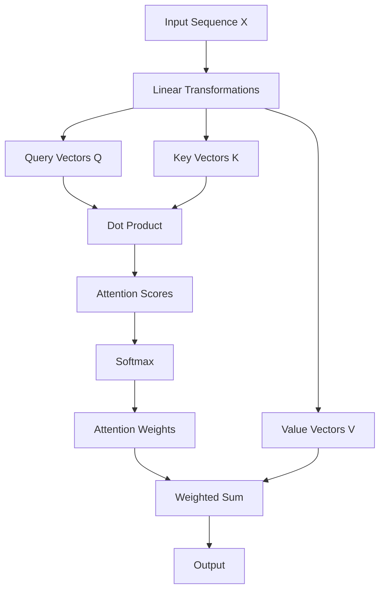

# Lesson 2: Self-Attention in Transformers

## 1. First-Principles Intuition & Invariants

In the realm of deep learning, the transformer architecture has emerged as a cornerstone of modern natural language processing (NLP) and beyond, revolutionizing tasks such as translation, text summarization, and even image and speech recognition. At the heart of the transformer's power lies the self-attention mechanism, a novel approach to capturing dependencies within data sequences that transcends the limitations of traditional recurrent neural networks (RNNs) and convolutional neural networks (CNNs).

To understand the self-attention mechanism, we must first delve into the problem it addresses. Traditional RNNs, for instance, process sequences in a sequential manner, where each element in the sequence is processed one after the other, with the model's hidden state being updated at each step. This sequential processing introduces a bottleneck, as the model can only attend to previous elements in the sequence, and the dependencies between distant elements are difficult to capture. CNNs, on the other hand, can capture local dependencies through convolutional filters, but they struggle to model long-range dependencies effectively.

The self-attention mechanism, introduced in the seminal paper "Attention is All You Need" by Vaswani et al., provides a parallelizable approach to capturing dependencies across the entire sequence. Unlike RNNs, which process sequences sequentially, self-attention allows the model to weigh the importance of all elements in the sequence simultaneously, enabling it to capture long-range dependencies more effectively.

At a high level, the self-attention mechanism operates by transforming the input sequence into a set of query, key, and value vectors. These vectors are then used to compute a weighted sum of the values, where the weights are determined by the dot product of the query and key vectors, scaled by the square root of the dimensionality of the key vectors. This process is repeated for each element in the sequence, resulting in a new representation that captures the dependencies between all elements.

The mathematical foundation of self-attention is rooted in linear algebra and the concept of dot products. Given an input sequence of length \( n \), the self-attention mechanism computes the attention scores for each pair of elements in the sequence. The attention score between two elements is computed as the dot product of their query and key vectors, scaled by the square root of the dimensionality of the key vectors. This scaling factor ensures that the dot product does not grow too large, which can lead to numerical instability.

The attention scores are then passed through a softmax function to obtain a probability distribution over the elements in the sequence. This probability distribution is used to compute a weighted sum of the value vectors, where the weights are determined by the attention scores. The resulting weighted sum is the new representation of the element, which captures the dependencies between all elements in the sequence.

The self-attention mechanism is invariant to the length of the input sequence, as it computes the attention scores and weighted sums in parallel for all elements in the sequence. This parallelizability is a key advantage of the self-attention mechanism, as it allows the model to process sequences of arbitrary length efficiently.

## 2. Core Architecture & Mechanics

To gain a deeper understanding of the self-attention mechanism, let us dissect its internal architecture and mechanics. The self-attention mechanism consists of three main components: the query, key, and value vectors. These vectors are derived from the input sequence through linear transformations, which are implemented using weight matrices.

Consider an input sequence \( X \) of length \( n \) and dimensionality \( d_{\text{model}} \). The input sequence is first transformed into query, key, and value vectors using linear transformations:

\[
Q = XW_Q
\]
\[
K = XW_K
\]
\[
V = XW_V
\]

where \( W_Q \), \( W_K \), and \( W_V \) are weight matrices of dimensions \( d_{\text{model}} \times d_k \), \( d_{\text{model}} \times d_k \), and \( d_{\text{model}} \times d_v \), respectively. The dimensions \( d_k \) and \( d_v \) are the dimensions of the key and value vectors, respectively.

The attention scores are computed as the dot product of the query and key vectors, scaled by the square root of the dimensionality of the key vectors:

\[
\text{scores} = \frac{QK^T}{\sqrt{d_k}}
\]

The attention scores are then passed through a softmax function to obtain a probability distribution over the elements in the sequence:

\[
\text{attention\_weights} = \text{softmax}(\text{scores})
\]

The attention weights are used to compute a weighted sum of the value vectors:

\[
\text{output} = \text{attention\_weights}V
\]

The output of the self-attention mechanism is a new representation of the input sequence, where each element in the sequence is a weighted sum of the value vectors, with the weights determined by the attention scores.

To illustrate the mechanics of the self-attention mechanism, let us consider a simple example. Suppose we have an input sequence of length 4 and dimensionality 8:

\[
X = \begin{bmatrix}
x_1 \\
x_2 \\
x_3 \\
x_4 \\
\end{bmatrix}
\]

where each \( x_i \) is a vector of dimensionality 8. The input sequence is transformed into query, key, and value vectors using linear transformations:

\[
Q = XW_Q
\]
\[
K = XW_K
\]
\[
V = XW_V
\]

The attention scores are computed as the dot product of the query and key vectors, scaled by the square root of the dimensionality of the key vectors:

\[
\text{scores} = \frac{QK^T}{\sqrt{d_k}}
\]

The attention scores are then passed through a softmax function to obtain a probability distribution over the elements in the sequence:

\[
\text{attention\_weights} = \text{softmax}(\text{scores})
\]

The attention weights are used to compute a weighted sum of the value vectors:

\[
\text{output} = \text{attention\_weights}V
\]

The output of the self-attention mechanism is a new representation of the input sequence, where each element in the sequence is a weighted sum of the value vectors, with the weights determined by the attention scores.

To visualize the mechanics of the self-attention mechanism, we can use a Mermaid diagram:

In this diagram, the input sequence \( X \) is transformed into query, key, and value vectors using linear transformations. The attention scores are computed as the dot product of the query and key vectors, scaled by the square root of the dimensionality of the key vectors. The attention scores are then passed through a softmax function to obtain a probability distribution over the elements in the sequence. The attention weights are used to compute a weighted sum of the value vectors, resulting in the output of the self-attention mechanism.

## 3. High-Performance Optimization & Failure Modes

The self-attention mechanism is a powerful tool for capturing dependencies within data sequences, but it is not without its challenges. One of the key challenges is the computational complexity of the self-attention mechanism, which can become prohibitively expensive for long sequences. The computational complexity of the self-attention mechanism is \( O(n^2) \), where \( n \) is the length of the input sequence. This quadratic complexity arises from the need to compute the dot product of the query and key vectors for each pair of elements in the sequence.

To address this challenge, several optimization techniques have been proposed. One popular technique is the use of sparse attention, which restricts the attention scores to a subset of the elements in the sequence. Sparse attention can significantly reduce the computational complexity of the self-attention mechanism, making it feasible to process longer sequences.

Another optimization technique is the use of linear attention, which approximates the self-attention mechanism using linear transformations. Linear attention can reduce the computational complexity of the self-attention mechanism to \( O(n) \), making it feasible to process very long sequences.

In addition to computational complexity, the self-attention mechanism is also susceptible to several failure modes. One common failure mode is the vanishing gradient problem, which can arise when the attention scores are too small or too large. The vanishing gradient problem can make it difficult for the model to learn long-range dependencies effectively.

To mitigate the vanishing gradient problem, several techniques have been proposed. One popular technique is the use of layer normalization, which normalizes the input to each layer of the transformer model. Layer normalization can help stabilize the training process and make it easier for the model to learn long-range dependencies.

Another technique is the use of residual connections, which add the input to each layer of the transformer model to the output of the layer. Residual connections can help prevent the vanishing gradient problem by providing a direct path for gradients to flow through the model.

In addition to the vanishing gradient problem, the self-attention mechanism is also susceptible to the problem of overfitting, which can arise when the model is too complex relative to the amount of training data. To mitigate overfitting, several techniques have been proposed, including dropout, weight decay, and data augmentation.

In summary, the self-attention mechanism is a powerful tool for capturing dependencies within data sequences, but it is not without its challenges. The computational complexity of the self-attention mechanism can become prohibitively expensive for long sequences, but several optimization techniques have been proposed to address this challenge. The self-attention mechanism is also susceptible to several failure modes, including the vanishing gradient problem and overfitting, but several techniques have been proposed to mitigate these failure modes.

By understanding the self-attention mechanism in depth, we can gain a deeper appreciation for the power and flexibility of the transformer architecture, and we can develop more effective models for a wide range of tasks in natural language processing and beyond.
