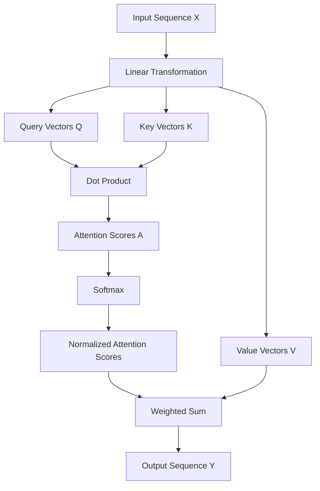

# Lesson 2: Self-Attention Mechanism

## 1. First-Principles Intuition & Invariants

The self-attention mechanism is a cornerstone of modern deep learning architectures, particularly within the Transformer model, which has revolutionized natural language processing and beyond. At its core, self-attention provides a way for a model to weigh the importance of different words in a sequence when making predictions about a particular word. This mechanism is not just a computational trick but a profound insight into how information can be dynamically and efficiently processed within a neural network.

To understand the self-attention mechanism, we must first delve into the problem it addresses. Traditional recurrent neural networks (RNNs) and their variants, such as long short-term memory (LSTM) networks, are designed to handle sequential data by maintaining a hidden state that is updated as the network processes each element in the sequence. However, these models suffer from several limitations. They are inherently sequential, meaning that they process one element at a time, which can be computationally expensive and limits parallelization. Additionally, RNNs struggle with long-range dependencies, where information from earlier parts of the sequence is crucial for understanding later parts.

The self-attention mechanism, introduced by Vaswani et al. in the paper "Attention is All You Need," offers a solution to these challenges by allowing the model to weigh the importance of all elements in the sequence simultaneously. This is achieved through a mechanism that computes a weighted sum of the values in the sequence, where the weights are determined by the relationships between the elements themselves. The key insight is that the importance of each element can be dynamically computed based on its context within the sequence, enabling the model to capture long-range dependencies more effectively.

Mathematically, the self-attention mechanism can be described using a series of linear transformations and a softmax function. Given a sequence of input vectors \( \mathbf{X} = [\mathbf{x}_1, \mathbf{x}_2, \ldots, \mathbf{x}_N] \), where \( N \) is the length of the sequence, the self-attention mechanism computes a set of query, key, and value vectors for each element in the sequence. These vectors are obtained by applying linear transformations to the input vectors:

\[
\mathbf{Q} = \mathbf{X} \mathbf{W}_Q, \quad \mathbf{K} = \mathbf{X} \mathbf{W}_K, \quad \mathbf{V} = \mathbf{X} \mathbf{W}_V
\]

where \( \mathbf{W}_Q \), \( \mathbf{W}_K \), and \( \mathbf{W}_V \) are weight matrices that are learned during training. The attention scores, or affinities, between each pair of elements in the sequence are then computed using the dot product of the query and key vectors:

\[
\mathbf{A} = \text{softmax}\left(\frac{\mathbf{Q} \mathbf{K}^T}{\sqrt{d_k}}\right)
\]

where \( d_k \) is the dimensionality of the key vectors, and the softmax function ensures that the attention scores are normalized between 0 and 1. The final output of the self-attention mechanism is a weighted sum of the value vectors, where the weights are determined by the attention scores:

\[
\mathbf{Y} = \mathbf{A} \mathbf{V}
\]

This process can be visualized as a series of interactions between the elements in the sequence, where each element dynamically adjusts its representation based on the context provided by all other elements. The self-attention mechanism is not only mathematically elegant but also computationally efficient, as it allows for parallel processing of the entire sequence, significantly reducing the computational overhead compared to sequential models.

## 2. Core Architecture & Mechanics

The architecture of the self-attention mechanism is built around the concept of query, key, and value vectors, which are derived from the input sequence through linear transformations. These vectors play a crucial role in determining the attention scores and the final output of the mechanism.

To illustrate the internal data structures and algorithms of the self-attention mechanism, we can use a Mermaid diagram to visualize the flow of data through the mechanism:

In this diagram, the input sequence \( \mathbf{X} \) is first transformed into query, key, and value vectors through linear transformations. The dot product of the query and key vectors is then computed, and the resulting attention scores are normalized using the softmax function. Finally, the normalized attention scores are used to compute a weighted sum of the value vectors, resulting in the output sequence \( \mathbf{Y} \).

The linear transformations applied to the input sequence are crucial for capturing the relationships between the elements in the sequence. The weight matrices \( \mathbf{W}_Q \), \( \mathbf{W}_K \), and \( \mathbf{W}_V \) are learned during training and allow the model to adapt to the specific characteristics of the input data. The dot product operation between the query and key vectors computes the raw attention scores, which are then normalized using the softmax function to ensure that the scores are interpretable as probabilities.

The softmax function is a key component of the self-attention mechanism, as it ensures that the attention scores are normalized and can be used to compute a weighted sum of the value vectors. The normalization process is achieved by exponentiating the raw attention scores and dividing by the sum of the exponentiated scores, resulting in a set of scores that sum to 1. This normalization step is essential for ensuring that the attention scores are interpretable and can be used to compute a meaningful weighted sum of the value vectors.

The final output of the self-attention mechanism is a weighted sum of the value vectors, where the weights are determined by the normalized attention scores. This output sequence \( \mathbf{Y} \) captures the context-dependent representations of the input sequence, allowing the model to make predictions based on the relationships between the elements in the sequence.

## 3. High-Performance Optimization & Failure Modes

The self-attention mechanism is a powerful tool for processing sequential data, but its computational efficiency can be a challenge, particularly for long sequences. The dot product operation between the query and key vectors has a time complexity of \( O(N^2) \), where \( N \) is the length of the sequence. This quadratic time complexity can be computationally expensive, especially for long sequences, and can limit the scalability of the mechanism.

To address this challenge, several optimization techniques have been developed to improve the computational efficiency of the self-attention mechanism. One such technique is the use of sparse attention, which reduces the number of attention scores that need to be computed by only considering a subset of the elements in the sequence. This approach can significantly reduce the computational overhead of the mechanism, making it more scalable for long sequences.

Another optimization technique is the use of linear attention, which approximates the dot product operation using a linear transformation. This approach can reduce the time complexity of the mechanism to \( O(N) \), making it more efficient for long sequences. Linear attention is particularly useful in scenarios where the attention scores are sparse, as it can capture the most important relationships between the elements in the sequence without computing the full set of attention scores.

In addition to these optimization techniques, several failure modes can arise in the self-attention mechanism, particularly when the mechanism is applied to large-scale datasets. One such failure mode is the vanishing gradient problem, which can occur when the attention scores are too small, leading to numerical instability and poor convergence during training. To mitigate this issue, several techniques have been developed, including the use of layer normalization and the addition of residual connections.

Another failure mode is the overfitting problem, which can occur when the model becomes too complex and captures noise in the training data. To mitigate this issue, several regularization techniques have been developed, including the use of dropout and the addition of noise to the input data.

In conclusion, the self-attention mechanism is a powerful tool for processing sequential data, providing a way for the model to weigh the importance of different elements in the sequence when making predictions. The mechanism is grounded in a series of linear transformations and a softmax function, and its computational efficiency can be improved through the use of optimization techniques such as sparse attention and linear attention. However, several failure modes can arise in the mechanism, and these must be addressed through the use of regularization techniques and other strategies to ensure the stability and performance of the model.
