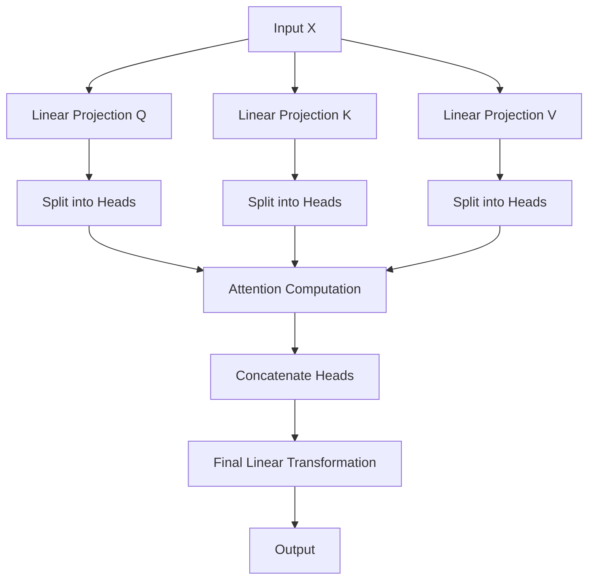

# Lesson 3: Multi-Head Attention

## 1. First-Principles Intuition & Invariants

The Transformer architecture, introduced in *Attention Is All You Need* by Vaswani et al., revolutionized sequence modeling by replacing recurrence with self-attention mechanisms. At its heart lies the attention mechanism—a function that computes a weighted sum of values, where the weights are determined by the relevance of keys to a query. This relevance is computed via a similarity measure, typically the dot product between query and key vectors. While single-head attention is capable of capturing global dependencies, it is inherently limited in its capacity to model diverse relationships within a sequence. The introduction of multi-head attention addresses this limitation by allowing the model to jointly attend to information from different representation subspaces at different positions.

The fundamental invariant of attention is that it operates on a set of vectors—queries, keys, and values—each of dimension $d_{\text{model}}$, and computes a mapping from this set to a new representation of the same dimension. In the case of multi-head attention, this process is replicated across $h$ distinct heads, each with its own learned projection matrices. This enables the model to capture a richer set of relationships, such as syntactic dependencies, semantic roles, or positional relationships, all simultaneously. The key insight is that while a single head may specialize in one type of relationship, the ensemble of heads allows the model to learn a more comprehensive and nuanced representation of the input.

The mathematical formulation of multi-head attention is grounded in the principle of linear transformation and inner product similarity. For a given input sequence, the model projects the queries, keys, and values into $h$ separate subspaces, each defined by a set of learned weight matrices $W^Q_i$, $W^K_i$, and $W^V_i$, where $i \in [1, h]$. Each head computes attention scores using the scaled dot-product attention mechanism, which is defined as:

$$
\text{Attention}(Q, K, V) = \text{softmax}\left(\frac{QK^T}{\sqrt{d_k}}\right)V
$$

Here, $d_k$ is the dimension of the key vectors, and the scaling factor $\sqrt{d_k}$ ensures that the dot products remain of reasonable magnitude, preventing the softmax from saturating. The outputs of each head are concatenated and linearly transformed to produce the final output. This process is invariant to the number of heads, provided that the total dimensionality of the projected space is preserved.

The invariants that govern multi-head attention are rooted in the principles of linear algebra and information theory. Each head is trained to optimize a shared loss function, but the learned projections allow each head to focus on different aspects of the input. This is analogous to how a human reader might simultaneously process syntax, semantics, and context, each through a different lens. The concatenation of outputs from multiple heads ensures that the model can represent a broader range of information, while the final linear transformation ensures that the output is consistent with the expected dimensionality.

## 2. Core Architecture & Mechanics

The architecture of multi-head attention is elegantly simple yet powerful. It begins with the input sequence, represented as a matrix $X \in \mathbb{R}^{n \times d_{\text{model}}}$, where $n$ is the sequence length and $d_{\text{model}}$ is the model dimension. From this input, three matrices are derived through learned linear projections:

$$
Q = XW^Q, \quad K = XW^K, \quad V = XW^V
$$

Each of these matrices is then split into $h$ heads, where each head operates on a subset of the dimensions. For instance, if $d_{\text{model}} = d_k \times h$, then each head processes a $d_k$-dimensional projection of the query, key, and value matrices. The attention computation for each head is then performed independently:

$$
\text{Head}_i = \text{Attention}(QW_i^Q, KW_i^K, VW_i^V)
$$

The outputs of all $h$ heads are concatenated and linearly transformed to produce the final output:

$$
\text{MultiHead}(Q, K, V) = \text{Concat}(\text{Head}_1, \ldots, \text{Head}_h)W^O
$$

This structure is implemented in a way that allows for efficient computation using matrix operations. The key insight is that the attention mechanism can be vectorized across all positions and heads, enabling parallel processing on modern hardware. The linear projections $W^Q$, $W^K$, $W^V$, and $W^O$ are learned during training and are initialized using techniques such as Xavier or He initialization to ensure stable gradient flow.

In practice, the multi-head attention mechanism is implemented as a single block that can be composed into larger Transformer layers. The memory layout of the attention computation is such that the query, key, and value matrices are stored in contiguous memory blocks, allowing for efficient cache usage and memory access patterns. The attention scores are computed using a matrix multiplication followed by a softmax operation, which is implemented using optimized libraries such as cuBLAS or MKL.

The Mermaid diagram below illustrates the flow of data through a multi-head attention block:

This architecture ensures that the attention mechanism is both scalable and modular, allowing for easy integration into larger Transformer models. The use of multiple heads allows the model to capture a diverse set of relationships, while the linear transformations ensure that the model can adapt to the specific characteristics of the input data.

## 3. High-Performance Optimization & Failure Modes

The performance of multi-head attention is highly dependent on the efficient execution of matrix operations and memory access patterns. Modern implementations leverage specialized hardware such as GPUs and TPUs to accelerate the computation. The key to high performance lies in minimizing memory bandwidth bottlenecks and maximizing parallelism. The attention mechanism is particularly well-suited for parallel execution because the computation of attention scores for each head is independent, and the matrix multiplications can be efficiently vectorized.

One of the most significant optimizations is the use of fused operations, where the attention computation is combined with the softmax and linear transformation into a single kernel. This reduces memory traffic and improves cache locality. Additionally, techniques such as flash attention and sparse attention are used to reduce the computational complexity of attention, especially for long sequences. Flash attention, for instance, uses a technique called "chunking" to compute attention scores in smaller batches, reducing memory usage and improving throughput.

Despite its efficiency, multi-head attention is not without failure modes. One common issue is the vanishing gradient problem, which can occur when the attention weights are too small, leading to poor gradient flow during backpropagation. This is mitigated by using techniques such as gradient clipping and careful initialization of the weight matrices. Another failure mode is the computational complexity of the attention mechanism, which scales quadratically with sequence length. This can be addressed through approximation techniques such as sparse attention or by using models with a reduced number of heads.

Memory management is another critical aspect of multi-head attention. The attention mechanism requires storing intermediate matrices, such as the attention scores and the output of each head. In large models, this can lead to memory exhaustion. Techniques such as gradient checkpointing and memory-efficient attention mechanisms are used to reduce memory usage. Gradient checkpointing trades computation for memory by recomputing intermediate values during the backward pass, rather than storing them.

In distributed training, multi-head attention introduces additional complexity. The attention computation must be synchronized across multiple devices, and the communication overhead can become a bottleneck. Techniques such as pipeline parallelism and tensor parallelism are used to distribute the computation across multiple GPUs or nodes. Pipeline parallelism splits the model into stages, each executed on a different device, while tensor parallelism splits the computation across multiple devices by partitioning the tensors.

The failure modes of multi-head attention are not limited to computational issues. In some cases, the model may overfit to specific attention patterns, leading to poor generalization. This can be mitigated by using regularization techniques such as dropout or by training with a diverse set of data. Additionally, the model may fail to attend to important information if the attention weights are not properly distributed. Techniques such as attention visualization and interpretability tools can help identify such issues and guide model improvements.

In conclusion, multi-head attention is a powerful mechanism that enables Transformers to capture complex relationships in sequential data. Its design is grounded in first-principles reasoning, and its implementation is optimized for performance and scalability. However, careful attention must be paid to its failure modes and optimization strategies to ensure robust and efficient deployment in real-world systems.
