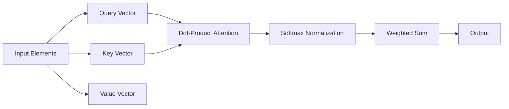

# Lesson 4: Applications and Variants of Transformer Attention

## 1. First-Principles Intuition & Invariants

Transformer attention mechanisms have revolutionized the field of natural language processing (NLP) and beyond. At its core, the transformer architecture is a self-attention mechanism that allows the model to weigh the importance of different input elements relative to each other. This is achieved through a set of learned weights, often referred to as attention weights or attention scores, which are computed based on the input elements' similarity to each other.

The transformer's attention mechanism is grounded in the concept of self-attention, which is a fundamental aspect of many machine learning models. Self-attention allows the model to attend to different parts of the input sequence simultaneously, rather than processing them sequentially. This enables the model to capture long-range dependencies and contextual relationships between input elements.

One of the key invariants of the transformer attention mechanism is its reliance on the dot-product attention formula. This formula computes the attention weights by taking the dot product of the query and key vectors, followed by a softmax normalization. The resulting attention weights are then used to compute the weighted sum of the value vectors.

Mathematically, the dot-product attention formula can be represented as:

$$\text{Attention}(Q, K, V) = \text{softmax}\left(\frac{QK^T}{\sqrt{d_k}}\right)V$$

where $Q$ is the query vector, $K$ is the key vector, $V$ is the value vector, and $d_k$ is the dimensionality of the key vector.

## 2. Core Architecture & Mechanics

The transformer attention mechanism consists of three primary components: the query, key, and value vectors. These vectors are computed based on the input elements and are used to compute the attention weights.

The query vector is computed by applying a linear transformation to the input elements, followed by a ReLU activation function. The key vector is computed similarly, but with a different linear transformation. The value vector is computed by applying a linear transformation to the input elements, without any activation function.

The attention weights are computed by taking the dot product of the query and key vectors, followed by a softmax normalization. The resulting attention weights are then used to compute the weighted sum of the value vectors.

Here is a simplified representation of the transformer attention mechanism using Mermaid diagrams:

## 3. High-Performance Optimization & Failure Modes

Transformer attention mechanisms are highly computationally intensive, particularly for large input sequences. To optimize performance, several techniques can be employed, including:

* **Parallelization**: Transformer attention mechanisms can be parallelized across multiple GPUs or CPU cores, allowing for significant speedups.
* **Batching**: Input sequences can be batched together to reduce the number of computations required.
* **Knowledge Distillation**: Pre-trained transformer models can be distilled to smaller, more efficient models.

However, transformer attention mechanisms are not without their failure modes. Some common issues include:

* **Vanishing Gradients**: The softmax normalization in the dot-product attention formula can lead to vanishing gradients, particularly for large input sequences.
* **Overfitting**: Transformer attention mechanisms can overfit to the training data, particularly if the model is too complex or the training data is too small.
* **Computational Complexity**: Transformer attention mechanisms can be computationally intensive, particularly for large input sequences.

To mitigate these issues, several techniques can be employed, including:

* **Regularization**: Regularization techniques, such as dropout and weight decay, can be used to prevent overfitting.
* **Early Stopping**: Early stopping can be used to prevent overfitting and reduce computational complexity.
* **Knowledge Distillation**: Knowledge distillation can be used to transfer knowledge from a pre-trained transformer model to a smaller, more efficient model.
