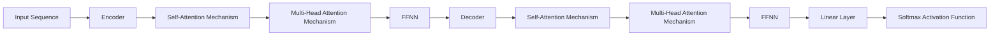
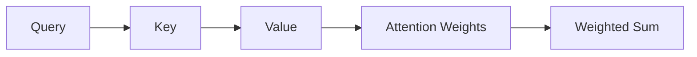

# Lesson 4: Applications and Variants of Transformers

## 1. First-Principles Intuition & Invariants

Transformers, introduced by Vaswani et al. in 2017, have revolutionized the field of natural language processing (NLP) and beyond. At their core, transformers are a type of neural network architecture that leverages self-attention mechanisms to weigh the importance of different input elements. This allows for parallelization of computations, reducing the need for sequential processing and enabling the handling of long-range dependencies.

The transformer architecture consists of an encoder and a decoder, with the encoder responsible for generating contextualized representations of the input sequence and the decoder generating the output sequence. The encoder is composed of a series of identical layers, each consisting of a self-attention mechanism, a multi-head attention mechanism, and a feed-forward neural network (FFNN). The decoder, on the other hand, consists of a series of identical layers, each consisting of a self-attention mechanism, a multi-head attention mechanism, and a FFNN, followed by a linear layer and a softmax activation function.

The self-attention mechanism is the key innovation of the transformer architecture. It allows the model to weigh the importance of different input elements based on their relevance to the current position in the sequence. This is achieved through a set of learnable weights, known as attention weights, which are computed based on the input elements and their positions in the sequence. The attention weights are then used to compute a weighted sum of the input elements, resulting in a contextualized representation of the input sequence.

The multi-head attention mechanism is an extension of the self-attention mechanism, which allows the model to jointly attend to information from different representation subspaces at different positions. This is achieved through a set of parallel attention mechanisms, each with its own set of learnable weights, which are then concatenated and linearly transformed.

## 2. Core Architecture & Mechanics

The transformer architecture can be visualized as follows:

The self-attention mechanism can be visualized as follows:

## 3. High-Performance Optimization & Failure Modes

Transformers are highly parallelizable, making them well-suited for distributed computing environments. However, this also means that they can be computationally expensive, requiring significant amounts of memory and processing power.

To mitigate this, several techniques have been developed, including:

* **Model parallelism**: splitting the model across multiple devices, allowing for parallelization of computations.
* **Data parallelism**: splitting the input data across multiple devices, allowing for parallelization of computations.
* **Mixed precision training**: using lower precision data types to reduce memory usage and increase training speed.

However, transformers are not immune to failure modes, including:

* **Overfitting**: the model becomes too specialized to the training data and fails to generalize to new data.
* **Underfitting**: the model is too simple and fails to capture the underlying patterns in the data.
* **Vanishing gradients**: the gradients of the loss function become too small, causing the model to converge slowly or not at all.

To mitigate these failure modes, several techniques have been developed, including:

* **Regularization**: adding penalties to the loss function to prevent overfitting.
* **Early stopping**: stopping training when the model's performance on the validation set starts to degrade.
* **Gradient clipping**: clipping the gradients of the loss function to prevent vanishing gradients.

In conclusion, transformers have revolutionized the field of NLP and beyond, enabling the handling of long-range dependencies and parallelization of computations. However, they are not without their challenges, including high computational costs and failure modes such as overfitting and vanishing gradients. By understanding the core architecture and mechanics of transformers, as well as the techniques for high-performance optimization and failure mitigation, developers can unlock the full potential of these powerful models.
