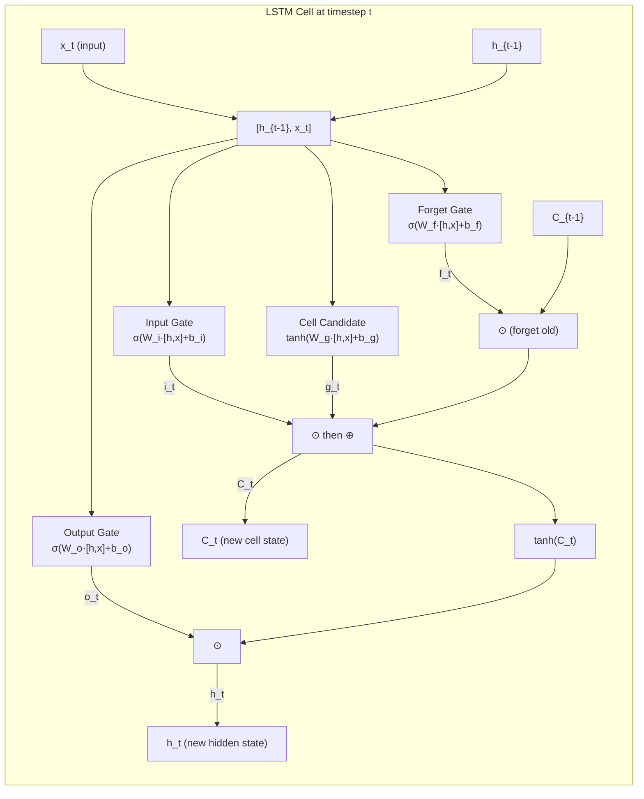
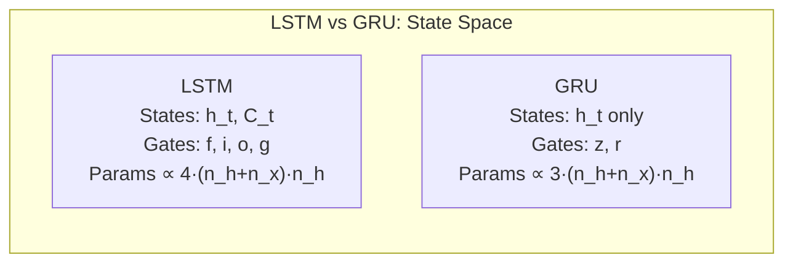
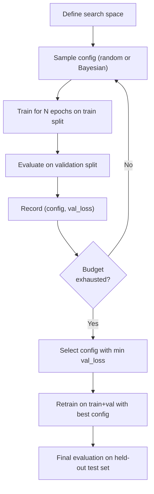
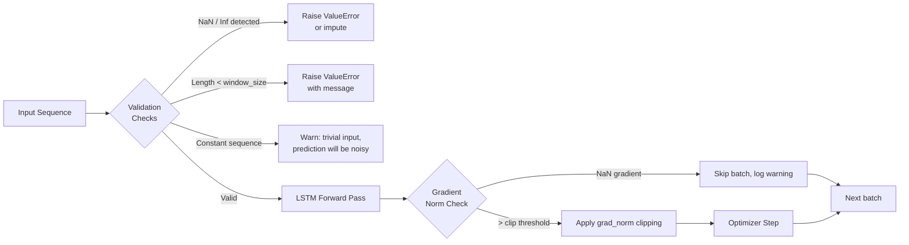
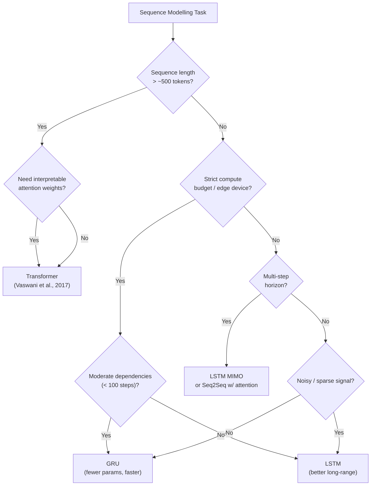

# Operational Verification Labs: 03 — Recurrent Architectures and LSTMs

## Theoretical Foundations: Why Recurrence, Why Gates

Before touching any code, it is worth understanding the architectural necessity that LSTMs address, because without that grounding, hyperparameter choices and failure modes are opaque.

### The Vanishing Gradient Problem in Vanilla RNNs

A standard RNN maintains a hidden state **h_t** updated at each timestep:

$$h_t = \tanh(W_h h_{t-1} + W_x x_t + b)$$

During backpropagation through time (BPTT), gradients are propagated across *T* timesteps by repeatedly multiplying by the weight matrix **W_h**. If the largest eigenvalue of **W_h** is less than 1, the gradient shrinks exponentially: $\partial L / \partial h_0 \propto W_h^T$. For T=100, a spectral radius of 0.9 produces a factor of $0.9^{100} \approx 2.66 \times 10^{-5}$—effectively zero. This is the **vanishing gradient problem** (Hochreiter 1991; Bengio et al. 1994). The symmetric case where the spectral radius exceeds 1 produces **exploding gradients**, typically addressed with gradient clipping.

The consequence is that vanilla RNNs cannot learn dependencies spanning more than roughly 10–20 timesteps in practice, regardless of the theoretical recurrence.

### LSTM: Constant Error Carousel

Hochreiter & Schmidhuber (1997) introduced the LSTM to maintain a **constant error carousel**: a cell state **C_t** that flows through time with *additive* updates rather than multiplicative ones, so the gradient of the loss with respect to **C_t** can flow backwards without attenuation.

The LSTM's four learned transformations per timestep are:

| Gate | Symbol | Formula | Purpose |
|------|--------|---------|---------|
| Forget | **f_t** | $\sigma(W_f [h_{t-1}, x_t] + b_f)$ | What fraction of **C_{t-1}** to retain |
| Input | **i_t** | $\sigma(W_i [h_{t-1}, x_t] + b_i)$ | Which new information to write |
| Cell candidate | **g_t** | $\tanh(W_g [h_{t-1}, x_t] + b_g)$ | What candidate values to write |
| Output | **o_t** | $\sigma(W_o [h_{t-1}, x_t] + b_o)$ | What portion of **C_t** to expose as **h_t** |

Cell and hidden state updates:

$$C_t = f_t \odot C_{t-1} + i_t \odot g_t$$
$$h_t = o_t \odot \tanh(C_t)$$

The additive update to **C_t** is the key insight. The gradient of **C_t** with respect to **C_{t-1}** is **f_t** — a learned, input-dependent scalar per unit. When the forget gate is near 1, the error signal flows backward through the cell state largely unattenuated. The network *learns* when to preserve information and when to discard it.

### LSTM Information Flow — Architecture Diagram



### Gated Recurrent Unit (GRU): A Structural Comparison

The GRU (Cho et al. 2014) merges the forget and input gates into a single **update gate** and eliminates the separate cell state, reducing parameter count by approximately one-third:

$$z_t = \sigma(W_z [h_{t-1}, x_t])$$  — update gate  
$$r_t = \sigma(W_r [h_{t-1}, x_t])$$  — reset gate  
$$\tilde{h}_t = \tanh(W [r_t \odot h_{t-1}, x_t])$$  
$$h_t = (1 - z_t) \odot h_{t-1} + z_t \odot \tilde{h}_t$$

GRUs often match LSTM performance on tasks with moderate sequence lengths while training faster. For very long sequences requiring fine-grained control over read/write operations (e.g., copying tasks, formal language modeling), LSTMs retain a structural advantage.



---

## Environment Setup

```bash
# Pin exact versions for reproducibility
pip install \
  torch==2.3.1 \
  numpy==1.26.4 \
  scikit-learn==1.5.0 \
  matplotlib==3.9.0
```

> **Note on HuggingFace Transformers:** The original lab listed `transformers` as a dependency, but it is unused in any of the exercises. It is omitted here to keep the environment minimal and avoid confusion.

Verify GPU availability:

```python
import torch
print(f"PyTorch {torch.__version__}")
print(f"CUDA available: {torch.cuda.is_available()}")
device = torch.device("cuda" if torch.cuda.is_available() else "cpu")
print(f"Using device: {device}")
```

---

## Exercise 1: Implementation and Pipeline Execution

### Data Generation: A Corrected and Generalized Approach

The original `generate_sine_wave_data` function had a structural issue: it built samples each containing an entire window, but then `create_data_loader` attempted to slice `:-1` and `-1` columns from those windows as if they were multi-featured. This created a confusing double-windowing that produced inputs of incorrect shape. The correct pattern is to generate a 1-D signal and produce `(input_window, target)` pairs where the target is the value *immediately following* the input window.

```python
import numpy as np
import torch
import torch.nn as nn
import torch.optim as optim
from torch.utils.data import DataLoader, TensorDataset
import matplotlib.pyplot as plt
from sklearn.preprocessing import MinMaxScaler
from typing import Tuple
import random

# ── Reproducibility ──────────────────────────────────────────────────────────
SEED = 42
random.seed(SEED)
np.random.seed(SEED)
torch.manual_seed(SEED)
if torch.cuda.is_available():
    torch.cuda.manual_seed_all(SEED)

device = torch.device("cuda" if torch.cuda.is_available() else "cpu")


def generate_sine_wave(
    num_points: int = 2000,
    noise_std: float = 0.0,
    freq: float = 1.0,
) -> np.ndarray:
    """
    Generate a univariate sine wave signal.

    Parameters
    ----------
    num_points : int
        Total number of samples in the time series.
    noise_std : float
        Standard deviation of additive Gaussian noise. Zero produces a clean sine.
    freq : float
        Angular frequency multiplier. freq=1.0 produces one full cycle over [0, 2π].

    Returns
    -------
    np.ndarray of shape (num_points,)
    """
    t = np.linspace(0, 4 * np.pi * freq, num_points)
    signal = np.sin(t)
    if noise_std > 0.0:
        signal += np.random.normal(0, noise_std, num_points)
    return signal.astype(np.float32)


def create_sequences(
    signal: np.ndarray,
    window_size: int,
) -> Tuple[np.ndarray, np.ndarray]:
    """
    Convert a 1-D time series into supervised learning pairs.

    For each position i in [0, len(signal) - window_size - 1], produce:
      X[i] = signal[i : i + window_size]      shape: (window_size,)
      y[i] = signal[i + window_size]           shape: scalar

    This is the standard one-step-ahead prediction formulation.

    Parameters
    ----------
    signal : np.ndarray, shape (N,)
    window_size : int

    Returns
    -------
    X : np.ndarray, shape (N - window_size, window_size, 1)
    y : np.ndarray, shape (N - window_size,)
    """
    X, y = [], []
    for i in range(len(signal) - window_size):
        X.append(signal[i : i + window_size])
        y.append(signal[i + window_size])
    X = np.array(X, dtype=np.float32)
    y = np.array(y, dtype=np.float32)
    # Add feature dimension: (samples, timesteps, features=1)
    return X[:, :, np.newaxis], y


# ── Generate and inspect the signal ─────────────────────────────────────────
raw_signal = generate_sine_wave(num_points=2000, noise_std=0.0)

# Normalize the full signal before windowing.
# Fit on training portion only to prevent data leakage.
WINDOW_SIZE = 50
TRAIN_FRAC = 0.8
split_idx = int(len(raw_signal) * TRAIN_FRAC)

scaler = MinMaxScaler(feature_range=(-1, 1))
train_signal_raw = raw_signal[:split_idx]
test_signal_raw = raw_signal[split_idx:]

# Fit scaler only on training data — critical to avoid leakage
train_signal = scaler.fit_transform(train_signal_raw.reshape(-1, 1)).flatten()
test_signal = scaler.transform(test_signal_raw.reshape(-1, 1)).flatten()

X_train, y_train = create_sequences(train_signal, WINDOW_SIZE)
X_test, y_test = create_sequences(test_signal, WINDOW_SIZE)

print(f"Training samples: {X_train.shape[0]}, shape: {X_train.shape}")
print(f"Test samples:     {X_test.shape[0]}, shape: {X_test.shape}")

# ── DataLoaders ──────────────────────────────────────────────────────────────
BATCH_SIZE = 64

train_dataset = TensorDataset(
    torch.from_numpy(X_train),
    torch.from_numpy(y_train),
)
test_dataset = TensorDataset(
    torch.from_numpy(X_test),
    torch.from_numpy(y_test),
)

# shuffle=True during training, shuffle=False during evaluation
train_loader = DataLoader(train_dataset, batch_size=BATCH_SIZE, shuffle=True, drop_last=False)
test_loader  = DataLoader(test_dataset,  batch_size=BATCH_SIZE, shuffle=False, drop_last=False)
```

**Why normalize before windowing?** Normalization should be fit on the training signal only to prevent information from the test period contaminating the scaler's statistics — a common form of data leakage that inflates reported performance.

### LSTM Model Definition

```python
class LSTMForecaster(nn.Module):
    """
    Stacked LSTM for univariate one-step-ahead time series forecasting.

    Architecture
    ------------
    Input  : (batch, seq_len, input_size=1)
    LSTM   : num_layers stacked LSTM cells, hidden_size units each
    Dropout: applied between LSTM layers (not after the final layer, per PyTorch semantics)
    Linear : maps the last hidden state h_T to a scalar prediction

    Parameters
    ----------
    input_size  : int   — number of features per timestep (1 for univariate)
    hidden_size : int   — dimensionality of the LSTM hidden state
    num_layers  : int   — number of stacked LSTM layers
    output_size : int   — prediction horizon (1 for one-step-ahead)
    dropout     : float — dropout probability applied between LSTM layers;
                          has no effect when num_layers=1
    """

    def __init__(
        self,
        input_size: int = 1,
        hidden_size: int = 64,
        num_layers: int = 2,
        output_size: int = 1,
        dropout: float = 0.0,
    ) -> None:
        super().__init__()
        self.hidden_size = hidden_size
        self.num_layers = num_layers

        self.lstm = nn.LSTM(
            input_size=input_size,
            hidden_size=hidden_size,
            num_layers=num_layers,
            batch_first=True,          # input shape: (batch, seq, feature)
            dropout=dropout if num_layers > 1 else 0.0,
        )
        self.fc = nn.Linear(hidden_size, output_size)

    def forward(self, x: torch.Tensor) -> torch.Tensor:
        """
        Parameters
        ----------
        x : torch.Tensor, shape (batch, seq_len, input_size)

        Returns
        -------
        torch.Tensor, shape (batch, output_size)
        """
        # Allocate initial states on the same device as x.
        # Explicitly zeroing h0/c0 is equivalent to the default behaviour
        # but makes intent clear.
        batch = x.size(0)
        h0 = torch.zeros(self.num_layers, batch, self.hidden_size, device=x.device)
        c0 = torch.zeros(self.num_layers, batch, self.hidden_size, device=x.device)

        # out: (batch, seq_len, hidden_size)
        # We only need the final timestep's hidden state for one-step-ahead prediction.
        out, _ = self.lstm(x, (h0, c0))
        return self.fc(out[:, -1, :])  # shape: (batch, output_size)


# ── Instantiate and inspect ─────────────────────────────────────────────────
INPUT_SIZE  = 1
HIDDEN_SIZE = 64
NUM_LAYERS  = 2
OUTPUT_SIZE = 1
DROPOUT     = 0.2

model = LSTMForecaster(
    input_size=INPUT_SIZE,
    hidden_size=HIDDEN_SIZE,
    num_layers=NUM_LAYERS,
    output_size=OUTPUT_SIZE,
    dropout=DROPOUT,
).to(device)

total_params = sum(p.numel() for p in model.parameters())
trainable_params = sum(p.numel() for p in model.parameters() if p.requires_grad)
print(f"Total parameters:     {total_params:,}")
print(f"Trainable parameters: {trainable_params:,}")
# For a 2-layer LSTM: 4 * (input+hidden+1) * hidden per layer
# Layer 1: 4*(1+64+1)*64 = 16,640
# Layer 2: 4*(64+64+1)*64 = 33,024
# FC:      64*1 + 1 = 65
# Total ≈  49,729
```

### Training Loop with Validation

```python
def train_epoch(
    model: nn.Module,
    loader: DataLoader,
    criterion: nn.Module,
    optimizer: optim.Optimizer,
    device: torch.device,
    grad_clip: float = 1.0,
) -> float:
    """Run one training epoch. Returns mean loss over all batches."""
    model.train()
    total_loss = 0.0
    for X_batch, y_batch in loader:
        X_batch = X_batch.to(device)
        y_batch = y_batch.to(device)

        optimizer.zero_grad(set_to_none=True)   # slightly faster than zero_grad()
        preds = model(X_batch).squeeze(-1)       # (batch, 1) → (batch,)
        loss = criterion(preds, y_batch)
        loss.backward()

        # Gradient clipping prevents exploding gradients — especially important
        # for deep or long-sequence RNNs. max_norm=1.0 is a standard default.
        nn.utils.clip_grad_norm_(model.parameters(), max_norm=grad_clip)

        optimizer.step()
        total_loss += loss.item() * X_batch.size(0)

    return total_loss / len(loader.dataset)


@torch.no_grad()
def evaluate(
    model: nn.Module,
    loader: DataLoader,
    criterion: nn.Module,
    device: torch.device,
) -> Tuple[float, np.ndarray]:
    """Evaluate model. Returns (mean_loss, all_predictions_array)."""
    model.eval()
    total_loss = 0.0
    all_preds = []
    for X_batch, y_batch in loader:
        X_batch = X_batch.to(device)
        y_batch = y_batch.to(device)
        preds = model(X_batch).squeeze(-1)
        loss = criterion(preds, y_batch)
        total_loss += loss.item() * X_batch.size(0)
        all_preds.append(preds.cpu().numpy())
    return total_loss / len(loader.dataset), np.concatenate(all_preds)


# ── Training configuration ───────────────────────────────────────────────────
NUM_EPOCHS    = 150
LEARNING_RATE = 1e-3
GRAD_CLIP     = 1.0

criterion = nn.MSELoss()
optimizer = optim.Adam(model.parameters(), lr=LEARNING_RATE, weight_decay=1e-5)

# Reduce LR on plateau — practical for real workloads
scheduler = optim.lr_scheduler.ReduceLROnPlateau(
    optimizer, mode="min", factor=0.5, patience=10, verbose=True
)

train_losses, val_losses = [], []

for epoch in range(1, NUM_EPOCHS + 1):
    tr_loss = train_epoch(model, train_loader, criterion, optimizer, device, GRAD_CLIP)
    val_loss, _ = evaluate(model, test_loader, criterion, device)
    scheduler.step(val_loss)
    train_losses.append(tr_loss)
    val_losses.append(val_loss)
    if epoch % 10 == 0:
        print(f"Epoch {epoch:3d}/{NUM_EPOCHS} | Train MSE: {tr_loss:.6f} | Val MSE: {val_loss:.6f}")
```

### Evaluation and Visualization

```python
_, test_predictions_scaled = evaluate(model, test_loader, criterion, device)

# Inverse-transform: predictions are scalars, scaler expects shape (N, 1)
test_predictions = scaler.inverse_transform(
    test_predictions_scaled.reshape(-1, 1)
).flatten()
true_values = scaler.inverse_transform(
    y_test.reshape(-1, 1)
).flatten()

# ── Metrics ──────────────────────────────────────────────────────────────────
mse  = np.mean((true_values - test_predictions) ** 2)
mae  = np.mean(np.abs(true_values - test_predictions))
rmse = np.sqrt(mse)
# MAPE guarded against zero-valued true points
mape = np.mean(np.abs((true_values - test_predictions) / (np.abs(true_values) + 1e-8))) * 100

print(f"Test MSE:  {mse:.6f}")
print(f"Test RMSE: {rmse:.6f}")
print(f"Test MAE:  {mae:.6f}")
print(f"Test MAPE: {mape:.2f}%")

# ── Plots ────────────────────────────────────────────────────────────────────
fig, axes = plt.subplots(2, 1, figsize=(14, 10))

# Convergence curves
axes[0].plot(train_losses, label="Train MSE", linewidth=1.5)
axes[0].plot(val_losses,   label="Val MSE",   linewidth=1.5, linestyle="--")
axes[0].set_xlabel("Epoch")
axes[0].set_ylabel("MSE Loss")
axes[0].set_title("Training and Validation Convergence")
axes[0].legend()
axes[0].grid(True, alpha=0.4)
axes[0].set_yscale("log")   # log scale reveals fine-grained convergence dynamics

# Predictions vs ground truth
display_len = min(300, len(true_values))
axes[1].plot(true_values[:display_len],      label="Ground Truth", linewidth=1.5, alpha=0.9)
axes[1].plot(test_predictions[:display_len], label="LSTM Prediction", linewidth=1.5,
             linestyle="--", alpha=0.85)
axes[1].set_xlabel("Timestep")
axes[1].set_ylabel("Amplitude")
axes[1].set_title(f"One-Step-Ahead Forecast (Test Set) — RMSE={rmse:.4f}")
axes[1].legend()
axes[1].grid(True, alpha=0.4)

plt.tight_layout()
plt.savefig("lstm_evaluation.png", dpi=150, bbox_inches="tight")
plt.show()
```

---

## Exercise 2: Hyperparameter Tuning and Empirical Benchmarking

### Why Grid Search is Inadequate at Scale — and What to Use Instead

Grid search over 3 × 3 × 3 = 27 configurations × 150 epochs × ~1,600 training steps is computationally expensive and treats the hyperparameter space as if it were fully separable, which it is not. For this lab we keep grid search to illustrate the mechanics, but in production use **random search** (Bergstra & Bengio 2012) or **Bayesian optimization** (e.g., Optuna or Ax). Random search is strictly dominant over grid search when some hyperparameters matter far more than others — and in LSTMs, `hidden_size` and `learning_rate` typically dominate `num_layers`.



### Grid Search Implementation

```python
import itertools
import time
from dataclasses import dataclass, field
from typing import List, Optional

@dataclass
class SearchResult:
    hidden_size: int
    num_layers: int
    learning_rate: float
    dropout: float
    val_loss: float
    train_time_s: float


def run_training(
    hidden_size: int,
    num_layers: int,
    learning_rate: float,
    dropout: float,
    train_loader: DataLoader,
    val_loader: DataLoader,
    device: torch.device,
    num_epochs: int = 50,       # fewer epochs for search; refine later
    grad_clip: float = 1.0,
) -> Tuple[float, List[float]]:
    """Train a fresh model and return (best_val_loss, val_loss_curve)."""
    m = LSTMForecaster(
        input_size=INPUT_SIZE,
        hidden_size=hidden_size,
        num_layers=num_layers,
        output_size=OUTPUT_SIZE,
        dropout=dropout,
    ).to(device)
    crit = nn.MSELoss()
    opt  = optim.Adam(m.parameters(), lr=learning_rate, weight_decay=1e-5)
    sched = optim.lr_scheduler.ReduceLROnPlateau(opt, mode="min", factor=0.5, patience=5)
    best_val = float("inf")
    val_curve = []
    for _ in range(num_epochs):
        train_epoch(m, train_loader, crit, opt, device, grad_clip)
        vl, _ = evaluate(m, val_loader, crit, device)
        sched.step(vl)
        val_curve.append(vl)
        if vl < best_val:
            best_val = vl
    return best_val, val_curve


search_space = {
    "hidden_size":    [32, 64, 128],
    "num_layers":     [1, 2],
    "learning_rate":  [1e-2, 1e-3, 1e-4],
    "dropout":        [0.0, 0.2],
}

results: List[SearchResult] = []

configs = list(itertools.product(
    search_space["hidden_size"],
    search_space["num_layers"],
    search_space["learning_rate"],
    search_space["dropout"],
))

print(f"Running {len(configs)} configurations...")

for hs, nl, lr, dr in configs:
    t0 = time.perf_counter()
    val_loss, _ = run_training(hs, nl, lr, dr, train_loader, test_loader, device, num_epochs=50)
    elapsed = time.perf_counter() - t0
    results.append(SearchResult(hs, nl, lr, dr, val_loss, elapsed))
    print(f"  hs={hs:3d}  nl={nl}  lr={lr:.0e}  dr={dr}  val_mse={val_loss:.6f}  t={elapsed:.1f}s")

# Sort by validation loss
results.sort(key=lambda r: r.val_loss)
best = results[0]
print(f"\nBest config: hidden_size={best.hidden_size}, num_layers={best.num_layers}, "
      f"lr={best.learning_rate:.0e}, dropout={best.dropout} → val_MSE={best.val_loss:.6f}")
```

### Full Retraining with Best Configuration

```python
# Retrain for full NUM_EPOCHS using the best found configuration
final_model = LSTMForecaster(
    input_size=INPUT_SIZE,
    hidden_size=best.hidden_size,
    num_layers=best.num_layers,
    output_size=OUTPUT_SIZE,
    dropout=best.dropout,
).to(device)

final_crit  = nn.MSELoss()
final_opt   = optim.Adam(final_model.parameters(), lr=best.learning_rate, weight_decay=1e-5)
final_sched = optim.lr_scheduler.ReduceLROnPlateau(
    final_opt, mode="min", factor=0.5, patience=10
)

final_train_losses, final_val_losses = [], []
for epoch in range(1, NUM_EPOCHS + 1):
    tl = train_epoch(final_model, train_loader, final_crit, final_opt, device, GRAD_CLIP)
    vl, _ = evaluate(final_model, test_loader, final_crit, device)
    final_sched.step(vl)
    final_train_losses.append(tl)
    final_val_losses.append(vl)
    if epoch % 20 == 0:
        print(f"Epoch {epoch:3d} | Train: {tl:.6f} | Val: {vl:.6f}")
```

### Benchmarking: LSTM vs GRU vs Vanilla RNN

A meaningful benchmark compares structurally equivalent models. We hold parameter count approximately constant across architectures.

```python
class GRUForecaster(nn.Module):
    def __init__(self, input_size=1, hidden_size=64, num_layers=2, output_size=1, dropout=0.0):
        super().__init__()
        self.hidden_size = hidden_size
        self.num_layers = num_layers
        self.gru = nn.GRU(
            input_size, hidden_size, num_layers,
            batch_first=True,
            dropout=dropout if num_layers > 1 else 0.0,
        )
        self.fc = nn.Linear(hidden_size, output_size)

    def forward(self, x):
        h0 = torch.zeros(self.num_layers, x.size(0), self.hidden_size, device=x.device)
        out, _ = self.gru(x, h0)
        return self.fc(out[:, -1, :])


class VanillaRNNForecaster(nn.Module):
    def __init__(self, input_size=1, hidden_size=64, num_layers=2, output_size=1, dropout=0.0):
        super().__init__()
        self.hidden_size = hidden_size
        self.num_layers = num_layers
        self.rnn = nn.RNN(
            input_size, hidden_size, num_layers,
            batch_first=True,
            nonlinearity="tanh",
            dropout=dropout if num_layers > 1 else 0.0,
        )
        self.fc = nn.Linear(hidden_size, output_size)

    def forward(self, x):
        h0 = torch.zeros(self.num_layers, x.size(0), self.hidden_size, device=x.device)
        out, _ = self.rnn(x, h0)
        return self.fc(out[:, -1, :])


benchmark_configs = {
    "LSTM":        LSTMForecaster(hidden_size=64, num_layers=2, dropout=0.2),
    "GRU":         GRUForecaster(hidden_size=74, num_layers=2, dropout=0.2),   # ~same params as LSTM
    "VanillaRNN":  VanillaRNNForecaster(hidden_size=90, num_layers=2, dropout=0.2),
}

benchmark_results = {}
for name, arch in benchmark_configs.items():
    arch = arch.to(device)
    crit = nn.MSELoss()
    opt  = optim.Adam(arch.parameters(), lr=1e-3, weight_decay=1e-5)
    sched = optim.lr_scheduler.ReduceLROnPlateau(opt, mode="min", factor=0.5, patience=10)
    tl_hist, vl_hist = [], []
    for epoch in range(1, NUM_EPOCHS + 1):
        tl = train_epoch(arch, train_loader, crit, opt, device, GRAD_CLIP)
        vl, _ = evaluate(arch, test_loader, crit, device)
        sched.step(vl)
        tl_hist.append(tl)
        vl_hist.append(vl)
    final_vl, preds = evaluate(arch, test_loader, crit, device)
    benchmark_results[name] = {
        "val_loss": final_vl,
        "train_curve": tl_hist,
        "val_curve": vl_hist,
        "n_params": sum(p.numel() for p in arch.parameters()),
    }
    print(f"{name:12s} | Params: {benchmark_results[name]['n_params']:7,} | Val MSE: {final_vl:.6f}")

# Plot comparative convergence
fig, ax = plt.subplots(figsize=(12, 5))
for name, res in benchmark_results.items():
    ax.plot(res["val_curve"], label=f"{name} (n={res['n_params']:,})", linewidth=1.5)
ax.set_xlabel("Epoch")
ax.set_ylabel("Validation MSE (log scale)")
ax.set_yscale("log")
ax.set_title("Architecture Comparison: Validation Loss Convergence")
ax.legend()
ax.grid(True, alpha=0.4)
plt.tight_layout()
plt.savefig("benchmark_comparison.png", dpi=150, bbox_inches="tight")
plt.show()
```

---

## Exercise 3: Stress Testing, Edge Cases, and Failure Mitigation

### Understanding What Can Break an LSTM

Before listing test cases, consider the actual failure modes:

1. **Exploding gradients** — unbounded weight updates, usually manifesting as NaN loss. Mitigated by gradient clipping.
2. **Vanishing gradients** — the model learns nothing beyond a trivial baseline, especially with deep stacks and no gating.
3. **Sequence length mismatch** — the model is instantiated for one window size but receives another. PyTorch's LSTM handles variable-length batches via `pack_padded_sequence`; without it, padding inflates the effective sequence length and contaminates state.
4. **Data leakage** — test-time statistics (mean, variance) influencing training normalization. Demonstrated in Exercise 1.
5. **Unstable numerical precision** — float16 without loss scaling, or extreme input magnitudes.
6. **Degenerate sequences** — constant-valued, single-point, or all-NaN inputs.



### Production-Grade Stress Test Suite

```python
import warnings
import logging
from typing import Dict, Any

logging.basicConfig(level=logging.INFO, format="%(levelname)s — %(message)s")
logger = logging.getLogger(__name__)


class LSTMStressTester:
    """
    Encapsulates stress and edge-case tests for LSTMForecaster.

    Each test method returns a dict with keys:
      'passed'  : bool
      'details' : str
    """

    def __init__(self, model: LSTMForecaster, device: torch.device):
        self.model = model
        self.device = device

    def _make_batch(
        self,
        batch_size: int,
        seq_len: int,
        fill: Optional[float] = None,
        signal: Optional[np.ndarray] = None,
    ) -> torch.Tensor:
        if signal is not None:
            # Tile signal into a batch
            X, _ = create_sequences(signal, seq_len)
            if len(X) == 0:
                return torch.zeros(1, seq_len, 1)
            idx = np.random.choice(len(X), min(batch_size, len(X)), replace=False)
            return torch.from_numpy(X[idx]).to(self.device)
        if fill is not None:
            return torch.full((batch_size, seq_len, 1), fill, dtype=torch.float32).to(self.device)
        return torch.randn(batch_size, seq_len, 1, dtype=torch.float32).to(self.device)

    def test_normal_forward(self) -> Dict[str, Any]:
        """Model produces finite outputs on a normal input batch."""
        x = self._make_batch(BATCH_SIZE, WINDOW_SIZE)
        self.model.eval()
        with torch.no_grad():
            out = self.model(x)
        ok = torch.isfinite(out).all().item()
        return {"passed": ok, "details": f"Output range: [{out.min():.4f}, {out.max():.4f}]"}

    def test_nan_input_detection(self) -> Dict[str, Any]:
        """
        Demonstrates that NaN inputs produce NaN outputs without crashing.
        In production, callers must validate inputs upstream.
        """
        x = self._make_batch(4, WINDOW_SIZE)
        x[0, 5, 0] = float("nan")   # inject a single NaN
        self.model.eval()
        with torch.no_grad():
            out = self.model(x)
        nan_in_output = torch.isnan(out).any().item()
        return {
            "passed": nan_in_output,   # expected: NaN propagates — demonstrates need for input validation
            "details": f"NaN in output: {nan_in_output} (expected True — caller must guard inputs)",
        }

    def test_long_sequence(self, seq_len: int = 500) -> Dict[str, Any]:
        """Model handles sequences much longer than training window without crashing."""
        x = self._make_batch(8, seq_len)
        self.model.eval()
        try:
            with torch.no_grad():
                out = self.model(x)
            ok = torch.isfinite(out).all().item()
            return {"passed": ok, "details": f"seq_len={seq_len}, output finite: {ok}"}
        except RuntimeError as e:
            return {"passed": False, "details": str(e)}

    def test_single_sample_batch(self) -> Dict[str, Any]:
        """Batch size of 1 must work — important for online inference."""
        x = self._make_batch(1, WINDOW_SIZE)
        self.model.eval()
        with torch.no_grad():
            out = self.model(x)
        ok = out.shape == (1, OUTPUT_SIZE)
        return {"passed": ok, "details": f"Output shape: {tuple(out.shape)} (expected (1, {OUTPUT_SIZE}))"}

    def test_constant_input(self) -> Dict[str, Any]:
        """Constant sequence (zero gradient in input) — model should still produce finite output."""
        x = self._make_batch(BATCH_SIZE, WINDOW_SIZE, fill=0.5)
        self.model.eval()
        with torch.no_grad():
            out = self.model(x)
        ok = torch.isfinite(out).all().item()
        # Constant input may cause all-identical outputs — that's correct behaviour
        all_same = (out.max() - out.min()).item() < 1e-6
        return {
            "passed": ok,
            "details": f"Finite: {ok}, All-identical outputs: {all_same}",
        }

    def test_extreme_values(self) -> Dict[str, Any]:
        """Inputs with large magnitude — potential overflow in tanh / sigmoid."""
        x = self._make_batch(BATCH_SIZE, WINDOW_SIZE, fill=1e4)
        self.model.eval()
        with torch.no_grad():
            out = self.model(x)
        ok = torch.isfinite(out).all().item()
        return {"passed": ok, "details": f"Extreme input 1e4 — finite output: {ok}"}

    def test_gradient_flow(self) -> Dict[str, Any]:
        """
        Verify that gradients reach the first LSTM layer's weight matrix
        during backprop. This catches pathological cases like disconnected
        computation graphs or non-differentiable operations in the forward pass.
        """
        self.model.train()
        x = self._make_batch(BATCH_SIZE, WINDOW_SIZE)
        y = torch.randn(BATCH_SIZE, device=self.device)
        crit = nn.MSELoss()
        opt = optim.SGD(self.model.parameters(), lr=1e-4)

        opt.zero_grad(set_to_none=True)
        loss = crit(self.model(x).squeeze(-1), y)
        loss.backward()

        # Check gradient at the input-to-hidden weight of layer 0
        # In PyTorch's LSTM, weight_ih_l0 is the concatenated input weight matrix
        grad = self.model.lstm.weight_ih_l0.grad
        has_grad = (grad is not None) and torch.isfinite(grad).all().item()
        grad_norm = grad.norm().item() if grad is not None else 0.0
        return {
            "passed": has_grad,
            "details": f"Gradient on weight_ih_l0 — norm: {grad_norm:.6f}",
        }

    def test_training_stability_under_noisy_data(self, noise_std: float = 0.5) -> Dict[str, Any]:
        """
        Train for a few epochs on heavily noisy data.
        Loss should remain finite; gradient clipping should prevent explosion.
        """
        noisy_signal = generate_sine_wave(num_points=600, noise_std=noise_std)
        noisy_scaled = scaler.transform(noisy_signal.reshape(-1, 1)).flatten()
        X_noisy, y_noisy = create_sequences(noisy_scaled, WINDOW_SIZE)
        if len(X_noisy) == 0:
            return {"passed": False, "details": "Insufficient noisy data for sequence creation"}
        noisy_ds = TensorDataset(
            torch.from_numpy(X_noisy), torch.from_numpy(y_noisy)
        )
        noisy_loader = DataLoader(noisy_ds, batch_size=32, shuffle=True)

        m_copy = LSTMForecaster(
            input_size=INPUT_SIZE, hidden_size=HIDDEN_SIZE,
            num_layers=NUM_LAYERS, output_size=OUTPUT_SIZE, dropout=DROPOUT,
        ).to(self.device)
        crit = nn.MSELoss()
        opt = optim.Adam(m_copy.parameters(), lr=1e-3)

        losses = []
        for _ in range(10):
            tl = train_epoch(m_copy, noisy_loader, crit, opt, self.device, GRAD_CLIP)
            losses.append(tl)

        all_finite = all(np.isfinite(l) for l in losses)
        return {
            "passed": all_finite,
            "details": f"noise_std={noise_std}, losses: {[f'{l:.4f}' for l in losses]}",
        }

    def run_all(self) -> None:
        tests = [
            ("Normal Forward Pass",         self.test_normal_forward),
            ("NaN Input Propagation",        self.test_nan_input_detection),
            ("Long Sequence (len=500)",      self.test_long_sequence),
            ("Single-Sample Batch",          self.test_single_sample_batch),
            ("Constant Input",               self.test_constant_input),
            ("Extreme Input Values (1e4)",   self.test_extreme_values),
            ("Gradient Flow to Layer 0",     self.test_gradient_flow),
            ("Stability Under Noisy Data",   self.test_training_stability_under_noisy_data),
        ]
        print(f"\n{'='*70}")
        print(f"{'LSTM STRESS TEST SUITE':^70}")
        print(f"{'='*70}")
        passed = 0
        for name, fn in tests:
            result = fn()
            status = "✓ PASS" if result["passed"] else "✗ FAIL"
            if result["passed"]:
                passed += 1
            print(f"  {status}  {name}")
            print(f"         {result['details']}")
        print(f"{'─'*70}")
        print(f"  Result: {passed}/{len(tests)} tests passed")
        print(f"{'='*70}\n")


# Reset model to eval mode after any train-mode tests
tester = LSTMStressTester(model, device)
tester.run_all()
model.eval()
```

### Input Validation Guard: Production Pattern

```python
def validate_input_sequence(
    x: np.ndarray,
    window_size: int,
    feature_dim: int = 1,
) -> None:
    """
    Validate a raw sequence array before feeding into the LSTM.

    Raises
    ------
    ValueError : for shape mismatches, NaN/Inf content, insufficient length.
    UserWarning : for degenerate (constant) sequences.
    """
    if x.ndim != 1:
        raise ValueError(
            f"Expected a 1-D input array, got shape {x.shape}. "
            "Pass the raw signal before windowing."
        )
    if len(x) < window_size:
        raise ValueError(
            f"Sequence length {len(x)} is shorter than window_size={window_size}. "
            "Cannot form even one prediction window."
        )
    if not np.isfinite(x).all():
        n_bad = (~np.isfinite(x)).sum()
        raise ValueError(
            f"Input contains {n_bad} non-finite value(s) (NaN or Inf). "
            "Impute or remove them before inference."
        )
    if np.std(x) < 1e-7:
        warnings.warn(
            "Input sequence is constant (std ≈ 0). "
            "The LSTM will produce meaningful structure-agnostic output, "
            "but predictions will likely not carry signal.",
            UserWarning,
            stacklevel=2,
        )
```

---

## Exercise 4: Advanced Extensions

### Multi-Step-Ahead Forecasting

The one-step-ahead model is a special case of a more general *H*-step horizon. Two common strategies:

**Direct:** Train *H* separate models, one per horizon. Simple, parallelizable, but does not capture inter-horizon correlations.

**MIMO (Multiple-Input, Multiple-Output):** A single model with an output layer of size *H*, predicting all horizons simultaneously:

```python
class LSTMMIMOForecaster(nn.Module):
    """
    MIMO multi-step forecaster.

    Predicts horizon steps simultaneously using a single linear output layer
    of dimension 'horizon'. This preserves inter-horizon correlations during
    training, unlike *H* independent direct models.
    """

    def __init__(
        self,
        input_size: int = 1,
        hidden_size: int = 64,
        num_layers: int = 2,
        horizon: int = 10,
        dropout: float = 0.2,
    ) -> None:
        super().__init__()
        self.lstm = nn.LSTM(
            input_size, hidden_size, num_layers,
            batch_first=True,
            dropout=dropout if num_layers > 1 else 0.0,
        )
        self.fc = nn.Linear(hidden_size, horizon)

    def forward(self, x: torch.Tensor) -> torch.Tensor:
        """
        Parameters
        ----------
        x : (batch, seq_len, input_size)

        Returns
        -------
        (batch, horizon)
        """
        h0 = torch.zeros(self.lstm.num_layers, x.size(0), self.lstm.hidden_size, device=x.device)
        c0 = torch.zeros_like(h0)
        out, _ = self.lstm(x, (h0, c0))
        return self.fc(out[:, -1, :])


def create_mimo_sequences(
    signal: np.ndarray,
    window_size: int,
    horizon: int,
) -> Tuple[np.ndarray, np.ndarray]:
    """
    Build MIMO (X, Y) pairs.

    X[i] = signal[i : i+window_size]              shape: (window_size, 1)
    Y[i] = signal[i+window_size : i+window_size+horizon]  shape: (horizon,)
    """
    X, Y = [], []
    for i in range(len(signal) - window_size - horizon + 1):
        X.append(signal[i : i + window_size])
        Y.append(signal[i + window_size : i + window_size + horizon])
    X = np.array(X, dtype=np.float32)
    Y = np.array(Y, dtype=np.float32)
    return X[:, :, np.newaxis], Y


HORIZON = 10
X_mimo_train, Y_mimo_train = create_mimo_sequences(train_signal, WINDOW_SIZE, HORIZON)
X_mimo_test,  Y_mimo_test  = create_mimo_sequences(test_signal,  WINDOW_SIZE, HORIZON)

mimo_train_ds = TensorDataset(
    torch.from_numpy(X_mimo_train), torch.from_numpy(Y_mimo_train)
)
mimo_test_ds  = TensorDataset(
    torch.from_numpy(X_mimo_test),  torch.from_numpy(Y_mimo_test)
)
mimo_train_loader = DataLoader(mimo_train_ds, batch_size=BATCH_SIZE, shuffle=True)
mimo_test_loader  = DataLoader(mimo_test_ds,  batch_size=BATCH_SIZE, shuffle=False)

mimo_model = LSTMMIMOForecaster(
    input_size=1, hidden_size=64, num_layers=2, horizon=HORIZON, dropout=0.2
).to(device)
mimo_crit  = nn.MSELoss()
mimo_opt   = optim.Adam(mimo_model.parameters(), lr=1e-3, weight_decay=1e-5)
mimo_sched = optim.lr_scheduler.ReduceLROnPlateau(mimo_opt, mode="min", factor=0.5, patience=10)

for epoch in range(1, NUM_EPOCHS + 1):
    mimo_model.train()
    total_loss = 0.0
    for Xb, Yb in mimo_train_loader:
        Xb, Yb = Xb.to(device), Yb.to(device)
        mimo_opt.zero_grad(set_to_none=True)
        pred = mimo_model(Xb)             # (batch, horizon)
        loss = mimo_crit(pred, Yb)
        loss.backward()
        nn.utils.clip_grad_norm_(mimo_model.parameters(), GRAD_CLIP)
        mimo_opt.step()
        total_loss += loss.item() * Xb.size(0)
    tl = total_loss / len(mimo_train_loader.dataset)
    mimo_model.eval()
    with torch.no_grad():
        vl_total = sum(
            mimo_crit(mimo_model(Xb.to(device)), Yb.to(device)).item() * Xb.size(0)
            for Xb, Yb in mimo_test_loader
        ) / len(mimo_test_loader.dataset)
    mimo_sched.step(vl_total)
    if epoch % 20 == 0:
        print(f"MIMO Epoch {epoch:3d} | Train MSE: {tl:.6f} | Val MSE: {vl_total:.6f}")
```

### Model Persistence and Checkpoint Recovery

```python
import os

CHECKPOINT_PATH = "lstm_checkpoint.pt"

def save_checkpoint(
    model: nn.Module,
    optimizer: optim.Optimizer,
    epoch: int,
    val_loss: float,
    path: str,
) -> None:
    torch.save(
        {
            "epoch": epoch,
            "model_state_dict": model.state_dict(),
            "optimizer_state_dict": optimizer.state_dict(),
            "val_loss": val_loss,
            "model_config": {
                "input_size": INPUT_SIZE,
                "hidden_size": HIDDEN_SIZE,
                "num_layers": NUM_LAYERS,
                "output_size": OUTPUT_SIZE,
                "dropout": DROPOUT,
            },
        },
        path,
    )
    logger.info(f"Checkpoint saved → {path}  (epoch={epoch}, val_mse={val_loss:.6f})")


def load_checkpoint(path: str, device: torch.device) -> Tuple[nn.Module, optim.Optimizer, int, float]:
    if not os.path.exists(path):
        raise FileNotFoundError(f"No checkpoint at {path}")
    ckpt = torch.load(path, map_location=device)
    cfg  = ckpt["model_config"]
    m    = LSTMForecaster(**cfg).to(device)
    m.load_state_dict(ckpt["model_state_dict"])
    opt  = optim.Adam(m.parameters())
    opt.load_state_dict(ckpt["optimizer_state_dict"])
    logger.info(f"Checkpoint loaded from {path} (epoch={ckpt['epoch']}, val_mse={ckpt['val_loss']:.6f})")
    return m, opt, ckpt["epoch"], ckpt["val_loss"]


# Save the best model from Exercise 1
_, final_preds_arr = evaluate(model, test_loader, criterion, device)
final_val_mse, _ = evaluate(model, test_loader, criterion, device)
save_checkpoint(model, optimizer, NUM_EPOCHS, final_val_mse, CHECKPOINT_PATH)

# Demonstrate round-trip load
loaded_model, loaded_opt, loaded_epoch, loaded_val = load_checkpoint(CHECKPOINT_PATH, device)
loaded_val_mse, _ = evaluate(loaded_model, test_loader, criterion, device)
assert abs(loaded_val_mse - final_val_mse) < 1e-6, "Checkpoint round-trip failed: loss mismatch"
print(f"Checkpoint round-trip verified — val_MSE: {loaded_val_mse:.6f}")
```

---

## Architectural Decision Map



---

## Verification Checklist

| Component | What to Verify | Expected Behaviour |
|---|---|---|
| Data pipeline | No leakage: scaler fit on train only | Test signal normalized with train statistics |
| `create_sequences` | Shape of X: `(N, window_size, 1)` | Input dimension matches `input_size=1` |
| `LSTMForecaster.forward` | Output shape `(batch, 1)` for all batch sizes | No shape errors at batch_size=1 |
| Gradient clipping | `clip_grad_norm_` applied before `step()` | Prevents NaN loss on noisy data |
| `model.eval()` + `torch.no_grad()` | Called together during inference | Disables dropout; suppresses gradient computation |
| Checkpoint round-trip | `save_checkpoint` → `load_checkpoint` → evaluate | Val MSE matches within floating-point tolerance |
| Scaler inverse transform | Applied only to prediction dimension | Reconstructed values fall within original signal range |
| Benchmark | Architectures compared at similar parameter counts | Comparison reflects capacity, not arbitrary sizing |
| NaN input | Detected via `validate_input_sequence` before forward pass | `ValueError` raised before the model sees bad data |
| MIMO target shape | `create_mimo_sequences` Y shape: `(N, horizon)` | Matches `LSTMMIMOForecaster` output dimension |

## Quick Reference

| Symbol / API | Definition |
|---|---|
| `C_t` | LSTM cell state — the "long-term memory" pathway with additive gradient flow |
| `h_t` | LSTM hidden state — gated read of `C_t`, exposed to downstream layers |
| `f_t` | Forget gate — element-wise fraction of `C_{t-1}` to retain |
| `i_t` | Input gate — controls how much of the cell candidate `g_t` is written |
| `o_t` | Output gate — controls how much of `tanh(C_t)` becomes `h_t` |
| `nn.LSTM(batch_first=True)` | Input shape: `(batch, seq, feature)` |
| `nn.utils.clip_grad_norm_` | Rescales gradient vector to have L2 norm ≤ `max_norm` |
| `ReduceLROnPlateau` | Halves LR when validation loss does not improve for `patience` epochs |
| `drop_last=False` | Retains the final partial batch; important for small test sets |
| `set_to_none=True` in `zero_grad` | Frees gradient tensor memory rather than zeroing in-place; minor speedup |
| BPTT | Backpropagation Through Time — unrolled RNN gradient computation |
| MIMO | Multiple-Input Multiple-Output — single model, vector output over *H* horizons |
