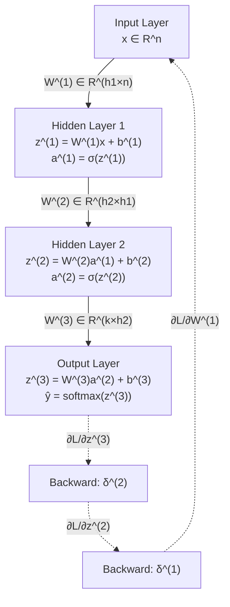

# Lesson 1: Introduction to Deep Learning Fundamentals

## 1. First-Principles Intuition & Invariants

Deep learning architectures approximate arbitrary functions through composition of parameterized nonlinear transformations. This capability emerges from the universal approximation theorem: a feedforward network with a single hidden layer containing a finite number of neurons can approximate any continuous function on compact subsets of R^n, given appropriate activation functions. However, the theorem provides no guidance on the number of neurons required or the computational efficiency of finding appropriate weights. Deep architectures with multiple layers exploit hierarchical composition to represent complex functions more efficiently than shallow networks, requiring exponentially fewer parameters for equivalent representational capacity in many problem domains.

The fundamental invariant of neural computation is the affine transformation followed by nonlinear activation. At each layer l, the forward propagation computes z^(l) = W^(l) * a^(l-1) + b^(l), where W represents the weight matrix, b the bias vector, and a^(l-1) the activations from the previous layer. The nonlinearity sigma transforms z^(l) into a^(l) = sigma(z^(l)). This composition enables networks to partition input space into regions of different behavior. Linear transformations alone cannot represent XOR or any function requiring non-convex decision boundaries. The nonlinearity is essential: without it, stacking layers reduces to a single linear transformation, as matrix multiplication is associative.

Information flow in neural networks exhibits specific mathematical properties. The forward pass propagates signals from input to output through successive transformations. The backward pass, derived from the chain rule of calculus, propagates error gradients from output to input. For a loss function L and parameters theta, the gradient dL/dtheta determines the direction of steepest descent in parameter space. This bidirectional information flow—forward activation propagation and backward gradient propagation—constitutes the backpropagation algorithm, first formalized by Rumelhart, Hinton, and Williams in 1986.

The problem space deep learning addresses involves learning representations from high-dimensional data where manual feature engineering is intractable. Image data arrives as raw pixel intensities, speech as waveform amplitudes, text as token sequences. Deep networks automatically discover hierarchical features: early layers detect edges and textures, middle layers compose these into parts and patterns, later layers recognize high-level concepts. This representational learning distinguishes deep learning from classical machine learning, where domain experts manually engineer features.

## 2. Core Architecture & Mechanics

A feedforward neural network organizes neurons into layers with unidirectional connections. The input layer has dimensionality matching the input data: 784 neurons for 28x28 grayscale images, 512 for embeddings of maximum token length. Hidden layers have designer-specified widths, often decreasing toward the output to create information bottlenecks. The output layer dimensionality matches the task: one neuron for regression, k neurons with softmax activation for k-class classification, arbitrary dimensions for generative models.

The computational graph structure determines both forward computation and gradient flow. Each layer l maintains parameters theta^(l) = {W^(l), b^(l)} and computes:

```
z^(l) = W^(l) @ a^(l-1) + b^(l)
a^(l) = sigma(z^(l))
```

For an L-layer network, the complete forward pass chains these operations: x -> a^(1) -> a^(2) -> ... -> a^(L) = y_hat. The backward pass computes gradients via the chain rule. For the output layer, delta^(L) = dL/dz^(L) = (a^(L) - y) * sigma'(z^(L)) for mean squared error loss. For hidden layers, delta^(l) = (W^(l+1))^T @ delta^(l+1) * sigma'(z^(l)). Parameter gradients are dL/dW^(l) = delta^(l) @ (a^(l-1))^T and dL/db^(l) = delta^(l).



The choice of activation function critically impacts network behavior. The sigmoid function sigma(z) = 1/(1 + exp(-z)) squashes inputs to (0,1) but suffers from vanishing gradients: sigma'(z) = sigma(z)(1-sigma(z)) approaches zero for large |z|. The hyperbolic tangent tanh(z) = (exp(z) - exp(-z))/(exp(z) + exp(-z)) outputs to (-1,1) with zero mean, improving gradient flow slightly. The Rectified Linear Unit (ReLU) sigma(z) = max(0,z) became dominant after 2012 because its gradient is either 0 or 1, eliminating vanishing gradients for positive activations. ReLU introduces sparsity: roughly 50% of neurons output zero for random inputs. Variants like Leaky ReLU sigma(z) = max(alpha*z, z) with small alpha (typically 0.01) prevent "dead neurons" that never activate.

Weight initialization significantly affects training dynamics. Random initialization breaks symmetry; if all weights are identical, all neurons compute identical functions and receive identical gradients. Initializing from N(0, 1/sqrt(n_in)) where n_in is the fan-in maintains variance of activations and gradients across layers. Xavier/Glorot initialization scales by sqrt(2/(n_in + n_out)) for tanh activations. He initialization uses sqrt(2/n_in) for ReLU, accounting for the zero'd negative half.

Training proceeds through stochastic gradient descent. Given training data {(x_i, y_i)}, a forward pass computes predictions y_hat_i for a minibatch, the loss function L quantifies prediction error, and the backward pass computes gradients. The update rule theta <- theta - eta * dL/dtheta adjusts parameters in the negative gradient direction, where eta is the learning rate. Minibatch SGD balances computational efficiency (vectorized operations on GPU) with gradient noise that aids escaping local minima. Typical batch sizes are 32, 64, 128, or 256.

## 3. High-Performance Optimization & Failure Modes

Training deep networks requires optimizing non-convex functions in high-dimensional spaces with millions to billions of parameters. Plain SGD exhibits slow convergence and sensitivity to learning rate selection. Modern optimizers incorporate momentum and adaptive learning rates. SGD with momentum accumulates an exponentially decaying moving average of gradients: v_t = beta * v_{t-1} + (1-beta) * g_t, then theta <- theta - eta * v_t. The velocity v_t builds up in directions of consistent gradients, accelerating convergence and dampening oscillations. Typical beta values are 0.9.

Adam (Adaptive Moment Estimation) maintains both first moment (mean) m_t and second moment (variance) v_t estimates of gradients. The updates are m_t = beta_1 * m_{t-1} + (1-beta_1) * g_t and v_t = beta_2 * v_{t-1} + (1-beta_2) * g_t^2, with bias correction m_hat = m_t/(1-beta_1^t) and v_hat = v_t/(1-beta_2^t). The parameter update becomes theta <- theta - eta * m_hat/sqrt(v_hat + epsilon). Adam adapts learning rates per-parameter based on gradient history, using typical hyperparameters beta_1=0.9, beta_2=0.999, epsilon=1e-8, and eta=1e-3 or 1e-4.

Overfitting occurs when model capacity exceeds the information content in the training data. The network memorizes training examples rather than learning generalizable patterns. Test error diverges from training error as the model fits noise. Regularization techniques combat overfitting. L2 regularization adds lambda * ||W||^2 to the loss, penalizing large weights and encouraging smaller, more distributed representations. Dropout randomly zeroes activations with probability p (typically 0.5) during training, forcing the network to learn redundant representations. At test time, activations are scaled by (1-p) to maintain expected values.

Vanishing and exploding gradients arise from the multiplicative nature of backpropagation. For an L-layer network, the gradient dL/dW^(1) involves the product of L Jacobian matrices. If the spectral norms are less than 1, gradients vanish exponentially in L; if greater than 1, they explode. Sigmoids and tanh exacerbate vanishing gradients because their derivatives are bounded by 0.25 and 1 respectively. ReLU mitigates this for positive activations but introduces dead neurons for negative pre-activations. Residual connections, introduced in ResNets, add skip connections a^(l+1) = a^(l) + F(a^(l)) that create gradient highways, enabling training of networks with hundreds of layers.

Batch normalization normalizes layer inputs to zero mean and unit variance within each minibatch: z_hat = (z - mu_B)/sqrt(sigma_B^2 + epsilon), then scales and shifts with learned parameters gamma and beta. This reduces internal covariate shift—the change in input distributions to layers during training—stabilizing optimization. Batch norm allows higher learning rates and reduces dependence on initialization. However, it couples examples within a minibatch and behaves differently during training versus inference, where running statistics replace batch statistics.

Gradient clipping prevents exploding gradients by rescaling gradient vectors that exceed a threshold. If ||g|| > threshold, set g <- g * threshold/||g||. This preserves gradient direction while capping magnitude.

Distributed training parallelizes computation across multiple devices. Data parallelism replicates the model on each device and partitions minibatches, with devices synchronizing gradients after each backward pass. Model parallelism partitions the model itself across devices when a single device lacks sufficient memory. Pipeline parallelism divides the model into stages processed sequentially, with microbatching to improve throughput. Communication overhead becomes the bottleneck as device count increases. Parameter servers or ring-allreduce architectures aggregate gradients efficiently. Mixed precision training uses FP16 for forward and backward passes to reduce memory and increase throughput, while maintaining FP32 master weights for numerical stability.

Model compression reduces memory footprint and inference latency. Pruning removes weights below a threshold, creating sparse networks. Quantization reduces precision from FP32 to INT8 or lower. Knowledge distillation trains a smaller student network to match the outputs of a larger teacher network. These techniques enable deployment on edge devices with constrained resources.

The learning rate schedule significantly impacts final performance. Constant learning rates risk overshooting minima or converging slowly. Step decay reduces eta by a factor (e.g., 0.1) at fixed epochs. Cosine annealing smoothly decreases eta following a cosine curve. Learning rate warm-up gradually increases eta from near-zero over initial epochs, stabilizing training in early stages when parameter initialization is poor.

Underfitting occurs when model capacity is insufficient for the complexity of the target function. Training and test error both remain high. Solutions include increasing network depth or width, training longer, or reducing regularization. The bias-variance tradeoff frames this: high bias (underfitting) models have low capacity and high error, high variance (overfitting) models fit training data perfectly but generalize poorly. Deep learning in practice often operates in the overparameterized regime where models have more parameters than training examples yet still generalize, defying classical statistical learning theory. The implicit regularization of SGD and architecture inductive biases contribute to this phenomenon.
