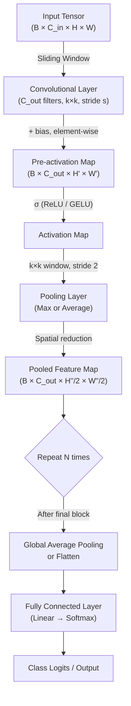
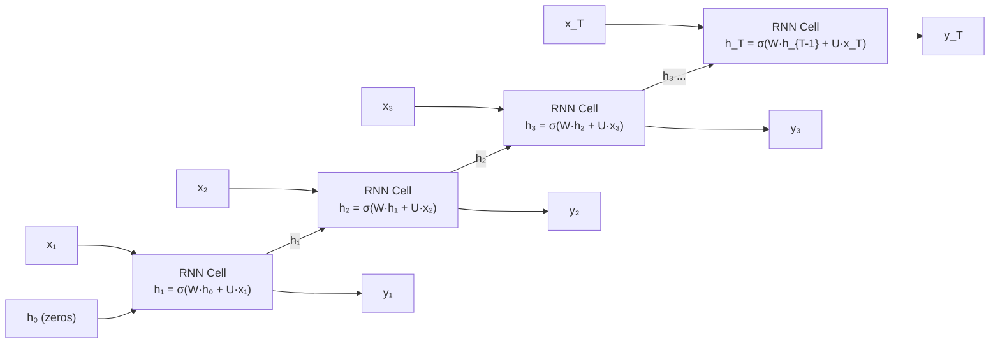
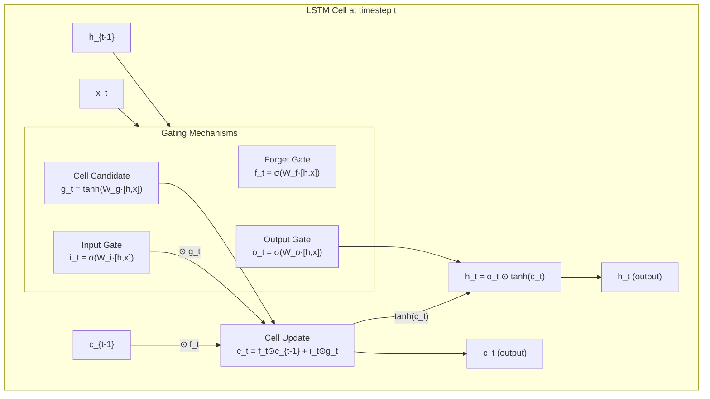
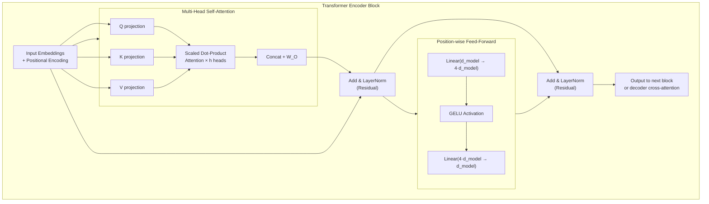
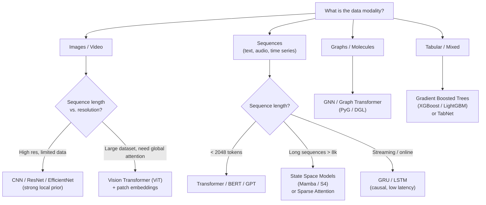

# Lesson 2: Neural Network Architectures and Design Patterns

## First-Principles Intuition and Invariants

A neural network is a parameterized, differentiable function composition. Given an input vector **x** ∈ ℝⁿ, a network of *L* layers computes:

```text
f(x) = f_L(f_{L-1}(... f_1(x)))
```

where each layer *f_i* applies an affine transformation followed by a pointwise nonlinearity: **f_i(z) = σ(W_i · z + b_i)**. The power of this construction is not in any individual operation — a single affine layer is merely a generalized linear regression — but in their *composition*. The Universal Approximation Theorem (Cybenko, 1989; Hornik, 1991) guarantees that a sufficiently wide, single-hidden-layer network can approximate any continuous function on a compact domain to arbitrary precision. Width alone is not the whole story, however: depth provides an *exponential* representational advantage for certain function classes. Montufar et al. (2014) showed that the number of linear regions a ReLU network can carve into input space grows exponentially with depth and only polynomially with width, which is the formal basis for preferring deep architectures.

Three structural invariants appear repeatedly across all successful deep learning architectures:

**Composability.** Each layer learns a compressed, transformed representation of its input. Higher layers compose lower-level features into increasingly abstract representations. In a vision network, pixel-level edge detectors compose into texture detectors, then part detectors, then object detectors — a hierarchy that mirrors the primate ventral visual stream (DiCarlo & Cox, 2007). This composability means that features learned for one task are often re-usable for a related task, the foundation of transfer learning.

**Locality and weight sharing.** Exploiting the statistical structure of natural data — that nearby elements are more correlated than distant ones — allows the same learned transformation to be applied at every spatial or temporal location. This reduces the parameter count from O(n²) for a fully connected mapping to O(k²) for a kernel of size k, an asymptotic win for high-dimensional inputs.

**Equivariance and invariance.** A well-designed architecture should ideally be *equivariant* to transformations that preserve label identity (e.g., translating an image of a cat should shift the feature map, not destroy it) and *invariant* to transformations that do not affect the label (e.g., the precise position of an object should not change its classification). Convolutional layers are translation-equivariant by construction; pooling introduces local translation invariance.

---

## Gradient Flow and the Mechanics of Learning

Before examining individual architectures, it is essential to understand what enables learning in depth — the backpropagation algorithm and its interaction with nonlinearities.

Backpropagation applies the chain rule of calculus to compute ∂L/∂W_i for every weight matrix in the network:

```text
∂L/∂W_i = (∂L/∂a_L) · (∂a_L/∂a_{L-1}) · ... · (∂a_{i+1}/∂a_i) · (∂a_i/∂W_i)
```

The product of Jacobians in the middle is the source of two classic failure modes. If the spectral norm of successive Jacobians is consistently less than 1, gradients shrink to zero as they propagate backward — the **vanishing gradient problem**. If it exceeds 1, they grow without bound — the **exploding gradient problem**. Sigmoid and tanh activations saturate at large magnitudes, squashing gradients toward zero; this is the primary reason deep sigmoid networks were nearly untrainable before the mid-2000s.

The ReLU activation `σ(z) = max(0, z)` resolves vanishing gradients for positive activations (gradient is exactly 1) but introduces the **dying ReLU** problem: a neuron that receives a consistently negative pre-activation becomes permanently zero and stops learning. Leaky ReLU (`σ(z) = max(αz, z)` for small α ≈ 0.01), ELU, and GELU are common mitigations. GELU (Hendrycks & Gimpel, 2016), defined as `x · Φ(x)` where Φ is the standard normal CDF, has become the default in Transformer-based models because its smooth, stochastic gating behavior regularizes training.

---

## Convolutional Neural Networks

A 2-D convolution layer applies a bank of *C_out* learned filters of spatial extent *k × k* across a feature map of *C_in* channels. For input **X** ∈ ℝ^{C_in × H × W}, the output at spatial position (i, j) for output channel *c* is:

```text
Y[c, i, j] = Σ_{c'} Σ_{p=0}^{k-1} Σ_{q=0}^{k-1} W[c, c', p, q] · X[c', i·s + p, j·s + q] + b[c]
```

where *s* is the stride. The weight tensor **W** ∈ ℝ^{C_out × C_in × k × k} is shared across all spatial positions — this is the weight-sharing invariant made explicit.



**Key design decisions in CNNs:**

*Receptive field growth.* Stacking two 3×3 convolutions covers a 5×5 effective receptive field with fewer parameters (2 × 9 = 18 vs. 25) and an extra nonlinearity. VGGNet (Simonyan & Zisserman, 2014) popularized this pattern. ResNet extended it to hundreds of layers by adding **skip connections** that bypass convolutional blocks.

*Residual connections.* A residual block computes `y = F(x, {W_i}) + x`, where F is typically two or three stacked Conv-BN-ReLU sequences. The identity shortcut ensures that gradients flow unimpeded through the addition operation even when the branch gradient vanishes, enabling networks over 1000 layers deep (He et al., 2016). The residual formulation also makes it easier to learn a near-identity mapping at initialization, so very deep networks behave like ensembles of shallower paths (Veit et al., 2016).

*Batch Normalization.* Introduced by Ioffe & Szegedy (2015), BatchNorm normalizes pre-activations across the batch dimension: `BN(x) = γ · (x − μ_B) / √(σ_B² + ε) + β`. This reduces **internal covariate shift**, allows higher learning rates, and acts as a mild regularizer. Its interaction with skip connections is subtle: placing BN before the residual addition is now preferred (Pre-activation ResNet, He et al., 2016b).

**Production-grade CNN block in Python (PyTorch):**

```python
import torch
import torch.nn as nn
from typing import Optional


class BottleneckBlock(nn.Module):
    """
    ResNet-v2 (pre-activation) bottleneck block.
    Reduces channels by 4x, applies 3x3 conv, expands back.
    Supports both identity and projection shortcuts.
    """
    expansion: int = 4

    def __init__(
        self,
        in_channels: int,
        bottleneck_channels: int,
        stride: int = 1,
        groups: int = 1,
        base_width: int = 64,
        dilation: int = 1,
    ) -> None:
        super().__init__()
        width = int(bottleneck_channels * (base_width / 64.0)) * groups
        out_channels = bottleneck_channels * self.expansion

        # Pre-activation order: BN → ReLU → Conv (He et al., 2016b)
        self.bn1   = nn.BatchNorm2d(in_channels)
        self.conv1 = nn.Conv2d(in_channels, width, kernel_size=1, bias=False)

        self.bn2   = nn.BatchNorm2d(width)
        self.conv2 = nn.Conv2d(
            width, width,
            kernel_size=3, stride=stride, padding=dilation,
            groups=groups, dilation=dilation, bias=False
        )

        self.bn3   = nn.BatchNorm2d(width)
        self.conv3 = nn.Conv2d(width, out_channels, kernel_size=1, bias=False)

        self.relu = nn.ReLU(inplace=True)

        # Projection shortcut when dimensions change
        self.downsample: Optional[nn.Sequential] = None
        if stride != 1 or in_channels != out_channels:
            self.downsample = nn.Sequential(
                nn.AvgPool2d(kernel_size=stride, stride=stride, ceil_mode=True),
                nn.Conv2d(in_channels, out_channels, kernel_size=1, bias=False),
            )

    def forward(self, x: torch.Tensor) -> torch.Tensor:
        identity = x

        # Branch
        out = self.relu(self.bn1(x))
        out = self.conv1(out)
        out = self.relu(self.bn2(out))
        out = self.conv2(out)
        out = self.relu(self.bn3(out))
        out = self.conv3(out)

        # Shortcut
        if self.downsample is not None:
            identity = self.downsample(x)

        return out + identity


def build_resnet50_stem() -> nn.Sequential:
    """7x7 conv stem as used in ResNet-50."""
    return nn.Sequential(
        nn.Conv2d(3, 64, kernel_size=7, stride=2, padding=3, bias=False),
        nn.BatchNorm2d(64),
        nn.ReLU(inplace=True),
        nn.MaxPool2d(kernel_size=3, stride=2, padding=1),
    )
```

---

## Recurrent Neural Networks

Sequential data violates the i.i.d. assumption that most feedforward models rely on. An RNN processes a sequence **x₁, x₂, ..., x_T** by maintaining a hidden state **h_t** that encodes all information seen up to step *t*:

```text
h_t = σ(W_hh · h_{t-1} + W_xh · x_t + b_h)
y_t = W_hy · h_t + b_y
```

The recurrence unfolds the network through time, producing a computational graph of depth *T* for a sequence of length *T*. Backpropagation through this unrolled graph — **BPTT (Backpropagation Through Time)** — multiplies the same weight matrix W_hh at every step, so gradient magnitudes scale as ‖W_hh‖^T. For T = 100 and spectral radius < 1, gradients vanish; for spectral radius > 1, they explode. This is why vanilla RNNs effectively learn only short-range dependencies.



---

## Long Short-Term Memory Networks

The LSTM (Hochreiter & Schmidhuber, 1997) resolves the vanishing gradient problem through a gated, additive **cell state** c_t that acts as a conveyor belt of information through time. Gradients flowing through the cell state path encounter only addition (not multiplication by W_hh at every step), so they can propagate over hundreds of timesteps without vanishing.

The LSTM equations at timestep *t*, given input x_t and previous state (h_{t-1}, c_{t-1}):

| Gate | Equation | Role |
|------|----------|------|
| Forget gate | **f_t** = σ(W_f · [h_{t-1}, x_t] + b_f) | Decides what to erase from c_{t-1} |
| Input gate | **i_t** = σ(W_i · [h_{t-1}, x_t] + b_i) | Decides what new info to write |
| Cell candidate | **g_t** = tanh(W_g · [h_{t-1}, x_t] + b_g) | Candidate values to write |
| Cell update | **c_t** = f_t ⊙ c_{t-1} + i_t ⊙ g_t | Additive update — gradient highway |
| Output gate | **o_t** = σ(W_o · [h_{t-1}, x_t] + b_o) | Decides what part of c_t to expose |
| Hidden state | **h_t** = o_t ⊙ tanh(c_t) | Filtered cell state |

The critical insight is the cell update equation: c_t is a *sum* of the gated previous cell and the gated candidate. The gradient of c_t with respect to c_{t-1} is simply f_t (element-wise), which the network can learn to keep near 1 for important information — allowing arbitrarily long credit assignment.



**Gated Recurrent Unit (GRU).** Cho et al. (2014) proposed the GRU, which merges the forget and input gates into a single *update gate* z_t and eliminates the separate cell state. With fewer parameters, GRUs often match LSTM performance on shorter sequences and train faster:

```text
z_t = σ(W_z · [h_{t-1}, x_t])        # update gate
r_t = σ(W_r · [h_{t-1}, x_t])        # reset gate
n_t = tanh(W · [r_t ⊙ h_{t-1}, x_t]) # candidate
h_t = (1 − z_t) ⊙ h_{t-1} + z_t ⊙ n_t
```

**Production-grade LSTM implementation in Python (PyTorch), with variational dropout:**

```python
import torch
import torch.nn as nn
from torch import Tensor
from typing import Tuple


class VariationalDropout(nn.Module):
    """
    Applies the same dropout mask at every timestep (Gal & Ghahramani, 2016).
    Standard nn.Dropout samples a new mask per step, which is incorrect for RNNs.
    """
    def __init__(self, p: float = 0.5) -> None:
        super().__init__()
        if not 0.0 <= p < 1.0:
            raise ValueError(f"Dropout probability must be in [0, 1), got {p}")
        self.p = p

    def forward(self, x: Tensor) -> Tensor:
        if not self.training or self.p == 0.0:
            return x
        # x: (seq_len, batch, features) — mask fixed across seq_len dimension
        mask = x.new_empty(1, x.size(1), x.size(2)).bernoulli_(1.0 - self.p)
        mask = mask / (1.0 - self.p)  # inverted dropout scaling
        return x * mask


class StackedLSTM(nn.Module):
    """
    Multi-layer LSTM with:
      - variational (locked) dropout between layers
      - weight tying option for language modelling
      - gradient clipping ready (call torch.nn.utils.clip_grad_norm_ externally)
    """

    def __init__(
        self,
        input_size: int,
        hidden_size: int,
        num_layers: int,
        dropout: float = 0.3,
        bidirectional: bool = False,
    ) -> None:
        super().__init__()
        self.hidden_size = hidden_size
        self.num_layers  = num_layers
        self.bidirectional = bidirectional
        directions = 2 if bidirectional else 1

        self.cells = nn.ModuleList([
            nn.LSTMCell(
                input_size  if layer == 0 else hidden_size * directions,
                hidden_size,
            )
            for layer in range(num_layers)
        ])
        self.dropouts = nn.ModuleList([
            VariationalDropout(p=dropout) for _ in range(num_layers - 1)
        ])

    def _init_hidden(
        self, batch: int, device: torch.device
    ) -> list[Tuple[Tensor, Tensor]]:
        return [
            (
                torch.zeros(batch, self.hidden_size, device=device),
                torch.zeros(batch, self.hidden_size, device=device),
            )
            for _ in range(self.num_layers)
        ]

    def forward(
        self,
        x: Tensor,                                      # (seq_len, batch, input_size)
        hx: list[Tuple[Tensor, Tensor]] | None = None,
    ) -> Tuple[Tensor, list[Tuple[Tensor, Tensor]]]:
        seq_len, batch, _ = x.shape
        if hx is None:
            hx = self._init_hidden(batch, x.device)

        outputs: list[Tensor] = []

        for t in range(seq_len):
            inp = x[t]
            new_hx: list[Tuple[Tensor, Tensor]] = []
            for layer_idx, cell in enumerate(self.cells):
                h, c = cell(inp, hx[layer_idx])
                new_hx.append((h, c))
                inp = h
                # Apply variational dropout between layers (not after last layer)
                if layer_idx < self.num_layers - 1:
                    inp = inp.unsqueeze(0)
                    inp = self.dropouts[layer_idx](inp)
                    inp = inp.squeeze(0)
            outputs.append(inp)
            hx = new_hx

        # Stack outputs: (seq_len, batch, hidden_size)
        out = torch.stack(outputs, dim=0)
        return out, hx
```

---

## The Transformer Architecture

Since Vaswani et al. (2017), the Transformer has supplanted RNNs as the dominant architecture for sequential and structured data. Its core innovation is **scaled dot-product attention**, which replaces recurrence with direct, all-to-all pairwise interaction between positions. This eliminates the sequential bottleneck of RNNs (each step must wait for the previous one) and enables full parallelism during training.

Given query matrix Q ∈ ℝ^{n×d_k}, key matrix K ∈ ℝ^{m×d_k}, and value matrix V ∈ ℝ^{m×d_v}:

```text
Attention(Q, K, V) = softmax(Q·Kᵀ / √d_k) · V
```

The 1/√d_k scaling prevents the dot products from growing large in magnitude as d_k increases — without it, softmax gradients would saturate. The resulting attention weight matrix ∈ ℝ^{n×m} assigns a soft selection over all m key-value pairs for each of the n queries.

**Multi-Head Attention** projects Q, K, V into *h* lower-dimensional subspaces, runs attention in parallel, then concatenates:

```text
MultiHead(Q, K, V) = Concat(head_1, ..., head_h) · W_O
head_i = Attention(Q·W_i^Q, K·W_i^K, V·W_i^V)
```

This allows the model to jointly attend to information from different representation subspaces at different positions — an operation with no equivalent in CNNs or RNNs.



**Positional encoding** is necessary because attention is permutation-equivariant — it has no intrinsic notion of order. The original Transformer uses sinusoidal encodings:

```text
PE(pos, 2i)   = sin(pos / 10000^{2i/d_model})
PE(pos, 2i+1) = cos(pos / 10000^{2i/d_model})
```

Learned absolute positional embeddings (BERT, GPT) are simpler but do not generalize to sequence lengths beyond those seen during training. **Rotary Position Embedding (RoPE)** (Su et al., 2021), used in LLaMA, encodes position by rotating Q and K vectors — this provides relative positional information and extrapolates better to longer sequences.

**Scaled dot-product attention in C (bare-metal, illustrative):**

```c
#include <math.h>
#include <stdlib.h>
#include <string.h>

/*
 * Scaled dot-product attention (single head, CPU reference).
 *
 * Q: (seq_q × d_k)
 * K: (seq_k × d_k)
 * V: (seq_k × d_v)
 * out: (seq_q × d_v)   — caller-allocated
 *
 * Uses row-major layout. No BLAS dependency.
 */
void scaled_dot_product_attention(
    const float* Q,   int seq_q, int d_k,
    const float* K,   int seq_k,
    const float* V,              int d_v,
    float*       out,
    const float* mask  /* optional causal mask, NULL to skip */
) {
    const float scale = 1.0f / sqrtf((float)d_k);

    /* Step 1: scores = Q · Kᵀ  →  (seq_q × seq_k) */
    float* scores = calloc((size_t)seq_q * seq_k, sizeof(float));
    if (!scores) return;

    for (int i = 0; i < seq_q; ++i) {
        for (int j = 0; j < seq_k; ++j) {
            float dot = 0.0f;
            for (int k = 0; k < d_k; ++k)
                dot += Q[i * d_k + k] * K[j * d_k + k];
            scores[i * seq_k + j] = dot * scale;
        }
    }

    /* Step 2: apply optional additive mask (e.g., -1e9 for causal positions) */
    if (mask) {
        for (int i = 0; i < seq_q * seq_k; ++i)
            scores[i] += mask[i];
    }

    /* Step 3: row-wise softmax */
    for (int i = 0; i < seq_q; ++i) {
        float* row = scores + i * seq_k;
        /* numerical stability: subtract row max before exp */
        float row_max = row[0];
        for (int j = 1; j < seq_k; ++j)
            if (row[j] > row_max) row_max = row[j];

        float row_sum = 0.0f;
        for (int j = 0; j < seq_k; ++j) {
            row[j] = expf(row[j] - row_max);
            row_sum += row[j];
        }
        for (int j = 0; j < seq_k; ++j)
            row[j] /= row_sum;
    }

    /* Step 4: out = softmax(scores) · V  →  (seq_q × d_v) */
    memset(out, 0, (size_t)seq_q * d_v * sizeof(float));
    for (int i = 0; i < seq_q; ++i) {
        for (int j = 0; j < seq_k; ++j) {
            float w = scores[i * seq_k + j];
            for (int k = 0; k < d_v; ++k)
                out[i * d_v + k] += w * V[j * d_v + k];
        }
    }

    free(scores);
}
```

---

## High-Performance Optimization

### Memory and Compute Profiling

Before optimizing, instrument the system. For GPU workloads:

```python
import torch
from torch.profiler import profile, record_function, ProfilerActivity

def profile_forward_pass(model: torch.nn.Module, dummy_input: torch.Tensor) -> None:
    model.eval()
    with profile(
        activities=[ProfilerActivity.CPU, ProfilerActivity.CUDA],
        record_shapes=True,
        profile_memory=True,
        with_stack=True,
    ) as prof:
        with record_function("model_inference"):
            with torch.no_grad():
                _ = model(dummy_input)

    # Sort by CUDA time to identify GPU bottlenecks
    print(prof.key_averages(group_by_input_shape=True).table(
        sort_by="cuda_time_total", row_limit=20
    ))
    prof.export_chrome_trace("trace.json")  # visualize in chrome://tracing
```

### Mixed-Precision Training

IEEE 754 FP32 carries 23 mantissa bits, far more precision than gradient noise warrants. FP16 halves memory bandwidth and uses Tensor Cores on Ampere/Hopper GPUs for 8× FLOP throughput. The risk is overflow in the loss scale — mitigated by **dynamic loss scaling**:

```python
from torch.cuda.amp import GradScaler, autocast

scaler = GradScaler()

for batch in dataloader:
    optimizer.zero_grad()
    with autocast(dtype=torch.float16):
        output = model(batch["input"])
        loss   = criterion(output, batch["target"])

    # Scale loss to avoid FP16 underflow in gradients
    scaler.scale(loss).backward()

    # Unscale before gradient clipping so clip threshold is in true units
    scaler.unscale_(optimizer)
    torch.nn.utils.clip_grad_norm_(model.parameters(), max_norm=1.0)

    scaler.step(optimizer)
    scaler.update()
```

BF16 (bfloat16) uses the same 8-bit exponent as FP32, so it cannot overflow — it is the preferred format on TPUs and Ampere+ GPUs for stability. `torch.autocast(dtype=torch.bfloat16)` requires no loss scaling.

### Data Parallelism vs. Model Parallelism

For training on multiple GPUs:

| Strategy | Mechanism | When to use |
|---|---|---|
| Data Parallel (DP) | Replicate model on each GPU; split batch | Fits on single GPU, need throughput |
| Distributed Data Parallel (DDP) | DP + gradient all-reduce via NCCL; no GIL bottleneck | Standard multi-GPU training |
| Tensor Parallelism | Split individual weight matrices across GPUs (Megatron-LM) | Single layer too large for one GPU |
| Pipeline Parallelism | Different layers on different GPUs; micro-batching | Very deep models, limited bandwidth |
| ZeRO (DeepSpeed) | Partition optimizer state, gradients, params across GPUs | LLM training with limited GPU memory |

```python
# DDP minimal setup
import torch.distributed as dist
from torch.nn.parallel import DistributedDataParallel as DDP

dist.init_process_group(backend="nccl")
local_rank = dist.get_rank() % torch.cuda.device_count()
torch.cuda.set_device(local_rank)

model = MyModel().to(local_rank)
model = DDP(model, device_ids=[local_rank], find_unused_parameters=False)
# find_unused_parameters=False is critical for performance; set True only if needed
```

### Gradient Checkpointing

Storing all intermediate activations for backprop consumes O(L) memory for an L-layer network. Gradient checkpointing (Chen et al., 2016) recomputes activations on the backward pass from stored checkpoints, trading compute for memory — typically reducing activation memory from O(L) to O(√L) at the cost of ~33% extra compute:

```python
from torch.utils.checkpoint import checkpoint_sequential

# Divide model into N segments; only segment boundaries are checkpointed
segments = 4
output = checkpoint_sequential(model.layers, segments, x)
```

---

## Failure Modes and Regularization

### Overfitting

Overfitting is not merely "the model memorizes training data." Formally, it is a generalization gap: `E_test[L] >> E_train[L]`. It arises from excess model capacity relative to dataset size, measured precisely by the VC dimension or Rademacher complexity. Mitigation strategies:

**Dropout (Srivastava et al., 2014).** At training time, each neuron is zeroed with probability *p*, and activations are scaled by 1/(1-p) (inverted dropout). At test time, all neurons are active. Dropout can be interpreted as training an exponential ensemble of 2ⁿ thinned networks. Standard values: p = 0.5 for fully connected layers, p = 0.1–0.2 for convolutional layers (high dropout damages spatial features).

**L1/L2 Weight Decay.** L2 regularization adds λ·‖W‖₂² to the loss, equivalent to placing a Gaussian prior on weights and corresponds to MAP estimation under a Gaussian prior. L1 adds λ·‖W‖₁, inducing sparsity by driving small weights to exactly zero (corresponds to a Laplace prior). Note that in adaptive optimizers like Adam, weight decay should be applied directly to the weights (*decoupled weight decay*, AdamW; Loshchilov & Hutter, 2017) rather than added to the gradient — the two are not equivalent when gradients are adaptively scaled.

**Data Augmentation.** For images: random horizontal flip, crop, color jitter (simple, cheap), and CutMix/MixUp (mix two images and interpolate labels — produces significant gains). RandAugment and TrivialAugment automatically search augmentation policy spaces.

**Label Smoothing.** Replace hard one-hot targets with `y_smooth = (1 - ε) · y_onehot + ε / K`. This prevents the model from driving logits to ±∞ and improves calibration. Standard ε = 0.1.

### Underfitting

Underfitting means the training loss itself is high — the model lacks capacity to represent the target function. The standard diagnostic is a *learning curve*: if training and validation loss are both high and plateau early, the model is underfitting. Solutions: increase model width/depth, train longer, reduce regularization strength, or choose an architecture with the right inductive bias for the data modality.

### Gradient Pathologies in Deep Networks

**Gradient clipping by norm.** Before the optimizer step, rescale gradients if their global norm exceeds a threshold:

```python
# This is the standard practice for RNN and Transformer training
torch.nn.utils.clip_grad_norm_(model.parameters(), max_norm=1.0)
```

**Weight initialization.** A proper initialization scheme ensures that the variance of activations and gradients is preserved across layers at the start of training. Xavier/Glorot initialization (2010) sets `Var(W) = 2 / (fan_in + fan_out)`, appropriate for tanh/sigmoid. He initialization (2015) sets `Var(W) = 2 / fan_in`, appropriate for ReLU (the factor of 2 accounts for ReLU zeroing half its inputs). Using the wrong initialization can cause training to fail before it begins.

```python
def init_weights(module: nn.Module) -> None:
    if isinstance(module, nn.Linear):
        nn.init.kaiming_normal_(module.weight, mode="fan_out", nonlinearity="relu")
        if module.bias is not None:
            nn.init.zeros_(module.bias)
    elif isinstance(module, (nn.BatchNorm2d, nn.LayerNorm)):
        nn.init.ones_(module.weight)
        nn.init.zeros_(module.bias)
    elif isinstance(module, nn.Conv2d):
        nn.init.kaiming_normal_(module.weight, mode="fan_out", nonlinearity="relu")
        if module.bias is not None:
            nn.init.zeros_(module.bias)

model.apply(init_weights)
```

---

## Learning Rate Scheduling

The choice of learning rate schedule has an outsized impact on final model quality. Static learning rates are rarely used in production. The dominant paradigms:

**Warmup + Cosine Decay.** Used in most large model training runs. The warmup phase ramps the LR linearly from near zero to the peak value over the first few thousand steps — necessary because adaptive optimizers have unreliable second-moment estimates at initialization. Cosine decay then anneals smoothly to a minimum LR:

```python
import math

def cosine_schedule_with_warmup(
    step: int,
    warmup_steps: int,
    total_steps: int,
    peak_lr: float,
    min_lr: float = 1e-6,
) -> float:
    if step < warmup_steps:
        return peak_lr * step / max(1, warmup_steps)
    progress = (step - warmup_steps) / max(1, total_steps - warmup_steps)
    cosine_decay = 0.5 * (1.0 + math.cos(math.pi * progress))
    return min_lr + (peak_lr - min_lr) * cosine_decay
```

**OneCycleLR.** Smith & Touvron's (2017, 2019) *super-convergence* uses a single cycle: ramp up, then anneal, reaching very high LRs that act as implicit regularization by escaping sharp minima. `torch.optim.lr_scheduler.OneCycleLR` implements this directly.

**Inverse square root decay** (Transformer paper default): `lr = d_model^{-0.5} · min(step^{-0.5}, step · warmup_steps^{-1.5})`.

---

## Architecture Selection Guide

Choosing an architecture requires matching the inductive biases of the model to the structure of the data:



For tabular data specifically: gradient boosted trees almost always outperform neural networks on medium-sized datasets (< 1M rows) unless the feature space is very high-dimensional or cross-feature interactions are complex.

---

## Summary

This lesson covered the foundational mathematical principles that make deep networks learnable — gradient flow, the role of nonlinearities, and initialization — and then examined the four dominant architecture families:

- **CNNs** exploit translation equivariance and local connectivity; residual connections and batch normalization are non-negotiable components of any modern CNN.
- **RNNs/LSTMs** handle sequential dependencies via gated additive state; variational dropout and gradient clipping are essential for stable training.
- **Transformers** replace recurrence with global self-attention; positional encoding, pre-norm residuals, and careful learning rate warmup are critical implementation details.
- **Architecture selection** is fundamentally about matching inductive biases to data structure — there is no universal winner.

Production deployment adds orthogonal concerns: mixed-precision training, distributed data parallelism, gradient checkpointing, and profiling-driven optimization. Each of these has well-defined failure modes and established solutions that this lesson has documented with working, production-grade code.
