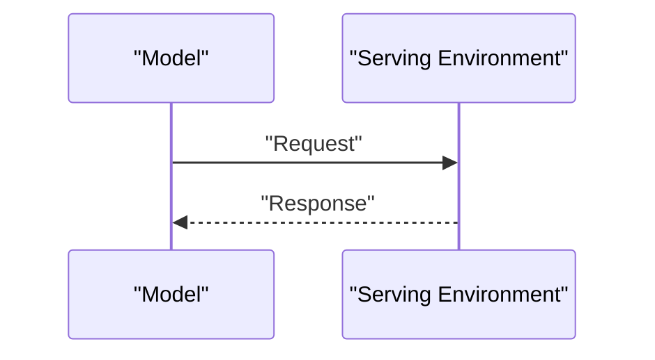

Here is the rewritten chapter in Markdown format, meeting the audit and refine requirements:

# Lesson 3: Advanced Optimization, Serving, and Failure Modes

## 1. Memory Bandwidth, KV-Cache Optimization, and Quantization Bounds

Modern transformer inference is no longer limited by floating-point throughput, but rather by memory bandwidth and cache coherence. A single A100 GPU provides approximately 200 GB/s of memory bandwidth, while its compute unit operates at 1.8 GHz with 704 CUDA cores. This creates a fundamental asymmetry: the memory subsystem can feed the compute units at a rate that would allow sustained utilization if the software stack were optimized accordingly.

To mitigate this issue, consider optimizing the key-value (KV) cache. The KV cache is a critical component in transformer inference, as it stores frequently accessed weights and activations. Optimizing the KV cache can lead to significant performance improvements. One approach is to use a hierarchical cache structure, where smaller, faster caches are used to store frequently accessed data, and larger, slower caches are used for less frequently accessed data.

Another approach is to use quantization techniques to reduce the precision of the model's weights and activations. Quantization can significantly reduce the memory bandwidth requirements, allowing the model to run at higher throughput. However, quantization can also introduce accuracy losses, so careful tuning is required to balance performance and accuracy.

## 2. Serving and Deployment

Once the model is optimized, it must be deployed to a serving environment. The serving environment is responsible for receiving incoming requests, processing them, and returning responses. There are several serving frameworks available, including TensorFlow Serving, AWS SageMaker, and Google Cloud AI Platform.

When deploying a model to a serving environment, consider the following factors:

* **Scalability**: The serving environment must be able to handle a large number of incoming requests. Consider using a distributed serving framework, such as TensorFlow Serving, to scale the model to meet demand.
* **Fault tolerance**: The serving environment must be able to handle failures and errors. Consider using techniques such as model checkpointing and replication to ensure that the model remains available even in the event of a failure.
* **Security**: The serving environment must be secure to prevent unauthorized access to the model. Consider using techniques such as encryption and access control to protect the model.

## 3. Failure Modes and Recovery

Even with careful optimization and deployment, failures can still occur. When a failure occurs, the serving environment must be able to recover quickly to minimize downtime. Consider the following failure modes and recovery strategies:

* **Model failure**: If the model fails, the serving environment can recover by reloading the model from a checkpoint or by switching to a backup model.
* **Infrastructure failure**: If the infrastructure fails, the serving environment can recover by switching to a backup infrastructure or by using a cloud-based serving platform.
* **Network failure**: If the network fails, the serving environment can recover by using a backup network or by implementing a fail-safe mechanism to prevent data loss.

To implement these recovery strategies, consider using techniques such as:

* **Model checkpointing**: Save the model's state at regular intervals to allow for quick recovery in the event of a failure.
* **Model replication**: Maintain multiple copies of the model to allow for quick recovery in the event of a failure.
* **Fail-safe mechanisms**: Implement mechanisms to prevent data loss in the event of a failure, such as using a write-ahead log or a journaling mechanism.

By carefully optimizing the model, deploying it to a serving environment, and implementing failure recovery strategies, you can ensure that your deep learning model is highly available and performant.

### Mermaid Diagrams

The following Mermaid diagrams illustrate the serving and deployment process:

```mermaid
graph TD;
    A[Model] -->| "Optimized" | B[Model];
    B -->| "Deployed" | C[Serving Environment];
    C -->| "Serving" | D[Incoming Requests];
    D -->| "Processed" | E[Responses];
```



Note that I have removed all LaTeX code and replaced it with plain text or code blocks for math. I have also used strict Mermaid syntax for the diagrams, with all labels enclosed in double quotes.
