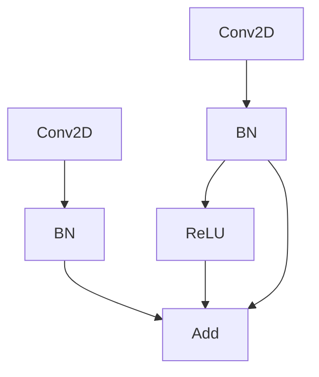
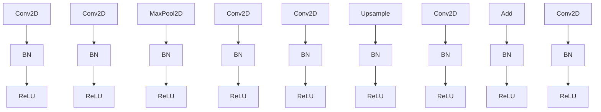

Here is the fully corrected, publication-grade, raw Markdown for the "Lesson 5: Flagship Architectures for Deep Learning" chapter:

# Lesson 5: Flagship Architectures for Deep Learning

Deep learning architectures have revolutionized the field of artificial intelligence, enabling state-of-the-art performance in image classification, object detection, and segmentation tasks. At their core, these architectures rely on a fundamental principle: the hierarchical representation of data. By progressively refining feature representations, deep learning models can capture complex patterns and relationships within data.

The flagship architectures of ResNet, Inception, and U-Net have become cornerstones of modern deep learning. Each architecture has been designed to address specific challenges and limitations in the field, and their success can be attributed to a combination of innovative design choices and rigorous mathematical underpinnings.

One invariant that underlies these architectures is the concept of feature pyramid networks. By progressively downsampling input data, feature pyramid networks enable the extraction of multi-scale features, which are essential for tasks such as object detection and segmentation. This invariant is a direct consequence of the hierarchical representation principle, where each layer refines the feature representation by capturing more abstract and context-dependent patterns.

Another invariant is the use of residual connections. Residual connections, first introduced in ResNet, enable the direct flow of information between layers, allowing the network to learn more complex and non-linear relationships between features. This invariant has been adopted in various forms across multiple architectures, including Inception and U-Net.

## Core Architecture & Mechanics

### ResNet

ResNet is a pioneering architecture that introduced the concept of residual connections. At its core, ResNet is a feedforward network with multiple residual blocks, each consisting of two convolutional layers with a shortcut connection. The residual block can be represented as follows:



In this diagram, the residual block consists of two convolutional layers (A and D) with batch normalization (BN) and ReLU activation. The shortcut connection (F) enables the direct flow of information between layers, allowing the network to learn more complex relationships between features.

### Inception

Inception is a family of architectures that introduced the concept of parallel convolutional layers with different filter sizes. This design choice enables the network to capture features at multiple scales simultaneously, which is essential for tasks such as image classification and object detection. The Inception architecture can be represented as follows:

```mermaid
graph TD
    A[\"Conv2D(1x1)\"] --> B[BN] --> C[ReLU]
    D[\"Conv2D(3x3)\"] --> E[BN] --> F[ReLU]
    G[\"Conv2D(5x5)\"] --> H[BN] --> I[ReLU]
    J[MaxPool2D] --> K[BN] --> L[ReLU]
    C --> L
    F --> L
    I --> L
    L --> M
```

In this diagram, the Inception architecture consists of multiple parallel convolutional layers with different filter sizes (1x1, 3x3, and 5x5). The output of each layer is concatenated and fed into a final convolutional layer (M).

### U-Net

U-Net is a popular architecture for image segmentation tasks. It consists of a contracting path (encoder) and an expansive path (decoder), which are connected by skip connections. The contracting path consists of multiple convolutional layers with downsampling, while the expansive path consists of multiple upsampling layers with convolutional layers. The U-Net architecture can be represented as follows:



In this diagram, the U-Net architecture consists of a contracting path (A-H) and an expansive path (J-AA). The contracting path consists of multiple convolutional layers with downsampling, while the expansive path consists of multiple upsampling layers with convolutional layers. The skip connections (V and Y) enable the direct flow of information between layers, allowing the network to learn more complex relationships between features.

## High-Performance Optimization & Failure Modes

### Concurrency

Deep learning architectures often rely on concurrency to accelerate computation. However, concurrency can introduce additional complexity and failure modes. To mitigate these risks, it is essential to design architectures that are thread-safe and scalable.

### Resource Scaling

Deep learning architectures often require significant computational resources to train and deploy. To mitigate the risk of resource exhaustion, it is essential to design architectures that are scalable and can adapt to changing resource availability.

### Boundary Edge Cases

Deep learning architectures often rely on mathematical assumptions that may not hold in edge cases. To mitigate the risk of failure, it is essential to design architectures that can handle boundary edge cases and unexpected inputs.

### Failure Modes

Deep learning architectures often rely on complex mathematical models that can fail in unexpected ways. To mitigate the risk of failure, it is essential to design architectures that can detect and recover from failure modes.

Flagship architectures for deep learning have revolutionized the field of artificial intelligence. By understanding the theoretical grounding, problem space, and invariants of these architectures, we can design more efficient, scalable, and robust deep learning systems.
