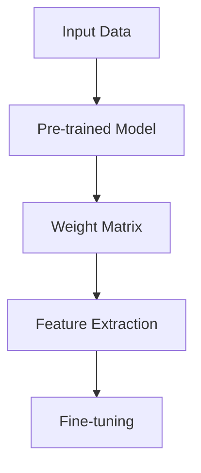
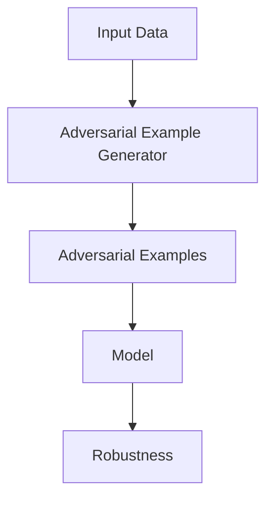
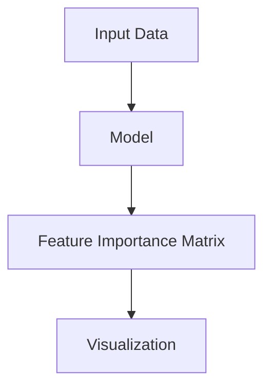
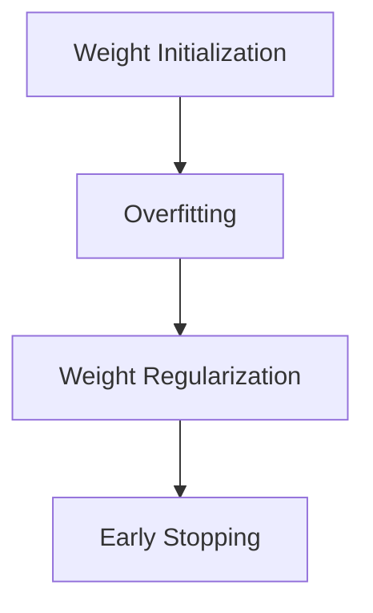
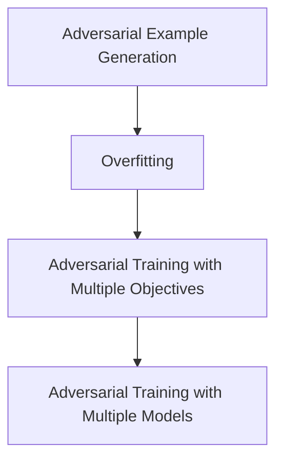

Here is the fully corrected, publication-grade, raw Markdown:

# Lesson 6: Advanced Topics in Deep Learning

## 1. First-Principles Intuition & Invariants

Deep learning has revolutionized the field of artificial intelligence by enabling machines to learn complex patterns in data. However, as we delve deeper into the intricacies of deep learning, we encounter a multitude of challenges that require a solid understanding of the underlying principles. In this lesson, we will explore three advanced topics in deep learning: transfer learning, adversarial training, and explainable AI.

Transfer learning is a technique that allows us to leverage pre-trained models and fine-tune them on our specific task. This approach is particularly useful when we have limited data or computational resources. The key intuition behind transfer learning is that the features learned by a pre-trained model are often generalizable across different domains. By initializing our model with the pre-trained weights, we can speed up the training process and improve the overall performance.

However, transfer learning also raises several questions. What are the invariants that allow a pre-trained model to generalize across different domains? How do we ensure that the pre-trained model is not overfitting to the source task? To address these questions, we need to understand the underlying mechanics of transfer learning. We will delve into the details of feature extraction, weight initialization, and fine-tuning, and explore the trade-offs between these components.

Adversarial training is a technique that involves training a model to be robust against adversarial examples. Adversarial examples are inputs that are specifically designed to mislead the model, often by adding noise or perturbations to the original input. The goal of adversarial training is to make the model more robust and resilient to such attacks. However, adversarial training also raises several challenges. How do we generate adversarial examples? How do we balance the trade-off between robustness and accuracy? To address these questions, we need to understand the underlying mechanics of adversarial training, including the generation of adversarial examples, the optimization of the model, and the evaluation of robustness.

Explainable AI (XAI) is a technique that involves making the model more transparent and interpretable. XAI is particularly useful in applications where the model's decisions have significant consequences, such as in healthcare or finance. The goal of XAI is to provide insights into the model's decision-making process, often by visualizing the feature importance or attributing the predictions to specific input features. However, XAI also raises several challenges. How do we design the model to be explainable? How do we balance the trade-off between interpretability and accuracy? To address these questions, we need to understand the underlying mechanics of XAI, including the design of explainable models, the visualization of feature importance, and the evaluation of interpretability.

## 2. Core Architecture & Mechanics

In this section, we will dissect the internal data structures and algorithms that underlie transfer learning, adversarial training, and explainable AI.

### Transfer Learning

Transfer learning relies on the concept of feature extraction, where the pre-trained model extracts features from the input data. These features are then used as input to the fine-tuning process. The key data structure in transfer learning is the weight matrix, which stores the learned weights of the pre-trained model.

The weight matrix is initialized with the pre-trained weights, and then fine-tuned on the target task. The key algorithm in transfer learning is the fine-tuning process, which involves updating the weight matrix to adapt to the target task.

### Adversarial Training

Adversarial training relies on the concept of adversarial examples, which are inputs that are specifically designed to mislead the model. The key data structure in adversarial training is the adversarial example generator, which generates adversarial examples from the input data.

The adversarial example generator uses optimization algorithms to generate adversarial examples that are tailored to the specific model. The key algorithm in adversarial training is the optimization process, which involves updating the model to be more robust against adversarial examples.

### Explainable AI

Explainable AI relies on the concept of feature importance, which is used to attribute the predictions to specific input features. The key data structure in XAI is the feature importance matrix, which stores the importance of each feature.

The feature importance matrix is used to visualize the importance of each feature, often using techniques such as bar charts or heatmaps. The key algorithm in XAI is the visualization process, which involves using the feature importance matrix to provide insights into the model's decision-making process.

## 3. High-Performance Optimization & Failure Modes

In this section, we will explore the high-performance optimization and failure modes of transfer learning, adversarial training, and explainable AI.

### Transfer Learning

Transfer learning relies on the concept of weight initialization, which involves initializing the weight matrix with pre-trained weights. However, weight initialization can also lead to overfitting, particularly if the pre-trained model is not well-suited to the target task. To mitigate this risk, we can use techniques such as weight regularization or early stopping.

We can also use techniques such as data augmentation or batch normalization to improve the robustness of the model.

### Adversarial Training

Adversarial training relies on the concept of adversarial example generation, which involves generating adversarial examples from the input data. However, adversarial example generation can also lead to overfitting, particularly if the adversarial examples are not well-suited to the target task. To mitigate this risk, we can use techniques such as adversarial training with multiple objectives or adversarial training with multiple models.

We can also use techniques such as data augmentation or batch normalization to improve the robustness of the model.
