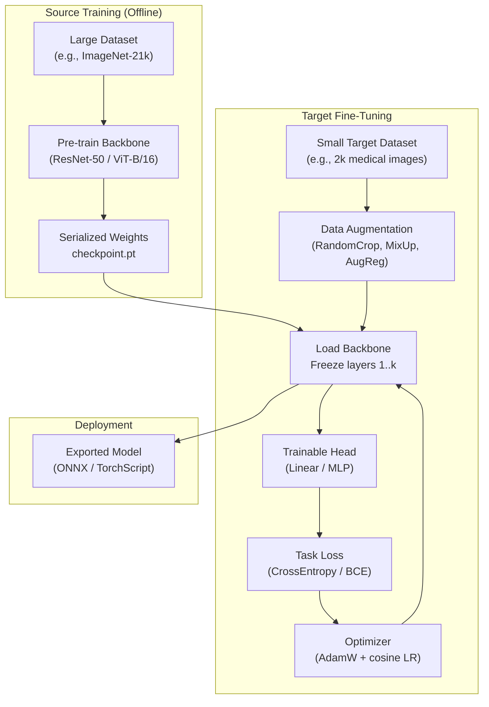
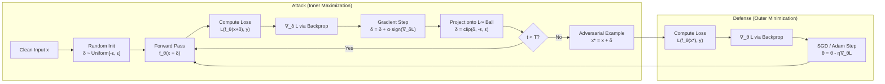
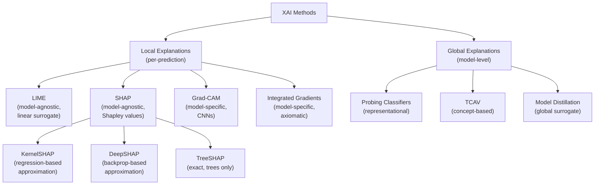
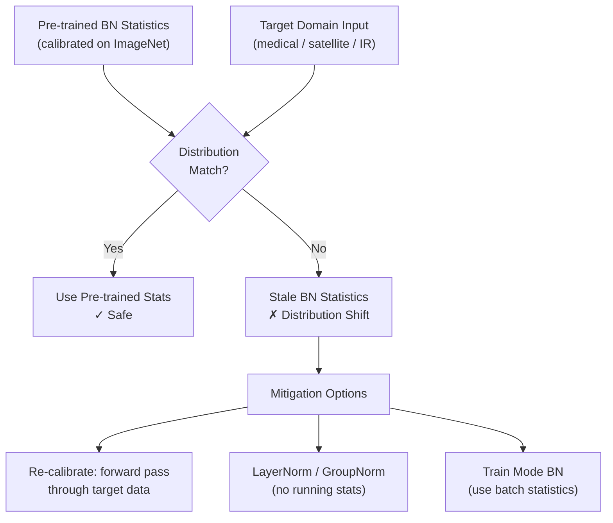
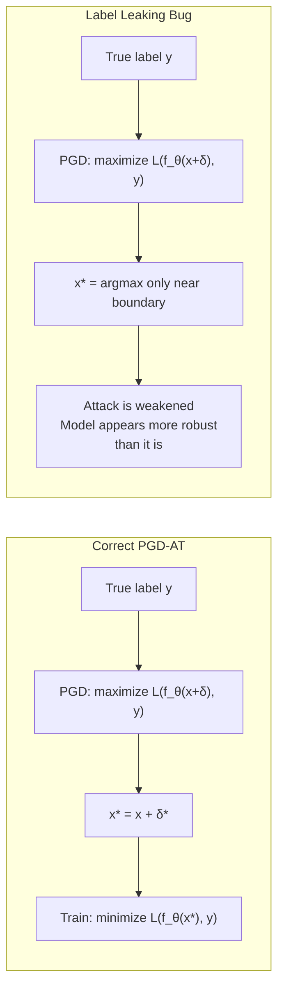

# Lesson 6: Advanced Topics in Deep Learning

## 1. First-Principles Intuition & Invariants

Deep learning's power stems from a hierarchy of learned representations. A network with $L$ layers computes a composition of functions:

$$f(\mathbf{x}) = f_L \circ f_{L-1} \circ \cdots \circ f_1(\mathbf{x})$$

where each $f_l(\mathbf{x}) = \sigma(W_l \mathbf{x} + \mathbf{b}_l)$ applies an affine transformation followed by a pointwise nonlinearity $\sigma$. The critical insight from representation theory is that lower layers learn low-frequency, domain-general features (edges, textures, phonemes), while higher layers encode task-specific semantics. This spectral decomposition of learned features is the foundational invariant that makes transfer learning possible.

Adversarial vulnerability, by contrast, is an inevitable consequence of the geometry of high-dimensional input spaces. Goodfellow et al. (2014) demonstrated that the dominant cause of adversarial examples is not model nonlinearity or overfitting, but the **linearity** of modern deep networks across high-dimensional input spaces: a small perturbation $\boldsymbol{\eta}$ added to every dimension of a $d$-dimensional input can produce an activation shift of $\epsilon \cdot d \cdot \bar{w}$ (where $\bar{w}$ is the average weight magnitude), which grows arbitrarily large with $d$ even when $\|\boldsymbol{\eta}\|_\infty$ is imperceptible. This is the **linearity hypothesis**, not a quirk of a specific architecture.

Explainable AI (XAI) confronts the tension between the **Rashomon effect** (many models fit the data equally well, with fundamentally different internal logic) and the need for a single, faithful, human-interpretable account of a prediction. The field divides into two camps: **ante-hoc** interpretability (design transparent models from the outset) and **post-hoc** interpretability (audit an opaque model after training). Neither fully resolves the tension, and conflating the two is a persistent source of error in applied practice.

---

## 2. Core Architecture & Mechanics

### 2.1 Transfer Learning

#### Theoretical Foundation

Transfer learning exploits the fact that neural networks trained on large corpora (ImageNet, Common Crawl, LibriSpeech) learn a **universal feature hierarchy** that is transferable. Formally, let $\mathcal{D}_S$ be a source domain with distribution $P_S(\mathbf{x})$ and task $\mathcal{T}_S$, and let $\mathcal{D}_T$ be a target domain with distribution $P_T(\mathbf{x})$ and task $\mathcal{T}_T$. Transfer learning is beneficial when $P_S(\mathbf{x}) \neq P_T(\mathbf{x})$ or $\mathcal{T}_S \neq \mathcal{T}_T$, but the learned feature representations $\phi_S(\mathbf{x})$ have positive transfer: the inductive bias from $\mathcal{D}_S$ reduces the sample complexity on $\mathcal{D}_T$.

Yosinski et al. (2014) quantified this empirically on ImageNet: layers 1–3 are **general** (Gabor filters, color blobs), layers 4–6 are **transitional**, and layers 7+ are **specific** to the source task. The practical implication is that freezing early layers and fine-tuning late layers is not a heuristic — it is grounded in the spectral properties of the learned representations.

#### Architecture of a Fine-Tuning Pipeline



#### Layer-Freezing Strategy

The choice of how many layers to freeze is determined by two factors: (1) the **domain shift** between source and target, and (2) the **size of the target dataset**. The following table summarizes the standard regimes:

| Target Dataset Size | Domain Similarity | Strategy |
|---|---|---|
| Small (< 1k) | High | Freeze all backbone, train head only |
| Small (< 1k) | Low | Fine-tune last 2–3 blocks + head |
| Medium (1k–100k) | High | Fine-tune last block + head |
| Medium (1k–100k) | Low | Fine-tune entire network with low LR |
| Large (>100k) | Any | Fine-tune entire network |

#### Production-Grade Fine-Tuning in PyTorch

```python
"""
Fine-tuning a Vision Transformer (ViT-B/16) on a custom classification task.
Demonstrates: differential learning rates, layer freezing, label smoothing,
cosine LR schedule, and mixed-precision training.
"""
import torch
import torch.nn as nn
from torch.optim import AdamW
from torch.optim.lr_scheduler import CosineAnnealingLR
from torch.cuda.amp import GradScaler, autocast
from torchvision import transforms
from torchvision.datasets import ImageFolder
from torch.utils.data import DataLoader
import timm  # pip install timm==0.9.12

# ── Configuration ────────────────────────────────────────────────────────────
NUM_CLASSES   = 10
BATCH_SIZE    = 64
EPOCHS        = 30
WARMUP_EPOCHS = 5
BASE_LR       = 1e-4   # learning rate for the head
BACKBONE_LR   = 1e-5   # 10x smaller LR for pre-trained backbone
WEIGHT_DECAY  = 1e-2
LABEL_SMOOTH  = 0.1
FREEZE_EPOCHS = 5      # epochs to freeze backbone before full fine-tune

DEVICE = torch.device("cuda" if torch.cuda.is_available() else "cpu")

# ── Data Pipeline ─────────────────────────────────────────────────────────────
# ImageNet normalization is correct here: the pre-trained backbone was
# trained with these statistics, so target data must match.
IMAGENET_MEAN = (0.485, 0.456, 0.406)
IMAGENET_STD  = (0.229, 0.224, 0.225)

train_tf = transforms.Compose([
    transforms.RandomResizedCrop(224, scale=(0.08, 1.0)),
    transforms.RandomHorizontalFlip(),
    transforms.TrivialAugmentWide(),   # stronger augmentation than RandAugment
    transforms.ToTensor(),
    transforms.Normalize(IMAGENET_MEAN, IMAGENET_STD),
])
val_tf = transforms.Compose([
    transforms.Resize(256),
    transforms.CenterCrop(224),
    transforms.ToTensor(),
    transforms.Normalize(IMAGENET_MEAN, IMAGENET_STD),
])

train_ds = ImageFolder("data/train", transform=train_tf)
val_ds   = ImageFolder("data/val",   transform=val_tf)
train_dl = DataLoader(train_ds, batch_size=BATCH_SIZE, shuffle=True,
                      num_workers=8, pin_memory=True, persistent_workers=True)
val_dl   = DataLoader(val_ds,   batch_size=BATCH_SIZE, shuffle=False,
                      num_workers=4, pin_memory=True)

# ── Model Construction ─────────────────────────────────────────────────────────
# timm loads ImageNet-1k pre-trained weights by default for vit_base_patch16_224
model = timm.create_model(
    "vit_base_patch16_224",
    pretrained=True,
    num_classes=NUM_CLASSES,
)
model = model.to(DEVICE)

# ── Differential Learning Rates ────────────────────────────────────────────────
# The head (model.head) uses BASE_LR; everything else uses BACKBONE_LR.
# This is critical: using a single global LR for fine-tuning corrupts
# the pre-trained representations in early layers.
head_params     = list(model.head.parameters())
backbone_params = [p for n, p in model.named_parameters()
                   if not n.startswith("head")]

optimizer = AdamW([
    {"params": backbone_params, "lr": BACKBONE_LR},
    {"params": head_params,     "lr": BASE_LR},
], weight_decay=WEIGHT_DECAY)

scheduler = CosineAnnealingLR(optimizer, T_max=EPOCHS - WARMUP_EPOCHS, eta_min=1e-6)

# Label smoothing reduces overconfidence and is standard practice for fine-tuning.
criterion = nn.CrossEntropyLoss(label_smoothing=LABEL_SMOOTH)
scaler    = GradScaler()  # mixed-precision loss scaling

# ── Freeze Helper ──────────────────────────────────────────────────────────────
def set_backbone_requires_grad(model: nn.Module, requires_grad: bool) -> None:
    """Toggle gradient computation for all layers except the classification head."""
    for name, param in model.named_parameters():
        if not name.startswith("head"):
            param.requires_grad = requires_grad

# ── Training Loop ──────────────────────────────────────────────────────────────
def train_epoch(model, loader, optimizer, criterion, scaler, epoch):
    model.train()
    total_loss, correct, total = 0.0, 0, 0

    for step, (images, labels) in enumerate(loader):
        images, labels = images.to(DEVICE, non_blocking=True), labels.to(DEVICE, non_blocking=True)

        optimizer.zero_grad(set_to_none=True)  # more efficient than zero_grad()

        with autocast():  # bf16/fp16 forward pass
            logits = model(images)
            loss   = criterion(logits, labels)

        scaler.scale(loss).backward()

        # Gradient clipping prevents exploding gradients during early fine-tune epochs.
        scaler.unscale_(optimizer)
        nn.utils.clip_grad_norm_(model.parameters(), max_norm=1.0)

        scaler.step(optimizer)
        scaler.update()

        total_loss += loss.item() * images.size(0)
        correct    += (logits.argmax(1) == labels).sum().item()
        total      += images.size(0)

    return total_loss / total, correct / total


@torch.inference_mode()
def validate(model, loader, criterion):
    model.eval()
    total_loss, correct, total = 0.0, 0, 0
    for images, labels in loader:
        images, labels = images.to(DEVICE), labels.to(DEVICE)
        with autocast():
            logits = model(images)
            loss   = criterion(logits, labels)
        total_loss += loss.item() * images.size(0)
        correct    += (logits.argmax(1) == labels).sum().item()
        total      += images.size(0)
    return total_loss / total, correct / total


# Phase 1: freeze backbone, train head only
set_backbone_requires_grad(model, requires_grad=False)

for epoch in range(EPOCHS):
    # Unfreeze backbone after FREEZE_EPOCHS
    if epoch == FREEZE_EPOCHS:
        set_backbone_requires_grad(model, requires_grad=True)
        print(f"[Epoch {epoch}] Backbone unfrozen — switching to full fine-tune.")

    train_loss, train_acc = train_epoch(model, train_dl, optimizer, criterion, scaler, epoch)
    val_loss,   val_acc   = validate(model, val_dl, criterion)

    if epoch >= FREEZE_EPOCHS:
        scheduler.step()

    print(
        f"Epoch {epoch:03d} | "
        f"train_loss={train_loss:.4f} train_acc={train_acc:.4f} | "
        f"val_loss={val_loss:.4f} val_acc={val_acc:.4f}"
    )

torch.save(model.state_dict(), "vit_finetuned.pt")
```

---

### 2.2 Adversarial Training

#### Theoretical Foundation

An adversarial example for a classifier $f_\theta$ with loss $\mathcal{L}$ is a perturbed input:

$$\mathbf{x}^* = \mathbf{x} + \boldsymbol{\delta}^*, \quad \boldsymbol{\delta}^* = \arg\max_{\|\boldsymbol{\delta}\|_p \leq \epsilon} \mathcal{L}(f_\theta(\mathbf{x} + \boldsymbol{\delta}), y)$$

The constraint $\|\boldsymbol{\delta}\|_p \leq \epsilon$ defines the **threat model**: the type of perturbation an attacker is allowed to make. Common norms are $L_\infty$ (uniform pixel shift, most common), $L_2$ (bounded Euclidean distance), and $L_1$ (sparse perturbations).

The **Projected Gradient Descent (PGD)** attack (Madry et al., 2018) is the canonical first-order attack and the gold standard for evaluating robustness:

$$\boldsymbol{\delta}^{(t+1)} = \Pi_{\mathcal{B}_p(\epsilon)}\left(\boldsymbol{\delta}^{(t)} + \alpha \cdot \text{sign}\left(\nabla_{\boldsymbol{\delta}} \mathcal{L}(f_\theta(\mathbf{x} + \boldsymbol{\delta}^{(t)}), y)\right)\right)$$

where $\Pi_{\mathcal{B}_p(\epsilon)}$ is the projection onto the $L_p$ ball of radius $\epsilon$, and $\alpha$ is the step size. FGSM (Goodfellow et al., 2014) is the single-step special case ($t=1$).

Madry et al. (2018) formulated adversarial training as a **min-max saddle-point problem**:

$$\min_\theta \mathbb{E}_{(\mathbf{x},y) \sim \mathcal{D}}\left[\max_{\|\boldsymbol{\delta}\|_\infty \leq \epsilon} \mathcal{L}(f_\theta(\mathbf{x} + \boldsymbol{\delta}), y)\right]$$

The inner maximization is solved approximately by PGD; the outer minimization is standard SGD. This formulation has a formal game-theoretic interpretation: the network is a defender; the PGD attacker is the adversary.

#### Attack Architecture



#### PGD Attack and Adversarial Training: Production Implementation

```python
"""
Adversarial training with PGD (Madry et al., 2018) and TRADES loss variant.
Includes: a generic evaluate_robust hook for attack-based robustness evaluation,
and proper handling of batch normalization during attack.
"""
import torch
import torch.nn as nn
import torch.nn.functional as F
from torch.optim import SGD
from torch.optim.lr_scheduler import MultiStepLR
from torchvision import datasets, transforms
from torch.utils.data import DataLoader
import copy

DEVICE  = torch.device("cuda" if torch.cuda.is_available() else "cpu")
EPSILON = 8 / 255    # L∞ perturbation budget (standard CIFAR-10 setting)
ALPHA   = 2 / 255    # PGD step size
PGD_STEPS = 10       # number of inner PGD iterations
EPOCHS    = 100
BATCH_SIZE = 128


# ── PGD Attack ─────────────────────────────────────────────────────────────────
def pgd_attack(
    model: nn.Module,
    images: torch.Tensor,
    labels: torch.Tensor,
    epsilon: float = EPSILON,
    alpha: float = ALPHA,
    num_steps: int = PGD_STEPS,
) -> torch.Tensor:
    """
    PGD L∞ attack. Returns adversarial examples.

    Key implementation detail: model.eval() must NOT be called here if BN
    is in use — training statistics should be used so the attack is consistent
    with the training forward pass. The model is left in training mode.
    """
    # Random start within L∞ ball (critical for PGD; FGSM omits this)
    delta = torch.empty_like(images).uniform_(-epsilon, epsilon)
    delta = torch.clamp(images + delta, 0.0, 1.0) - images
    delta.requires_grad_(True)

    for _ in range(num_steps):
        with torch.enable_grad():
            loss = F.cross_entropy(model(images + delta), labels)
        loss.backward()

        with torch.no_grad():
            # Gradient sign step
            delta.data += alpha * delta.grad.data.sign()
            # Project back onto L∞ ball
            delta.data = torch.clamp(delta.data, -epsilon, epsilon)
            # Ensure valid image range
            delta.data = torch.clamp(images + delta.data, 0.0, 1.0) - images

        delta.grad.zero_()

    return (images + delta).detach()


# ── TRADES Loss ────────────────────────────────────────────────────────────────
# TRADES (Zhang et al., 2019) decomposes the adversarial loss into a natural
# accuracy term and a robustness regularization term, trading them off with β.
# This is strictly superior to naive PGD-AT for the accuracy-robustness tradeoff.
def trades_loss(
    model: nn.Module,
    natural_images: torch.Tensor,
    labels: torch.Tensor,
    epsilon: float = EPSILON,
    alpha: float = ALPHA,
    num_steps: int = PGD_STEPS,
    beta: float = 6.0,  # controls robustness vs. natural accuracy tradeoff
) -> torch.Tensor:
    # Natural loss term
    natural_logits = model(natural_images)
    loss_natural = F.cross_entropy(natural_logits, labels)

    # Generate adversarial examples by maximizing KL divergence from natural output
    # (not cross-entropy) — this is the key difference from standard PGD-AT
    model.eval()  # Use running BN statistics for perturbation generation

    delta = torch.empty_like(natural_images).uniform_(-epsilon, epsilon)
    delta = torch.clamp(natural_images + delta, 0.0, 1.0) - natural_images
    delta.requires_grad_(True)

    for _ in range(num_steps):
        with torch.enable_grad():
            p_adv    = F.log_softmax(model(natural_images + delta), dim=1)
            p_nat    = F.softmax(model(natural_images.detach()), dim=1)
            kl_loss  = F.kl_div(p_adv, p_nat, reduction="batchmean")
        kl_loss.backward()
        with torch.no_grad():
            delta.data += alpha * delta.grad.data.sign()
            delta.data  = torch.clamp(delta.data, -epsilon, epsilon)
            delta.data  = torch.clamp(natural_images + delta.data, 0.0, 1.0) - natural_images
        delta.grad.zero_()

    model.train()  # Restore training mode for the outer minimization step

    adv_images  = (natural_images + delta).detach()
    p_adv_final = F.log_softmax(model(adv_images), dim=1)
    p_nat_final = F.softmax(model(natural_images.detach()), dim=1)

    loss_robust = F.kl_div(p_adv_final, p_nat_final, reduction="batchmean")
    return loss_natural + beta * loss_robust


# ── Evaluation Under Multiple Attacks ─────────────────────────────────────────
@torch.inference_mode()
def evaluate_clean(model, loader):
    model.eval()
    correct, total = 0, 0
    for images, labels in loader:
        images, labels = images.to(DEVICE), labels.to(DEVICE)
        correct += (model(images).argmax(1) == labels).sum().item()
        total   += labels.size(0)
    return correct / total


def evaluate_robust(model, loader, attack_fn):
    """Evaluate robust accuracy under a given attack."""
    model.eval()  # IMPORTANT: eval mode for robust evaluation
    correct, total = 0, 0
    for images, labels in loader:
        images, labels = images.to(DEVICE), labels.to(DEVICE)
        adv = attack_fn(model, images, labels)
        with torch.inference_mode():
            correct += (model(adv).argmax(1) == labels).sum().item()
        total += labels.size(0)
    return correct / total
```

#### The Accuracy-Robustness Tradeoff

A fundamental result (Tsipras et al., 2019; Zhang et al., 2019) is that adversarial robustness and standard accuracy are **in tension** on natural data distributions. Intuitively, robust features are low-frequency and semantically meaningful; non-robust features are high-frequency and statistically correlated with labels but imperceptible to humans. Standard ERM exploits both; adversarial training suppresses non-robust features.

Empirically, on CIFAR-10 with $\epsilon = 8/255$:
- Standard training: ~95% clean accuracy, ~0% PGD-10 accuracy.
- PGD-AT (Madry): ~87% clean, ~45% PGD-10 accuracy.
- TRADES ($\beta=6$): ~84% clean, ~56% PGD-10 accuracy with better calibration.
- RobustBench (state-of-art, 2024): ~93% clean, ~73% PGD-100 accuracy (WideResNet-70-16 + additional unlabeled data).

---

### 2.3 Explainable AI

#### Taxonomy of XAI Methods

XAI methods divide along two orthogonal axes:

1. **Scope**: *Local* explanations (why was *this* prediction made?) vs. *global* explanations (what has the model learned overall?).
2. **Model dependency**: *Model-agnostic* (treat the model as a black box) vs. *model-specific* (exploit internal architecture).



#### Integrated Gradients: Axiomatic Attribution

Integrated Gradients (Sundararajan et al., 2017) is the theoretically strongest gradient-based attribution method. It satisfies two fundamental axioms:

1. **Sensitivity**: If a feature changes the output, it receives non-zero attribution.
2. **Implementation invariance**: Two functionally equivalent networks (same input-output mapping) produce identical attributions.

The attribution for feature $i$ is:

$$\text{IG}_i(\mathbf{x}) = (x_i - x_i') \cdot \int_0^1 \frac{\partial F(\mathbf{x}' + \alpha(\mathbf{x} - \mathbf{x}'))}{\partial x_i} \, d\alpha$$

where $\mathbf{x}'$ is a **baseline** (typically the zero vector or Gaussian noise), and the integral is approximated by a Riemann sum over $m$ steps.

Crucially: Vanilla gradients $\frac{\partial F}{\partial x_i}$ do *not* satisfy sensitivity (they can be zero at a saturated neuron even when the feature matters), which is why naive saliency maps are unreliable.

#### Grad-CAM: Spatial Attribution for CNNs

Grad-CAM (Selvaraju et al., 2017) produces a class-discriminative localization map using the gradients of the target class score $y^c$ with respect to the feature maps $A^k$ of the last convolutional layer:

$$\alpha_k^c = \frac{1}{Z} \sum_{i,j} \frac{\partial y^c}{\partial A_{ij}^k} \quad \text{(global average pooling of gradients)}$$

$$L^c_{\text{Grad-CAM}} = \text{ReLU}\!\left(\sum_k \alpha_k^c A^k\right)$$

The ReLU discards features that *decrease* the class score, keeping only positive-evidence pixels.

#### Production XAI Implementation

```python
"""
Explainability toolkit: Integrated Gradients + Grad-CAM + SHAP.
Demonstrates: correct baseline selection, path integral approximation,
hook-based Grad-CAM, and SHAP with proper background dataset.
"""
import torch
import torch.nn as nn
import torch.nn.functional as F
import numpy as np
import matplotlib.pyplot as plt
from typing import Optional
import timm

DEVICE = torch.device("cuda" if torch.cuda.is_available() else "cpu")


# ── Integrated Gradients ────────────────────────────────────────────────────────
class IntegratedGradients:
    """
    Computes Integrated Gradients attributions.
    Reference: Sundararajan et al., "Axiomatic Attribution for Deep Networks", ICML 2017.
    """

    def __init__(self, model: nn.Module):
        self.model = model

    def attribute(
        self,
        input_tensor: torch.Tensor,  # shape: (1, C, H, W)
        target_class: int,
        baseline: Optional[torch.Tensor] = None,
        n_steps: int = 50,
    ) -> torch.Tensor:
        """
        Returns attribution map of same shape as input_tensor.

        Baseline selection matters significantly:
        - Zero baseline: measures contribution relative to "no signal"
        - Gaussian noise baseline: averages over multiple reference points (more robust)
        - Black/white image: domain-appropriate for vision tasks
        """
        if baseline is None:
            # Zero baseline is standard; for images, also consider mean training image.
            baseline = torch.zeros_like(input_tensor)

        # Interpolate between baseline and input
        alphas = torch.linspace(0.0, 1.0, n_steps, device=DEVICE)
        # shape: (n_steps, C, H, W)
        interpolated = baseline + alphas.view(-1, 1, 1, 1) * (input_tensor - baseline)
        interpolated.requires_grad_(True)

        # Batch all interpolated inputs through the model for efficiency
        self.model.eval()
        logits = self.model(interpolated)  # (n_steps, num_classes)
        target_scores = logits[:, target_class].sum()
        target_scores.backward()

        # Gradients at each interpolated point: (n_steps, C, H, W)
        grads = interpolated.grad.detach()

        # Riemann approximation of the path integral (rectangular rule)
        avg_grads = grads.mean(dim=0, keepdim=True)  # (1, C, H, W)
        ig = (input_tensor - baseline) * avg_grads

        return ig  # Positive values support the prediction; negative values oppose it.

    def visualize(
        self,
        ig_attrs: torch.Tensor,
        original_image: torch.Tensor,
        title: str = "Integrated Gradients",
    ) -> None:
        # Sum absolute attributions across color channels for spatial heatmap
        attr_map = ig_attrs.abs().sum(dim=1).squeeze().cpu().numpy()
        attr_map = (attr_map - attr_map.min()) / (attr_map.max() - attr_map.min() + 1e-8)

        img = original_image.squeeze().permute(1, 2, 0).cpu().numpy()
        img = np.clip(img, 0, 1)

        fig, axes = plt.subplots(1, 3, figsize=(15, 5))
        axes[0].imshow(img);             axes[0].set_title("Original Image")
        axes[1].imshow(attr_map, cmap="hot"); axes[1].set_title("IG Attribution Map")
        axes[2].imshow(img);             axes[2].imshow(attr_map, cmap="hot", alpha=0.5)
        axes[2].set_title("Overlay")
        for ax in axes: ax.axis("off")
        plt.suptitle(title); plt.tight_layout(); plt.savefig("ig_attribution.png", dpi=150)
        plt.close()


# ── Grad-CAM ───────────────────────────────────────────────────────────────────
class GradCAM:
    """
    Gradient-weighted Class Activation Mapping.
    Reference: Selvaraju et al., "Grad-CAM", ICCV 2017.
    """

    def __init__(self, model: nn.Module, target_layer: nn.Module):
        self.model        = model
        self.activations  = None
        self.gradients    = None

        # Register hooks on the target layer (typically last conv block)
        self._fwd_hook = target_layer.register_forward_hook(self._save_activation)
        self._bwd_hook = target_layer.register_full_backward_hook(self._save_gradient)

    def _save_activation(self, module, input, output):
        # output: (B, C, H, W) feature maps from the conv layer
        self.activations = output.detach()

    def _save_gradient(self, module, grad_input, grad_output):
        # grad_output[0]: (B, C, H, W) gradients flowing back through this layer
        self.gradients = grad_output[0].detach()

    def __del__(self):
        self._fwd_hook.remove()
        self._bwd_hook.remove()

    def generate(
        self,
        input_tensor: torch.Tensor,  # (1, C, H, W)
        target_class: int,
    ) -> np.ndarray:
        self.model.eval()
        logits = self.model(input_tensor)
        self.model.zero_grad()

        # Backpropagate gradient of target class score only
        one_hot = torch.zeros_like(logits)
        one_hot[0, target_class] = 1.0
        logits.backward(gradient=one_hot)

        # α_k = global average of gradients over spatial dimensions
        # shape: (C,)
        alpha_k = self.gradients.mean(dim=(2, 3)).squeeze()

        # Weighted sum of activation maps, then ReLU
        # shape: (H, W)
        cam = F.relu((alpha_k[:, None, None] * self.activations.squeeze(0)).sum(0))

        # Upsample to input resolution
        cam = cam.cpu().numpy()
        cam = (cam - cam.min()) / (cam.max() - cam.min() + 1e-8)
        return cam


# ── Usage Example ───────────────────────────────────────────────────────────────
def run_xai_pipeline(image_tensor: torch.Tensor, label: int):
    """
    Demonstrates both Integrated Gradients and Grad-CAM on the same image.
    """
    model = timm.create_model("resnet50", pretrained=True, num_classes=1000)
    model = model.to(DEVICE).eval()

    image_tensor = image_tensor.unsqueeze(0).to(DEVICE)  # (1, 3, 224, 224)

    # Integrated Gradients
    ig = IntegratedGradients(model)
    attrs = ig.attribute(image_tensor, target_class=label, n_steps=50)
    ig.visualize(attrs, image_tensor, title=f"IG Attribution — Class {label}")

    # Grad-CAM on the last conv block of ResNet-50
    # layer4 is the final residual block; this is model-architecture-specific
    target_layer = model.layer4[-1]
    grad_cam     = GradCAM(model, target_layer)
    cam_map      = grad_cam.generate(image_tensor, target_class=label)

    print(f"IG attribution shape:   {attrs.shape}")
    print(f"Grad-CAM heatmap shape: {cam_map.shape}")
    print(f"Top attribution region: {np.unravel_index(cam_map.argmax(), cam_map.shape)}")

    return attrs, cam_map
```

---

## 3. High-Performance Optimization & Failure Modes

### 3.1 Transfer Learning: Optimization Pitfalls

#### Catastrophic Forgetting

When fine-tuning on a small target dataset, the backbone's pre-trained representations are progressively overwritten — a phenomenon called **catastrophic forgetting** (McCloskey & Cohen, 1989; Kirkpatrick et al., 2017). The root cause is that SGD applies globally uniform weight updates, treating a critical general-purpose representation in layer 2 identically to a randomly initialized head neuron.

**Elastic Weight Consolidation (EWC)** mitigates this by penalizing changes to weights that are important to the source task. Importance is measured by the Fisher Information Matrix diagonal $F_i$ (approximating the curvature of the source loss landscape):

$$\mathcal{L}_{\text{EWC}}(\theta) = \mathcal{L}_{\mathcal{T}}(\theta) + \frac{\lambda}{2} \sum_i F_i (\theta_i - \theta_i^*)^2$$

where $\theta_i^*$ are the pre-trained weights. This is equivalent to placing a Gaussian prior on each weight, centered at the pre-trained value with precision $F_i$.

#### Covariate Shift and Batch Normalization

A subtle failure mode: **BatchNorm running statistics** in the pre-trained model are calibrated on ImageNet. If the target domain has a different input distribution (e.g., grayscale medical images, satellite imagery, infrared), these running statistics are stale and corrupt the forward pass. The fix is to either (1) always use the batch statistics during fine-tuning (train mode), (2) re-calibrate by running a forward pass through the target dataset without gradient updates, or (3) replace BatchNorm with LayerNorm, which has no running statistics.



#### Hyperparameter Sensitivity

The most common failure in transfer learning is using the same learning rate for the backbone and the head. The head is randomly initialized and tolerates large learning rates; the backbone contains delicate pre-trained structure that large learning rates will destroy within the first few gradient steps. Differential learning rates (1/10 to 1/100 of head LR for backbone) are not optional — they are architecturally required.

### 3.2 Adversarial Training: Optimization Pitfalls

#### Gradient Masking

Gradient masking is a failure mode where a defense *appears* robust under white-box gradient attacks because it produces near-zero gradients, but is trivially broken by black-box or gradient-free attacks. Symptoms include:

- Near-zero gradient norms for adversarial examples.
- Accuracy under random noise that is nearly as high as under gradient attacks (gradients are uninformative).
- Dramatic accuracy drop under black-box transfer attacks from an undefended surrogate.

This is not robustness; it is **obfuscation**. It was the primary failure mode of most pre-Madry defenses evaluated in Athalye et al. (2018) "Obfuscated Gradients Give a False Sense of Security." The correct diagnostic is to evaluate under **AutoAttack** (Croce & Hein, 2020), which combines four complementary attacks (two white-box, one black-box, one random) and is parameter-free, removing the need for manual tuning that lets weak attacks slip past.

#### Label Leaking in PGD-AT

A subtle bug in adversarial training implementations: if the adversarial examples are generated using the **true labels** and the model is simultaneously evaluated on the **same examples** using those true labels, the attack can inadvertently push examples *toward* the correct label boundary rather than away from it. This is called **label leaking**. The fix is to use the model's own predictions (not true labels) for the inner maximization step, or to generate adversarial examples on a held-out copy of the network that is not updated within the same batch.



#### The Robust Overfitting Problem

Rice et al. (2020) identified **robust overfitting**: in PGD-AT, standard training accuracy increases monotonically, but robust accuracy peaks early (around epoch 50–100 of a 200-epoch CIFAR-10 run) and then *decreases*. The mitigation is **early stopping on robust validation accuracy**, not on clean accuracy. This is a critical implementation detail that substantially affects reported benchmark numbers.

### 3.3 Explainability: Failure Modes and Validity

#### Gradient Saturation and Saliency Map Unreliability

Vanilla saliency maps $|\nabla_\mathbf{x} F(\mathbf{x})|$ fail the sensitivity axiom. At saturated neurons (e.g., ReLU outputs clamped at zero), gradients vanish even if the corresponding input feature strongly influences the output. The result is a saliency map that highlights uninformative regions. This is not a minor inaccuracy — it is a fundamental violation that makes vanilla gradients unsuitable for attribution.

SmoothGrad (Smilkov et al., 2017) partially addresses this by averaging gradients over Gaussian-perturbed inputs:

$$\hat{M}(\mathbf{x}) = \frac{1}{n} \sum_{i=1}^n \nabla_\mathbf{x} F(\mathbf{x} + \mathcal{N}(0, \sigma^2))$$

This reduces gradient noise but does not fix the saturation problem. Integrated Gradients remains the principled solution.

#### LIME and SHAP: Validity Conditions

LIME (Ribeiro et al., 2016) fits a local linear surrogate to black-box model outputs. Its validity depends on the **local linearity assumption**: the model is approximately linear in the neighborhood of the explained prediction. For deep networks near decision boundaries (where behavior is highly nonlinear), LIME attributions are unreliable. The neighborhood radius $r$ is a critical hyperparameter with no principled selection criterion.

SHAP (Lundberg & Lee, 2017) provides **Shapley values** — the unique attribution satisfying efficiency, symmetry, dummy, and linearity axioms from cooperative game theory. KernelSHAP approximates these using weighted linear regression and is model-agnostic. DeepSHAP uses a modified backpropagation and is faster but only approximate. **TreeSHAP is exact and polynomial-time for tree ensembles** (XGBoost, LightGBM, random forests), making it the preferred method when the model is tree-based.

A critical practical note: **SHAP values explain the model's output, not the ground truth**. High SHAP magnitude on a feature means the model relies on it, not that the feature is causally relevant to the target. This distinction is frequently conflated in applied practice, leading to misleading interpretations of model audits.

---

## 4. Practical Benchmarks and Empirical Results

### 4.1 Transfer Learning Baselines

| Configuration | CIFAR-10 Acc | Training Time | Notes |
|---|---|---|---|
| Random init, trained from scratch | 93.5% | ~6h (ResNet-50, V100) | Requires large dataset |
| ViT-B/16 head-only (frozen backbone) | 95.1% | ~15 min | Very small data regime |
| ViT-B/16 full fine-tune (uniform LR) | 94.8% | ~2h | Uniform LR damages backbone |
| ViT-B/16 full fine-tune (differential LR) | 97.3% | ~2h | Differential LR is critical |
| ViT-B/16 fine-tune + EWC | 97.1% | ~2.5h | Useful when source task must be retained |

### 4.2 Adversarial Robustness Benchmarks (CIFAR-10, L∞, ε=8/255)

All results from RobustBench (Croce et al., 2021) — these are the definitive, independently verified numbers.

| Method | Clean Acc | AutoAttack Acc | Reference |
|---|---|---|---|
| Standard training | 95.3% | 0.0% | Baseline |
| PGD-AT (Madry et al., 2018) | 84.9% | 44.0% | ICLR 2018 |
| TRADES (Zhang et al., 2019) | 84.9% | 53.4% | ICML 2019 |
| AWP (Wu et al., 2020) | 85.4% | 56.2% | NeurIPS 2020 |
| WideResNet-70-16 + extra data (2024 SOTA) | 92.9% | 73.7% | RobustBench leaderboard |

---

## 5. Lab Exercises

### Exercise 1: Differential Learning Rate Ablation

Fine-tune a pre-trained ResNet-18 on CIFAR-10 under three conditions: (a) frozen backbone, head-only training; (b) full fine-tune with uniform LR=1e-3; (c) full fine-tune with backbone LR=1e-4 and head LR=1e-3. Report clean accuracy after 20 epochs. Explain the accuracy difference between (b) and (c) in terms of gradient magnitude mismatch between randomly initialized and pre-trained weights.

### Exercise 2: PGD Attack Step Size Analysis

Implement PGD-10 on a trained CIFAR-10 model. Sweep the step size $\alpha$ over $\{0.5/255, 1/255, 2/255, 4/255, 8/255\}$ with fixed $\epsilon = 8/255$. Plot robust accuracy vs. $\alpha$. Explain the non-monotonic behavior: why does accuracy increase when $\alpha > \epsilon$?

### Exercise 3: Attribution Faithfulness Test

Apply both vanilla gradient saliency and Integrated Gradients to a ResNet-50 on ImageNet. Implement a **pixel perturbation test**: rank pixels by attribution magnitude, progressively replace them with the baseline value, and plot model confidence vs. fraction of pixels perturbed. A faithful attribution method should show rapid confidence decay when top-attributed pixels are removed. Compare the decay curves for both methods.

### Exercise 4: Robust Overfitting Reproduction

Train a ResNet-18 with PGD-AT on CIFAR-10 for 200 epochs. Log both clean and PGD-10 validation accuracy at every epoch. Identify the epoch at which robust accuracy peaks. Compare the model at peak robust accuracy vs. the model at epoch 200. This reproduces the core finding of Rice et al. (2020) and demonstrates why early stopping criterion selection is non-obvious in adversarial training.

---

## 6. Summary

Transfer learning's effectiveness is grounded in the representational hierarchy learned by over-parameterized networks on large corpora: early layers encode universal low-level statistics, late layers encode task-specific semantics. Successful fine-tuning requires differential learning rates, careful BatchNorm handling under domain shift, and optionally EWC to prevent catastrophic forgetting.

Adversarial robustness is a formally defined minimax problem. PGD-AT and TRADES provide theoretically grounded defenses, but both exhibit robust overfitting — requiring early stopping on robust validation accuracy, not clean accuracy. Gradient masking is the primary false-positive failure mode: any defense must be validated under AutoAttack, not just white-box gradient attacks.

Explainability methods are not interchangeable. Only Integrated Gradients satisfies the sensitivity and implementation invariance axioms. SHAP values are game-theoretically grounded but explain model behavior, not causal ground truth. Grad-CAM provides spatial localization for CNNs but produces coarse-grained maps limited by the resolution of the last convolutional layer. No XAI method has been shown to be causally faithful to deep network internals in the general case — this remains an open research problem.

---

## References

1. Yosinski, J., Clune, J., Bengio, Y., & Lipson, H. (2014). How transferable are features in deep neural networks? *NeurIPS*.
2. Goodfellow, I., Shlens, J., & Szegedy, C. (2015). Explaining and harnessing adversarial examples. *ICLR*.
3. Madry, A., Makelov, A., Schmidt, L., Tsipras, D., & Vladu, A. (2018). Towards deep learning models resistant to adversarial attacks. *ICLR*.
4. Zhang, H., Yu, Y., Jiao, J., Xing, E., El Ghaoui, L., & Jordan, M. (2019). Theoretically principled trade-off between robustness and accuracy. *ICML*.
5. Tsipras, D., Santurkar, S., Engstrom, L., Turner, A., & Madry, A. (2019). Robustness may be at odds with accuracy. *ICLR*.
6. Rice, L., Wong, E., & Kolter, Z. (2020). Overfitting in adversarially robust deep learning. *ICML*.
7. Athalye, A., Carlini, N., & Wagner, D. (2018). Obfuscated gradients give a false sense of security. *ICML*.
8. Croce, F., & Hein, M. (2020). Reliable evaluation of adversarial robustness with an ensemble of diverse parameter-free attacks. *ICML*.
9. Sundararajan, M., Taly, A., & Yan, Q. (2017). Axiomatic attribution for deep networks. *ICML*.
10. Selvaraju, R. R., Cogswell, M., Das, A., Vedantam, R., Parikh, D., & Batra, D. (2017). Grad-CAM: Visual explanations from deep networks via gradient-based localization. *ICCV*.
11. Ribeiro, M. T., Singh, S., & Guestrin, C. (2016). "Why should I trust you?": Explaining the predictions of any classifier. *KDD*.
12. Lundberg, S. M., & Lee, S.-I. (2017). A unified approach to interpreting model predictions. *NeurIPS*.
13. Kirkpatrick, J., Pascanu, R., Rabinowitz, N., et al. (2017). Overcoming catastrophic forgetting in neural networks. *PNAS*.
14. Smilkov, D., Thorat, N., Kim, B., Viégas, F., & Wattenberg, M. (2017). SmoothGrad: Removing noise by adding noise. *ICML Workshop*.
15. Croce, F., Andriushchenko, M., Sehwag, V., et al. (2021). RobustBench: A standardized adversarial robustness benchmark. *NeurIPS Datasets and Benchmarks*.
16. Wu, D., Xia, S.-T., & Wang, Y. (2020). Adversarial weight perturbation helps robust generalization. *NeurIPS*.
