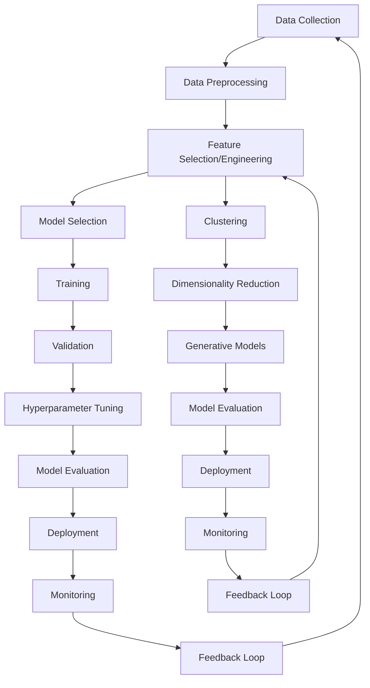

# Lesson 1: Foundations & System Invariants

## Curriculum Roadmap
This masterclass curriculum on the foundations of machine learning (ML) will delve deeply into the core principles and architectural invariants that underpin supervised and unsupervised learning. The curriculum is structured to provide a comprehensive understanding, starting with the fundamental mental models and problem spaces, followed by rigorous guarantees and invariants, and concluding with high-level process and component architectures. The modules are designed to build upon each other, ensuring a solid theoretical and practical foundation for senior software engineers, systems programmers, and infrastructure architects.

## 1. First-Principles Mental Model & Problem Space

The advent of machine learning represents a paradigm shift in how software systems interact with data. Traditional programming relies on explicit rules and algorithms crafted by human engineers to solve specific problems. In contrast, machine learning leverages statistical models and algorithms to learn patterns and make predictions from data, thereby automating the process of rule discovery. This shift is driven by the increasing availability of large datasets and the computational power required to process them.

At its core, machine learning is about building models that can generalize from observed data to make accurate predictions or decisions on unseen data. The problem space of machine learning is vast and encompasses a wide range of applications, from image and speech recognition to natural language processing and autonomous systems. The choice between supervised and unsupervised learning depends on the nature of the data and the desired outcome.

Supervised learning involves training a model on labeled data, where each input is paired with a corresponding output. The goal is to learn a mapping from inputs to outputs such that the model can predict the output for new, unseen inputs. This approach is particularly useful in tasks where the desired outcome is well-defined and can be easily labeled, such as classification and regression problems.

Unsupervised learning, on the other hand, involves training a model on unlabeled data, where the goal is to discover hidden patterns or structures within the data. This approach is useful in tasks where the desired outcome is not well-defined, such as clustering and dimensionality reduction. Unsupervised learning can reveal insights that are not immediately apparent from the raw data, making it a powerful tool for exploratory data analysis.

The choice between supervised and unsupervised learning is not always straightforward and often depends on the specific problem at hand. In some cases, a combination of both approaches may be necessary to achieve the desired outcome. For instance, unsupervised learning can be used to preprocess data and identify clusters, which can then be used to train a supervised model.

## 2. Fundamental System Guarantees & Non-Negotiable Invariants

To ensure the reliability and effectiveness of machine learning models, it is essential to establish a set of fundamental system guarantees and non-negotiable invariants. These guarantees and invariants provide a solid theoretical foundation for the design and implementation of machine learning systems.

### Supervised Learning Guarantees

In supervised learning, the primary guarantee is that the model will learn a mapping from inputs to outputs that generalizes well to unseen data. This guarantee is achieved through the use of training and validation datasets, which are used to evaluate the model's performance and prevent overfitting. Overfitting occurs when a model learns the noise in the training data rather than the underlying patterns, resulting in poor generalization to new data.

To prevent overfitting, several techniques can be employed, including regularization, dropout, and early stopping. Regularization adds a penalty term to the loss function to discourage overly complex models, while dropout randomly drops units from the neural network during training to prevent co-adaptation. Early stopping halts training when the model's performance on the validation dataset begins to degrade, indicating that the model is starting to overfit.

Another critical guarantee in supervised learning is the assumption that the training data is representative of the underlying distribution of the data. If the training data is biased or incomplete, the model may learn spurious patterns that do not generalize to new data. Therefore, it is essential to ensure that the training data is diverse and representative of the problem space.

### Unsupervised Learning Guarantees

In unsupervised learning, the primary guarantee is that the model will discover meaningful patterns or structures within the data. This guarantee is achieved through the use of clustering algorithms, dimensionality reduction techniques, and generative models. Clustering algorithms group similar data points together, while dimensionality reduction techniques reduce the number of features in the data while preserving its essential structure. Generative models learn the underlying distribution of the data and can generate new data samples that are similar to the training data.

To ensure the quality of the discovered patterns, several techniques can be employed, including feature selection, feature engineering, and model evaluation. Feature selection involves selecting the most relevant features from the data, while feature engineering involves creating new features that capture the underlying structure of the data. Model evaluation involves assessing the quality of the discovered patterns using metrics such as silhouette score, reconstruction error, and perplexity.

### Non-Negotiable Invariants

In addition to the guarantees, there are several non-negotiable invariants that must be satisfied in both supervised and unsupervised learning. These invariants provide a set of constraints that ensure the reliability and effectiveness of the machine learning models.

One critical invariant is the assumption that the data is clean and preprocessed. Machine learning models are sensitive to noise and outliers, which can negatively impact their performance. Therefore, it is essential to preprocess the data to remove noise and outliers, normalize the features, and handle missing values.

Another critical invariant is the assumption that the model is trained using an appropriate algorithm and hyperparameters. The choice of algorithm and hyperparameters can significantly impact the performance of the model. Therefore, it is essential to select an appropriate algorithm and hyperparameters based on the problem space and the characteristics of the data.

Finally, another critical invariant is the assumption that the model is evaluated using appropriate metrics and validation techniques. The choice of metrics and validation techniques can significantly impact the evaluation of the model. Therefore, it is essential to select appropriate metrics and validation techniques based on the problem space and the desired outcome.

## 3. High-Level Process & Component Architecture

To provide a high-level overview of the process and component architecture of supervised and unsupervised learning, we can use a Mermaid diagram to represent the core data and control flow. The diagram below illustrates the high-level process and component architecture of supervised and unsupervised learning.

The high-level process and component architecture of supervised and unsupervised learning can be summarized as follows:

1. **Data Collection**: The first step in the process is to collect the data that will be used to train the model. The data can be collected from various sources, such as databases, sensors, and user interactions.
2. **Data Preprocessing**: The collected data is preprocessed to remove noise and outliers, normalize the features, and handle missing values. This step is critical to ensure the quality of the data and the reliability of the model.
3. **Feature Selection/Engineering**: The preprocessed data is used to select the most relevant features and create new features that capture the underlying structure of the data. This step is critical to improve the performance of the model and reduce the dimensionality of the data.
4. **Model Selection**: The selected features are used to select an appropriate algorithm and hyperparameters for the model. The choice of algorithm and hyperparameters can significantly impact the performance of the model.
5. **Training**: The selected algorithm and hyperparameters are used to train the model on the training dataset. The training process involves optimizing the model's parameters to minimize the loss function.
6. **Validation**: The trained model is evaluated on the validation dataset to assess its performance and prevent overfitting. The validation process involves monitoring the model's performance on the validation dataset and adjusting the hyperparameters as needed.
7. **Hyperparameter Tuning**: The hyperparameters of the model are tuned to improve its performance. The tuning process involves selecting the best hyperparameters based on the validation results.
8. **Model Evaluation**: The tuned model is evaluated on the test dataset to assess its performance and generalization to new data. The evaluation process involves using appropriate metrics and validation techniques to assess the quality of the model.
9. **Deployment**: The evaluated model is deployed to production, where it can be used to make predictions or decisions on new data.
10. **Monitoring**: The deployed model is monitored to ensure its reliability and effectiveness. The monitoring process involves tracking the model's performance and detecting any anomalies or issues.
11. **Feedback Loop**: The feedback loop involves using the feedback from the monitoring process to improve the model. The feedback loop involves retraining the model with new data, tuning the hyperparameters, and adjusting the model architecture as needed.

In unsupervised learning, the process is similar, but the focus is on discovering meaningful patterns or structures within the data. The key components of unsupervised learning include clustering, dimensionality reduction, and generative models. The clustering component involves grouping similar data points together, while the dimensionality reduction component involves reducing the number of features in the data while preserving its essential structure. The generative models component involves learning the underlying distribution of the data and generating new data samples that are similar to the training data.

In conclusion, this lesson has provided a deep narrative exposition on the foundations and system invariants of supervised and unsupervised learning. The lesson has covered the first-principles mental model and problem space, fundamental system guarantees and non-negotiable invariants, and high-level process and component architecture. The lesson has provided a solid theoretical foundation for the design and implementation of machine learning systems, ensuring that the models are reliable, effective, and generalizable to new data.
